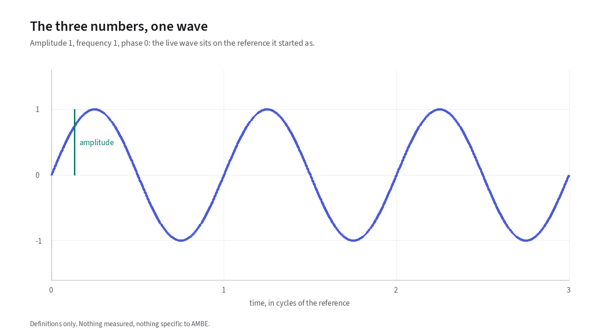
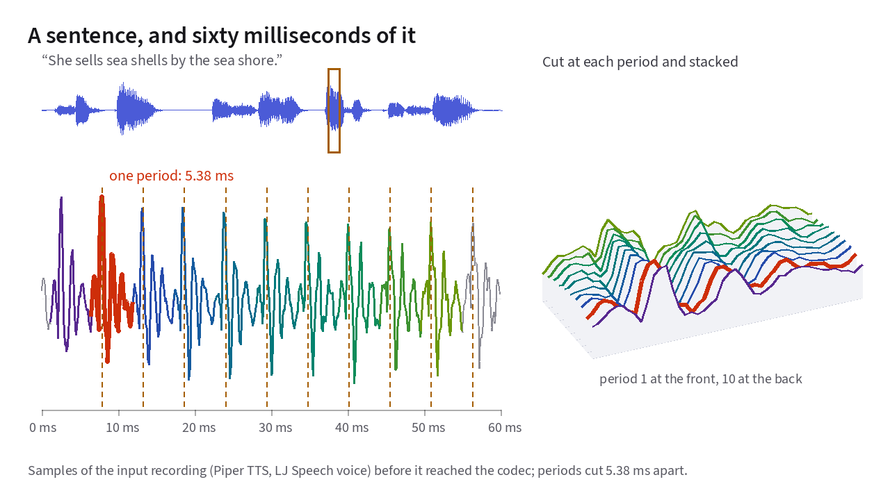
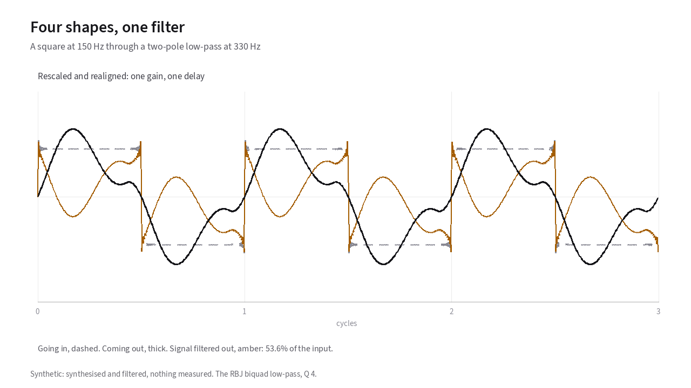
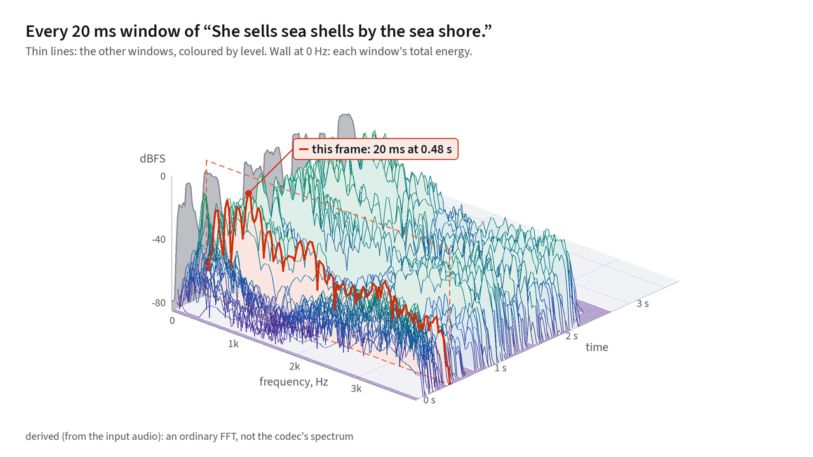

# Sinusoids

Every chapter that follows describes human speech as a sum of [sine waves](18-glossary.md#sine-wave).
Before accepting that, it is worth asking a direct question. Why sine waves
and not some other shape? The answer is not mathematical convenience. Sine
waves are the only wave shapes that survive passing through a [vocal tract](18-glossary.md#vocal-folds-and-vocal-tract) and
a radio channel without changing their shape.
{: .lede }

## The three numbers of a sinusoid

Every pure sinusoid is completely specified by three numbers:

- **[Amplitude](18-glossary.md#amplitude):** How tall the wave swings from zero to peak, which sets its
  loudness.
- **[Frequency](18-glossary.md#frequency):** How many complete cycles pass each second, which sets its
  pitch. Its unit is the hertz.
- **[Phase](18-glossary.md#phase):** Where in its cycle the wave sits at time
  zero, measured as an angle from 0° to 360°.

In [**Figure 1.1**](#fig-1-1), you can adjust each of these three numbers independently
against a fixed reference wave.

<!-- slot: three-numbers -->

<figure class="anim-fallback" markdown="0">
  
  <figcaption>One sinusoid over the reference it started as. The reference
  has amplitude 1, frequency 1 and phase 0.</figcaption>
</figure>

<!-- end slot: three-numbers -->

While amplitude and frequency are immediately audible, the human ear is
mostly insensitive to the phase of individual [harmonics](18-glossary.md#harmonic) within a steady
20 ms [frame](18-glossary.md#frame-and-analysis-window). That perceptual quirk allows a 2,400 bit/s vocoder to discard
all phase measurements before transmission and synthesize continuous phase at
the receiver (see [Chapter 11](11-synthesis.md)).

## A sound has to pass through a filter

Let's say you want to send someone's voice over a narrow digital radio channel,
and you need the signal to accurately represent the speaker's voice and message.

The most intuitive approach is to describe the audio waveform directly. On an
[oscilloscope](18-glossary.md#oscilloscope), a spoken [vowel](18-glossary.md#vowel) looks like a repeating train of pulses. 

It's possible to record the shape of a single pulse, measure how many times per second
it repeats, and send just those numbers.  For the vocal cords, that
waveform would be nearly complete.  It however leaves out [consonants](18-glossary.md#consonant) and [fricatives](18-glossary.md#fricative) which are made by the lips, tongue, and teeth.

To compare one cycle of the vowel with the next, you first need to know where
each cycle starts. A **[pitch marker](18-glossary.md#pitch-marker)** is a mark
at the same point in every cycle, such as the peak of each pulse. In this
vowel the markers fall 5.38 milliseconds apart.

In [**Figure 1.2**](#fig-1-2), look at 60 milliseconds of a vowel magnified
below the sentence. The waveform is a repeating train of pulses, one every
5.38 milliseconds. To see how closely those pulses match, step into the 3D
view to see them stacked front to back, or press Play to hear the sentence.

<!-- slot: utterance -->

<figure class="anim-fallback" markdown="0">
  
  <figcaption>A spoken sentence, and 60 ms of a vowel from it at full
  sample resolution. The vowel is a train of pulses, one every 5.38 ms.</figcaption>
</figure>
<ol class="anim-steps" markdown="1">
<li data-window="voiced" data-view="2d" markdown="block">
In the vowel of “sells”, the same pulse comes round every 5.38 ms.
</li>
<li data-window="voiced" data-layout="stacked" data-view="3d" data-preset="corner" markdown="block">
The [vowel](18-glossary.md#vowel) in “sells” is cut at each pulse and
stacked front to back. The ten slices are nearly the same shape.
</li>
<li data-window="unvoiced" data-layout="stacked" data-view="3d" data-preset="corner" markdown="block">
The [fricative](18-glossary.md#fricative) “sh” in “shells” is cut the
same way. Its ten slices share no shape.
</li>
</ol>

The time from one pulse to the next is the
**[pitch period](18-glossary.md#fundamental-frequency-and-pitch-period)**.
One second divided by the pitch period gives the pitch you hear. For this
vowel, 1 / 5.38 ms is about 186 Hz.

On the vowel in "sells", the vocal cords open and close every 5.38
milliseconds, producing a clear repeating cycle.[^pulse-rate] When
you switch to the consonant "sh" in "shells", that repeating structure
disappears completely. A [fricative](18-glossary.md#fricative) is turbulent air forced through a narrow
gap in the mouth, which produces random noise with no [pitch period](18-glossary.md#fundamental-frequency-and-pitch-period) to mark
(see [voiced and unvoiced speech](18-glossary.md#voiced-and-unvoiced-speech)).

Stacked in 3D, each slice of the [vowel](18-glossary.md#vowel) nearly lines up ridge-for-ridge with the
slice in front of it.[^vowel-corr] Slicing the [consonants](18-glossary.md#consonant) "sh" at the same
5.38-millisecond interval produces ten unrelated waveforms.[^sh-corr]

<!-- end slot: utterance -->

Even for a clean vowel, a second obstacle appears as soon as the sound leaves
the vocal cords.

Between your vocal cords and the microphone sits an acoustic tube made of
your throat and mouth. Your tongue, jaw, and lips shape it. That tube resonates, boosting some
frequencies and dampening others. Whenever you move your tongue to form a
different vowel, the resonant shape of that tube changes. 

By the time the [vowel](18-glossary.md#vowel) reaches the air, it has passed
through an [acoustic filter](18-glossary.md#acoustic-filter). The filter
spreads each pulse out in time. After every pulse the tube keeps vibrating
for a moment before it dies away, like a bell after it's struck. The shape
of that fading vibration changes from vowel to vowel.

## Why sine waves survive an acoustic filter unchanged 

You might ask a question now. Instead of picking a waveform shape and hoping
it survives a filter, which wave shapes pass through any linear filter and
come out with little distortion?

Todo: Define low-pass filter

If you send a square wave through a low-pass filter, its sharp corners round
off and its flat tops become rounded. If you send a sawtooth ramp or a triangle wave
through a low-pass filter, the shape bends and distorts.

If you send a pure sine wave into a linear filter, a pure sine wave comes
out the other side at the exact same frequency. Only two things about it can
change. Its [amplitude](18-glossary.md#amplitude) may be scaled up or down,
and its [phase](18-glossary.md#phase) may be delayed.

In [**Figure 1.3**](#fig-1-3), you can test this directly by sending four different wave
shapes through a two-pole low-pass filter. Toggle *Rescale and realign* to
make a copy of the wave coming out at the same size and timing as the wave
going in. The amber line is the signal filtered out, which is the original
minus that copy. It shows how much the shape changed. 

<!-- slot: filter -->

<figure class="anim-fallback" markdown="0">
  
  <figcaption>Four wave shapes passing through a two-pole low-pass filter at
  330 Hz.</figcaption>
</figure>
<ol class="anim-steps" markdown="1">
<li data-shape="sine" data-aligned="off" markdown="block">
A sine wave goes in (dashed) and comes out (thick) a different size and a
little later, but it is still a sine wave.
</li>
<li data-shape="sine" data-aligned="on" markdown="block">
*Rescale and realign* makes a copy of the wave coming out, resized to match
the wave going in and shifted back by the filter's delay. The amber line is
the signal filtered out, the original minus that copy. It stays under one
percent.
</li>
<li data-shape="sawtooth" data-aligned="on" markdown="block">
For a sawtooth wave, the signal filtered out (the amber line) stays
large, whatever cutoff you pick.
</li>
</ol>

For the pure sine wave, the remainder stays under one percent at every cutoff
setting.[^rounding]
For the other three shapes, no single gain and delay can make the output
match the input.

Why does the filter distort every wave shape except a sine? Because a
sawtooth, square, or triangle wave is secretly a sum of many sine waves at
whole-number multiples of the fundamental frequency. Those sine waves are
called [harmonics](18-glossary.md#harmonic). Under
[**Figure 1.3**](#fig-1-3), the *each sine inside* readout lists the gain and
delay the filter gives each of those harmonics.

Because the filter's gain curve peaks near the cutoff frequency and rolls off
above it, each harmonic gets scaled by a different gain and shifted by a
different time delay. When those differently scaled and delayed harmonics add
back together, the composite waveform changes shape. A pure sine wave is a
single harmonic, so it can only ever be scaled and delayed.

<!-- end slot: filter -->

In linear systems theory, sine waves are the *eigenfunctions* of any linear,
time-invariant filter. They are the only inputs that return as scaled,
time-shifted copies of themselves. Over a 20-millisecond analysis frame, your vocal tract
behaves as a linear filter, which is why decomposing speech into sinusoids
turns a complicated reshaping problem into a simple list of gains across
frequency.

## The same rule on the radio side

This property is not specific to acoustics. Any linear system that does not
change over the measurement window treats sinusoids the same way.

Your radio works the same way. A length of coax cable, the filters inside
your transceiver, and the large filters at a repeater site that keep its
transmitter out of its own receiver can each make a sine wave stronger or
weaker and delay it a little. None of them changes its frequency. So the
same three numbers describe both the voice going into the microphone and the
radio signal leaving the antenna.

## Watching a sentence as a sequence of spectra

Once you represent speech by how much sinusoidal energy sits at each
frequency, two simplifications follow immediately:

1. **A vocal tract filter becomes a smooth curve.** Instead of tracking moving
   pulse shapes in time, the vocoder only needs to measure the
   [spectral envelope](18-glossary.md#spectral-envelope) across frequency.
2. **Every speech sound uses the same axes.** Whether the operator is saying
   a vowel ("ah") or a fricative ("sh"), the measurement is energy across
   0 to 4 kHz in each 20-millisecond [frame](18-glossary.md#frame-and-analysis-window).

[**Figure 1.4**](#fig-1-4) stacks those 20-millisecond spectra from front to back across
a full spoken sentence. Step through it to compare two windows, then see the
whole sentence at once.

<!-- slot: utterance-spectra -->

<figure class="anim-fallback" markdown="0">
  
  <figcaption>The spectrum of every 20&nbsp;ms window of one sentence, in a
  box fixed at 0 to 3.7&nbsp;s, 0 to 4&nbsp;kHz and -85 to 0&nbsp;dBFS.</figcaption>
</figure>
<ol class="anim-steps" markdown="1">
<li data-sentence="c" data-voice="lj" data-pick="low-heavy" data-view="2d" markdown="block">
In this 20&nbsp;ms window of “She sells sea shells”, most of the energy sits
in a few humps below 1&nbsp;kHz.
</li>
<li data-sentence="c" data-voice="lj" data-pick="high-heavy" data-view="2d" markdown="block">
In another window of the same sentence, most of the energy sits at 2&nbsp;kHz
and above, spread over a wide band.
</li>
<li data-sentence="c" data-voice="lj" data-pick="low-heavy" data-view="3d" data-preset="corner" markdown="block">
Stacked front to back, the windows of the whole sentence show its spectrum
changing as it plays.
</li>
</ol>

<!-- end slot: utterance-spectra -->

The shapes of the individual spectra change from vowel to consonant, but the
coordinate system stays identical on every frame.

[^pulse-rate]: A pulse every 5.38 milliseconds works out to 186 pulses per
    second.
[^vowel-corr]: Neighboring slices of the vowel have an average
    correlation of 0.95.
[^sh-corr]: Neighboring slices of the "sh" have a correlation of 0.06.
[^rounding]: That remainder comes only from rounding the filter's delay to
    the nearest whole sample.

---

**Next: [The Fourier transform and the DFT](02-fourier-and-the-dft.md).**
How the encoder measures which sinusoids are present in a block of samples.
Back to [the start](index.md). To jump straight to the vocoder model, see
[What AMBE actually is](07-multi-band-excitation.md).
{: .chapter-nav }

Last reviewed: 2026-10-13.
{: .source-note }
