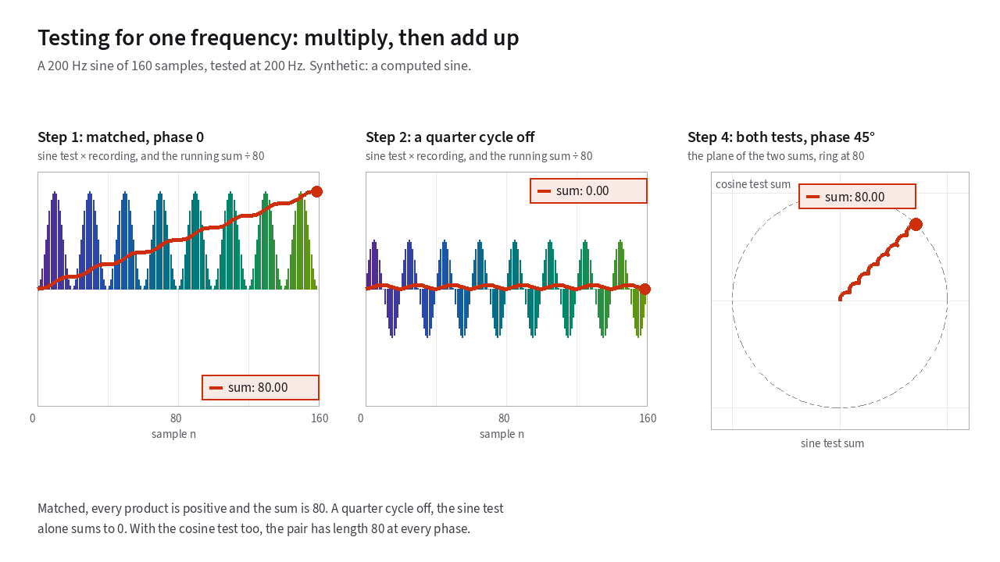
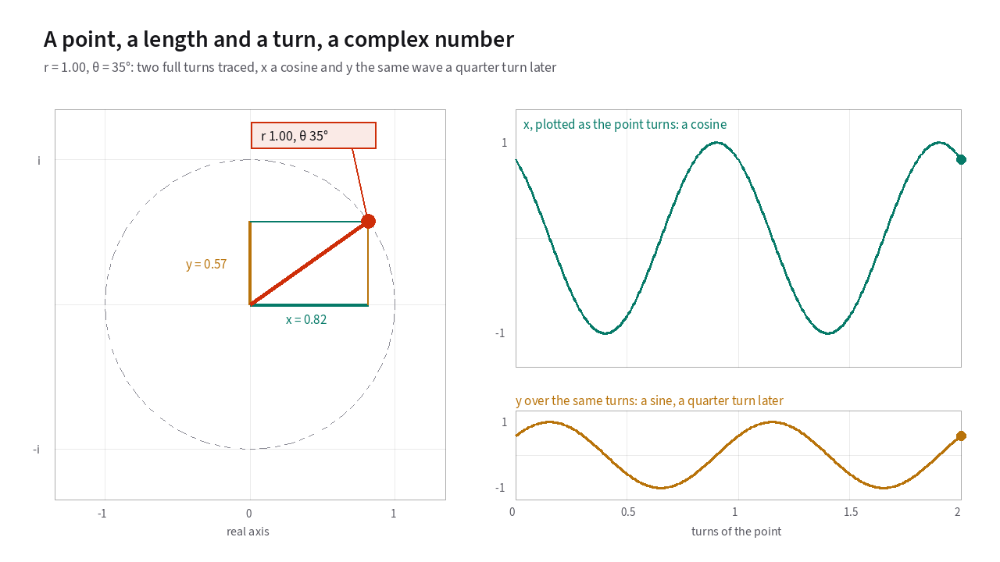

# The Fourier transform and the DFT

[Chapter 1](01-why-sinusoids.md) showed why sine waves are the natural
coordinates for speech passing through a [vocal tract](18-glossary.md#vocal-folds-and-vocal-tract) and a radio channel. That
leaves a practical question. When a microphone hands the vocoder 160 audio
samples, how does the chip find out which sine waves are inside that block
and how loud each one is?[^block-length]
{: .lede }

## Testing one frequency at a time

Start with a smaller question. Instead of searching for every frequency at
once, suppose you only want to know how much 200 Hz energy sits inside a
160-sample block.

You can test for 200 Hz with two basic arithmetic operations. Generate a
200 Hz sine wave of your own, multiply it against the recorded audio sample by
sample, and add up the 160 products.

Think about why that multiplication works.

- **When the recording contains 200 Hz in step with your test wave:** Whenever
  the recording swings positive, your test wave is also positive, and a
  positive times a positive is positive. Whenever the recording swings
  negative, your test wave is also negative, and a negative times a negative
  is *also* positive. Every single product pushes the running sum upward.
- **When the recording is at a different frequency:** Half the time the two
  waves agree in sign, and half the time they oppose each other. Positive and
  negative products cancel out over the block, and the running sum wanders
  back to zero.

<!-- diagram: probe-in-step -->
<figure class="gloss-diagram" data-diagram="probe-in-step">
<svg class="gloss-diagram__svg" viewBox="0 0 640 336" role="img" aria-label="Three rows against time over 160 samples. Top, a 200 Hz recording and a 200 Hz test wave. Middle, their product at each sample. Bottom, the running sum of the products, which ends at 80."><path class="gd-axis" d="M120,52 L620,52"/><path class="gd-a" d="M120.0,52.0 L121.2,49.9 L122.5,47.7 L123.8,45.6 L125.0,43.5 L126.2,41.5 L127.5,39.5 L128.8,37.5 L130.0,35.6 L131.2,33.8 L132.5,32.0 L133.8,30.3 L135.0,28.7 L136.2,27.2 L137.5,25.8 L138.8,24.5 L140.0,23.3 L141.2,22.2 L142.5,21.2 L143.8,20.4 L145.0,19.7 L146.2,19.1 L147.5,18.6 L148.8,18.3 L150.0,18.1 L151.2,18.0 L152.5,18.1 L153.8,18.3 L155.0,18.6 L156.2,19.1 L157.5,19.7 L158.8,20.4 L160.0,21.2 L161.2,22.2 L162.5,23.3 L163.8,24.5 L165.0,25.8 L166.2,27.2 L167.5,28.7 L168.8,30.3 L170.0,32.0 L171.2,33.8 L172.5,35.6 L173.8,37.5 L175.0,39.5 L176.2,41.5 L177.5,43.5 L178.8,45.6 L180.0,47.7 L181.2,49.9 L182.5,52.0 L183.8,54.1 L185.0,56.3 L186.2,58.4 L187.5,60.5 L188.8,62.5 L190.0,64.5 L191.2,66.5 L192.5,68.4 L193.8,70.2 L195.0,72.0 L196.2,73.7 L197.5,75.3 L198.8,76.8 L200.0,78.2 L201.2,79.5 L202.5,80.7 L203.8,81.8 L205.0,82.8 L206.2,83.6 L207.5,84.3 L208.8,84.9 L210.0,85.4 L211.2,85.7 L212.5,85.9 L213.8,86.0 L215.0,85.9 L216.2,85.7 L217.5,85.4 L218.8,84.9 L220.0,84.3 L221.2,83.6 L222.5,82.8 L223.8,81.8 L225.0,80.7 L226.2,79.5 L227.5,78.2 L228.8,76.8 L230.0,75.3 L231.2,73.7 L232.5,72.0 L233.8,70.2 L235.0,68.4 L236.2,66.5 L237.5,64.5 L238.8,62.5 L240.0,60.5 L241.2,58.4 L242.5,56.3 L243.8,54.1 L245.0,52.0 L246.2,49.9 L247.5,47.7 L248.8,45.6 L250.0,43.5 L251.2,41.5 L252.5,39.5 L253.8,37.5 L255.0,35.6 L256.2,33.8 L257.5,32.0 L258.8,30.3 L260.0,28.7 L261.2,27.2 L262.5,25.8 L263.8,24.5 L265.0,23.3 L266.2,22.2 L267.5,21.2 L268.8,20.4 L270.0,19.7 L271.2,19.1 L272.5,18.6 L273.8,18.3 L275.0,18.1 L276.2,18.0 L277.5,18.1 L278.8,18.3 L280.0,18.6 L281.2,19.1 L282.5,19.7 L283.8,20.4 L285.0,21.2 L286.2,22.2 L287.5,23.3 L288.8,24.5 L290.0,25.8 L291.2,27.2 L292.5,28.7 L293.8,30.3 L295.0,32.0 L296.2,33.8 L297.5,35.6 L298.8,37.5 L300.0,39.5 L301.2,41.5 L302.5,43.5 L303.8,45.6 L305.0,47.7 L306.2,49.9 L307.5,52.0 L308.8,54.1 L310.0,56.3 L311.2,58.4 L312.5,60.5 L313.8,62.5 L315.0,64.5 L316.2,66.5 L317.5,68.4 L318.8,70.2 L320.0,72.0 L321.2,73.7 L322.5,75.3 L323.8,76.8 L325.0,78.2 L326.2,79.5 L327.5,80.7 L328.8,81.8 L330.0,82.8 L331.2,83.6 L332.5,84.3 L333.8,84.9 L335.0,85.4 L336.2,85.7 L337.5,85.9 L338.8,86.0 L340.0,85.9 L341.2,85.7 L342.5,85.4 L343.8,84.9 L345.0,84.3 L346.2,83.6 L347.5,82.8 L348.8,81.8 L350.0,80.7 L351.2,79.5 L352.5,78.2 L353.8,76.8 L355.0,75.3 L356.2,73.7 L357.5,72.0 L358.8,70.2 L360.0,68.4 L361.2,66.5 L362.5,64.5 L363.8,62.5 L365.0,60.5 L366.2,58.4 L367.5,56.3 L368.8,54.1 L370.0,52.0 L371.2,49.9 L372.5,47.7 L373.8,45.6 L375.0,43.5 L376.2,41.5 L377.5,39.5 L378.8,37.5 L380.0,35.6 L381.2,33.8 L382.5,32.0 L383.8,30.3 L385.0,28.7 L386.2,27.2 L387.5,25.8 L388.8,24.5 L390.0,23.3 L391.2,22.2 L392.5,21.2 L393.8,20.4 L395.0,19.7 L396.2,19.1 L397.5,18.6 L398.8,18.3 L400.0,18.1 L401.2,18.0 L402.5,18.1 L403.8,18.3 L405.0,18.6 L406.2,19.1 L407.5,19.7 L408.8,20.4 L410.0,21.2 L411.2,22.2 L412.5,23.3 L413.8,24.5 L415.0,25.8 L416.2,27.2 L417.5,28.7 L418.8,30.3 L420.0,32.0 L421.2,33.8 L422.5,35.6 L423.8,37.5 L425.0,39.5 L426.2,41.5 L427.5,43.5 L428.8,45.6 L430.0,47.7 L431.2,49.9 L432.5,52.0 L433.8,54.1 L435.0,56.3 L436.2,58.4 L437.5,60.5 L438.8,62.5 L440.0,64.5 L441.2,66.5 L442.5,68.4 L443.8,70.2 L445.0,72.0 L446.2,73.7 L447.5,75.3 L448.8,76.8 L450.0,78.2 L451.2,79.5 L452.5,80.7 L453.8,81.8 L455.0,82.8 L456.2,83.6 L457.5,84.3 L458.8,84.9 L460.0,85.4 L461.2,85.7 L462.5,85.9 L463.8,86.0 L465.0,85.9 L466.2,85.7 L467.5,85.4 L468.8,84.9 L470.0,84.3 L471.2,83.6 L472.5,82.8 L473.8,81.8 L475.0,80.7 L476.2,79.5 L477.5,78.2 L478.8,76.8 L480.0,75.3 L481.2,73.7 L482.5,72.0 L483.8,70.2 L485.0,68.4 L486.2,66.5 L487.5,64.5 L488.8,62.5 L490.0,60.5 L491.2,58.4 L492.5,56.3 L493.8,54.1 L495.0,52.0 L496.2,49.9 L497.5,47.7 L498.8,45.6 L500.0,43.5 L501.2,41.5 L502.5,39.5 L503.8,37.5 L505.0,35.6 L506.2,33.8 L507.5,32.0 L508.8,30.3 L510.0,28.7 L511.2,27.2 L512.5,25.8 L513.8,24.5 L515.0,23.3 L516.2,22.2 L517.5,21.2 L518.8,20.4 L520.0,19.7 L521.2,19.1 L522.5,18.6 L523.8,18.3 L525.0,18.1 L526.2,18.0 L527.5,18.1 L528.8,18.3 L530.0,18.6 L531.2,19.1 L532.5,19.7 L533.8,20.4 L535.0,21.2 L536.2,22.2 L537.5,23.3 L538.8,24.5 L540.0,25.8 L541.2,27.2 L542.5,28.7 L543.8,30.3 L545.0,32.0 L546.2,33.8 L547.5,35.6 L548.8,37.5 L550.0,39.5 L551.2,41.5 L552.5,43.5 L553.8,45.6 L555.0,47.7 L556.2,49.9 L557.5,52.0 L558.8,54.1 L560.0,56.3 L561.2,58.4 L562.5,60.5 L563.8,62.5 L565.0,64.5 L566.2,66.5 L567.5,68.4 L568.8,70.2 L570.0,72.0 L571.2,73.7 L572.5,75.3 L573.8,76.8 L575.0,78.2 L576.2,79.5 L577.5,80.7 L578.8,81.8 L580.0,82.8 L581.2,83.6 L582.5,84.3 L583.8,84.9 L585.0,85.4 L586.2,85.7 L587.5,85.9 L588.8,86.0 L590.0,85.9 L591.2,85.7 L592.5,85.4 L593.8,84.9 L595.0,84.3 L596.2,83.6 L597.5,82.8 L598.8,81.8 L600.0,80.7 L601.2,79.5 L602.5,78.2 L603.8,76.8 L605.0,75.3 L606.2,73.7 L607.5,72.0 L608.8,70.2 L610.0,68.4 L611.2,66.5 L612.5,64.5 L613.8,62.5 L615.0,60.5 L616.2,58.4 L617.5,56.3 L618.8,54.1 L620.0,52.0"/><path style="stroke:var(--ambe-plot-ink);stroke-width:1.5" class="gd-dash" d="M120.0,52.0 L121.2,49.9 L122.5,47.7 L123.8,45.6 L125.0,43.5 L126.2,41.5 L127.5,39.5 L128.8,37.5 L130.0,35.6 L131.2,33.8 L132.5,32.0 L133.8,30.3 L135.0,28.7 L136.2,27.2 L137.5,25.8 L138.8,24.5 L140.0,23.3 L141.2,22.2 L142.5,21.2 L143.8,20.4 L145.0,19.7 L146.2,19.1 L147.5,18.6 L148.8,18.3 L150.0,18.1 L151.2,18.0 L152.5,18.1 L153.8,18.3 L155.0,18.6 L156.2,19.1 L157.5,19.7 L158.8,20.4 L160.0,21.2 L161.2,22.2 L162.5,23.3 L163.8,24.5 L165.0,25.8 L166.2,27.2 L167.5,28.7 L168.8,30.3 L170.0,32.0 L171.2,33.8 L172.5,35.6 L173.8,37.5 L175.0,39.5 L176.2,41.5 L177.5,43.5 L178.8,45.6 L180.0,47.7 L181.2,49.9 L182.5,52.0 L183.8,54.1 L185.0,56.3 L186.2,58.4 L187.5,60.5 L188.8,62.5 L190.0,64.5 L191.2,66.5 L192.5,68.4 L193.8,70.2 L195.0,72.0 L196.2,73.7 L197.5,75.3 L198.8,76.8 L200.0,78.2 L201.2,79.5 L202.5,80.7 L203.8,81.8 L205.0,82.8 L206.2,83.6 L207.5,84.3 L208.8,84.9 L210.0,85.4 L211.2,85.7 L212.5,85.9 L213.8,86.0 L215.0,85.9 L216.2,85.7 L217.5,85.4 L218.8,84.9 L220.0,84.3 L221.2,83.6 L222.5,82.8 L223.8,81.8 L225.0,80.7 L226.2,79.5 L227.5,78.2 L228.8,76.8 L230.0,75.3 L231.2,73.7 L232.5,72.0 L233.8,70.2 L235.0,68.4 L236.2,66.5 L237.5,64.5 L238.8,62.5 L240.0,60.5 L241.2,58.4 L242.5,56.3 L243.8,54.1 L245.0,52.0 L246.2,49.9 L247.5,47.7 L248.8,45.6 L250.0,43.5 L251.2,41.5 L252.5,39.5 L253.8,37.5 L255.0,35.6 L256.2,33.8 L257.5,32.0 L258.8,30.3 L260.0,28.7 L261.2,27.2 L262.5,25.8 L263.8,24.5 L265.0,23.3 L266.2,22.2 L267.5,21.2 L268.8,20.4 L270.0,19.7 L271.2,19.1 L272.5,18.6 L273.8,18.3 L275.0,18.1 L276.2,18.0 L277.5,18.1 L278.8,18.3 L280.0,18.6 L281.2,19.1 L282.5,19.7 L283.8,20.4 L285.0,21.2 L286.2,22.2 L287.5,23.3 L288.8,24.5 L290.0,25.8 L291.2,27.2 L292.5,28.7 L293.8,30.3 L295.0,32.0 L296.2,33.8 L297.5,35.6 L298.8,37.5 L300.0,39.5 L301.2,41.5 L302.5,43.5 L303.8,45.6 L305.0,47.7 L306.2,49.9 L307.5,52.0 L308.8,54.1 L310.0,56.3 L311.2,58.4 L312.5,60.5 L313.8,62.5 L315.0,64.5 L316.2,66.5 L317.5,68.4 L318.8,70.2 L320.0,72.0 L321.2,73.7 L322.5,75.3 L323.8,76.8 L325.0,78.2 L326.2,79.5 L327.5,80.7 L328.8,81.8 L330.0,82.8 L331.2,83.6 L332.5,84.3 L333.8,84.9 L335.0,85.4 L336.2,85.7 L337.5,85.9 L338.8,86.0 L340.0,85.9 L341.2,85.7 L342.5,85.4 L343.8,84.9 L345.0,84.3 L346.2,83.6 L347.5,82.8 L348.8,81.8 L350.0,80.7 L351.2,79.5 L352.5,78.2 L353.8,76.8 L355.0,75.3 L356.2,73.7 L357.5,72.0 L358.8,70.2 L360.0,68.4 L361.2,66.5 L362.5,64.5 L363.8,62.5 L365.0,60.5 L366.2,58.4 L367.5,56.3 L368.8,54.1 L370.0,52.0 L371.2,49.9 L372.5,47.7 L373.8,45.6 L375.0,43.5 L376.2,41.5 L377.5,39.5 L378.8,37.5 L380.0,35.6 L381.2,33.8 L382.5,32.0 L383.8,30.3 L385.0,28.7 L386.2,27.2 L387.5,25.8 L388.8,24.5 L390.0,23.3 L391.2,22.2 L392.5,21.2 L393.8,20.4 L395.0,19.7 L396.2,19.1 L397.5,18.6 L398.8,18.3 L400.0,18.1 L401.2,18.0 L402.5,18.1 L403.8,18.3 L405.0,18.6 L406.2,19.1 L407.5,19.7 L408.8,20.4 L410.0,21.2 L411.2,22.2 L412.5,23.3 L413.8,24.5 L415.0,25.8 L416.2,27.2 L417.5,28.7 L418.8,30.3 L420.0,32.0 L421.2,33.8 L422.5,35.6 L423.8,37.5 L425.0,39.5 L426.2,41.5 L427.5,43.5 L428.8,45.6 L430.0,47.7 L431.2,49.9 L432.5,52.0 L433.8,54.1 L435.0,56.3 L436.2,58.4 L437.5,60.5 L438.8,62.5 L440.0,64.5 L441.2,66.5 L442.5,68.4 L443.8,70.2 L445.0,72.0 L446.2,73.7 L447.5,75.3 L448.8,76.8 L450.0,78.2 L451.2,79.5 L452.5,80.7 L453.8,81.8 L455.0,82.8 L456.2,83.6 L457.5,84.3 L458.8,84.9 L460.0,85.4 L461.2,85.7 L462.5,85.9 L463.8,86.0 L465.0,85.9 L466.2,85.7 L467.5,85.4 L468.8,84.9 L470.0,84.3 L471.2,83.6 L472.5,82.8 L473.8,81.8 L475.0,80.7 L476.2,79.5 L477.5,78.2 L478.8,76.8 L480.0,75.3 L481.2,73.7 L482.5,72.0 L483.8,70.2 L485.0,68.4 L486.2,66.5 L487.5,64.5 L488.8,62.5 L490.0,60.5 L491.2,58.4 L492.5,56.3 L493.8,54.1 L495.0,52.0 L496.2,49.9 L497.5,47.7 L498.8,45.6 L500.0,43.5 L501.2,41.5 L502.5,39.5 L503.8,37.5 L505.0,35.6 L506.2,33.8 L507.5,32.0 L508.8,30.3 L510.0,28.7 L511.2,27.2 L512.5,25.8 L513.8,24.5 L515.0,23.3 L516.2,22.2 L517.5,21.2 L518.8,20.4 L520.0,19.7 L521.2,19.1 L522.5,18.6 L523.8,18.3 L525.0,18.1 L526.2,18.0 L527.5,18.1 L528.8,18.3 L530.0,18.6 L531.2,19.1 L532.5,19.7 L533.8,20.4 L535.0,21.2 L536.2,22.2 L537.5,23.3 L538.8,24.5 L540.0,25.8 L541.2,27.2 L542.5,28.7 L543.8,30.3 L545.0,32.0 L546.2,33.8 L547.5,35.6 L548.8,37.5 L550.0,39.5 L551.2,41.5 L552.5,43.5 L553.8,45.6 L555.0,47.7 L556.2,49.9 L557.5,52.0 L558.8,54.1 L560.0,56.3 L561.2,58.4 L562.5,60.5 L563.8,62.5 L565.0,64.5 L566.2,66.5 L567.5,68.4 L568.8,70.2 L570.0,72.0 L571.2,73.7 L572.5,75.3 L573.8,76.8 L575.0,78.2 L576.2,79.5 L577.5,80.7 L578.8,81.8 L580.0,82.8 L581.2,83.6 L582.5,84.3 L583.8,84.9 L585.0,85.4 L586.2,85.7 L587.5,85.9 L588.8,86.0 L590.0,85.9 L591.2,85.7 L592.5,85.4 L593.8,84.9 L595.0,84.3 L596.2,83.6 L597.5,82.8 L598.8,81.8 L600.0,80.7 L601.2,79.5 L602.5,78.2 L603.8,76.8 L605.0,75.3 L606.2,73.7 L607.5,72.0 L608.8,70.2 L610.0,68.4 L611.2,66.5 L612.5,64.5 L613.8,62.5 L615.0,60.5 L616.2,58.4 L617.5,56.3 L618.8,54.1 L620.0,52.0"/><path class="gd-axis" d="M120,150 L620,150"/><path class="gd-b" style="stroke-width:1.5" d="M120.0,150 L120.0,150.0"/><path class="gd-b" style="stroke-width:1.5" d="M123.1,150 L123.1,149.2"/><path class="gd-b" style="stroke-width:1.5" d="M126.3,150 L126.3,146.8"/><path class="gd-b" style="stroke-width:1.5" d="M129.4,150 L129.4,143.0"/><path class="gd-b" style="stroke-width:1.5" d="M132.6,150 L132.6,138.3"/><path class="gd-b" style="stroke-width:1.5" d="M135.7,150 L135.7,133.0"/><path class="gd-b" style="stroke-width:1.5" d="M138.9,150 L138.9,127.7"/><path class="gd-b" style="stroke-width:1.5" d="M142.0,150 L142.0,123.0"/><path class="gd-b" style="stroke-width:1.5" d="M145.2,150 L145.2,119.2"/><path class="gd-b" style="stroke-width:1.5" d="M148.3,150 L148.3,116.8"/><path class="gd-b" style="stroke-width:1.5" d="M151.4,150 L151.4,116.0"/><path class="gd-b" style="stroke-width:1.5" d="M154.6,150 L154.6,116.8"/><path class="gd-b" style="stroke-width:1.5" d="M157.7,150 L157.7,119.2"/><path class="gd-b" style="stroke-width:1.5" d="M160.9,150 L160.9,123.0"/><path class="gd-b" style="stroke-width:1.5" d="M164.0,150 L164.0,127.7"/><path class="gd-b" style="stroke-width:1.5" d="M167.2,150 L167.2,133.0"/><path class="gd-b" style="stroke-width:1.5" d="M170.3,150 L170.3,138.3"/><path class="gd-b" style="stroke-width:1.5" d="M173.5,150 L173.5,143.0"/><path class="gd-b" style="stroke-width:1.5" d="M176.6,150 L176.6,146.8"/><path class="gd-b" style="stroke-width:1.5" d="M179.7,150 L179.7,149.2"/><path class="gd-b" style="stroke-width:1.5" d="M182.9,150 L182.9,150.0"/><path class="gd-b" style="stroke-width:1.5" d="M186.0,150 L186.0,149.2"/><path class="gd-b" style="stroke-width:1.5" d="M189.2,150 L189.2,146.8"/><path class="gd-b" style="stroke-width:1.5" d="M192.3,150 L192.3,143.0"/><path class="gd-b" style="stroke-width:1.5" d="M195.5,150 L195.5,138.3"/><path class="gd-b" style="stroke-width:1.5" d="M198.6,150 L198.6,133.0"/><path class="gd-b" style="stroke-width:1.5" d="M201.8,150 L201.8,127.7"/><path class="gd-b" style="stroke-width:1.5" d="M204.9,150 L204.9,123.0"/><path class="gd-b" style="stroke-width:1.5" d="M208.1,150 L208.1,119.2"/><path class="gd-b" style="stroke-width:1.5" d="M211.2,150 L211.2,116.8"/><path class="gd-b" style="stroke-width:1.5" d="M214.3,150 L214.3,116.0"/><path class="gd-b" style="stroke-width:1.5" d="M217.5,150 L217.5,116.8"/><path class="gd-b" style="stroke-width:1.5" d="M220.6,150 L220.6,119.2"/><path class="gd-b" style="stroke-width:1.5" d="M223.8,150 L223.8,123.0"/><path class="gd-b" style="stroke-width:1.5" d="M226.9,150 L226.9,127.7"/><path class="gd-b" style="stroke-width:1.5" d="M230.1,150 L230.1,133.0"/><path class="gd-b" style="stroke-width:1.5" d="M233.2,150 L233.2,138.3"/><path class="gd-b" style="stroke-width:1.5" d="M236.4,150 L236.4,143.0"/><path class="gd-b" style="stroke-width:1.5" d="M239.5,150 L239.5,146.8"/><path class="gd-b" style="stroke-width:1.5" d="M242.6,150 L242.6,149.2"/><path class="gd-b" style="stroke-width:1.5" d="M245.8,150 L245.8,150.0"/><path class="gd-b" style="stroke-width:1.5" d="M248.9,150 L248.9,149.2"/><path class="gd-b" style="stroke-width:1.5" d="M252.1,150 L252.1,146.8"/><path class="gd-b" style="stroke-width:1.5" d="M255.2,150 L255.2,143.0"/><path class="gd-b" style="stroke-width:1.5" d="M258.4,150 L258.4,138.3"/><path class="gd-b" style="stroke-width:1.5" d="M261.5,150 L261.5,133.0"/><path class="gd-b" style="stroke-width:1.5" d="M264.7,150 L264.7,127.7"/><path class="gd-b" style="stroke-width:1.5" d="M267.8,150 L267.8,123.0"/><path class="gd-b" style="stroke-width:1.5" d="M270.9,150 L270.9,119.2"/><path class="gd-b" style="stroke-width:1.5" d="M274.1,150 L274.1,116.8"/><path class="gd-b" style="stroke-width:1.5" d="M277.2,150 L277.2,116.0"/><path class="gd-b" style="stroke-width:1.5" d="M280.4,150 L280.4,116.8"/><path class="gd-b" style="stroke-width:1.5" d="M283.5,150 L283.5,119.2"/><path class="gd-b" style="stroke-width:1.5" d="M286.7,150 L286.7,123.0"/><path class="gd-b" style="stroke-width:1.5" d="M289.8,150 L289.8,127.7"/><path class="gd-b" style="stroke-width:1.5" d="M293.0,150 L293.0,133.0"/><path class="gd-b" style="stroke-width:1.5" d="M296.1,150 L296.1,138.3"/><path class="gd-b" style="stroke-width:1.5" d="M299.2,150 L299.2,143.0"/><path class="gd-b" style="stroke-width:1.5" d="M302.4,150 L302.4,146.8"/><path class="gd-b" style="stroke-width:1.5" d="M305.5,150 L305.5,149.2"/><path class="gd-b" style="stroke-width:1.5" d="M308.7,150 L308.7,150.0"/><path class="gd-b" style="stroke-width:1.5" d="M311.8,150 L311.8,149.2"/><path class="gd-b" style="stroke-width:1.5" d="M315.0,150 L315.0,146.8"/><path class="gd-b" style="stroke-width:1.5" d="M318.1,150 L318.1,143.0"/><path class="gd-b" style="stroke-width:1.5" d="M321.3,150 L321.3,138.3"/><path class="gd-b" style="stroke-width:1.5" d="M324.4,150 L324.4,133.0"/><path class="gd-b" style="stroke-width:1.5" d="M327.5,150 L327.5,127.7"/><path class="gd-b" style="stroke-width:1.5" d="M330.7,150 L330.7,123.0"/><path class="gd-b" style="stroke-width:1.5" d="M333.8,150 L333.8,119.2"/><path class="gd-b" style="stroke-width:1.5" d="M337.0,150 L337.0,116.8"/><path class="gd-b" style="stroke-width:1.5" d="M340.1,150 L340.1,116.0"/><path class="gd-b" style="stroke-width:1.5" d="M343.3,150 L343.3,116.8"/><path class="gd-b" style="stroke-width:1.5" d="M346.4,150 L346.4,119.2"/><path class="gd-b" style="stroke-width:1.5" d="M349.6,150 L349.6,123.0"/><path class="gd-b" style="stroke-width:1.5" d="M352.7,150 L352.7,127.7"/><path class="gd-b" style="stroke-width:1.5" d="M355.8,150 L355.8,133.0"/><path class="gd-b" style="stroke-width:1.5" d="M359.0,150 L359.0,138.3"/><path class="gd-b" style="stroke-width:1.5" d="M362.1,150 L362.1,143.0"/><path class="gd-b" style="stroke-width:1.5" d="M365.3,150 L365.3,146.8"/><path class="gd-b" style="stroke-width:1.5" d="M368.4,150 L368.4,149.2"/><path class="gd-b" style="stroke-width:1.5" d="M371.6,150 L371.6,150.0"/><path class="gd-b" style="stroke-width:1.5" d="M374.7,150 L374.7,149.2"/><path class="gd-b" style="stroke-width:1.5" d="M377.9,150 L377.9,146.8"/><path class="gd-b" style="stroke-width:1.5" d="M381.0,150 L381.0,143.0"/><path class="gd-b" style="stroke-width:1.5" d="M384.2,150 L384.2,138.3"/><path class="gd-b" style="stroke-width:1.5" d="M387.3,150 L387.3,133.0"/><path class="gd-b" style="stroke-width:1.5" d="M390.4,150 L390.4,127.7"/><path class="gd-b" style="stroke-width:1.5" d="M393.6,150 L393.6,123.0"/><path class="gd-b" style="stroke-width:1.5" d="M396.7,150 L396.7,119.2"/><path class="gd-b" style="stroke-width:1.5" d="M399.9,150 L399.9,116.8"/><path class="gd-b" style="stroke-width:1.5" d="M403.0,150 L403.0,116.0"/><path class="gd-b" style="stroke-width:1.5" d="M406.2,150 L406.2,116.8"/><path class="gd-b" style="stroke-width:1.5" d="M409.3,150 L409.3,119.2"/><path class="gd-b" style="stroke-width:1.5" d="M412.5,150 L412.5,123.0"/><path class="gd-b" style="stroke-width:1.5" d="M415.6,150 L415.6,127.7"/><path class="gd-b" style="stroke-width:1.5" d="M418.7,150 L418.7,133.0"/><path class="gd-b" style="stroke-width:1.5" d="M421.9,150 L421.9,138.3"/><path class="gd-b" style="stroke-width:1.5" d="M425.0,150 L425.0,143.0"/><path class="gd-b" style="stroke-width:1.5" d="M428.2,150 L428.2,146.8"/><path class="gd-b" style="stroke-width:1.5" d="M431.3,150 L431.3,149.2"/><path class="gd-b" style="stroke-width:1.5" d="M434.5,150 L434.5,150.0"/><path class="gd-b" style="stroke-width:1.5" d="M437.6,150 L437.6,149.2"/><path class="gd-b" style="stroke-width:1.5" d="M440.8,150 L440.8,146.8"/><path class="gd-b" style="stroke-width:1.5" d="M443.9,150 L443.9,143.0"/><path class="gd-b" style="stroke-width:1.5" d="M447.0,150 L447.0,138.3"/><path class="gd-b" style="stroke-width:1.5" d="M450.2,150 L450.2,133.0"/><path class="gd-b" style="stroke-width:1.5" d="M453.3,150 L453.3,127.7"/><path class="gd-b" style="stroke-width:1.5" d="M456.5,150 L456.5,123.0"/><path class="gd-b" style="stroke-width:1.5" d="M459.6,150 L459.6,119.2"/><path class="gd-b" style="stroke-width:1.5" d="M462.8,150 L462.8,116.8"/><path class="gd-b" style="stroke-width:1.5" d="M465.9,150 L465.9,116.0"/><path class="gd-b" style="stroke-width:1.5" d="M469.1,150 L469.1,116.8"/><path class="gd-b" style="stroke-width:1.5" d="M472.2,150 L472.2,119.2"/><path class="gd-b" style="stroke-width:1.5" d="M475.3,150 L475.3,123.0"/><path class="gd-b" style="stroke-width:1.5" d="M478.5,150 L478.5,127.7"/><path class="gd-b" style="stroke-width:1.5" d="M481.6,150 L481.6,133.0"/><path class="gd-b" style="stroke-width:1.5" d="M484.8,150 L484.8,138.3"/><path class="gd-b" style="stroke-width:1.5" d="M487.9,150 L487.9,143.0"/><path class="gd-b" style="stroke-width:1.5" d="M491.1,150 L491.1,146.8"/><path class="gd-b" style="stroke-width:1.5" d="M494.2,150 L494.2,149.2"/><path class="gd-b" style="stroke-width:1.5" d="M497.4,150 L497.4,150.0"/><path class="gd-b" style="stroke-width:1.5" d="M500.5,150 L500.5,149.2"/><path class="gd-b" style="stroke-width:1.5" d="M503.6,150 L503.6,146.8"/><path class="gd-b" style="stroke-width:1.5" d="M506.8,150 L506.8,143.0"/><path class="gd-b" style="stroke-width:1.5" d="M509.9,150 L509.9,138.3"/><path class="gd-b" style="stroke-width:1.5" d="M513.1,150 L513.1,133.0"/><path class="gd-b" style="stroke-width:1.5" d="M516.2,150 L516.2,127.7"/><path class="gd-b" style="stroke-width:1.5" d="M519.4,150 L519.4,123.0"/><path class="gd-b" style="stroke-width:1.5" d="M522.5,150 L522.5,119.2"/><path class="gd-b" style="stroke-width:1.5" d="M525.7,150 L525.7,116.8"/><path class="gd-b" style="stroke-width:1.5" d="M528.8,150 L528.8,116.0"/><path class="gd-b" style="stroke-width:1.5" d="M531.9,150 L531.9,116.8"/><path class="gd-b" style="stroke-width:1.5" d="M535.1,150 L535.1,119.2"/><path class="gd-b" style="stroke-width:1.5" d="M538.2,150 L538.2,123.0"/><path class="gd-b" style="stroke-width:1.5" d="M541.4,150 L541.4,127.7"/><path class="gd-b" style="stroke-width:1.5" d="M544.5,150 L544.5,133.0"/><path class="gd-b" style="stroke-width:1.5" d="M547.7,150 L547.7,138.3"/><path class="gd-b" style="stroke-width:1.5" d="M550.8,150 L550.8,143.0"/><path class="gd-b" style="stroke-width:1.5" d="M554.0,150 L554.0,146.8"/><path class="gd-b" style="stroke-width:1.5" d="M557.1,150 L557.1,149.2"/><path class="gd-b" style="stroke-width:1.5" d="M560.3,150 L560.3,150.0"/><path class="gd-b" style="stroke-width:1.5" d="M563.4,150 L563.4,149.2"/><path class="gd-b" style="stroke-width:1.5" d="M566.5,150 L566.5,146.8"/><path class="gd-b" style="stroke-width:1.5" d="M569.7,150 L569.7,143.0"/><path class="gd-b" style="stroke-width:1.5" d="M572.8,150 L572.8,138.3"/><path class="gd-b" style="stroke-width:1.5" d="M576.0,150 L576.0,133.0"/><path class="gd-b" style="stroke-width:1.5" d="M579.1,150 L579.1,127.7"/><path class="gd-b" style="stroke-width:1.5" d="M582.3,150 L582.3,123.0"/><path class="gd-b" style="stroke-width:1.5" d="M585.4,150 L585.4,119.2"/><path class="gd-b" style="stroke-width:1.5" d="M588.6,150 L588.6,116.8"/><path class="gd-b" style="stroke-width:1.5" d="M591.7,150 L591.7,116.0"/><path class="gd-b" style="stroke-width:1.5" d="M594.8,150 L594.8,116.8"/><path class="gd-b" style="stroke-width:1.5" d="M598.0,150 L598.0,119.2"/><path class="gd-b" style="stroke-width:1.5" d="M601.1,150 L601.1,123.0"/><path class="gd-b" style="stroke-width:1.5" d="M604.3,150 L604.3,127.7"/><path class="gd-b" style="stroke-width:1.5" d="M607.4,150 L607.4,133.0"/><path class="gd-b" style="stroke-width:1.5" d="M610.6,150 L610.6,138.3"/><path class="gd-b" style="stroke-width:1.5" d="M613.7,150 L613.7,143.0"/><path class="gd-b" style="stroke-width:1.5" d="M616.9,150 L616.9,146.8"/><path class="gd-b" style="stroke-width:1.5" d="M620.0,150 L620.0,149.2"/><path class="gd-axis" d="M120,296 L620,296"/><path class="gd-grid" d="M120.0,216.0 L620.0,216.0"/><path class="gd-c" d="M120.0,296.0 L123.1,296.0 L126.3,295.9 L129.4,295.7 L132.6,295.3 L135.7,294.8 L138.9,294.2 L142.0,293.4 L145.2,292.5 L148.3,291.5 L151.4,290.5 L154.6,289.5 L157.7,288.6 L160.9,287.8 L164.0,287.2 L167.2,286.7 L170.3,286.3 L173.5,286.1 L176.6,286.0 L179.7,286.0 L182.9,286.0 L186.0,286.0 L189.2,285.9 L192.3,285.7 L195.5,285.3 L198.6,284.8 L201.8,284.2 L204.9,283.4 L208.1,282.5 L211.2,281.5 L214.3,280.5 L217.5,279.5 L220.6,278.6 L223.8,277.8 L226.9,277.2 L230.1,276.7 L233.2,276.3 L236.4,276.1 L239.5,276.0 L242.6,276.0 L245.8,276.0 L248.9,276.0 L252.1,275.9 L255.2,275.7 L258.4,275.3 L261.5,274.8 L264.7,274.2 L267.8,273.4 L270.9,272.5 L274.1,271.5 L277.2,270.5 L280.4,269.5 L283.5,268.6 L286.7,267.8 L289.8,267.2 L293.0,266.7 L296.1,266.3 L299.2,266.1 L302.4,266.0 L305.5,266.0 L308.7,266.0 L311.8,266.0 L315.0,265.9 L318.1,265.7 L321.3,265.3 L324.4,264.8 L327.5,264.2 L330.7,263.4 L333.8,262.5 L337.0,261.5 L340.1,260.5 L343.3,259.5 L346.4,258.6 L349.6,257.8 L352.7,257.2 L355.8,256.7 L359.0,256.3 L362.1,256.1 L365.3,256.0 L368.4,256.0 L371.6,256.0 L374.7,256.0 L377.9,255.9 L381.0,255.7 L384.2,255.3 L387.3,254.8 L390.4,254.2 L393.6,253.4 L396.7,252.5 L399.9,251.5 L403.0,250.5 L406.2,249.5 L409.3,248.6 L412.5,247.8 L415.6,247.2 L418.7,246.7 L421.9,246.3 L425.0,246.1 L428.2,246.0 L431.3,246.0 L434.5,246.0 L437.6,246.0 L440.8,245.9 L443.9,245.7 L447.0,245.3 L450.2,244.8 L453.3,244.2 L456.5,243.4 L459.6,242.5 L462.8,241.5 L465.9,240.5 L469.1,239.5 L472.2,238.6 L475.3,237.8 L478.5,237.2 L481.6,236.7 L484.8,236.3 L487.9,236.1 L491.1,236.0 L494.2,236.0 L497.4,236.0 L500.5,236.0 L503.6,235.9 L506.8,235.7 L509.9,235.3 L513.1,234.8 L516.2,234.2 L519.4,233.4 L522.5,232.5 L525.7,231.5 L528.8,230.5 L531.9,229.5 L535.1,228.6 L538.2,227.8 L541.4,227.2 L544.5,226.7 L547.7,226.3 L550.8,226.1 L554.0,226.0 L557.1,226.0 L560.3,226.0 L563.4,226.0 L566.5,225.9 L569.7,225.7 L572.8,225.3 L576.0,224.8 L579.1,224.2 L582.3,223.4 L585.4,222.5 L588.6,221.5 L591.7,220.5 L594.8,219.5 L598.0,218.6 L601.1,217.8 L604.3,217.2 L607.4,216.7 L610.6,216.3 L613.7,216.1 L616.9,216.0 L620.0,216.0"/><text class="gd-label gd-label--a" x="106" y="46" text-anchor="end">recording</text><text class="gd-label" x="106" y="66" text-anchor="end">200 Hz test</text><text class="gd-label gd-label--b" x="106" y="155" text-anchor="end">products</text><text class="gd-label" x="106" y="221" text-anchor="end">80</text><text class="gd-label" x="106" y="301" text-anchor="end">0</text><text class="gd-label gd-label--c" x="620" y="206" text-anchor="end">running sum</text><text class="gd-label" x="370" y="328" text-anchor="middle">160 samples in 20 ms →</text></svg>
<figcaption>The recording and the dashed test wave are both 200 Hz, so they sit right on top of each other. Every product is positive or zero, and the running sum climbs to 80.</figcaption>
</figure>
<!-- end diagram -->

<!-- diagram: probe-out-of-step -->
<figure class="gloss-diagram" data-diagram="probe-out-of-step">
<svg class="gloss-diagram__svg" viewBox="0 0 640 336" role="img" aria-label="Three rows against time over 160 samples. Top, a 200 Hz recording and a 250 Hz test wave. Middle, their product at each sample. Bottom, the running sum of the products, which ends at -0."><path class="gd-axis" d="M120,52 L620,52"/><path class="gd-a" d="M120.0,52.0 L121.2,49.9 L122.5,47.7 L123.8,45.6 L125.0,43.5 L126.2,41.5 L127.5,39.5 L128.8,37.5 L130.0,35.6 L131.2,33.8 L132.5,32.0 L133.8,30.3 L135.0,28.7 L136.2,27.2 L137.5,25.8 L138.8,24.5 L140.0,23.3 L141.2,22.2 L142.5,21.2 L143.8,20.4 L145.0,19.7 L146.2,19.1 L147.5,18.6 L148.8,18.3 L150.0,18.1 L151.2,18.0 L152.5,18.1 L153.8,18.3 L155.0,18.6 L156.2,19.1 L157.5,19.7 L158.8,20.4 L160.0,21.2 L161.2,22.2 L162.5,23.3 L163.8,24.5 L165.0,25.8 L166.2,27.2 L167.5,28.7 L168.8,30.3 L170.0,32.0 L171.2,33.8 L172.5,35.6 L173.8,37.5 L175.0,39.5 L176.2,41.5 L177.5,43.5 L178.8,45.6 L180.0,47.7 L181.2,49.9 L182.5,52.0 L183.8,54.1 L185.0,56.3 L186.2,58.4 L187.5,60.5 L188.8,62.5 L190.0,64.5 L191.2,66.5 L192.5,68.4 L193.8,70.2 L195.0,72.0 L196.2,73.7 L197.5,75.3 L198.8,76.8 L200.0,78.2 L201.2,79.5 L202.5,80.7 L203.8,81.8 L205.0,82.8 L206.2,83.6 L207.5,84.3 L208.8,84.9 L210.0,85.4 L211.2,85.7 L212.5,85.9 L213.8,86.0 L215.0,85.9 L216.2,85.7 L217.5,85.4 L218.8,84.9 L220.0,84.3 L221.2,83.6 L222.5,82.8 L223.8,81.8 L225.0,80.7 L226.2,79.5 L227.5,78.2 L228.8,76.8 L230.0,75.3 L231.2,73.7 L232.5,72.0 L233.8,70.2 L235.0,68.4 L236.2,66.5 L237.5,64.5 L238.8,62.5 L240.0,60.5 L241.2,58.4 L242.5,56.3 L243.8,54.1 L245.0,52.0 L246.2,49.9 L247.5,47.7 L248.8,45.6 L250.0,43.5 L251.2,41.5 L252.5,39.5 L253.8,37.5 L255.0,35.6 L256.2,33.8 L257.5,32.0 L258.8,30.3 L260.0,28.7 L261.2,27.2 L262.5,25.8 L263.8,24.5 L265.0,23.3 L266.2,22.2 L267.5,21.2 L268.8,20.4 L270.0,19.7 L271.2,19.1 L272.5,18.6 L273.8,18.3 L275.0,18.1 L276.2,18.0 L277.5,18.1 L278.8,18.3 L280.0,18.6 L281.2,19.1 L282.5,19.7 L283.8,20.4 L285.0,21.2 L286.2,22.2 L287.5,23.3 L288.8,24.5 L290.0,25.8 L291.2,27.2 L292.5,28.7 L293.8,30.3 L295.0,32.0 L296.2,33.8 L297.5,35.6 L298.8,37.5 L300.0,39.5 L301.2,41.5 L302.5,43.5 L303.8,45.6 L305.0,47.7 L306.2,49.9 L307.5,52.0 L308.8,54.1 L310.0,56.3 L311.2,58.4 L312.5,60.5 L313.8,62.5 L315.0,64.5 L316.2,66.5 L317.5,68.4 L318.8,70.2 L320.0,72.0 L321.2,73.7 L322.5,75.3 L323.8,76.8 L325.0,78.2 L326.2,79.5 L327.5,80.7 L328.8,81.8 L330.0,82.8 L331.2,83.6 L332.5,84.3 L333.8,84.9 L335.0,85.4 L336.2,85.7 L337.5,85.9 L338.8,86.0 L340.0,85.9 L341.2,85.7 L342.5,85.4 L343.8,84.9 L345.0,84.3 L346.2,83.6 L347.5,82.8 L348.8,81.8 L350.0,80.7 L351.2,79.5 L352.5,78.2 L353.8,76.8 L355.0,75.3 L356.2,73.7 L357.5,72.0 L358.8,70.2 L360.0,68.4 L361.2,66.5 L362.5,64.5 L363.8,62.5 L365.0,60.5 L366.2,58.4 L367.5,56.3 L368.8,54.1 L370.0,52.0 L371.2,49.9 L372.5,47.7 L373.8,45.6 L375.0,43.5 L376.2,41.5 L377.5,39.5 L378.8,37.5 L380.0,35.6 L381.2,33.8 L382.5,32.0 L383.8,30.3 L385.0,28.7 L386.2,27.2 L387.5,25.8 L388.8,24.5 L390.0,23.3 L391.2,22.2 L392.5,21.2 L393.8,20.4 L395.0,19.7 L396.2,19.1 L397.5,18.6 L398.8,18.3 L400.0,18.1 L401.2,18.0 L402.5,18.1 L403.8,18.3 L405.0,18.6 L406.2,19.1 L407.5,19.7 L408.8,20.4 L410.0,21.2 L411.2,22.2 L412.5,23.3 L413.8,24.5 L415.0,25.8 L416.2,27.2 L417.5,28.7 L418.8,30.3 L420.0,32.0 L421.2,33.8 L422.5,35.6 L423.8,37.5 L425.0,39.5 L426.2,41.5 L427.5,43.5 L428.8,45.6 L430.0,47.7 L431.2,49.9 L432.5,52.0 L433.8,54.1 L435.0,56.3 L436.2,58.4 L437.5,60.5 L438.8,62.5 L440.0,64.5 L441.2,66.5 L442.5,68.4 L443.8,70.2 L445.0,72.0 L446.2,73.7 L447.5,75.3 L448.8,76.8 L450.0,78.2 L451.2,79.5 L452.5,80.7 L453.8,81.8 L455.0,82.8 L456.2,83.6 L457.5,84.3 L458.8,84.9 L460.0,85.4 L461.2,85.7 L462.5,85.9 L463.8,86.0 L465.0,85.9 L466.2,85.7 L467.5,85.4 L468.8,84.9 L470.0,84.3 L471.2,83.6 L472.5,82.8 L473.8,81.8 L475.0,80.7 L476.2,79.5 L477.5,78.2 L478.8,76.8 L480.0,75.3 L481.2,73.7 L482.5,72.0 L483.8,70.2 L485.0,68.4 L486.2,66.5 L487.5,64.5 L488.8,62.5 L490.0,60.5 L491.2,58.4 L492.5,56.3 L493.8,54.1 L495.0,52.0 L496.2,49.9 L497.5,47.7 L498.8,45.6 L500.0,43.5 L501.2,41.5 L502.5,39.5 L503.8,37.5 L505.0,35.6 L506.2,33.8 L507.5,32.0 L508.8,30.3 L510.0,28.7 L511.2,27.2 L512.5,25.8 L513.8,24.5 L515.0,23.3 L516.2,22.2 L517.5,21.2 L518.8,20.4 L520.0,19.7 L521.2,19.1 L522.5,18.6 L523.8,18.3 L525.0,18.1 L526.2,18.0 L527.5,18.1 L528.8,18.3 L530.0,18.6 L531.2,19.1 L532.5,19.7 L533.8,20.4 L535.0,21.2 L536.2,22.2 L537.5,23.3 L538.8,24.5 L540.0,25.8 L541.2,27.2 L542.5,28.7 L543.8,30.3 L545.0,32.0 L546.2,33.8 L547.5,35.6 L548.8,37.5 L550.0,39.5 L551.2,41.5 L552.5,43.5 L553.8,45.6 L555.0,47.7 L556.2,49.9 L557.5,52.0 L558.8,54.1 L560.0,56.3 L561.2,58.4 L562.5,60.5 L563.8,62.5 L565.0,64.5 L566.2,66.5 L567.5,68.4 L568.8,70.2 L570.0,72.0 L571.2,73.7 L572.5,75.3 L573.8,76.8 L575.0,78.2 L576.2,79.5 L577.5,80.7 L578.8,81.8 L580.0,82.8 L581.2,83.6 L582.5,84.3 L583.8,84.9 L585.0,85.4 L586.2,85.7 L587.5,85.9 L588.8,86.0 L590.0,85.9 L591.2,85.7 L592.5,85.4 L593.8,84.9 L595.0,84.3 L596.2,83.6 L597.5,82.8 L598.8,81.8 L600.0,80.7 L601.2,79.5 L602.5,78.2 L603.8,76.8 L605.0,75.3 L606.2,73.7 L607.5,72.0 L608.8,70.2 L610.0,68.4 L611.2,66.5 L612.5,64.5 L613.8,62.5 L615.0,60.5 L616.2,58.4 L617.5,56.3 L618.8,54.1 L620.0,52.0"/><path style="stroke:var(--ambe-plot-ink);stroke-width:1.5" class="gd-dash" d="M120.0,52.0 L121.2,49.3 L122.5,46.7 L123.8,44.1 L125.0,41.5 L126.2,39.0 L127.5,36.6 L128.8,34.2 L130.0,32.0 L131.2,29.9 L132.5,28.0 L133.8,26.1 L135.0,24.5 L136.2,23.0 L137.5,21.7 L138.8,20.6 L140.0,19.7 L141.2,18.9 L142.5,18.4 L143.8,18.1 L145.0,18.0 L146.2,18.1 L147.5,18.4 L148.8,18.9 L150.0,19.7 L151.2,20.6 L152.5,21.7 L153.8,23.0 L155.0,24.5 L156.2,26.1 L157.5,28.0 L158.8,29.9 L160.0,32.0 L161.2,34.2 L162.5,36.6 L163.8,39.0 L165.0,41.5 L166.2,44.1 L167.5,46.7 L168.8,49.3 L170.0,52.0 L171.2,54.7 L172.5,57.3 L173.8,59.9 L175.0,62.5 L176.2,65.0 L177.5,67.4 L178.8,69.8 L180.0,72.0 L181.2,74.1 L182.5,76.0 L183.8,77.9 L185.0,79.5 L186.2,81.0 L187.5,82.3 L188.8,83.4 L190.0,84.3 L191.2,85.1 L192.5,85.6 L193.8,85.9 L195.0,86.0 L196.2,85.9 L197.5,85.6 L198.8,85.1 L200.0,84.3 L201.2,83.4 L202.5,82.3 L203.8,81.0 L205.0,79.5 L206.2,77.9 L207.5,76.0 L208.8,74.1 L210.0,72.0 L211.2,69.8 L212.5,67.4 L213.8,65.0 L215.0,62.5 L216.2,59.9 L217.5,57.3 L218.8,54.7 L220.0,52.0 L221.2,49.3 L222.5,46.7 L223.8,44.1 L225.0,41.5 L226.2,39.0 L227.5,36.6 L228.8,34.2 L230.0,32.0 L231.2,29.9 L232.5,28.0 L233.8,26.1 L235.0,24.5 L236.2,23.0 L237.5,21.7 L238.8,20.6 L240.0,19.7 L241.2,18.9 L242.5,18.4 L243.8,18.1 L245.0,18.0 L246.2,18.1 L247.5,18.4 L248.8,18.9 L250.0,19.7 L251.2,20.6 L252.5,21.7 L253.8,23.0 L255.0,24.5 L256.2,26.1 L257.5,28.0 L258.8,29.9 L260.0,32.0 L261.2,34.2 L262.5,36.6 L263.8,39.0 L265.0,41.5 L266.2,44.1 L267.5,46.7 L268.8,49.3 L270.0,52.0 L271.2,54.7 L272.5,57.3 L273.8,59.9 L275.0,62.5 L276.2,65.0 L277.5,67.4 L278.8,69.8 L280.0,72.0 L281.2,74.1 L282.5,76.0 L283.8,77.9 L285.0,79.5 L286.2,81.0 L287.5,82.3 L288.8,83.4 L290.0,84.3 L291.2,85.1 L292.5,85.6 L293.8,85.9 L295.0,86.0 L296.2,85.9 L297.5,85.6 L298.8,85.1 L300.0,84.3 L301.2,83.4 L302.5,82.3 L303.8,81.0 L305.0,79.5 L306.2,77.9 L307.5,76.0 L308.8,74.1 L310.0,72.0 L311.2,69.8 L312.5,67.4 L313.8,65.0 L315.0,62.5 L316.2,59.9 L317.5,57.3 L318.8,54.7 L320.0,52.0 L321.2,49.3 L322.5,46.7 L323.8,44.1 L325.0,41.5 L326.2,39.0 L327.5,36.6 L328.8,34.2 L330.0,32.0 L331.2,29.9 L332.5,28.0 L333.8,26.1 L335.0,24.5 L336.2,23.0 L337.5,21.7 L338.8,20.6 L340.0,19.7 L341.2,18.9 L342.5,18.4 L343.8,18.1 L345.0,18.0 L346.2,18.1 L347.5,18.4 L348.8,18.9 L350.0,19.7 L351.2,20.6 L352.5,21.7 L353.8,23.0 L355.0,24.5 L356.2,26.1 L357.5,28.0 L358.8,29.9 L360.0,32.0 L361.2,34.2 L362.5,36.6 L363.8,39.0 L365.0,41.5 L366.2,44.1 L367.5,46.7 L368.8,49.3 L370.0,52.0 L371.2,54.7 L372.5,57.3 L373.8,59.9 L375.0,62.5 L376.2,65.0 L377.5,67.4 L378.8,69.8 L380.0,72.0 L381.2,74.1 L382.5,76.0 L383.8,77.9 L385.0,79.5 L386.2,81.0 L387.5,82.3 L388.8,83.4 L390.0,84.3 L391.2,85.1 L392.5,85.6 L393.8,85.9 L395.0,86.0 L396.2,85.9 L397.5,85.6 L398.8,85.1 L400.0,84.3 L401.2,83.4 L402.5,82.3 L403.8,81.0 L405.0,79.5 L406.2,77.9 L407.5,76.0 L408.8,74.1 L410.0,72.0 L411.2,69.8 L412.5,67.4 L413.8,65.0 L415.0,62.5 L416.2,59.9 L417.5,57.3 L418.8,54.7 L420.0,52.0 L421.2,49.3 L422.5,46.7 L423.8,44.1 L425.0,41.5 L426.2,39.0 L427.5,36.6 L428.8,34.2 L430.0,32.0 L431.2,29.9 L432.5,28.0 L433.8,26.1 L435.0,24.5 L436.2,23.0 L437.5,21.7 L438.8,20.6 L440.0,19.7 L441.2,18.9 L442.5,18.4 L443.8,18.1 L445.0,18.0 L446.2,18.1 L447.5,18.4 L448.8,18.9 L450.0,19.7 L451.2,20.6 L452.5,21.7 L453.8,23.0 L455.0,24.5 L456.2,26.1 L457.5,28.0 L458.8,29.9 L460.0,32.0 L461.2,34.2 L462.5,36.6 L463.8,39.0 L465.0,41.5 L466.2,44.1 L467.5,46.7 L468.8,49.3 L470.0,52.0 L471.2,54.7 L472.5,57.3 L473.8,59.9 L475.0,62.5 L476.2,65.0 L477.5,67.4 L478.8,69.8 L480.0,72.0 L481.2,74.1 L482.5,76.0 L483.8,77.9 L485.0,79.5 L486.2,81.0 L487.5,82.3 L488.8,83.4 L490.0,84.3 L491.2,85.1 L492.5,85.6 L493.8,85.9 L495.0,86.0 L496.2,85.9 L497.5,85.6 L498.8,85.1 L500.0,84.3 L501.2,83.4 L502.5,82.3 L503.8,81.0 L505.0,79.5 L506.2,77.9 L507.5,76.0 L508.8,74.1 L510.0,72.0 L511.2,69.8 L512.5,67.4 L513.8,65.0 L515.0,62.5 L516.2,59.9 L517.5,57.3 L518.8,54.7 L520.0,52.0 L521.2,49.3 L522.5,46.7 L523.8,44.1 L525.0,41.5 L526.2,39.0 L527.5,36.6 L528.8,34.2 L530.0,32.0 L531.2,29.9 L532.5,28.0 L533.8,26.1 L535.0,24.5 L536.2,23.0 L537.5,21.7 L538.8,20.6 L540.0,19.7 L541.2,18.9 L542.5,18.4 L543.8,18.1 L545.0,18.0 L546.2,18.1 L547.5,18.4 L548.8,18.9 L550.0,19.7 L551.2,20.6 L552.5,21.7 L553.8,23.0 L555.0,24.5 L556.2,26.1 L557.5,28.0 L558.8,29.9 L560.0,32.0 L561.2,34.2 L562.5,36.6 L563.8,39.0 L565.0,41.5 L566.2,44.1 L567.5,46.7 L568.8,49.3 L570.0,52.0 L571.2,54.7 L572.5,57.3 L573.8,59.9 L575.0,62.5 L576.2,65.0 L577.5,67.4 L578.8,69.8 L580.0,72.0 L581.2,74.1 L582.5,76.0 L583.8,77.9 L585.0,79.5 L586.2,81.0 L587.5,82.3 L588.8,83.4 L590.0,84.3 L591.2,85.1 L592.5,85.6 L593.8,85.9 L595.0,86.0 L596.2,85.9 L597.5,85.6 L598.8,85.1 L600.0,84.3 L601.2,83.4 L602.5,82.3 L603.8,81.0 L605.0,79.5 L606.2,77.9 L607.5,76.0 L608.8,74.1 L610.0,72.0 L611.2,69.8 L612.5,67.4 L613.8,65.0 L615.0,62.5 L616.2,59.9 L617.5,57.3 L618.8,54.7 L620.0,52.0"/><path class="gd-axis" d="M120,150 L620,150"/><path class="gd-b" style="stroke-width:1.5" d="M120.0,150 L120.0,150.0"/><path class="gd-b" style="stroke-width:1.5" d="M123.1,150 L123.1,149.0"/><path class="gd-b" style="stroke-width:1.5" d="M126.3,150 L126.3,146.0"/><path class="gd-b" style="stroke-width:1.5" d="M129.4,150 L129.4,141.4"/><path class="gd-b" style="stroke-width:1.5" d="M132.6,150 L132.6,135.9"/><path class="gd-b" style="stroke-width:1.5" d="M135.7,150 L135.7,130.0"/><path class="gd-b" style="stroke-width:1.5" d="M138.9,150 L138.9,124.6"/><path class="gd-b" style="stroke-width:1.5" d="M142.0,150 L142.0,120.3"/><path class="gd-b" style="stroke-width:1.5" d="M145.2,150 L145.2,117.7"/><path class="gd-b" style="stroke-width:1.5" d="M148.3,150 L148.3,117.1"/><path class="gd-b" style="stroke-width:1.5" d="M151.4,150 L151.4,118.6"/><path class="gd-b" style="stroke-width:1.5" d="M154.6,150 L154.6,122.1"/><path class="gd-b" style="stroke-width:1.5" d="M157.7,150 L157.7,127.1"/><path class="gd-b" style="stroke-width:1.5" d="M160.9,150 L160.9,133.2"/><path class="gd-b" style="stroke-width:1.5" d="M164.0,150 L164.0,139.5"/><path class="gd-b" style="stroke-width:1.5" d="M167.2,150 L167.2,145.3"/><path class="gd-b" style="stroke-width:1.5" d="M170.3,150 L170.3,150.0"/><path class="gd-b" style="stroke-width:1.5" d="M173.5,150 L173.5,153.0"/><path class="gd-b" style="stroke-width:1.5" d="M176.6,150 L176.6,154.0"/><path class="gd-b" style="stroke-width:1.5" d="M179.7,150 L179.7,153.0"/><path class="gd-b" style="stroke-width:1.5" d="M182.9,150 L182.9,150.0"/><path class="gd-b" style="stroke-width:1.5" d="M186.0,150 L186.0,145.6"/><path class="gd-b" style="stroke-width:1.5" d="M189.2,150 L189.2,140.3"/><path class="gd-b" style="stroke-width:1.5" d="M192.3,150 L192.3,134.9"/><path class="gd-b" style="stroke-width:1.5" d="M195.5,150 L195.5,130.0"/><path class="gd-b" style="stroke-width:1.5" d="M198.6,150 L198.6,126.4"/><path class="gd-b" style="stroke-width:1.5" d="M201.8,150 L201.8,124.6"/><path class="gd-b" style="stroke-width:1.5" d="M204.9,150 L204.9,124.8"/><path class="gd-b" style="stroke-width:1.5" d="M208.1,150 L208.1,127.1"/><path class="gd-b" style="stroke-width:1.5" d="M211.2,150 L211.2,131.3"/><path class="gd-b" style="stroke-width:1.5" d="M214.3,150 L214.3,137.0"/><path class="gd-b" style="stroke-width:1.5" d="M217.5,150 L217.5,143.4"/><path class="gd-b" style="stroke-width:1.5" d="M220.6,150 L220.6,150.0"/><path class="gd-b" style="stroke-width:1.5" d="M223.8,150 L223.8,155.9"/><path class="gd-b" style="stroke-width:1.5" d="M226.9,150 L226.9,160.5"/><path class="gd-b" style="stroke-width:1.5" d="M230.1,150 L230.1,163.4"/><path class="gd-b" style="stroke-width:1.5" d="M233.2,150 L233.2,164.1"/><path class="gd-b" style="stroke-width:1.5" d="M236.4,150 L236.4,162.8"/><path class="gd-b" style="stroke-width:1.5" d="M239.5,150 L239.5,159.7"/><path class="gd-b" style="stroke-width:1.5" d="M242.6,150 L242.6,155.2"/><path class="gd-b" style="stroke-width:1.5" d="M245.8,150 L245.8,150.0"/><path class="gd-b" style="stroke-width:1.5" d="M248.9,150 L248.9,144.8"/><path class="gd-b" style="stroke-width:1.5" d="M252.1,150 L252.1,140.3"/><path class="gd-b" style="stroke-width:1.5" d="M255.2,150 L255.2,137.2"/><path class="gd-b" style="stroke-width:1.5" d="M258.4,150 L258.4,135.9"/><path class="gd-b" style="stroke-width:1.5" d="M261.5,150 L261.5,136.6"/><path class="gd-b" style="stroke-width:1.5" d="M264.7,150 L264.7,139.5"/><path class="gd-b" style="stroke-width:1.5" d="M267.8,150 L267.8,144.1"/><path class="gd-b" style="stroke-width:1.5" d="M270.9,150 L270.9,150.0"/><path class="gd-b" style="stroke-width:1.5" d="M274.1,150 L274.1,156.6"/><path class="gd-b" style="stroke-width:1.5" d="M277.2,150 L277.2,163.0"/><path class="gd-b" style="stroke-width:1.5" d="M280.4,150 L280.4,168.7"/><path class="gd-b" style="stroke-width:1.5" d="M283.5,150 L283.5,172.9"/><path class="gd-b" style="stroke-width:1.5" d="M286.7,150 L286.7,175.2"/><path class="gd-b" style="stroke-width:1.5" d="M289.8,150 L289.8,175.4"/><path class="gd-b" style="stroke-width:1.5" d="M293.0,150 L293.0,173.6"/><path class="gd-b" style="stroke-width:1.5" d="M296.1,150 L296.1,170.0"/><path class="gd-b" style="stroke-width:1.5" d="M299.2,150 L299.2,165.1"/><path class="gd-b" style="stroke-width:1.5" d="M302.4,150 L302.4,159.7"/><path class="gd-b" style="stroke-width:1.5" d="M305.5,150 L305.5,154.4"/><path class="gd-b" style="stroke-width:1.5" d="M308.7,150 L308.7,150.0"/><path class="gd-b" style="stroke-width:1.5" d="M311.8,150 L311.8,147.0"/><path class="gd-b" style="stroke-width:1.5" d="M315.0,150 L315.0,146.0"/><path class="gd-b" style="stroke-width:1.5" d="M318.1,150 L318.1,147.0"/><path class="gd-b" style="stroke-width:1.5" d="M321.3,150 L321.3,150.0"/><path class="gd-b" style="stroke-width:1.5" d="M324.4,150 L324.4,154.7"/><path class="gd-b" style="stroke-width:1.5" d="M327.5,150 L327.5,160.5"/><path class="gd-b" style="stroke-width:1.5" d="M330.7,150 L330.7,166.8"/><path class="gd-b" style="stroke-width:1.5" d="M333.8,150 L333.8,172.9"/><path class="gd-b" style="stroke-width:1.5" d="M337.0,150 L337.0,177.9"/><path class="gd-b" style="stroke-width:1.5" d="M340.1,150 L340.1,181.4"/><path class="gd-b" style="stroke-width:1.5" d="M343.3,150 L343.3,182.9"/><path class="gd-b" style="stroke-width:1.5" d="M346.4,150 L346.4,182.3"/><path class="gd-b" style="stroke-width:1.5" d="M349.6,150 L349.6,179.7"/><path class="gd-b" style="stroke-width:1.5" d="M352.7,150 L352.7,175.4"/><path class="gd-b" style="stroke-width:1.5" d="M355.8,150 L355.8,170.0"/><path class="gd-b" style="stroke-width:1.5" d="M359.0,150 L359.0,164.1"/><path class="gd-b" style="stroke-width:1.5" d="M362.1,150 L362.1,158.6"/><path class="gd-b" style="stroke-width:1.5" d="M365.3,150 L365.3,154.0"/><path class="gd-b" style="stroke-width:1.5" d="M368.4,150 L368.4,151.0"/><path class="gd-b" style="stroke-width:1.5" d="M371.6,150 L371.6,150.0"/><path class="gd-b" style="stroke-width:1.5" d="M374.7,150 L374.7,151.0"/><path class="gd-b" style="stroke-width:1.5" d="M377.9,150 L377.9,154.0"/><path class="gd-b" style="stroke-width:1.5" d="M381.0,150 L381.0,158.6"/><path class="gd-b" style="stroke-width:1.5" d="M384.2,150 L384.2,164.1"/><path class="gd-b" style="stroke-width:1.5" d="M387.3,150 L387.3,170.0"/><path class="gd-b" style="stroke-width:1.5" d="M390.4,150 L390.4,175.4"/><path class="gd-b" style="stroke-width:1.5" d="M393.6,150 L393.6,179.7"/><path class="gd-b" style="stroke-width:1.5" d="M396.7,150 L396.7,182.3"/><path class="gd-b" style="stroke-width:1.5" d="M399.9,150 L399.9,182.9"/><path class="gd-b" style="stroke-width:1.5" d="M403.0,150 L403.0,181.4"/><path class="gd-b" style="stroke-width:1.5" d="M406.2,150 L406.2,177.9"/><path class="gd-b" style="stroke-width:1.5" d="M409.3,150 L409.3,172.9"/><path class="gd-b" style="stroke-width:1.5" d="M412.5,150 L412.5,166.8"/><path class="gd-b" style="stroke-width:1.5" d="M415.6,150 L415.6,160.5"/><path class="gd-b" style="stroke-width:1.5" d="M418.7,150 L418.7,154.7"/><path class="gd-b" style="stroke-width:1.5" d="M421.9,150 L421.9,150.0"/><path class="gd-b" style="stroke-width:1.5" d="M425.0,150 L425.0,147.0"/><path class="gd-b" style="stroke-width:1.5" d="M428.2,150 L428.2,146.0"/><path class="gd-b" style="stroke-width:1.5" d="M431.3,150 L431.3,147.0"/><path class="gd-b" style="stroke-width:1.5" d="M434.5,150 L434.5,150.0"/><path class="gd-b" style="stroke-width:1.5" d="M437.6,150 L437.6,154.4"/><path class="gd-b" style="stroke-width:1.5" d="M440.8,150 L440.8,159.7"/><path class="gd-b" style="stroke-width:1.5" d="M443.9,150 L443.9,165.1"/><path class="gd-b" style="stroke-width:1.5" d="M447.0,150 L447.0,170.0"/><path class="gd-b" style="stroke-width:1.5" d="M450.2,150 L450.2,173.6"/><path class="gd-b" style="stroke-width:1.5" d="M453.3,150 L453.3,175.4"/><path class="gd-b" style="stroke-width:1.5" d="M456.5,150 L456.5,175.2"/><path class="gd-b" style="stroke-width:1.5" d="M459.6,150 L459.6,172.9"/><path class="gd-b" style="stroke-width:1.5" d="M462.8,150 L462.8,168.7"/><path class="gd-b" style="stroke-width:1.5" d="M465.9,150 L465.9,163.0"/><path class="gd-b" style="stroke-width:1.5" d="M469.1,150 L469.1,156.6"/><path class="gd-b" style="stroke-width:1.5" d="M472.2,150 L472.2,150.0"/><path class="gd-b" style="stroke-width:1.5" d="M475.3,150 L475.3,144.1"/><path class="gd-b" style="stroke-width:1.5" d="M478.5,150 L478.5,139.5"/><path class="gd-b" style="stroke-width:1.5" d="M481.6,150 L481.6,136.6"/><path class="gd-b" style="stroke-width:1.5" d="M484.8,150 L484.8,135.9"/><path class="gd-b" style="stroke-width:1.5" d="M487.9,150 L487.9,137.2"/><path class="gd-b" style="stroke-width:1.5" d="M491.1,150 L491.1,140.3"/><path class="gd-b" style="stroke-width:1.5" d="M494.2,150 L494.2,144.8"/><path class="gd-b" style="stroke-width:1.5" d="M497.4,150 L497.4,150.0"/><path class="gd-b" style="stroke-width:1.5" d="M500.5,150 L500.5,155.2"/><path class="gd-b" style="stroke-width:1.5" d="M503.6,150 L503.6,159.7"/><path class="gd-b" style="stroke-width:1.5" d="M506.8,150 L506.8,162.8"/><path class="gd-b" style="stroke-width:1.5" d="M509.9,150 L509.9,164.1"/><path class="gd-b" style="stroke-width:1.5" d="M513.1,150 L513.1,163.4"/><path class="gd-b" style="stroke-width:1.5" d="M516.2,150 L516.2,160.5"/><path class="gd-b" style="stroke-width:1.5" d="M519.4,150 L519.4,155.9"/><path class="gd-b" style="stroke-width:1.5" d="M522.5,150 L522.5,150.0"/><path class="gd-b" style="stroke-width:1.5" d="M525.7,150 L525.7,143.4"/><path class="gd-b" style="stroke-width:1.5" d="M528.8,150 L528.8,137.0"/><path class="gd-b" style="stroke-width:1.5" d="M531.9,150 L531.9,131.3"/><path class="gd-b" style="stroke-width:1.5" d="M535.1,150 L535.1,127.1"/><path class="gd-b" style="stroke-width:1.5" d="M538.2,150 L538.2,124.8"/><path class="gd-b" style="stroke-width:1.5" d="M541.4,150 L541.4,124.6"/><path class="gd-b" style="stroke-width:1.5" d="M544.5,150 L544.5,126.4"/><path class="gd-b" style="stroke-width:1.5" d="M547.7,150 L547.7,130.0"/><path class="gd-b" style="stroke-width:1.5" d="M550.8,150 L550.8,134.9"/><path class="gd-b" style="stroke-width:1.5" d="M554.0,150 L554.0,140.3"/><path class="gd-b" style="stroke-width:1.5" d="M557.1,150 L557.1,145.6"/><path class="gd-b" style="stroke-width:1.5" d="M560.3,150 L560.3,150.0"/><path class="gd-b" style="stroke-width:1.5" d="M563.4,150 L563.4,153.0"/><path class="gd-b" style="stroke-width:1.5" d="M566.5,150 L566.5,154.0"/><path class="gd-b" style="stroke-width:1.5" d="M569.7,150 L569.7,153.0"/><path class="gd-b" style="stroke-width:1.5" d="M572.8,150 L572.8,150.0"/><path class="gd-b" style="stroke-width:1.5" d="M576.0,150 L576.0,145.3"/><path class="gd-b" style="stroke-width:1.5" d="M579.1,150 L579.1,139.5"/><path class="gd-b" style="stroke-width:1.5" d="M582.3,150 L582.3,133.2"/><path class="gd-b" style="stroke-width:1.5" d="M585.4,150 L585.4,127.1"/><path class="gd-b" style="stroke-width:1.5" d="M588.6,150 L588.6,122.1"/><path class="gd-b" style="stroke-width:1.5" d="M591.7,150 L591.7,118.6"/><path class="gd-b" style="stroke-width:1.5" d="M594.8,150 L594.8,117.1"/><path class="gd-b" style="stroke-width:1.5" d="M598.0,150 L598.0,117.7"/><path class="gd-b" style="stroke-width:1.5" d="M601.1,150 L601.1,120.3"/><path class="gd-b" style="stroke-width:1.5" d="M604.3,150 L604.3,124.6"/><path class="gd-b" style="stroke-width:1.5" d="M607.4,150 L607.4,130.0"/><path class="gd-b" style="stroke-width:1.5" d="M610.6,150 L610.6,135.9"/><path class="gd-b" style="stroke-width:1.5" d="M613.7,150 L613.7,141.4"/><path class="gd-b" style="stroke-width:1.5" d="M616.9,150 L616.9,146.0"/><path class="gd-b" style="stroke-width:1.5" d="M620.0,150 L620.0,149.0"/><path class="gd-axis" d="M120,296 L620,296"/><path class="gd-grid" d="M120.0,216.0 L620.0,216.0"/><path class="gd-c" d="M120.0,296.0 L123.1,296.0 L126.3,295.9 L129.4,295.6 L132.6,295.2 L135.7,294.6 L138.9,293.8 L142.0,293.0 L145.2,292.0 L148.3,291.1 L151.4,290.1 L154.6,289.3 L157.7,288.6 L160.9,288.1 L164.0,287.8 L167.2,287.7 L170.3,287.7 L173.5,287.8 L176.6,287.9 L179.7,288.0 L182.9,288.0 L186.0,287.9 L189.2,287.6 L192.3,287.1 L195.5,286.5 L198.6,285.8 L201.8,285.1 L204.9,284.4 L208.1,283.7 L211.2,283.1 L214.3,282.8 L217.5,282.6 L220.6,282.6 L223.8,282.7 L226.9,283.0 L230.1,283.4 L233.2,283.9 L236.4,284.2 L239.5,284.5 L242.6,284.7 L245.8,284.7 L248.9,284.5 L252.1,284.2 L255.2,283.9 L258.4,283.4 L261.5,283.0 L264.7,282.7 L267.8,282.6 L270.9,282.6 L274.1,282.8 L277.2,283.1 L280.4,283.7 L283.5,284.4 L286.7,285.1 L289.8,285.8 L293.0,286.5 L296.1,287.1 L299.2,287.6 L302.4,287.9 L305.5,288.0 L308.7,288.0 L311.8,287.9 L315.0,287.8 L318.1,287.7 L321.3,287.7 L324.4,287.8 L327.5,288.1 L330.7,288.6 L333.8,289.3 L337.0,290.1 L340.1,291.1 L343.3,292.0 L346.4,293.0 L349.6,293.8 L352.7,294.6 L355.8,295.2 L359.0,295.6 L362.1,295.9 L365.3,296.0 L368.4,296.0 L371.6,296.0 L374.7,296.0 L377.9,296.1 L381.0,296.4 L384.2,296.8 L387.3,297.4 L390.4,298.2 L393.6,299.0 L396.7,300.0 L399.9,300.9 L403.0,301.9 L406.2,302.7 L409.3,303.4 L412.5,303.9 L415.6,304.2 L418.7,304.3 L421.9,304.3 L425.0,304.2 L428.2,304.1 L431.3,304.0 L434.5,304.0 L437.6,304.1 L440.8,304.4 L443.9,304.9 L447.0,305.5 L450.2,306.2 L453.3,306.9 L456.5,307.6 L459.6,308.3 L462.8,308.9 L465.9,309.2 L469.1,309.4 L472.2,309.4 L475.3,309.3 L478.5,309.0 L481.6,308.6 L484.8,308.1 L487.9,307.8 L491.1,307.5 L494.2,307.3 L497.4,307.3 L500.5,307.5 L503.6,307.8 L506.8,308.1 L509.9,308.6 L513.1,309.0 L516.2,309.3 L519.4,309.4 L522.5,309.4 L525.7,309.2 L528.8,308.9 L531.9,308.3 L535.1,307.6 L538.2,306.9 L541.4,306.2 L544.5,305.5 L547.7,304.9 L550.8,304.4 L554.0,304.1 L557.1,304.0 L560.3,304.0 L563.4,304.1 L566.5,304.2 L569.7,304.3 L572.8,304.3 L576.0,304.2 L579.1,303.9 L582.3,303.4 L585.4,302.7 L588.6,301.9 L591.7,300.9 L594.8,300.0 L598.0,299.0 L601.1,298.2 L604.3,297.4 L607.4,296.8 L610.6,296.4 L613.7,296.1 L616.9,296.0 L620.0,296.0"/><text class="gd-label gd-label--a" x="106" y="46" text-anchor="end">recording</text><text class="gd-label" x="106" y="66" text-anchor="end">250 Hz test</text><text class="gd-label gd-label--b" x="106" y="155" text-anchor="end">products</text><text class="gd-label" x="106" y="221" text-anchor="end">80</text><text class="gd-label" x="106" y="301" text-anchor="end">0</text><text class="gd-label gd-label--c" x="620" y="286" text-anchor="end">running sum</text><text class="gd-label" x="370" y="328" text-anchor="middle">160 samples in 20 ms →</text></svg>
<figcaption>The dashed test wave is 250 Hz, so it drifts in and out of step with the 200 Hz recording. The products swing positive and negative, and the running sum rises, falls and ends at 0.</figcaption>
</figure>
<!-- end diagram -->

In [**Figure 2.1**](#fig-2-1), move the *Test frequency* slider on and off
200 Hz and watch the running sum (the thick amber line).

<!-- slot: probe -->

<figure class="anim-fallback" markdown="0">
  
  <figcaption>Testing a 160-sample recording of a 200 Hz sine wave by
  multiplying sample by sample against a test sine wave and summing the
  products.</figcaption>
</figure>
<ol class="anim-steps" markdown="1">
<li data-f="200" data-phase="0" data-cosine="off" data-sweep="off" data-view="2d" data-preset="corner" markdown="block">
The recording and the test wave are both 200&nbsp;Hz and rise and fall
together. Every product is positive, so the running sum climbs.
</li>
<li data-f="200" data-phase="90" data-cosine="off" data-sweep="off" data-view="2d" data-preset="top" markdown="block">
Now the recording starts a quarter cycle later. The products swing
positive and negative equally, and the sum ends at zero.
</li>
</ol>

<!-- end slot: probe -->

<!-- slot: probe -->

## Why the test needs a cosine as well as a sine

If you drag the *Recording's phase* slider in [**Figure 2.1**](#fig-2-1) from 0°
to 90°, something alarming happens. Even when your test frequency sits
dead on 200 Hz, the running sum drops all the way to zero.

Why did the 200 Hz signal vanish from the test? Because shifting the recording
by a quarter cycle, or 90°, places every peak of your test sine wave right
where the recording crosses zero. Every quarter cycle of agreement is
immediately followed by an equal quarter cycle of opposition, so the products
cancel completely.

A single sine test wave has a blind spot. It only measures the part of the
signal that happens to align with its own [phase](18-glossary.md#phase).

The fix is to probe the block twice at each frequency. One probe is a
**sine** wave, and the other is a **cosine** wave. A cosine is the exact same
wave shifted by a quarter cycle, or 90°. Because the sine and cosine probes sit a
quarter cycle apart, any 200 Hz signal that slips past the sine probe lands
squarely on the cosine probe.

In [**Figure 2.2**](#fig-2-2), both probes run together. Drag the *Recording's phase*
slider through a full 360° turn and watch the 3D running-sum path and
the 2D plane on the right.

<figure class="anim-fallback" markdown="0">
  
  <figcaption>Running both the sine and cosine tests on the 160-sample block
  recovers a point on a circle of radius 80 at every starting phase.</figcaption>
</figure>
<ol class="anim-steps" markdown="1">
<li data-f="200" data-phase="90" data-cosine="on" data-sweep="off" data-view="3d" data-preset="corner" markdown="block">
The cosine test catches what the sine test missed. Its products are all
positive. In 3D, each sample's two products make one stem, and the
running sum becomes a path.
</li>
<li data-f="200" data-phase="45" data-cosine="on" data-sweep="off" data-view="2d" data-preset="end" markdown="block">
Drag the *Recording's phase* slider. The end of the path moves around the
circle, but its distance from the centre stays the same. That distance
is how much 200&nbsp;Hz there is, and the angle is its phase.
</li>
<li data-f="250" data-phase="0" data-cosine="on" data-sweep="off" data-view="2d" data-preset="end" markdown="block">
Move the test to 250&nbsp;Hz, one whole cycle more than the recording.
The path loops once around the centre and ends back on it.
</li>
</ol>

<!-- end slot: probe -->

Treat the sine sum and the cosine sum as the horizontal and vertical legs of a
right triangle.

- **The hypotenuse length**, the square root of sine² + cosine², stays
  locked at 80 regardless of the recording's starting phase. Divided by half
  the block length (<i>N</i>/2 = 80), it gives the exact amplitude of the 200 Hz
  component.
- **The angle** (atan2(cosine, sine)) rotates smoothly
  around the circle in lockstep with the recording's phase.

<!-- slot: probe -->

Instead of writing two separate sums at every frequency, digital signal
processing packs that pair of numbers into a single complex number.

<!-- end slot: probe -->

In [**Figure 2.3**](#fig-2-3), you can drag the point on the complex plane or rotate the
3D helix to see how one rotating point traces both a cosine wave and a sine
wave at once. The cosine is the point's horizontal projection, and the sine
is its vertical projection.

<!-- slot: complex -->

<figure class="anim-fallback" markdown="0">
  
  <figcaption>One point written as Cartesian coordinates (x, y) and as polar
  coordinates (r, θ). As it turns, it traces a 3D helix whose projections are a
  cosine and a sine.</figcaption>
</figure>
<ol class="anim-steps" markdown="1">
<li data-r="1" data-theta="35" data-view="2d" data-preset="real" markdown="block">
This point sits at radius 1, 35° round from the real axis. Move the
*Angle* slider. Its x and y and its length and angle change together,
because they name the same point.
</li>
<li data-spin="trace" data-view="2d" data-preset="imag" markdown="block">
Now the point turns at a steady rate. Plotted against the turns, x
traces a cosine and y traces a sine, the same wave a quarter turn later.
</li>
<li data-view="3d" data-preset="corner" markdown="block">
In 3D the turns are laid out in depth, so the point's path is a helix.
Its shadow on the floor is the cosine, and its shadow on the back wall is
the sine.
</li>
<li data-theta="125" data-spin="trace" data-view="2d" data-preset="imag" markdown="block">
Set the starting angle to 125°. Both waves slide along together. The
starting angle is the wave's phase, and the radius is its amplitude.
</li>
</ol>

<!-- end slot: complex -->

## Which frequencies to test: why 20 ms gives 50 Hz bins

Testing every possible frequency on a continuous dial would take forever, and
a short block of audio cannot tell very close frequencies apart anyway.

Resolution comes directly from duration. If an analysis block lasts <i>T</i>
seconds, two frequencies must differ by at least 1/<i>T</i> hertz to complete one
full extra cycle of difference across the block.

- **A 1-second block** can tell apart two frequencies just 1 Hz apart.
- **A 20-millisecond block** can only tell apart frequencies at least 50 Hz
  apart, because 1 second divided by 0.02 seconds is 50.

<!-- slot: probe -->

Testing at every multiple of 1/<i>T</i> is the [Discrete Fourier Transform (DFT)](18-glossary.md#discrete-fourier-transform-dft-and-fft).
On a 20-millisecond block, those multiples are 0 Hz and every 50 Hz step above it.
[**Figure 2.4**](#fig-2-4) sweeps the combined sine-and-cosine probe across every
frequency from 0 to 400 Hz on our 20-millisecond block. Watch where the
curve drops to zero.

<figure class="anim-fallback" markdown="0">
  
  <figcaption>Sweeping the test frequency from 0 to 400 Hz across a 20 ms
  block. The sum hits 80 at 200 Hz and exactly 0 at every other multiple of
  50 Hz.</figcaption>
</figure>
<ol class="anim-steps" markdown="1">
<li data-f="225" data-phase="0" data-cosine="on" data-sweep="on" data-view="2d" data-preset="corner" markdown="block">
The curve peaks at 200&nbsp;Hz and touches zero at every other multiple
of 50&nbsp;Hz. Between those marks, as at 225&nbsp;Hz, it does not reach
zero. Move the *Test frequency* slider to follow it.
</li>
</ol>

At 200 Hz, the response is 80. At the other multiples of
50 Hz,[^other-multiples] the test wave completes a whole number of extra
cycles against the 200 Hz recording, so the response drops to
**exactly zero**. At a frequency between those 50 Hz marks, such as 225 Hz,
the extra half cycle does not cancel completely. It leaves a nonzero
sidelobe that [Chapter 3](03-windows-and-frames.md) addresses.

<!-- end slot: probe -->

That 50 Hz bin spacing is a fundamental constraint for digital voice radio.
Adult human speaking pitch (see [fundamental frequency <i>f</i>0](18-glossary.md#fundamental-frequency-and-pitch-period))
runs from roughly 80 Hz to 250 Hz, so a 20-millisecond frame resolves
individual voice harmonics with very little room to spare.

## The DFT loses nothing

A DFT of <i>N</i> audio samples produces <i>N</i> spectral numbers. Nothing has been
discarded or approximated. If you feed those <i>N</i> spectral numbers into the
inverse DFT, you recover every single original audio sample down to the last
bit.

All of the compression in an AMBE vocoder happens *after* the Fourier
transform. The encoder measures the pitch spacing, summarizes the
[spectral envelope](18-glossary.md#spectral-envelope), and discards the raw
phase (see [Chapter 9](09-quantization.md)).

## Reading a speech spectrum: fine structure and envelope

When you run the DFT on a spoken [vowel](18-glossary.md#vowel), the resulting spectrum always displays
two distinct patterns layered on top of each other.

1. **Fine structure from the vocal cord source:** Narrow peaks spaced at exact
   whole-number multiples of the speaker's pitch <i>f</i>0. The first
   peak sits at <i>f</i>0, the next at 2<i>f</i>0, and so on.
   These are the [harmonics](18-glossary.md#harmonic) generated by the
   repeating glottal pulse train.
2. **Coarse envelope from the vocal tract filter:** Broad hills and valleys
   across frequency where the throat, tongue, and lips boost some harmonics
   and dampen others. Those resonant hills are the
   [formants](18-glossary.md#formant) that distinguish an "ah" from an "ee".

On an unvoiced [consonant](18-glossary.md#consonant) like "s" or "sh", the vocal cords are silent and air
turbulence excites the mouth cavity instead, so the harmonic teeth vanish and
only a broad noise envelope remains.

## What goes wrong at the block edges

Everything above assumed that our 20-millisecond block of audio contained an
exact whole number of cycles, just like the 200 Hz tone, which fits 4
complete cycles in 20 ms. Real human speech changes pitch continuously, so a 20-millisecond cut
almost always slices through a cycle mid-swing. That sharp cut at the edges of
the block sprays false energy across the spectrum, and taming it requires
[windowing](03-windows-and-frames.md).

[^block-length]: At 8,000 samples per second, 160 samples last 20
    milliseconds.
[^other-multiples]: Below the 200 Hz tone, those multiples run from 50 to
    150 Hz. Above it, they run from 250 to 400 Hz.

---

**Next: [Windows and frames](03-windows-and-frames.md).**
Why cutting speech into blocks creates phantom frequencies, and how window
functions and the 20 ms frame length balance time against frequency.
Back to [Sinusoids](01-why-sinusoids.md), or to
[the start](index.md).
{: .chapter-nav }

Last reviewed: 2026-10-13.
{: .source-note }
