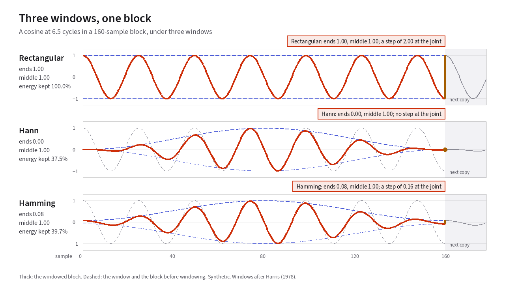
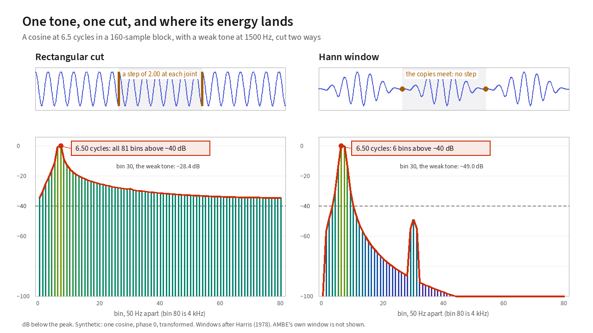
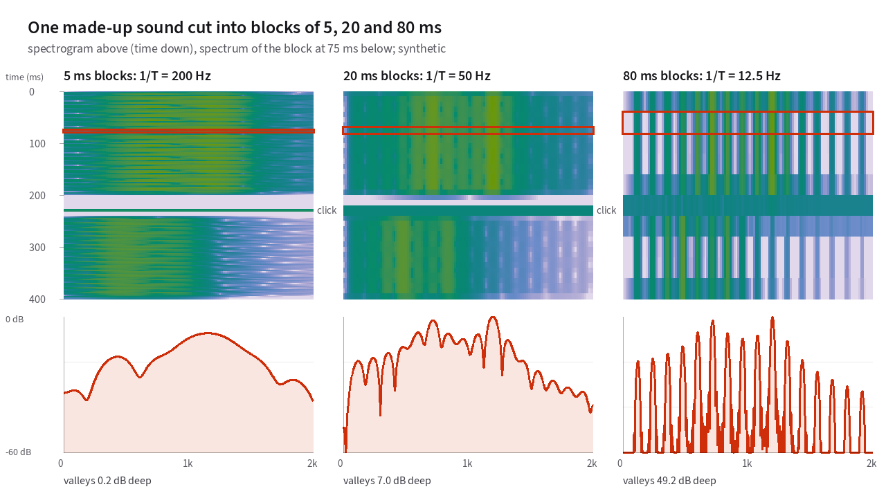

# Windows and frames

[Chapter 2](02-fourier-and-the-dft.md) ended on a practical catch. The
Discrete Fourier Transform is exact, but only when the audio inside a block
joins smoothly from the end of one copy to the start of the next. Real speech
almost never lands on a whole number of cycles inside a fixed block. Managing
that mismatch explains why every AMBE radio slices speech into 20-millisecond
frames and tapers each block with a window function.
{: .lede }

## Why a vocoder must slice speech into frames

Suppose you recorded ten seconds of a radio transmission and ran one giant
Fourier transform across the entire ten-second recording. The math would work,
and the resulting spectrum would be almost useless. It would tell you every
frequency that occurred anywhere during those ten seconds, with no indication
of *when* each sound happened. Every [vowel](18-glossary.md#vowel), [consonant](18-glossary.md#consonant), and pause would be
blurred into one static graph.

<!-- Todo: Add 2D graph comparing a single static FFT of a 10-second sentence against animated 20 ms spectral slices tracking the moving mouth -->

Speech carries meaning because the [vocal tract](18-glossary.md#vocal-folds-and-vocal-tract) is constantly moving. To track
a moving voice, a vocoder slices the incoming audio into short blocks called
[frames](18-glossary.md#frame-and-analysis-window) and transforms each block
in turn. At one frame every 20 milliseconds, or 50 frames per second, the
sequence of spectra moves in step with the speaker's tongue and jaw.

Cutting continuous audio into short blocks introduces two physical
problems. The cut creates edge discontinuities (see [spectral leakage](18-glossary.md#spectral-leakage)),
and block length forces a tradeoff between time and frequency resolution.

## How a hard cut leaks energy across the spectrum

The simplest way to extract the 160 samples in 20 milliseconds of audio at
8 kHz is a **rectangular cut**. It keeps the 160 samples inside the block at full
strength and drops everything outside the block to zero.

<!-- slot: leakage -->

To see what a rectangular cut does to the spectrum, consider a single pure
cosine tone fed into a 160-sample DFT. If that tone completes an exact
whole number of cycles inside the 20 ms block, such as 6.00 cycles at
300 Hz, the spectrum shows a single clean spike at bin 6 and nothing
anywhere else.

If the speaker's pitch shifts up by just 25 Hz to 325 Hz, the tone completes
6.50 cycles inside the block. The spectrum explodes with energy spilling across
all 81 frequency bins, creating a broad skirt of false frequencies from 0 Hz all the
way to 4,000 Hz.

<!-- diagram: leak-spectra -->
<figure class="gloss-diagram" data-diagram="leak-spectra">
<svg class="gloss-diagram__svg" viewBox="0 0 640 286" role="img" aria-label="Two spectra of a tone cut to 20 milliseconds with no taper. At 6.00 cycles there is a single spike at bin 6. At 6.50 cycles there are stems in every bin from 0 to 4 kilohertz."><path class="gd-axis" d="M120,110 L572,110"/><text class="gd-label gd-label--a" x="106" y="75" text-anchor="end">6.00 cycles</text><path class="gd-grid" d="M120.0,30.0 L572.0,30.0"/><text class="gd-label" x="576" y="35" text-anchor="start">0 dB</text><text class="gd-label" x="576" y="115" text-anchor="start">−80</text><path class="gd-a" style="stroke-width:2" d="M153.9,110 L153.9,30.0"/><path class="gd-axis" d="M120,230 L572,230"/><text class="gd-label gd-label--b" x="106" y="195" text-anchor="end">6.50 cycles</text><path class="gd-grid" d="M120.0,150.0 L572.0,150.0"/><text class="gd-label" x="576" y="155" text-anchor="start">0 dB</text><text class="gd-label" x="576" y="235" text-anchor="start">−80</text><path class="gd-b" style="stroke-width:2" d="M120.0,230 L120.0,184.4"/><path class="gd-b" style="stroke-width:2" d="M125.7,230 L125.7,180.4"/><path class="gd-b" style="stroke-width:2" d="M131.3,230 L131.3,175.3"/><path class="gd-b" style="stroke-width:2" d="M136.9,230 L136.9,171.0"/><path class="gd-b" style="stroke-width:2" d="M142.6,230 L142.6,166.6"/><path class="gd-b" style="stroke-width:2" d="M148.2,230 L148.2,161.0"/><path class="gd-b" style="stroke-width:2" d="M153.9,230 L153.9,150.7"/><path class="gd-b" style="stroke-width:2" d="M159.6,230 L159.6,150.0"/><path class="gd-b" style="stroke-width:2" d="M165.2,230 L165.2,159.0"/><path class="gd-b" style="stroke-width:2" d="M170.8,230 L170.8,163.0"/><path class="gd-b" style="stroke-width:2" d="M176.5,230 L176.5,165.5"/><path class="gd-b" style="stroke-width:2" d="M182.2,230 L182.2,167.4"/><path class="gd-b" style="stroke-width:2" d="M187.8,230 L187.8,168.9"/><path class="gd-b" style="stroke-width:2" d="M193.4,230 L193.4,170.1"/><path class="gd-b" style="stroke-width:2" d="M199.1,230 L199.1,171.1"/><path class="gd-b" style="stroke-width:2" d="M204.8,230 L204.8,172.0"/><path class="gd-b" style="stroke-width:2" d="M210.4,230 L210.4,172.8"/><path class="gd-b" style="stroke-width:2" d="M216.1,230 L216.1,173.5"/><path class="gd-b" style="stroke-width:2" d="M221.7,230 L221.7,174.1"/><path class="gd-b" style="stroke-width:2" d="M227.3,230 L227.3,174.7"/><path class="gd-b" style="stroke-width:2" d="M233.0,230 L233.0,175.2"/><path class="gd-b" style="stroke-width:2" d="M238.7,230 L238.7,175.7"/><path class="gd-b" style="stroke-width:2" d="M244.3,230 L244.3,176.2"/><path class="gd-b" style="stroke-width:2" d="M249.9,230 L249.9,176.6"/><path class="gd-b" style="stroke-width:2" d="M255.6,230 L255.6,177.0"/><path class="gd-b" style="stroke-width:2" d="M261.2,230 L261.2,177.4"/><path class="gd-b" style="stroke-width:2" d="M266.9,230 L266.9,177.8"/><path class="gd-b" style="stroke-width:2" d="M272.6,230 L272.6,178.1"/><path class="gd-b" style="stroke-width:2" d="M278.2,230 L278.2,178.4"/><path class="gd-b" style="stroke-width:2" d="M283.9,230 L283.9,178.7"/><path class="gd-b" style="stroke-width:2" d="M289.5,230 L289.5,179.0"/><path class="gd-b" style="stroke-width:2" d="M295.1,230 L295.1,179.3"/><path class="gd-b" style="stroke-width:2" d="M300.8,230 L300.8,179.6"/><path class="gd-b" style="stroke-width:2" d="M306.4,230 L306.4,179.8"/><path class="gd-b" style="stroke-width:2" d="M312.1,230 L312.1,180.0"/><path class="gd-b" style="stroke-width:2" d="M317.8,230 L317.8,180.3"/><path class="gd-b" style="stroke-width:2" d="M323.4,230 L323.4,180.5"/><path class="gd-b" style="stroke-width:2" d="M329.1,230 L329.1,180.7"/><path class="gd-b" style="stroke-width:2" d="M334.7,230 L334.7,180.9"/><path class="gd-b" style="stroke-width:2" d="M340.4,230 L340.4,181.1"/><path class="gd-b" style="stroke-width:2" d="M346.0,230 L346.0,181.3"/><path class="gd-b" style="stroke-width:2" d="M351.6,230 L351.6,181.5"/><path class="gd-b" style="stroke-width:2" d="M357.3,230 L357.3,181.6"/><path class="gd-b" style="stroke-width:2" d="M362.9,230 L362.9,181.8"/><path class="gd-b" style="stroke-width:2" d="M368.6,230 L368.6,182.0"/><path class="gd-b" style="stroke-width:2" d="M374.2,230 L374.2,182.1"/><path class="gd-b" style="stroke-width:2" d="M379.9,230 L379.9,182.3"/><path class="gd-b" style="stroke-width:2" d="M385.6,230 L385.6,182.4"/><path class="gd-b" style="stroke-width:2" d="M391.2,230 L391.2,182.5"/><path class="gd-b" style="stroke-width:2" d="M396.9,230 L396.9,182.7"/><path class="gd-b" style="stroke-width:2" d="M402.5,230 L402.5,182.8"/><path class="gd-b" style="stroke-width:2" d="M408.1,230 L408.1,182.9"/><path class="gd-b" style="stroke-width:2" d="M413.8,230 L413.8,183.0"/><path class="gd-b" style="stroke-width:2" d="M419.4,230 L419.4,183.1"/><path class="gd-b" style="stroke-width:2" d="M425.1,230 L425.1,183.2"/><path class="gd-b" style="stroke-width:2" d="M430.8,230 L430.8,183.3"/><path class="gd-b" style="stroke-width:2" d="M436.4,230 L436.4,183.4"/><path class="gd-b" style="stroke-width:2" d="M442.1,230 L442.1,183.5"/><path class="gd-b" style="stroke-width:2" d="M447.7,230 L447.7,183.6"/><path class="gd-b" style="stroke-width:2" d="M453.4,230 L453.4,183.7"/><path class="gd-b" style="stroke-width:2" d="M459.0,230 L459.0,183.7"/><path class="gd-b" style="stroke-width:2" d="M464.6,230 L464.6,183.8"/><path class="gd-b" style="stroke-width:2" d="M470.3,230 L470.3,183.9"/><path class="gd-b" style="stroke-width:2" d="M475.9,230 L475.9,183.9"/><path class="gd-b" style="stroke-width:2" d="M481.6,230 L481.6,184.0"/><path class="gd-b" style="stroke-width:2" d="M487.2,230 L487.2,184.1"/><path class="gd-b" style="stroke-width:2" d="M492.9,230 L492.9,184.1"/><path class="gd-b" style="stroke-width:2" d="M498.6,230 L498.6,184.2"/><path class="gd-b" style="stroke-width:2" d="M504.2,230 L504.2,184.2"/><path class="gd-b" style="stroke-width:2" d="M509.9,230 L509.9,184.2"/><path class="gd-b" style="stroke-width:2" d="M515.5,230 L515.5,184.3"/><path class="gd-b" style="stroke-width:2" d="M521.1,230 L521.1,184.3"/><path class="gd-b" style="stroke-width:2" d="M526.8,230 L526.8,184.3"/><path class="gd-b" style="stroke-width:2" d="M532.5,230 L532.5,184.4"/><path class="gd-b" style="stroke-width:2" d="M538.1,230 L538.1,184.4"/><path class="gd-b" style="stroke-width:2" d="M543.8,230 L543.8,184.4"/><path class="gd-b" style="stroke-width:2" d="M549.4,230 L549.4,184.4"/><path class="gd-b" style="stroke-width:2" d="M555.0,230 L555.0,184.4"/><path class="gd-b" style="stroke-width:2" d="M560.7,230 L560.7,184.4"/><path class="gd-b" style="stroke-width:2" d="M566.4,230 L566.4,184.4"/><path class="gd-b" style="stroke-width:2" d="M572.0,230 L572.0,184.4"/><path class="gd-axis" d="M120.0,230.0 L120.0,236.0"/><text class="gd-label" x="120" y="254" text-anchor="middle">0</text><path class="gd-axis" d="M233.0,230.0 L233.0,236.0"/><text class="gd-label" x="233" y="254" text-anchor="middle">1</text><path class="gd-axis" d="M346.0,230.0 L346.0,236.0"/><text class="gd-label" x="346" y="254" text-anchor="middle">2</text><path class="gd-axis" d="M459.0,230.0 L459.0,236.0"/><text class="gd-label" x="459" y="254" text-anchor="middle">3</text><path class="gd-axis" d="M572.0,230.0 L572.0,236.0"/><text class="gd-label" x="572" y="254" text-anchor="middle">4</text><text class="gd-label" x="346" y="278" text-anchor="middle">frequency in kHz →</text></svg>
<figcaption>The same tone cut to one 20 ms block, with no taper. At 6.00 cycles the spectrum is one spike at bin 6. At 6.50 cycles energy spills into every bin, only 25 to 35 dB below the peak.</figcaption>
</figure>
<!-- end diagram -->

<!-- end slot: leakage -->

## Where the phantom frequencies come from

Why does a pure tone at 325 Hz light up every bin of the transform?

The DFT treats your 160-sample block as one repeating period of an infinite
loop. Imagine printing that 160-sample block on a strip of paper and taping
copies of it end to end.

- **At 6.00 cycles:** The end of one block meets the start of the next copy at
  the exact same height and slope. The looped wave is an unbroken, smooth
  cosine.
- **At 6.50 cycles:** The block starts at +1, the top of a crest. It ends
  halfway through a cycle at −1, the bottom of a trough. Where the end of
  one block meets the start of the next copy, the waveform jumps vertically
  from −1 to +1.

<!-- diagram: tiled-copies -->
<figure class="gloss-diagram" data-diagram="tiled-copies">
<svg class="gloss-diagram__svg" viewBox="0 0 640 276" role="img" aria-label="Two rows zoomed in on the joint where one copy of a 20 millisecond block meets the next. At 6.00 cycles the wave runs smoothly through the joint. At 6.50 cycles it jumps from the bottom of a trough to the top of a crest."><path class="gd-axis" d="M120,70 L600,70"/><text class="gd-label gd-label--a" x="106" y="75" text-anchor="end">6.00 cycles</text><path class="gd-a" d="M120.0,106.0 L121.6,105.9 L123.2,105.7 L124.8,105.4 L126.4,104.9 L128.0,104.2 L129.6,103.5 L131.2,102.6 L132.8,101.5 L134.4,100.4 L136.0,99.1 L137.6,97.7 L139.2,96.2 L140.8,94.6 L142.4,92.9 L144.0,91.2 L145.6,89.3 L147.2,87.3 L148.8,85.3 L150.4,83.3 L152.0,81.1 L153.6,79.0 L155.2,76.7 L156.8,74.5 L158.4,72.3 L160.0,70.0 L161.6,67.7 L163.2,65.5 L164.8,63.3 L166.4,61.0 L168.0,58.9 L169.6,56.7 L171.2,54.7 L172.8,52.7 L174.4,50.7 L176.0,48.8 L177.6,47.1 L179.2,45.4 L180.8,43.8 L182.4,42.3 L184.0,40.9 L185.6,39.6 L187.2,38.5 L188.8,37.4 L190.4,36.5 L192.0,35.8 L193.6,35.1 L195.2,34.6 L196.8,34.3 L198.4,34.1 L200.0,34.0 L201.6,34.1 L203.2,34.3 L204.8,34.6 L206.4,35.1 L208.0,35.8 L209.6,36.5 L211.2,37.4 L212.8,38.5 L214.4,39.6 L216.0,40.9 L217.6,42.3 L219.2,43.8 L220.8,45.4 L222.4,47.1 L224.0,48.8 L225.6,50.7 L227.2,52.7 L228.8,54.7 L230.4,56.7 L232.0,58.9 L233.6,61.0 L235.2,63.3 L236.8,65.5 L238.4,67.7 L240.0,70.0 L241.6,72.3 L243.2,74.5 L244.8,76.7 L246.4,79.0 L248.0,81.1 L249.6,83.3 L251.2,85.3 L252.8,87.3 L254.4,89.3 L256.0,91.2 L257.6,92.9 L259.2,94.6 L260.8,96.2 L262.4,97.7 L264.0,99.1 L265.6,100.4 L267.2,101.5 L268.8,102.6 L270.4,103.5 L272.0,104.2 L273.6,104.9 L275.2,105.4 L276.8,105.7 L278.4,105.9 L280.0,106.0 L281.6,105.9 L283.2,105.7 L284.8,105.4 L286.4,104.9 L288.0,104.2 L289.6,103.5 L291.2,102.6 L292.8,101.5 L294.4,100.4 L296.0,99.1 L297.6,97.7 L299.2,96.2 L300.8,94.6 L302.4,92.9 L304.0,91.2 L305.6,89.3 L307.2,87.3 L308.8,85.3 L310.4,83.3 L312.0,81.1 L313.6,79.0 L315.2,76.7 L316.8,74.5 L318.4,72.3 L320.0,70.0 L321.6,67.7 L323.2,65.5 L324.8,63.3 L326.4,61.0 L328.0,58.9 L329.6,56.7 L331.2,54.7 L332.8,52.7 L334.4,50.7 L336.0,48.8 L337.6,47.1 L339.2,45.4 L340.8,43.8 L342.4,42.3 L344.0,40.9 L345.6,39.6 L347.2,38.5 L348.8,37.4 L350.4,36.5 L352.0,35.8 L353.6,35.1 L355.2,34.6 L356.8,34.3 L358.4,34.1 L360.0,34.0 L360.0,34.0 L361.6,34.1 L363.2,34.3 L364.8,34.6 L366.4,35.1 L368.0,35.8 L369.6,36.5 L371.2,37.4 L372.8,38.5 L374.4,39.6 L376.0,40.9 L377.6,42.3 L379.2,43.8 L380.8,45.4 L382.4,47.1 L384.0,48.8 L385.6,50.7 L387.2,52.7 L388.8,54.7 L390.4,56.7 L392.0,58.9 L393.6,61.0 L395.2,63.3 L396.8,65.5 L398.4,67.7 L400.0,70.0 L401.6,72.3 L403.2,74.5 L404.8,76.7 L406.4,79.0 L408.0,81.1 L409.6,83.3 L411.2,85.3 L412.8,87.3 L414.4,89.3 L416.0,91.2 L417.6,92.9 L419.2,94.6 L420.8,96.2 L422.4,97.7 L424.0,99.1 L425.6,100.4 L427.2,101.5 L428.8,102.6 L430.4,103.5 L432.0,104.2 L433.6,104.9 L435.2,105.4 L436.8,105.7 L438.4,105.9 L440.0,106.0 L441.6,105.9 L443.2,105.7 L444.8,105.4 L446.4,104.9 L448.0,104.2 L449.6,103.5 L451.2,102.6 L452.8,101.5 L454.4,100.4 L456.0,99.1 L457.6,97.7 L459.2,96.2 L460.8,94.6 L462.4,92.9 L464.0,91.2 L465.6,89.3 L467.2,87.3 L468.8,85.3 L470.4,83.3 L472.0,81.1 L473.6,79.0 L475.2,76.7 L476.8,74.5 L478.4,72.3 L480.0,70.0 L481.6,67.7 L483.2,65.5 L484.8,63.3 L486.4,61.0 L488.0,58.9 L489.6,56.7 L491.2,54.7 L492.8,52.7 L494.4,50.7 L496.0,48.8 L497.6,47.1 L499.2,45.4 L500.8,43.8 L502.4,42.3 L504.0,40.9 L505.6,39.6 L507.2,38.5 L508.8,37.4 L510.4,36.5 L512.0,35.8 L513.6,35.1 L515.2,34.6 L516.8,34.3 L518.4,34.1 L520.0,34.0 L521.6,34.1 L523.2,34.3 L524.8,34.6 L526.4,35.1 L528.0,35.8 L529.6,36.5 L531.2,37.4 L532.8,38.5 L534.4,39.6 L536.0,40.9 L537.6,42.3 L539.2,43.8 L540.8,45.4 L542.4,47.1 L544.0,48.8 L545.6,50.7 L547.2,52.7 L548.8,54.7 L550.4,56.7 L552.0,58.9 L553.6,61.0 L555.2,63.3 L556.8,65.5 L558.4,67.7 L560.0,70.0 L561.6,72.3 L563.2,74.5 L564.8,76.7 L566.4,79.0 L568.0,81.1 L569.6,83.3 L571.2,85.3 L572.8,87.3 L574.4,89.3 L576.0,91.2 L577.6,92.9 L579.2,94.6 L580.8,96.2 L582.4,97.7 L584.0,99.1 L585.6,100.4 L587.2,101.5 L588.8,102.6 L590.4,103.5 L592.0,104.2 L593.6,104.9 L595.2,105.4 L596.8,105.7 L598.4,105.9 L600.0,106.0"/><path class="gd-axis" d="M120,190 L600,190"/><text class="gd-label gd-label--b" x="106" y="195" text-anchor="end">6.50 cycles</text><path class="gd-b" d="M120.0,164.5 L121.6,162.9 L123.2,161.3 L124.8,159.9 L126.4,158.6 L128.0,157.5 L129.6,156.5 L131.2,155.7 L132.8,155.0 L134.4,154.5 L136.0,154.2 L137.6,154.0 L139.2,154.0 L140.8,154.2 L142.4,154.5 L144.0,155.0 L145.6,155.6 L147.2,156.5 L148.8,157.4 L150.4,158.5 L152.0,159.8 L153.6,161.2 L155.2,162.7 L156.8,164.4 L158.4,166.2 L160.0,168.1 L161.6,170.1 L163.2,172.2 L164.8,174.3 L166.4,176.6 L168.0,178.9 L169.6,181.2 L171.2,183.6 L172.8,186.0 L174.4,188.5 L176.0,190.9 L177.6,193.4 L179.2,195.8 L180.8,198.2 L182.4,200.6 L184.0,202.9 L185.6,205.2 L187.2,207.3 L188.8,209.4 L190.4,211.5 L192.0,213.4 L193.6,215.2 L195.2,216.9 L196.8,218.4 L198.4,219.9 L200.0,221.2 L201.6,222.3 L203.2,223.3 L204.8,224.2 L206.4,224.9 L208.0,225.4 L209.6,225.8 L211.2,226.0 L212.8,226.0 L214.4,225.9 L216.0,225.6 L217.6,225.1 L219.2,224.5 L220.8,223.7 L222.4,222.7 L224.0,221.6 L225.6,220.4 L227.2,219.0 L228.8,217.5 L230.4,215.9 L232.0,214.1 L233.6,212.2 L235.2,210.2 L236.8,208.2 L238.4,206.0 L240.0,203.8 L241.6,201.5 L243.2,199.1 L244.8,196.7 L246.4,194.3 L248.0,191.9 L249.6,189.4 L251.2,187.0 L252.8,184.6 L254.4,182.1 L256.0,179.8 L257.6,177.5 L259.2,175.2 L260.8,173.0 L262.4,170.9 L264.0,168.8 L265.6,166.9 L267.2,165.1 L268.8,163.4 L270.4,161.8 L272.0,160.3 L273.6,159.0 L275.2,157.8 L276.8,156.8 L278.4,155.9 L280.0,155.2 L281.6,154.7 L283.2,154.3 L284.8,154.1 L286.4,154.0 L288.0,154.1 L289.6,154.4 L291.2,154.8 L292.8,155.4 L294.4,156.2 L296.0,157.1 L297.6,158.2 L299.2,159.4 L300.8,160.8 L302.4,162.3 L304.0,163.9 L305.6,165.6 L307.2,167.5 L308.8,169.5 L310.4,171.5 L312.0,173.7 L313.6,175.9 L315.2,178.2 L316.8,180.5 L318.4,182.9 L320.0,185.3 L321.6,187.7 L323.2,190.2 L324.8,192.6 L326.4,195.1 L328.0,197.5 L329.6,199.9 L331.2,202.2 L332.8,204.5 L334.4,206.7 L336.0,208.8 L337.6,210.9 L339.2,212.8 L340.8,214.6 L342.4,216.4 L344.0,218.0 L345.6,219.5 L347.2,220.8 L348.8,222.0 L350.4,223.0 L352.0,223.9 L353.6,224.7 L355.2,225.3 L356.8,225.7 L358.4,225.9 L360.0,226.0 L360.0,154.0 L361.6,154.1 L363.2,154.3 L364.8,154.7 L366.4,155.3 L368.0,156.1 L369.6,157.0 L371.2,158.0 L372.8,159.2 L374.4,160.5 L376.0,162.0 L377.6,163.6 L379.2,165.4 L380.8,167.2 L382.4,169.1 L384.0,171.2 L385.6,173.3 L387.2,175.5 L388.8,177.8 L390.4,180.1 L392.0,182.5 L393.6,184.9 L395.2,187.4 L396.8,189.8 L398.4,192.3 L400.0,194.7 L401.6,197.1 L403.2,199.5 L404.8,201.8 L406.4,204.1 L408.0,206.3 L409.6,208.5 L411.2,210.5 L412.8,212.5 L414.4,214.4 L416.0,216.1 L417.6,217.7 L419.2,219.2 L420.8,220.6 L422.4,221.8 L424.0,222.9 L425.6,223.8 L427.2,224.6 L428.8,225.2 L430.4,225.6 L432.0,225.9 L433.6,226.0 L435.2,225.9 L436.8,225.7 L438.4,225.3 L440.0,224.8 L441.6,224.1 L443.2,223.2 L444.8,222.2 L446.4,221.0 L448.0,219.7 L449.6,218.2 L451.2,216.6 L452.8,214.9 L454.4,213.1 L456.0,211.2 L457.6,209.1 L459.2,207.0 L460.8,204.8 L462.4,202.5 L464.0,200.2 L465.6,197.9 L467.2,195.4 L468.8,193.0 L470.4,190.6 L472.0,188.1 L473.6,185.7 L475.2,183.3 L476.8,180.9 L478.4,178.5 L480.0,176.2 L481.6,174.0 L483.2,171.8 L484.8,169.8 L486.4,167.8 L488.0,165.9 L489.6,164.1 L491.2,162.5 L492.8,161.0 L494.4,159.6 L496.0,158.4 L497.6,157.3 L499.2,156.3 L500.8,155.5 L502.4,154.9 L504.0,154.4 L505.6,154.1 L507.2,154.0 L508.8,154.0 L510.4,154.2 L512.0,154.6 L513.6,155.1 L515.2,155.8 L516.8,156.7 L518.4,157.7 L520.0,158.8 L521.6,160.1 L523.2,161.6 L524.8,163.1 L526.4,164.8 L528.0,166.6 L529.6,168.5 L531.2,170.6 L532.8,172.7 L534.4,174.8 L536.0,177.1 L537.6,179.4 L539.2,181.8 L540.8,184.2 L542.4,186.6 L544.0,189.1 L545.6,191.5 L547.2,194.0 L548.8,196.4 L550.4,198.8 L552.0,201.1 L553.6,203.4 L555.2,205.7 L556.8,207.8 L558.4,209.9 L560.0,211.9 L561.6,213.8 L563.2,215.6 L564.8,217.3 L566.4,218.8 L568.0,220.2 L569.6,221.5 L571.2,222.6 L572.8,223.5 L574.4,224.4 L576.0,225.0 L577.6,225.5 L579.2,225.8 L580.8,226.0 L582.4,226.0 L584.0,225.8 L585.6,225.5 L587.2,225.0 L588.8,224.3 L590.4,223.5 L592.0,222.5 L593.6,221.4 L595.2,220.1 L596.8,218.7 L598.4,217.1 L600.0,215.5"/><text class="gd-label gd-label--c" x="370" y="158" text-anchor="start">jump</text><path class="gd-mark gd-dash" d="M360.0,20.0 L360.0,248.0"/><text class="gd-label" x="352" y="266" text-anchor="end">end of one copy</text><text class="gd-label" x="368" y="266" text-anchor="start">start of the next</text></svg>
<figcaption>The DFT treats the block as if copies of it ran end to end. Here is one joint, close up. At 6.00 cycles each copy ends where the next one starts. At 6.50 cycles one copy ends at the bottom of a trough, and the next starts at the top of a crest.</figcaption>
</figure>
<!-- end diagram -->

<!-- slot: leakage -->

That vertical cliff at the block boundary acts like a sharp impulse, and a sharp step
spreads energy across the entire spectrum. Those phantom frequencies are
called [spectral leakage](18-glossary.md#spectral-leakage). In speech, leakage is
dangerous because the skirt leaking from a loud, low-pitched vowel harmonic
can easily bury a quiet consonant harmonic higher up in the band.

<!-- end slot: leakage -->

<!-- slot: window-shapes -->

## Tapering the edges with a window function

Since the phantom frequencies come from the sudden cliff where the block starts
and stops, the remedy is to fade the audio smoothly down to zero at both ends
before running the transform.

A [window function](18-glossary.md#window-function-hann-and-hamming) is a set
of 160 weights that multiply the audio samples point by point. The middle
of the block receives a weight near 1.0, while the two ends taper smoothly
downward. A **Hann** window tapers all the way to zero at both ends. A **Hamming**
window tapers down to 0.08, leaving a tiny step but sharpening the center peak.
Harris 1978, Proc. IEEE 66(1); US 5,701,390

In [**Figure 3.1**](#fig-3-1), look at a 6.5-cycle tone. Switch between
**Rectangular**, **Hann**, and **Hamming** windows to watch the edge cliff
fade away.

<figure class="anim-fallback" markdown="0">
  
  <figcaption>Rectangular, Hann, and Hamming windows on one tone that sits
  half a bin off.</figcaption>
</figure>
<ol class="anim-steps" markdown="1">
<li data-window="rect" data-view="2d" data-preset="corner" markdown="block">
Here is one 20&nbsp;ms block of the 6.5-cycle tone, cut with a rectangular
window. It ends mid-swing, so it jumps where the next copy starts.
</li>
<li data-window="hann" data-view="2d" data-preset="corner" markdown="block">
Press Hann. The window (dashed) fades both ends of the block to zero, and
the jump at the joint disappears.
</li>
<li data-window="hamming" data-view="2d" data-preset="corner" markdown="block">
Press Hamming. Its ends stop just above zero, so a small jump is left.
The vocoder's analysis window has this shape
US 5,701,390.
</li>
<li data-window="hamming" data-view="3d" data-preset="corner" markdown="block">
In 3D, the whole family stands in a row, from the rectangular window at
the front to Hann at the back. The two rails along the block's ends close
to zero as you go back.
</li>
</ol>

<!-- end slot: window-shapes -->

<!-- slot: leakage -->

In [**Figure 3.2**](#fig-3-2), you can see what that edge taper accomplishes in the
spectrum. Drag the *Cycles in the block* slider between 6.00 and 7.00.
Toggle the *Weak second tone* at 1,500 Hz, which sits at bin 30, 50 dB
quieter than the main tone. Then switch between **Rectangular** and **Hann**.

<figure class="anim-fallback" markdown="0">
  
  <figcaption>Spectral leakage comparison between a rectangular cut and a Hann
  window on a 6.5-cycle tone.</figcaption>
</figure>
<ol class="anim-steps" markdown="1">
<li data-cycles="6" data-window="rect" data-weak="off" data-view="2d" data-preset="corner" markdown="block">
At exactly six cycles in the block, the spectrum is one stem at bin 6.
In the strip above, the copies of the block join without a jump.
</li>
<li data-cycles="6.5" data-window="rect" data-weak="off" data-view="2d" data-preset="corner" markdown="block">
At six and a half cycles, the copies jump at every joint, and the one
tone spills into every bin.
</li>
<li data-cycles="6.1" data-window="rect" data-weak="off" data-view="3d" data-preset="corner" markdown="block">
In 3D, the spectrum for every setting from 6 to 7 cycles stands one
behind the other. The spill opens as the tone leaves bin 6 and closes
again at 7.
</li>
<li data-cycles="6.5" data-window="rect" data-weak="on" data-view="2d" data-preset="corner" markdown="block">
Press *Weak second tone* to add a tone at bin 30, 50&nbsp;dB quieter.
The spill from the main tone covers it.
</li>
<li data-cycles="6.5" data-window="hann" data-weak="on" data-view="2d" data-preset="corner" markdown="block">
Press Hann. The spill drops far below the weak tone, which now stands
clear at bin 30.
</li>
<li data-cycles="6" data-window="hann" data-weak="off" data-view="2d" data-preset="front" data-focus="peak" markdown="block">
Back at six whole cycles, Hann turns the single stem into three. Press
Rectangular and Hann in turn to compare.
</li>
</ol>

Under the rectangular cut at 6.50 cycles, the leakage skirt at bin 30 sits near
−29 dB, completely hiding the −50 dB second tone. When you switch to the
Hann window, the leakage skirt drops below −80 dB, and the weak tone at
bin 30 stands out clearly.

<!-- end slot: leakage -->

<!-- slot: window-shapes -->

## The raised-cosine window family

Rectangular, Hamming, and Hann all belong to the same raised-cosine family.
They differ only in how much weight they leave at the ends of the block.
Rectangular leaves full weight at 1.00, Hamming leaves 0.08, and Hann drops
all the way to 0.00. Switch [**Figure 3.1**](#fig-3-1) to 3D to see the whole
family laid out from front to back, with Hamming in between. The two side
rails pinch the block edges closed as you go back.

<!-- diagram: window-family -->
<figure class="gloss-diagram" data-diagram="window-family">
<svg class="gloss-diagram__svg" viewBox="0 0 640 234" role="img" aria-label="A graph of three window shapes across one 160-sample block, weight from 0 to 1. Rectangular stays at 1. Hamming falls to 0.08 at both ends. Hann falls to 0."><path class="gd-axis" d="M110,200 L470,200"/><path class="gd-axis" d="M110,200 L110,30"/><path class="gd-axis" d="M104.0,200.0 L110.0,200.0"/><text class="gd-label" x="100" y="205" text-anchor="end">0</text><path class="gd-axis" d="M104.0,120.0 L110.0,120.0"/><text class="gd-label" x="100" y="125" text-anchor="end">0.5</text><path class="gd-axis" d="M104.0,40.0 L110.0,40.0"/><text class="gd-label" x="100" y="45" text-anchor="end">1</text><path class="gd-c" d="M110.0,40.0 L470.0,40.0"/><path class="gd-a" d="M110.0,187.2 L111.8,187.2 L113.6,187.1 L115.4,186.9 L117.2,186.6 L119.0,186.3 L120.8,185.9 L122.6,185.4 L124.4,184.9 L126.2,184.3 L128.0,183.6 L129.8,182.8 L131.6,182.0 L133.4,181.1 L135.2,180.2 L137.0,179.2 L138.8,178.1 L140.6,177.0 L142.4,175.7 L144.2,174.5 L146.0,173.1 L147.8,171.8 L149.6,170.3 L151.4,168.8 L153.2,167.3 L155.0,165.6 L156.8,164.0 L158.6,162.3 L160.4,160.5 L162.2,158.7 L164.0,156.9 L165.8,155.0 L167.6,153.0 L169.4,151.1 L171.2,149.1 L173.0,147.0 L174.8,144.9 L176.6,142.8 L178.4,140.7 L180.2,138.5 L182.0,136.3 L183.8,134.1 L185.6,131.9 L187.4,129.7 L189.2,127.4 L191.0,125.1 L192.8,122.8 L194.6,120.5 L196.4,118.2 L198.2,115.9 L200.0,113.6 L201.8,111.3 L203.6,109.0 L205.4,106.7 L207.2,104.4 L209.0,102.1 L210.8,99.8 L212.6,97.5 L214.4,95.3 L216.2,93.1 L218.0,90.9 L219.8,88.7 L221.6,86.5 L223.4,84.4 L225.2,82.3 L227.0,80.2 L228.8,78.1 L230.6,76.1 L232.4,74.2 L234.2,72.2 L236.0,70.3 L237.8,68.5 L239.6,66.7 L241.4,64.9 L243.2,63.2 L245.0,61.6 L246.8,59.9 L248.6,58.4 L250.4,56.9 L252.2,55.4 L254.0,54.1 L255.8,52.7 L257.6,51.5 L259.4,50.2 L261.2,49.1 L263.0,48.0 L264.8,47.0 L266.6,46.1 L268.4,45.2 L270.2,44.4 L272.0,43.6 L273.8,42.9 L275.6,42.3 L277.4,41.8 L279.2,41.3 L281.0,40.9 L282.8,40.6 L284.6,40.3 L286.4,40.1 L288.2,40.0 L290.0,40.0 L291.8,40.0 L293.6,40.1 L295.4,40.3 L297.2,40.6 L299.0,40.9 L300.8,41.3 L302.6,41.8 L304.4,42.3 L306.2,42.9 L308.0,43.6 L309.8,44.4 L311.6,45.2 L313.4,46.1 L315.2,47.0 L317.0,48.0 L318.8,49.1 L320.6,50.2 L322.4,51.5 L324.2,52.7 L326.0,54.1 L327.8,55.4 L329.6,56.9 L331.4,58.4 L333.2,59.9 L335.0,61.6 L336.8,63.2 L338.6,64.9 L340.4,66.7 L342.2,68.5 L344.0,70.3 L345.8,72.2 L347.6,74.2 L349.4,76.1 L351.2,78.1 L353.0,80.2 L354.8,82.3 L356.6,84.4 L358.4,86.5 L360.2,88.7 L362.0,90.9 L363.8,93.1 L365.6,95.3 L367.4,97.5 L369.2,99.8 L371.0,102.1 L372.8,104.4 L374.6,106.7 L376.4,109.0 L378.2,111.3 L380.0,113.6 L381.8,115.9 L383.6,118.2 L385.4,120.5 L387.2,122.8 L389.0,125.1 L390.8,127.4 L392.6,129.7 L394.4,131.9 L396.2,134.1 L398.0,136.3 L399.8,138.5 L401.6,140.7 L403.4,142.8 L405.2,144.9 L407.0,147.0 L408.8,149.1 L410.6,151.1 L412.4,153.0 L414.2,155.0 L416.0,156.9 L417.8,158.7 L419.6,160.5 L421.4,162.3 L423.2,164.0 L425.0,165.6 L426.8,167.3 L428.6,168.8 L430.4,170.3 L432.2,171.8 L434.0,173.1 L435.8,174.5 L437.6,175.7 L439.4,177.0 L441.2,178.1 L443.0,179.2 L444.8,180.2 L446.6,181.1 L448.4,182.0 L450.2,182.8 L452.0,183.6 L453.8,184.3 L455.6,184.9 L457.4,185.4 L459.2,185.9 L461.0,186.3 L462.8,186.6 L464.6,186.9 L466.4,187.1 L468.2,187.2 L470.0,187.2"/><path class="gd-b gd-dash" d="M110.0,200.0 L111.8,200.0 L113.6,199.8 L115.4,199.6 L117.2,199.4 L119.0,199.0 L120.8,198.6 L122.6,198.1 L124.4,197.5 L126.2,196.8 L128.0,196.1 L129.8,195.3 L131.6,194.4 L133.4,193.4 L135.2,192.4 L137.0,191.3 L138.8,190.1 L140.6,188.9 L142.4,187.5 L144.2,186.2 L146.0,184.7 L147.8,183.2 L149.6,181.6 L151.4,180.0 L153.2,178.3 L155.0,176.6 L156.8,174.8 L158.6,172.9 L160.4,171.0 L162.2,169.0 L164.0,167.0 L165.8,165.0 L167.6,162.9 L169.4,160.7 L171.2,158.5 L173.0,156.3 L174.8,154.1 L176.6,151.8 L178.4,149.4 L180.2,147.1 L182.0,144.7 L183.8,142.3 L185.6,139.9 L187.4,137.5 L189.2,135.0 L191.0,132.5 L192.8,130.0 L194.6,127.5 L196.4,125.0 L198.2,122.5 L200.0,120.0 L201.8,117.5 L203.6,115.0 L205.4,112.5 L207.2,110.0 L209.0,107.5 L210.8,105.0 L212.6,102.5 L214.4,100.1 L216.2,97.7 L218.0,95.3 L219.8,92.9 L221.6,90.6 L223.4,88.2 L225.2,85.9 L227.0,83.7 L228.8,81.5 L230.6,79.3 L232.4,77.1 L234.2,75.0 L236.0,73.0 L237.8,71.0 L239.6,69.0 L241.4,67.1 L243.2,65.2 L245.0,63.4 L246.8,61.7 L248.6,60.0 L250.4,58.4 L252.2,56.8 L254.0,55.3 L255.8,53.8 L257.6,52.5 L259.4,51.1 L261.2,49.9 L263.0,48.7 L264.8,47.6 L266.6,46.6 L268.4,45.6 L270.2,44.7 L272.0,43.9 L273.8,43.2 L275.6,42.5 L277.4,41.9 L279.2,41.4 L281.0,41.0 L282.8,40.6 L284.6,40.4 L286.4,40.2 L288.2,40.0 L290.0,40.0 L291.8,40.0 L293.6,40.2 L295.4,40.4 L297.2,40.6 L299.0,41.0 L300.8,41.4 L302.6,41.9 L304.4,42.5 L306.2,43.2 L308.0,43.9 L309.8,44.7 L311.6,45.6 L313.4,46.6 L315.2,47.6 L317.0,48.7 L318.8,49.9 L320.6,51.1 L322.4,52.5 L324.2,53.8 L326.0,55.3 L327.8,56.8 L329.6,58.4 L331.4,60.0 L333.2,61.7 L335.0,63.4 L336.8,65.2 L338.6,67.1 L340.4,69.0 L342.2,71.0 L344.0,73.0 L345.8,75.0 L347.6,77.1 L349.4,79.3 L351.2,81.5 L353.0,83.7 L354.8,85.9 L356.6,88.2 L358.4,90.6 L360.2,92.9 L362.0,95.3 L363.8,97.7 L365.6,100.1 L367.4,102.5 L369.2,105.0 L371.0,107.5 L372.8,110.0 L374.6,112.5 L376.4,115.0 L378.2,117.5 L380.0,120.0 L381.8,122.5 L383.6,125.0 L385.4,127.5 L387.2,130.0 L389.0,132.5 L390.8,135.0 L392.6,137.5 L394.4,139.9 L396.2,142.3 L398.0,144.7 L399.8,147.1 L401.6,149.4 L403.4,151.8 L405.2,154.1 L407.0,156.3 L408.8,158.5 L410.6,160.7 L412.4,162.9 L414.2,165.0 L416.0,167.0 L417.8,169.0 L419.6,171.0 L421.4,172.9 L423.2,174.8 L425.0,176.6 L426.8,178.3 L428.6,180.0 L430.4,181.6 L432.2,183.2 L434.0,184.7 L435.8,186.2 L437.6,187.5 L439.4,188.9 L441.2,190.1 L443.0,191.3 L444.8,192.4 L446.6,193.4 L448.4,194.4 L450.2,195.3 L452.0,196.1 L453.8,196.8 L455.6,197.5 L457.4,198.1 L459.2,198.6 L461.0,199.0 L462.8,199.4 L464.6,199.6 L466.4,199.8 L468.2,200.0 L470.0,200.0"/><text class="gd-label gd-label--c" x="480" y="45" text-anchor="start">rectangular 1.00</text><text class="gd-label gd-label--a" x="480" y="181" text-anchor="start">Hamming 0.08</text><text class="gd-label gd-label--b" x="480" y="205" text-anchor="start">Hann 0</text><text class="gd-label" x="30" y="120.0" text-anchor="middle" transform="rotate(-90 30 120.0)">weight</text><text class="gd-label" x="110" y="224" text-anchor="middle">sample 0</text><text class="gd-label" x="470" y="224" text-anchor="middle">159</text></svg>
<figcaption>The three raised-cosine windows across one block. All three give the middle sample full weight. They differ at the ends, where rectangular keeps 1.00, Hamming keeps 0.08 and Hann keeps 0.</figcaption>
</figure>
<!-- end diagram -->

<!-- end slot: window-shapes -->

<!-- slot: leakage -->

## How windowing widens the main lobe

Tapering the edges of a block is not free. When the samples near both ends
are multiplied by weights near zero, the transform effectively looks at a
shorter active duration in the middle of the block. A shorter duration
means wider frequency peaks. At exactly 6.00 cycles, a rectangular cut
produces a single 1-bin spike, whereas a Hann window produces a 3-bin
main lobe.[^hann-lobe]

<!-- diagram: main-lobe -->
<figure class="gloss-diagram" data-diagram="main-lobe">
<svg class="gloss-diagram__svg" viewBox="0 0 640 266" role="img" aria-label="Two spectra of a tone at exactly 6.00 cycles, bins 0 to 12. With no taper there is one stem at bin 6. With a Hann window there are three stems, at bins 5, 6 and 7."><path class="gd-axis" d="M150,100 L560,100"/><text class="gd-label gd-label--c" x="136" y="70" text-anchor="end">rectangular</text><path class="gd-grid" d="M150.0,30.0 L560.0,30.0"/><text class="gd-label" x="566" y="35" text-anchor="start">0 dB</text><text class="gd-label" x="566" y="105" text-anchor="start">−60</text><path class="gd-c gd-bar" d="M355.0,100 L355.0,30.0"/><path class="gd-axis" d="M150,210 L560,210"/><text class="gd-label gd-label--b" x="136" y="180" text-anchor="end">Hann</text><path class="gd-grid" d="M150.0,140.0 L560.0,140.0"/><text class="gd-label" x="566" y="145" text-anchor="start">0 dB</text><text class="gd-label" x="566" y="215" text-anchor="start">−60</text><path class="gd-b gd-bar" d="M320.8,210 L320.8,147.0"/><path class="gd-b gd-bar" d="M355.0,210 L355.0,140.0"/><path class="gd-b gd-bar" d="M389.2,210 L389.2,147.0"/><path class="gd-axis" d="M150.0,210.0 L150.0,216.0"/><text class="gd-label" x="150" y="234" text-anchor="middle">0</text><path class="gd-axis" d="M218.3,210.0 L218.3,216.0"/><text class="gd-label" x="218" y="234" text-anchor="middle">2</text><path class="gd-axis" d="M286.7,210.0 L286.7,216.0"/><text class="gd-label" x="287" y="234" text-anchor="middle">4</text><path class="gd-axis" d="M355.0,210.0 L355.0,216.0"/><text class="gd-label" x="355" y="234" text-anchor="middle">6</text><path class="gd-axis" d="M423.3,210.0 L423.3,216.0"/><text class="gd-label" x="423" y="234" text-anchor="middle">8</text><path class="gd-axis" d="M491.7,210.0 L491.7,216.0"/><text class="gd-label" x="492" y="234" text-anchor="middle">10</text><path class="gd-axis" d="M560.0,210.0 L560.0,216.0"/><text class="gd-label" x="560" y="234" text-anchor="middle">12</text><text class="gd-label" x="355" y="258" text-anchor="middle">DFT bin →</text></svg>
<figcaption>A tone at exactly 6.00 cycles, close up. With no taper it is one stem at bin 6. The Hann window spreads it over three bins, with bins 5 and 7 each 6 dB down.</figcaption>
</figure>
<!-- end diagram -->

Switch [**Figure 3.2**](#fig-3-2) to 3D to see the spectra of every setting
from 6.00 to 7.00 cycles stacked one behind the other. Comparing
Rectangular and Hann shows the fundamental tradeoff. A window trades a
slightly wider peak for a massive drop in false leakage across the rest
of the band.

<!-- end slot: leakage -->

## Choosing the block length: time sharpness versus frequency sharpness

Once you apply a smooth window, you must choose how many milliseconds each
analysis block should last. That choice is governed by a physical tradeoff.

- **Short blocks of 5 to 10 ms** pin down *when* a sound changes to within a
  few milliseconds, capturing sharp consonant clicks cleanly. But a 5 ms
  window has a main lobe 800 Hz wide, blurring individual voice harmonics
  into one smooth lump.
- **Long blocks of 80 to 400 ms** resolve every voice harmonic into a razor-sharp
  needle peak. But an 80 ms block spans an entire syllable transition,
  smearing brief consonant bursts and pauses across neighboring vowels.

<!-- slot: tradeoff -->

In [**Figure 3.3**](#fig-3-3), test block lengths from 5 ms to 400 ms on a
synthetic utterance containing two vowels, a short silence, and a sharp click
at 230 ms.

<figure class="anim-fallback" markdown="0">
  
  <figcaption>Comparing 5 ms, 20 ms, and 80 ms analysis blocks on a 400 ms
  synthetic utterance with a 120 Hz vowel pitch and a click at 230 ms.</figcaption>
</figure>
<ol class="anim-steps" markdown="1">
<li data-block="20" data-f0="120" data-at="75" data-view="2d" data-preset="corner" markdown="block">
This made-up sound has a vowel, a short silence with a click at 230&nbsp;ms,
and a second vowel. At 20&nbsp;ms blocks, the harmonics of the vowel show
as separate peaks.
</li>
<li data-block="5" data-f0="120" data-at="75" data-view="2d" data-preset="high" markdown="block">
Shorten the block to 5&nbsp;ms. The click is now a thin line, but the
harmonics have merged into one smooth ridge.
</li>
<li data-block="80" data-f0="120" data-at="75" data-view="2d" data-preset="high" markdown="block">
Lengthen it to 80&nbsp;ms. Every harmonic is a sharp peak, but the click
spreads across several blocks and the silence disappears.
</li>
<li data-block="10" data-f0="80" data-at="75" data-view="2d" data-preset="high" markdown="block">
Lower the voice to 80&nbsp;Hz at a 10&nbsp;ms block. Harmonics this close
merge into one ridge. Move Block back to 20&nbsp;ms. The peaks only just
come apart.
</li>
<li data-block="400" data-f0="120" data-at="75" data-view="2d" data-preset="corner" markdown="block">
Last, the whole sound as one block. Every harmonic is a needle. The
transform adds the click, the silence and both vowels into one spectrum,
with no sign of when each happened.
</li>
</ol>

<!-- end slot: tradeoff -->

## Why speech coders converge on 20 milliseconds

Two physical facts about the human voice box and mouth bracket the block length.

1. **Deep voices set the lower bound:** Adult male speaking pitch drops to
   roughly 80 Hz. Separating harmonic peaks 80 Hz apart requires an analysis
   window spanning at least 20 to 30 milliseconds.
2. **Tongue and jaw movement sets the upper bound:** Your tongue, lips, and
   jaw change position on a timescale of 20 to 40 milliseconds. Any frame
   much longer than 20 ms averages across two different vocal tract shapes.

Twenty milliseconds, or 50 frames per second, sits right in the narrow gap
between those two physical limits. That is why AMBE and Codec 2 transmit
updates every 20 milliseconds, and so do MELP and GSM.

[^hann-lobe]: In the Hann window's main lobe, the two bins next to the peak
    sit at −6 dB.

---

**Next: [Multi-band excitation](07-multi-band-excitation.md).**
Why a single voiced/unvoiced flag makes the voice sound buzzy, and how
splitting the spectrum into independent voicing bands fixes it.
Back to [The Fourier transform and the DFT](02-fourier-and-the-dft.md), or
to [the start](index.md).
{: .chapter-nav }

Last reviewed: 2026-10-13.
{: .source-note }
