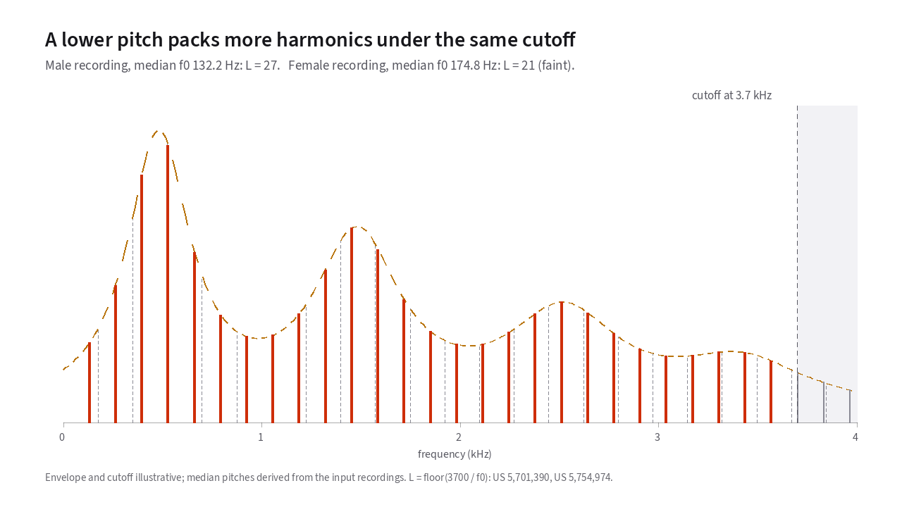

# What AMBE actually is

When you key the microphone on a digital voice radio, your voice does not
travel across the air as an audio wave. Digital radio protocols like D-STAR,
DMR, and System Fusion transmit a stream of digital bits.
{: .lede }

Standard telephone-quality digital audio requires 128,000 bits every
second.[^tel-rate] On a narrowband radio
channel, D-STAR gives the voice encoder only 2,400 bits per second. It adds
another 1,200 bits per second for error correction, for 3,600 bits per
second on the air
<span class="cite">JARL D-STAR system specification §1.1(3)</span>.
Each transmission is divided into 20-millisecond frames
<span class="cite">JARL D-STAR spec §2.1.2(2)</span>.
That leaves the vocoder chip with just 48 bits of speech data per frame.
Those six bytes of information represent a fiftieth of a second of human voice.

No general-purpose audio compression format can shrink a sound wave by a
factor of 53 without destroying it. Instead of sending the waveform, the
AMBE chip measures a simplified physical model of your voice fifty times a
second. It sends those measurements over the air, and the receiving radio
uses them to synthesize a voice from scratch.

To understand how AMBE works, let us look at the underlying vocal model.
This chapter covers what those measurements represent and why they were
chosen. It also shows how they solve the audio problems that challenged
earlier digital radios.

## How your voice makes sound

The human voice produces sound using two physical sources, shaped by the
geometry of the mouth and throat:

1. **Periodic buzz, or [voiced sound](18-glossary.md#voiced-and-unvoiced-speech).**
   When you say a [vowel](18-glossary.md#vowel) like "ah" or
   "ee", your vocal cords snap open and shut at a steady rhythm called the
   [fundamental frequency](18-glossary.md#fundamental-frequency-and-pitch-period).
   This rhythm is the voice's pitch, written <i>f</i><sub>0</sub>. This rapid
   pulsing of air creates a dense ladder of [harmonic](18-glossary.md#harmonic) overtones at exact integer multiples
   of your pitch. The ladder climbs in steps of <i>f</i><sub>0</sub>, from 2<i>f</i><sub>0</sub> to
   3<i>f</i><sub>0</sub> to 4<i>f</i><sub>0</sub> and on up.
2. **Turbulent noise, or [unvoiced sound](18-glossary.md#voiced-and-unvoiced-speech).**
   When you whisper or pronounce
   [consonants](18-glossary.md#consonant) like "s" or "sh", your vocal cords do not vibrate.
   Background road noise in a mobile rig belongs in this group too. Air
   rushes turbulently through narrow constrictions, producing random
   acoustic hiss.
3. **The [vocal tract](18-glossary.md#vocal-folds-and-vocal-tract) filter.** Either sound then travels through your throat,
   mouth, and lips. On the way, the shape of your vocal tract amplifies
   certain frequencies and dampens others. This filtering creates the
   [spectral envelope](18-glossary.md#spectral-envelope), the overall volume
   shape that allows a listener to tell vowels and words apart.

Early digital voice systems, such as the LPC vocoders used in 1970s
military radios, made a single all-or-nothing choice for every frame. They
declared the entire 20 milliseconds either completely voiced or completely
unvoiced. A voiced frame used a periodic impulse train, and an unvoiced
frame used random noise
<span class="cite">Griffin &amp; Lim 1988, §I</span>.

Competing sinusoidal coders described speech as a sum of sine waves at the
harmonics of the fundamental. That worked well for clean vowels. But noise
has no harmonics, so those coders had to spend four or five bits per
harmonic on phase just to make noisy segments sound like noise
<span class="cite">Griffin &amp; Lim 1988, §II</span>.

Both approaches struggled when a sound contained buzz and hiss at the same
instant. Griffin and Lim call the resulting distortion **buzziness**
<span class="cite">Griffin &amp; Lim 1988, §I</span>.
Real speech frequently mixes both sources. A voiced consonant like "z"
combines vocal cord vibration with teeth friction, and an operator talking
in a vehicle combines vocal pitch with wind and engine noise. When a
single-switch vocoder encounters mixed speech, it has to pick one source for
the whole spectrum. If it picks voiced, it replaces the high-frequency noise
with periodic buzz. That creates the artificial, mechanical "kazoo" sound
familiar from older vocoders.

The problem becomes much more noticeable in noisy conditions. Gold and
Tierney measured a contemporary 2,400 bit/s vocoder against uncoded speech.
In quiet conditions it lost 10.3
[Diagnostic Rhyme Test](18-glossary.md#intelligibility-and-the-diagnostic-rhyme-test) (DRT) intelligibility points.
In F15 aircraft noise it lost 18.7 points
<span class="cite">Griffin &amp; Lim 1988, §I, citing Gold &amp; Tierney</span>.
Human listeners rely on knowing which frequency regions are periodic voice
and which regions are background noise to separate a speaker from a noisy
environment. A single-decision vocoder erases that distinction.

## The multi-band idea

In 1988, Daniel Griffin and Jae Lim introduced a straightforward remedy.
Instead of making one voicing decision for the entire spectrum, their coder
divides the frequency range into multiple bands and makes an independent
binary voiced/unvoiced decision for each band
<span class="cite">Griffin &amp; Lim 1988, §II</span>.

Mathematically, the windowed speech frame <i>s</i><sub>w</sub>(<i>n</i>) = <i>w</i>(<i>n</i>) · <i>s</i>(<i>n</i>)
<span class="cite">Griffin &amp; Lim 1988, eq. 1</span>
is modeled in the frequency domain by multiplying a smooth **spectral
envelope** <i>H</i><sub>w</sub>(ω) by an **excitation spectrum** |<i>E</i><sub>w</sub>(ω)|:

```text
S_w(ω) = H_w(ω) · |E_w(ω)|
```

<span class="cite">Griffin &amp; Lim 1988, eq. 2</span>

Earlier mixed-excitation experiments used at most three bands. The
[Multi-Band Excitation (MBE)](18-glossary.md#multi-band-excitation-mbe-imbe-ambe-ambe2) model divides the spectrum into a much larger
number of bands, which gives fine control over which parts of the voice channel
buzz and which parts hiss
<span class="cite">Griffin &amp; Lim 1988, §II</span>.

In the full-rate AMBE system used on amateur radio, the 0 to 4 kHz voice
channel is divided into **eight 500 Hz bands**
<span class="cite">US 5,754,974</span>.
For every 20-millisecond frame, each 500 Hz band receives its own 1-bit
decision. Low bands can be generated from clean harmonic buzz while upper
bands are simultaneously generated from shaped noise.

<!-- slot: harmonics -->

Before looking at how the eight bands are assembled, use [**Figure 7.1**](#fig-7-1)
to see how pitch controls the harmonic comb. Drag the *Fundamental frequency*
slider from a deep voice at 60 Hz to a high voice at 400 Hz and watch how many
harmonic peaks fit under the codec's 3.7 kHz cutoff. The count is 27 at the
male recording's median pitch, 21 at the female's, and from 61 down to 9
across the full range. Press *3D* to stack the combs for every pitch from 60 to 400 Hz,
with a staircase on the right wall counting how many amplitudes (<i>L</i>) fit
below 3.7 kHz at each pitch:

<div id="fig-7-1" data-anim="harmonics" data-title="Harmonic comb spacing and pitch" data-caption="How many harmonics fit under the 3.7 kHz cutoff at each pitch, for a deep voice and a high one." markdown="1">
<figure class="anim-fallback" markdown="0">
  
  <figcaption>Harmonic comb spacing under the codec's 3.7 kHz cutoff.</figcaption>
</figure>
<ol class="anim-steps" markdown="1">
<li data-f0="120" data-view="2d" markdown="block">
Each spike is one harmonic of a 120 Hz voice. Every spike left of the
3.7 kHz cutoff is one amplitude the frame has to send.
</li>
<li data-view="3d" data-preset="corner" markdown="block">
Each row is one pitch, from 60 Hz at the back to 400 Hz at the front, and
the bright comb is the pitch on the slider. Toward the back, deeper voices
pack their harmonics closer together, so the staircase on the right wall
climbs as <i>L</i> grows.
</li>
<li data-view="2d" markdown="block">
Press *Male recording*, then *Female recording*. The deeper voice fits more
harmonics under the cutoff, so it has more amplitudes to send in the same
frame.
</li>
</ol>
</div>

<!-- end slot: harmonics -->

Once the pitch ω<sub>0</sub> and the band voicing flags are known, the
synthesizer builds the excitation spectrum band by band. It places segments
of a **periodic harmonic spectrum** |<i>P</i><sub>w</sub>(ω)| in the voiced bands and
segments of a **random noise spectrum** |<i>U</i><sub>w</sub>(ω)| in the unvoiced
bands
<span class="cite">Griffin &amp; Lim 1988, §II</span>.
Because the spacing of the periodic spectrum is determined entirely by the
pitch ω<sub>0</sub>, the harmonic positions cost no extra bits beyond the pitch
itself.

```text
PSEUDOCODE: assembling the model spectrum (NOT EXECUTABLE)

given  ω₀            the fundamental pitch frequency for this 20 ms frame
       v[1..K]       one binary voiced/unvoiced flag per frequency band
       A[1..L]       one spectral envelope amplitude per harmonic of ω₀

for each frequency ω in the audio passband:
    let b ← the band index containing ω
    if v[b] is voiced:
        excitation(ω) ← periodic harmonic spectrum at ω (from ω₀ alone)
    else:
        excitation(ω) ← random noise spectrum at ω, normalised across the band
    envelope(ω)  ← interpolate between the harmonic amplitudes A[·] near ω
    spectrum(ω)  ← envelope(ω) × excitation(ω)
```

In practical radio terms, a single bit per band lets the vocoder represent
mixed sounds without forcing the entire audio channel to buzz or hiss at
once. Those include a vowel with a breathy top end, a voiced consonant like
"z", and an operator's voice over vehicle noise.

<!-- slot: voicing -->

In [**Figure 7.2**](#fig-7-2), you can compare *One switch* against **Eight
bands**. *One switch* uses a single voicing switch for the whole frame. The
figure tries both on a vowel, a [fricative](18-glossary.md#fricative), and
a mixed frame from a hardware AMBE-3000 round trip. Press *Whole clip (3D)* to see the voicing strength of
all eight 500 Hz bands across the whole sentence, drawn as ridges cut by the
voicing threshold plane:

<div id="fig-7-2" data-anim="voicing" data-clips="lr-b,lr-c,lj-c" data-title="Single-switch and 8-band voicing on real speech" data-caption="One 20 ms frame of a vowel, a hiss or a mix, coded with one voicing switch or with eight." markdown="1">
<figure class="anim-fallback" markdown="0">
  
  <figcaption>Band voicing strengths over one sentence, derived from the
  decoded audio of a real AMBE-3000 round trip. Band strengths are an
  autocorrelation estimate computed from the decoded audio, not the codec's
  transmitted voicing bits. Stems use the f0 of the chip's decoded
  audio.</figcaption>
</figure>
<ol class="anim-steps" markdown="1">
<li data-pick="vowel" data-mode="one" data-one="voiced" data-model="on" data-measure="off" data-threshold="0.55" data-view="2d" markdown="block">
This frame comes from a vowel. With one switch set to *Voiced*, the model's
harmonic comb fits the spectrum.
</li>
<li data-pick="fricative" data-mode="one" data-one="unvoiced" data-model="on" data-measure="off" data-threshold="0.55" data-view="2d" markdown="block">
This frame comes from a hiss. With the switch on *Unvoiced*, the model fills
every band with noise, and that fits too.
</li>
<li data-pick="mixed" data-mode="one" data-one="voiced" data-model="on" data-measure="off" data-threshold="0.55" data-view="2d" markdown="block">
This frame repeats at the bottom and hisses at the top, so one switch can't
fit it. The tint marks each band the model gets wrong. Griffin and Lim call
what you hear in this case buzz <span class="cite">Griffin &amp; Lim 1988, §I</span>.
</li>
<li data-pick="mixed" data-mode="bands" data-choice="fit" data-model="on" data-measure="off" data-threshold="0.55" data-view="2d" markdown="block">
Now there are eight switches, one per 500 Hz band <span class="cite">US 5,754,974</span>.
Each band gets harmonics or noise on its own, and the tints are gone. That is
multi-band excitation <span class="cite">Griffin &amp; Lim 1988, §II</span>.
</li>
<li data-pick="mixed" data-mode="bands" data-choice="fit" data-model="on" data-measure="on" data-threshold="0.55" data-view="3d" markdown="block">
Here is the whole sentence. Each ridge is one band's voicing strength over
time. Above the plane the band gets harmonics, and below it the band gets
noise. These strengths
come from the chip's decoded audio, not the codec's transmitted voicing bits.
</li>
</ol>
</div>

<!-- end slot: voicing -->

## The parameters each frame sends

To represent the overall shape of the vocal tract filter, AMBE samples the
spectral envelope **once at each harmonic** of the fundamental, across
voiced and unvoiced bands alike. When the receiver needs a continuous curve,
it interpolates smoothly between those harmonic samples
<span class="cite">Griffin &amp; Lim 1988, §II</span>.

Every 20 milliseconds, the vocoder packages three groups of parameters:

| Parameter | What it describes | Count per 20 ms frame |
| --- | --- | --- |
| Fundamental frequency `ω₀` | Pitch of vocal cord vibration | 1 |
| Voiced/unvoiced decisions | One buzz/hiss bit per 500 Hz band | 8 in the AMBE-rate system |
| Spectral amplitudes `M_l` | Volume envelope sampled at each harmonic | `L` (from 9 to 60, depending on pitch) |

<span class="cite">US 5,754,974 (Griffin &amp; Hardwick, DVSI, filed 1995, issued 1998)</span>

Because harmonics of a low pitch sit closer together in frequency, the count
<i>L</i> changes from speaker to speaker and from syllable to syllable. The
patents state the count as <i>L</i> = ⌊ α · π / ω<sub>0</sub> ⌋,
where α = 0.925 sets the coded audio bandwidth to 3,700 Hz at an
8 kHz sample rate
<span class="cite">US 5,754,974; US 5,701,390</span>.
A deep voice produces more harmonic amplitudes to fit into the same 48-bit
frame than a high voice, which is why the bit-allocation logic in
[chapter 9](09-quantization.md) has to adapt on every frame.

The table leaves out **[phase](18-glossary.md#phase)**, a textbook property
of every sine wave. The 1988 research coder transmitted the phase of each voiced
harmonic, spending a large portion of its 160-bit frame budget to do so
<span class="cite">Griffin &amp; Lim 1988, §II and §V-A</span>.
Because the human ear is largely insensitive to relative phase within steady
speech, commercial descendants dropped phase transmission completely. The
receiving radio generates synthetic phase values locally, as covered on the
[synthesis page](11-synthesis.md).

## How multi-band excitation did in listening tests

Griffin and Lim tested their multi-band coder against an identical control
coder in which the 12 band switches were replaced by a single frame-wide
switch. That control coder is Single Band Excitation (SBE)
<span class="cite">Griffin &amp; Lim 1988, §V</span>.

Diagnostic Rhyme Test intelligibility scores, where 100 is perfect:

| Condition | Uncoded audio | 8 kbit/s Multi-Band (MBE) | 7.45 kbit/s Single-Band (SBE) |
| --- | --- | --- | --- |
| Clean speech | 97.8 | 96.2 | 96.0 |
| Speech in wideband noise | 63.1 | 58.0 | 46.0 |

<span class="cite">Griffin &amp; Lim 1988, Abstract and Tables III–IV</span>

In a quiet room, the two coders scored almost identically, at 96.2 and 96.0.
In wideband background noise, the single-switch coder dropped to 46.0. The
multi-band coder held at 58.0, within five points of uncoded speech. Spending just 550 extra bits per second on per-band voicing preserved
intelligibility when background noise entered the microphone
<span class="cite">Griffin &amp; Lim 1988, §V-B, Figs. 12–13</span>.

## Where AMBE sits in the radio family

All four generations of MBE vocoders use this same frequency-band model,
progressively compressing the parameter representation to fit narrower radio
channels:

- **MBE:** The original MIT research coder from 1988. It sampled at 10 kHz with
  a 50 Hz frame rate and used 12 voicing bands. Because it also transmitted
  harmonic phases, it needed 160 bits per frame, or 8.0 kbit/s
  <span class="cite">Griffin &amp; Lim 1988, §V-A</span>.
- **Improved Multiband Excitation (IMBE):** Dropped phase transmission and
  added dedicated error protection. It runs at 7.2 kbit/s, or 144 bits
  per 20 ms frame. Each frame holds 87 parameter bits plus 57
  error-correction and sync bits. IMBE became the standard vocoder for Phase 1
  of APCO Project 25, the public safety radio standard known as P25
  <span class="cite">US 5,630,011</span>.
- **Advanced Multiband Excitation (AMBE):** Reduced the rate to 3.6 kbit/s,
  or 72 bits per 20 ms frame. The patent gives an uncoded 3.6 kbit/s example.
  It divides the 72 bits into 7 bits for pitch, 8 bits for eight 500 Hz
  voicing bands, and 57 bits for the harmonic amplitudes
  <span class="cite">US 5,754,974</span>.
  D-STAR uses the protected member of this family. Every 20 ms it packs 48
  bits of voice parameters and 24 bits of
  [forward error correction](18-glossary.md#unequal-error-protection-uep-golay-and-hamming)
  into the same 72-bit frame. That is 2,400 bit/s of voice and 1,200 bit/s of
  error correction
  <span class="cite">JARL D-STAR spec §1.1(3), §2.1.2(2)</span>.
  How D-STAR divides its 48 voice bits among the parameters is not in the
  public record; [quantization](09-quantization.md) covers the coding
  methods, and [what is not established](13-what-is-not-established.md)
  documents the remaining unknowns.
- **AMBE+2:** The later half-rate generation used in DMR, Yaesu System
  Fusion, and NXDN. US 8,359,197 remains active until May 2028, as the
  [patents page](16-patents.md) explains.[^half-rate] This site
  focuses on full-rate AMBE and IMBE as used in D-STAR.

## What the model leaves out

AMBE does not model tongue position, jaw movement, or resonant cavities
directly the way a physical vocal-tract simulator does. It reduces each 20-millisecond
window of speech to three practical measurements: a fundamental pitch, eight
yes/no decisions on whether each 500 Hz band is buzz or hiss, and the volume
of each harmonic peak.

That leaves the practical engineering question. The chip gets 160 raw
microphone samples every 20 milliseconds. How does it accurately measure the
pitch, the band voicing, and the harmonic amplitudes from them? The chapter on
[analysis](08-analysis.md) answers that.

[^tel-rate]: That is 8,000 samples per second at 16 bits per sample.
[^half-rate]: The title of US 8,359,197 is "Half-rate vocoder". The patent
    office granted it in 2013.

---

**Next: [How the encoder measures pitch, voicing and amplitudes](08-analysis.md).** How 20 ms
of microphone audio becomes one pitch, eight flags, and a list of
amplitudes.
Back to [the start](index.md). If you would rather hear the result first,
[Listen](12-listen.md) plays eight sentences before and after a real
AMBE-3000 chip.
{: .chapter-nav }

Last reviewed: 2026-10-13.
{: .source-note }
