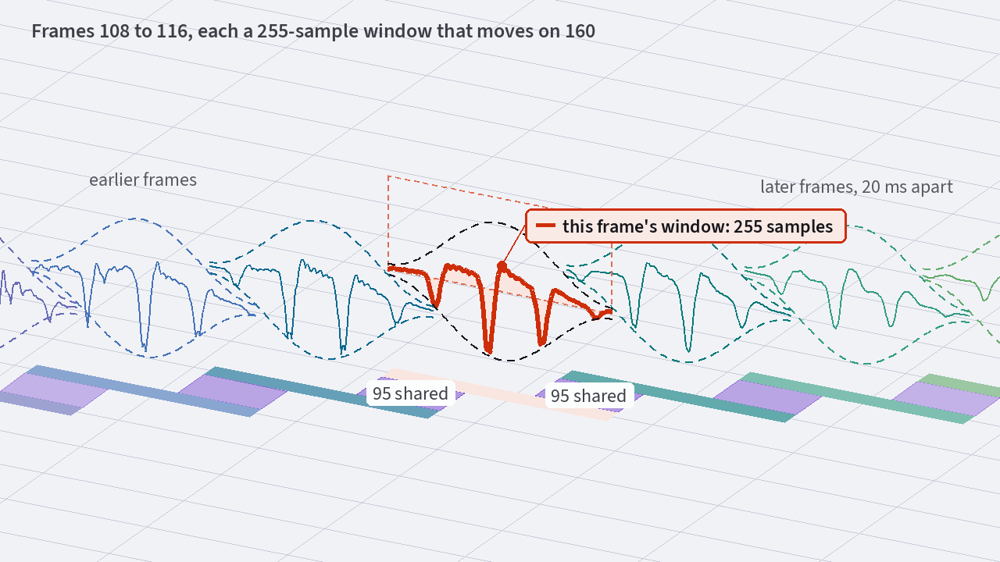
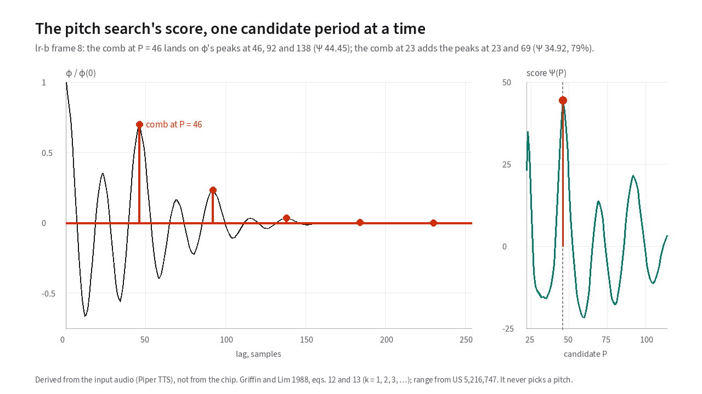

# How the encoder measures pitch, voicing and amplitudes

[Chapter 7](07-multi-band-excitation.md) showed what an AMBE frame carries over
the air. Each frame holds a fundamental pitch, a set of voiced/unvoiced band
flags, and a list of harmonic amplitudes. **Analysis** is the encoder's job of inspecting 20
milliseconds of microphone audio and measuring those three sets of numbers
fifty times every second.
{: .lede }

This half of the codec determines how intelligible the radio sounds. As Daniel
Griffin and Jae Lim noted in their 1988 paper, inaccurate pitch or voicing
estimates "often introduce very noticeable degradations in the synthesized
speech". They do so especially when background noise is present at the
microphone
Griffin &amp; Lim 1988, §I.

## Overlapping windows on 20 ms frames

At an 8,000 Hz sample rate, a 20-millisecond [frame](18-glossary.md#frame-and-analysis-window)
contains exactly 160 new audio samples. If the encoder only looked at those
160 samples in isolation, a low-pitched voice at 80 Hz would complete barely
one and a half cycles inside the block.[^80-hz] That is too short to separate
individual [harmonics](18-glossary.md#harmonic).

To get sharper frequency resolution without slowing down the 50 Hz frame rate,
the AMBE encoder uses a **255-sample symmetric Hamming [window](18-glossary.md#window-function-hann-and-hamming)**[^window-width]
padded to a 256-point FFT, and slides that window
forward by 160 samples on every frame
US 5,701,390.

<!-- slot: frames -->

Because each 255-sample window advances by only 160 samples, the encoder
analyzes **95 of every 160 samples twice**, once in the current frame and once
in the next.
In [**Figure 8.1**](#fig-8-1), you can scrub through a spoken sentence and
toggle *Windows* to see how the 255-sample Hamming window reaches 47 samples
into the previous frame and 48 samples into the next frame. Press *3D* to pull
consecutive frames apart from front to back, with the shaded 95-sample overlap
strips on the floor between neighboring windows:

<figure class="anim-fallback" markdown="0">
  
  <figcaption>Each 20 ms frame advances 160 samples while its 255-sample
  Hamming window shares 95 samples with the next frame
  US 5,701,390.</figcaption>
</figure>
<ol class="anim-steps" markdown="1">
<li data-pick="mixed" data-windows="on" data-preset="corner" data-view="2d" markdown="block">
This frame holds 160 samples, 20 ms of speech. The dashed curve is the
analysis window, which reaches into the frames on either side
US 5,701,390. Where the chip places it is not
public, so this placement is illustrative.
</li>
<li data-pick="mixed" data-windows="off" data-preset="front" data-view="2d" markdown="block">
With the windows off, the frames tile the signal end to end, with no gap and
no overlap.
</li>
<li data-pick="mixed" data-windows="on" data-preset="front" data-view="2d" markdown="block">
With the windows back on, the shading marks the 95 samples each window shares
with the next.
</li>
<li data-pick="mixed" data-windows="on" data-view="3d" data-preset="corner" data-replay="slide" markdown="block">
Here the figure pulls the windows apart in depth, one row per frame. The
strips on the floor are the samples that neighboring windows share.
</li>
<li data-pick="mixed" data-windows="on" data-preset="front" data-view="2d" markdown="block">
*Periods in window* shows that about four pitch periods fit in one window at
this pitch, enough to tell the harmonics apart
Griffin &amp; Lim 1988, §II. On a hiss there is no
period to count.
</li>
</ol>

<!-- end slot: frames -->

## Analysis by synthesis: testing candidate spectra

Traditional vocoders measure pitch, voicing, and spectral shape with separate
heuristics that have nothing to do with each other. Multi-Band Excitation uses [analysis-by-synthesis](18-glossary.md#analysis-by-synthesis).
For every candidate pitch and voicing pattern, the encoder computes the
spectrum that the *receiver's synthesizer* would produce, and compares it
directly against the microphone's windowed spectrum <i>S</i>w(ω):

<!-- math: \varepsilon = \frac{1}{2\pi} \int \left( |S_w(\omega)| - |\hat{S}_w(\omega)| \right)^2 \,d\omega -->

<math xmlns="http://www.w3.org/1998/Math/MathML" display="block"><semantics><mrow><mi>ε</mi><mo>=</mo><mfrac><mn>1</mn><mrow><mn>2</mn><mi>π</mi></mrow></mfrac><mo>∫</mo><msup><mrow><mo fence="true">(</mo><mi mathvariant="normal">∣</mi><msub><mi>S</mi><mi>w</mi></msub><mo stretchy="false">(</mo><mi>ω</mi><mo stretchy="false">)</mo><mi mathvariant="normal">∣</mi><mo>−</mo><mi mathvariant="normal">∣</mi><msub><mover accent="true"><mi>S</mi><mo>^</mo></mover><mi>w</mi></msub><mo stretchy="false">(</mo><mi>ω</mi><mo stretchy="false">)</mo><mi mathvariant="normal">∣</mi><mo fence="true">)</mo></mrow><mn>2</mn></msup><mtext> </mtext><mi>d</mi><mi>ω</mi></mrow><annotation encoding="application/x-tex">\varepsilon = \frac{1}{2\pi} \int \left( |S_w(\omega)| - |\hat{S}_w(\omega)| \right)^2 \,d\omega</annotation></semantics></math>ε=2π1​∫(∣Sw​(ω)∣−∣S^w​(ω)∣)2dω

<!-- end math -->

Griffin &amp; Lim 1988, eq. 3

Minimizing that error across pitch, voicing, and dozens of harmonic amplitudes
simultaneously would take far too much computation if done by brute force.
Griffin and Lim simplified the search by noticing that **once you pick a
candidate pitch period, the best harmonic amplitudes have an exact closed-form
formula**. For each harmonic interval [<i>a</i>m, <i>b</i>m] centered on <i>m</i>ω0, the
amplitude |<i>A</i>m| that minimizes the squared spectral error is the
correlation of the measured spectrum against the window's main lobe <i>E</i>w(ω):

<!-- math: |A_m| = \frac{\int |S_w(\omega)| \cdot |E_w(\omega)| \,d\omega}{\int |E_w(\omega)|^2 \,d\omega} -->

<math xmlns="http://www.w3.org/1998/Math/MathML" display="block"><semantics><mrow><mi mathvariant="normal">∣</mi><msub><mi>A</mi><mi>m</mi></msub><mi mathvariant="normal">∣</mi><mo>=</mo><mfrac><mrow><mo>∫</mo><mi mathvariant="normal">∣</mi><msub><mi>S</mi><mi>w</mi></msub><mo stretchy="false">(</mo><mi>ω</mi><mo stretchy="false">)</mo><mi mathvariant="normal">∣</mi><mo>⋅</mo><mi mathvariant="normal">∣</mi><msub><mi>E</mi><mi>w</mi></msub><mo stretchy="false">(</mo><mi>ω</mi><mo stretchy="false">)</mo><mi mathvariant="normal">∣</mi><mtext> </mtext><mi>d</mi><mi>ω</mi></mrow><mrow><mo>∫</mo><mi mathvariant="normal">∣</mi><msub><mi>E</mi><mi>w</mi></msub><mo stretchy="false">(</mo><mi>ω</mi><mo stretchy="false">)</mo><msup><mi mathvariant="normal">∣</mi><mn>2</mn></msup><mtext> </mtext><mi>d</mi><mi>ω</mi></mrow></mfrac></mrow><annotation encoding="application/x-tex">|A_m| = \frac{\int |S_w(\omega)| \cdot |E_w(\omega)| \,d\omega}{\int |E_w(\omega)|^2 \,d\omega}</annotation></semantics></math>∣Am​∣=∫∣Ew​(ω)∣2dω∫∣Sw​(ω)∣⋅∣Ew​(ω)∣dω​

<!-- end math -->

Griffin &amp; Lim 1988, eq. 7

That closed-form amplitude reduces the entire multi-dimensional fitting problem
to a **one-dimensional search over candidate pitch periods**.

## Finding the pitch period without octave errors

Instead of looking for a single peak in the [autocorrelation](18-glossary.md#autocorrelation) curve, MBE scores
each candidate pitch period <i>P</i> by summing the autocorrelation φ at
**all whole-number multiples** of <i>P</i>. Those multiples are <i>P</i>,
2<i>P</i>, 3<i>P</i> and so on:

<!-- math: \Psi(P) = P \sum_{k \in \mathbb{Z}} \varphi(kP) -->

<math xmlns="http://www.w3.org/1998/Math/MathML" display="block"><semantics><mrow><mi mathvariant="normal">Ψ</mi><mo stretchy="false">(</mo><mi>P</mi><mo stretchy="false">)</mo><mo>=</mo><mi>P</mi><munder><mo>∑</mo><mrow><mi>k</mi><mo>∈</mo><mi mathvariant="double-struck">Z</mi></mrow></munder><mi>φ</mi><mo stretchy="false">(</mo><mi>k</mi><mi>P</mi><mo stretchy="false">)</mo></mrow><annotation encoding="application/x-tex">\Psi(P) = P \sum_{k \in \mathbb{Z}} \varphi(kP)</annotation></semantics></math>Ψ(P)=Pk∈Z∑​φ(kP)

<!-- end math -->

Griffin &amp; Lim 1988, eqs. 11-13

Summing across all multiples of <i>P</i> rewards a candidate period that explains
the entire repeating pulse train, and includes an unbiased normalization factor
(1 − <i>P</i> Σ <i>w</i>4(<i>n</i>)) so closely spaced combs do not artificially win on random
noise Griffin &amp; Lim 1988, eq. 10.

### Guarding against the double-period (sub-harmonic) trap

Even when you sum across all multiples of <i>P</i>, one ambiguity remains.
Suppose a speaker's true pitch period is 46 samples, or 174 Hz. A candidate
period twice as long is 2<i>P</i> = 92 samples, or 87 Hz. Every second tooth
of its comb lands right on top of the true peaks at 46, 92, and 138 samples. Left
unchecked, a 92-sample estimate drops the decoded voice by a full octave
mid-word.

To prevent octave drops, the encoder checks the sub-multiples of the
highest-scoring period <i>P</i>'. Those are <i>P</i>'/2, <i>P</i>'/3 and
<i>P</i>'/4. The encoder then selects the **shortest period** whose score sits
within a tight threshold of the maximum
Griffin &amp; Lim 1988, §III-A; US 5,216,747.

<!-- slot: pitch-search -->

In [**Figure 8.2**](#fig-8-2), slide the candidate period <i>P</i> from 22 to
114 samples to see how the comb teeth line up with the autocorrelation peaks
at <i>P</i> = 46 samples. You'll also see why <i>P</i> = 23, half the period,
scores lower and how sub-multiple checking avoids the double-period trap at
<i>P</i> = 92.
Press *3D* to stand every candidate comb side by side. Press *Whole clip* to
follow the winning pitch ridge across the spoken clip. The dashed lines there
mark the ± 20% frame-to-frame look-back corridor that dynamic programming
pitch tracking uses US 5,216,747:

<figure class="anim-fallback" markdown="0">
  
  <figcaption>Autocorrelation comb and cumulative pitch score across candidate
  periods from 22 to 114 samples
  Griffin &amp; Lim 1988; US 5,216,747.</figcaption>
</figure>
<ol class="anim-steps" markdown="1">
<li data-mode="frame" data-source="frame" data-cand="46" data-view="2d" data-preset="front" markdown="block">
The white curve is the autocorrelation of 32 ms of the vowel in "CQ"
Griffin &amp; Lim 1988, eq. 13. The comb at 46
samples lands on its tallest peaks at 46, 92 and 138. The score on the right
adds them up.
</li>
<li data-mode="frame" data-source="frame" data-cand="23" data-view="2d" data-preset="side" markdown="block">
The score is highest at 46, with a second hump at 23, half the period. Its
comb hits every peak that 46 does, plus the ones in between. That's why the
encoder checks <i>P</i>′/2, <i>P</i>′/3 and <i>P</i>′/4 to avoid coming out an
octave too high US 5,216,747.
</li>
<li data-mode="frame" data-source="alternate" data-cand="92" data-view="2d" data-preset="front" markdown="block">
This made-up voice repeats every 46 samples, but every second pulse has a
different shape, as in a creaky voice. The score now peaks at 92, so the
encoder keeps the shortest period whose score comes close
Griffin &amp; Lim 1988, §III-A.
</li>
<li data-mode="frame" data-source="fraction" data-cand="45.6" data-view="2d" data-preset="front" markdown="block">
This made-up voice repeats every 45.6 samples. Set <i>P</i> to 46 and the
teeth drift off the peaks, so the encoder refines the search below whole
samples US 5,216,747.
</li>
<li data-mode="clip" data-pick="corridor-exit" data-view="2d" data-preset="corner" markdown="block">
Here is the whole clip, one row per frame, with time running up. The white
line is the pitch period from the site's own tracker, not the codec's, and the
dashed lines are the 20% corridor around it. At the red arrow the period jumps
outside the corridor, so the look-back rule would fail there.
</li>
</ol>

<!-- end slot: pitch-search -->

### Sub-sample pitch refinement

Because high-frequency harmonics multiply any pitch error by the harmonic index
<i>l</i>, integer-sample pitch resolution is only the first
stage.[^pitch-error] After finding the coarse integer period and checking
sub-multiples, the encoder interpolates between samples down to quarter-sample or eighth-sample accuracy
Griffin &amp; Lim 1988, §III-A; US 5,216,747.

## Voicing decisions: reading the fit residual in each band

Once the encoder has locked in the refined pitch ω0 and harmonic amplitudes
|<i>A</i>m|, it gets its per-band [voiced/unvoiced decisions](18-glossary.md#voiced-and-unvoiced-speech)
directly from the fitting error ε<i>m</i> around each harmonic:

<!-- math: \xi_m = \frac{\varepsilon_m}{\frac{1}{2\pi} \int |S_w(\omega)|^2 \,d\omega} -->

<math xmlns="http://www.w3.org/1998/Math/MathML" display="block"><semantics><mrow><msub><mi>ξ</mi><mi>m</mi></msub><mo>=</mo><mfrac><msub><mi>ε</mi><mi>m</mi></msub><mrow><mfrac><mn>1</mn><mrow><mn>2</mn><mi>π</mi></mrow></mfrac><mo>∫</mo><mi mathvariant="normal">∣</mi><msub><mi>S</mi><mi>w</mi></msub><mo stretchy="false">(</mo><mi>ω</mi><mo stretchy="false">)</mo><msup><mi mathvariant="normal">∣</mi><mn>2</mn></msup><mtext> </mtext><mi>d</mi><mi>ω</mi></mrow></mfrac></mrow><annotation encoding="application/x-tex">\xi_m = \frac{\varepsilon_m}{\frac{1}{2\pi} \int |S_w(\omega)|^2 \,d\omega}</annotation></semantics></math>ξm​=2π1​∫∣Sw​(ω)∣2dωεm​​

<!-- end math -->

Griffin &amp; Lim 1988, eq. 14

- **When ξ<i>m</i> is small and near 0:** The spectrum around
  harmonic <i>m</i> looks like a clean harmonic peak shaped by the analysis
  window. That harmonic is periodic, which makes it **voiced**.
- **When ξ<i>m</i> is large and above the threshold:**[^threshold]
  The energy in that interval is spread out rather than concentrated in a
  harmonic spike. The region is turbulent air noise, which makes it
  **unvoiced**.

To save bits on the radio channel, the encoder groups the harmonics into 8
frequency bands, roughly 500 Hz each across the 0 to 4 kHz passband. Inside
each band <i>k</i>, it combines the normalized errors into an amplitude-weighted
average so loud harmonics govern the band's decision
Griffin &amp; Lim 1988, eq. 18; US 5,754,974:

<!-- math: E_k = \frac{\sum_{m} |A_m| \, \xi_m}{\sum_{m} |A_m|} \qquad \text{for harmonics } m \text{ in band } k -->

<math xmlns="http://www.w3.org/1998/Math/MathML" display="block"><semantics><mrow><msub><mi>E</mi><mi>k</mi></msub><mo>=</mo><mfrac><mrow><munder><mo>∑</mo><mi>m</mi></munder><mi mathvariant="normal">∣</mi><msub><mi>A</mi><mi>m</mi></msub><mi mathvariant="normal">∣</mi><mtext> </mtext><msub><mi>ξ</mi><mi>m</mi></msub></mrow><mrow><munder><mo>∑</mo><mi>m</mi></munder><mi mathvariant="normal">∣</mi><msub><mi>A</mi><mi>m</mi></msub><mi mathvariant="normal">∣</mi></mrow></mfrac><mspace width="2em"/><mtext>for harmonics </mtext><mi>m</mi><mtext> in band </mtext><mi>k</mi></mrow><annotation encoding="application/x-tex">E_k = \frac{\sum_{m} |A_m| \, \xi_m}{\sum_{m} |A_m|} \qquad \text{for harmonics } m \text{ in band } k</annotation></semantics></math>Ek​=∑m​∣Am​∣∑m​∣Am​∣ξm​​for harmonics m in band k

<!-- end math -->

Later DVSI patents make the voicing threshold adaptive to background noise and
combine frequency-domain harmonic concentration with a time-domain sinusoid
check before comparing against the threshold
US 5,216,747; US 5,826,222.

## Compensated harmonic amplitudes

In the original 1988 MBE coder, voiced harmonics and unvoiced bands used
slightly different amplitude formulas, which could cause small loudness steps
whenever a frequency band flipped between voiced and unvoiced. The AMBE-era
patents replace that dual formula with a single **compensated total energy**
measurement in every harmonic bin, regardless of whether the band is marked
voiced or unvoiced US 5,754,974; US 5,701,390.

At the end of every 20 ms analysis cycle, the encoder hands three things to
the quantizer:

1. **One refined pitch period**, which sets the harmonic count <i>L</i>. The
   count runs from roughly 9 to 56 harmonics below 3,700 Hz.
2. **Eight voiced/unvoiced band flags**, one bit per 500 Hz band.
3. **<i>L</i> harmonic magnitudes**, which describe the
   [spectral envelope](18-glossary.md#spectral-envelope). The encoder discards
   all raw phase.

Packing that variable-length list of measurements into a fixed 48-bit voice
payload is the job of [quantization](09-quantization.md).

[^80-hz]: At 80 Hz, one pitch period lasts 100 samples.
[^window-width]: The 255-sample window is 31.875 milliseconds wide.
[^pitch-error]: A 0.5-sample error on the fundamental becomes a 10-sample
    error at the 20th harmonic.
[^threshold]: The threshold is typically around 0.2.

---

**Next: [Turning measurements into bits](09-quantization.md).**
How prediction, the Discrete Cosine Transform, and vector quantization pack
up to 56 harmonic amplitudes into a handful of bits per frame.
Back to [What AMBE actually is](07-multi-band-excitation.md), or to
[the start](index.md).
{: .chapter-nav }

Last reviewed: 2026-10-13.
{: .source-note }
