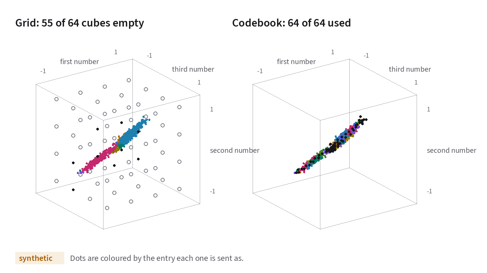
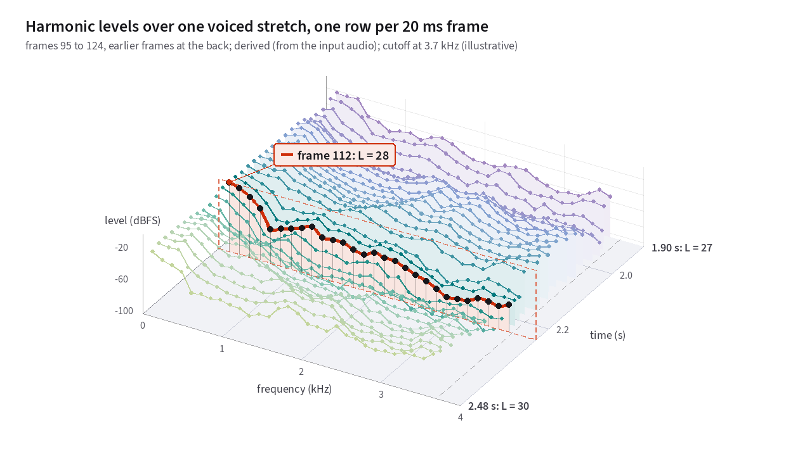
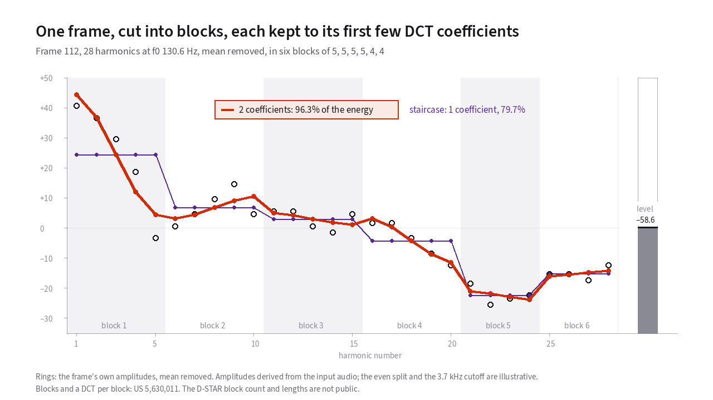

# Turning measurements into bits

[Chapter 8](08-analysis.md) ended with a set of continuous measurements for
each 20-millisecond frame of speech: a refined pitch period, eight
voiced/unvoiced band flags, and between 9 and 56 harmonic amplitudes. All of
those measurements are floating-point numbers. A D-STAR radio channel gives the
vocoder just **72 bits per frame**.[^split]
{: .lede }

**Quantization** is the process of packing those continuous measurements into
fixed-width binary integers while keeping the rounding error where the human
ear is least likely to notice it.

## How a 72-bit frame budget is divided

In US 5,754,974, DVSI gives a baseline example of how a 3.6 kbit/s MBE coder
divides 72 bits across a 20 ms frame when all 72 bits carry voice parameters:

> *"In the 3.6 kbps system 72 bits are used to quantize the model parameters
> for each 20 ms frame. Seven (7) bits are used to quantize the fundamental
> frequency, and 8 bits are used to code the V/UV decisions in 8 different
> frequency bands... The remaining 57 bits per frame are used to quantize the
> spectral magnitudes for each frame."*[^974]

In D-STAR (see [Chapter 10](10-the-dstar-frame.md)), 24 of those 72 bits are
reserved for forward error correction, leaving 48 voice bits per frame. Even
with the smaller payload, the structural hierarchy stays identical:

1. **A compact field for pitch** (see [fundamental frequency](18-glossary.md#fundamental-frequency-and-pitch-period)).
2. **A few bits for band [voicing](18-glossary.md#voiced-and-unvoiced-speech).**
3. **Every remaining bit for the [spectral envelope](18-glossary.md#spectral-envelope).**

## Scalar quantization: non-uniform steps that match human hearing

The simplest way to turn a continuous measurement into a binary integer is
**scalar quantization**. You lay out 2<i>n</i> fixed levels along a number line, find
the level closest to your measurement, and transmit its <i>n</i>-bit index.

Because human perception of pitch and loudness is logarithmic rather than
linear, uniform spacing in hertz or linear voltage wastes bits:

- **Pitch is quantized uniformly in period, counted in
  [samples](18-glossary.md#sample-and-sample-rate), not frequency.** In
  US 5,630,011, the pitch period <i>P</i> is quantized with half-sample steps[^011].
  At 8,000 samples per second, a half-sample step corresponds to about 0.6 Hz
  on a deep 100 Hz voice and 5.7 Hz on a higher 300 Hz voice,[^step-share]
  matching the ear's proportional pitch sensitivity.
- **Harmonic amplitudes are quantized in decibels.**[^log2] Equal
  quantizer steps produce equal decibel changes at both quiet and loud
  levels[^974].
- **Frame gain uses a dedicated 6-bit non-uniform quantizer.** Overall frame
  loudness travels in its own field so a single bit error cannot permanently
  shift the volume of subsequent frames[^405].

## Vector quantization: coding correlated harmonics together

Scalar quantization rounds each harmonic amplitude on its own, as if neighboring
harmonics were independent. In human speech, adjacent harmonics sit under the
same vocal-tract [formant](18-glossary.md#formant) resonance, so they rise and
fall together.

[Vector quantization (VQ)](18-glossary.md#vector-quantization-vq-and-codebooks)
takes advantage of that correlation. Instead of rounding two or three harmonic
amplitudes separately on a square grid, the encoder compares the group of
numbers against a pre-trained **codebook** of candidate shapes and transmits
the single index of the closest codebook entry.

<!-- slot: vq-space -->

In [**Figure 9.1**](#fig-9-1), you can see why a codebook beats a scalar grid whenever
neighboring harmonics move together. Switch between the scalar *Grid* and
the vector *Codebook*, and adjust the correlation with *Stretch*. You can also
switch the data source to *Speech* to plot harmonics 4, 5, and 6 across real
spoken [vowels](18-glossary.md#vowel):

<figure class="anim-fallback" markdown="0">
  
  <figcaption>Comparing a scalar grid against a trained vector codebook on
  correlated harmonic amplitudes.</figcaption>
</figure>
<ol class="anim-steps" markdown="1">
<li data-dims="auto" data-method="none" data-bits="4" data-rho="0.5" data-probe="on" data-view="2d" markdown="block">
Each dot is a pair of numbers that tend to move together, like the levels
of two neighboring harmonics.
</li>
<li data-dims="2" data-method="grid" data-bits="4" data-rho="0.5" data-probe="on" data-view="2d" markdown="block">
Give each number 2 bits and you get a grid of 16 cells. The hatched cells
hold no dots, so their codes are never sent.
</li>
<li data-dims="2" data-method="grid" data-bits="4" data-rho="0.9" data-probe="on" data-view="2d" markdown="block">
Now the two numbers move together more closely. The dots thin to a band,
and more cells go empty.
</li>
<li data-dims="2" data-method="codebook" data-bits="4" data-rho="0.9" data-probe="on" data-view="2d" markdown="block">
Spend the same bits on a codebook of 16 entries instead. Press *One Lloyd
step* a few times and watch the entries move into the band.
</li>
<li data-dims="3" data-method="grid" data-bits="6" data-rho="0.9" data-probe="on" data-view="3d" markdown="block">
Add a third number. In 3D the dots crowd onto a thin tilted band, and most
of the grid's 64 cubes stay empty. Drag sideways to turn the cube.
</li>
<li data-dims="3" data-data="speech" data-method="grid" data-bits="6" data-rho="0.9" data-probe="on" data-view="3d" markdown="block">
These dots are real speech. They plot harmonics 4, 5 and 6 of every voiced
frame in the input clips. Turn the cube and they lie along a narrow rod, which is
where a codebook puts its entries.
</li>
</ol>

<!-- end slot: vq-space -->

Look at what happens in 3D on the real speech harmonics. Harmonics 4, 5, and
6 rise and fall together. That's why all the voiced frames cluster inside a
narrow diagonal rod. A 6-bit scalar grid spends 2 bits on each of the three
axes and leaves 36 of its 64 cubes completely empty. That wastes more than half
its codes on spectral shapes a human [vocal tract](18-glossary.md#vocal-folds-and-vocal-tract) never produces. A 64-entry vector codebook places
all 64 entries directly inside the populated rod.

## Coding the spectral envelope in three stages

Even with vector quantization, the encoder cannot look up all <i>L</i>
harmonic amplitudes in one giant codebook, because the number of harmonics
<i>L</i> = ⌊ 3700 / <i>f</i>0 ⌋ changes every time the speaker's pitch moves. It runs
from roughly 9 harmonics on a high voice to 52 harmonics on a deep voice.[^974]

To compress a variable-length list of harmonic amplitudes into a fixed bit
budget, AMBE uses a three-stage hierarchy. US 5,630,011, US 5,754,974, and
US 5,870,405 describe its stages between them.

<!-- slot: envelope -->

First, look at the raw harmonic amplitudes the encoder has to send. In
[**Figure 9.2**](#fig-9-2), each dot is the decibel level of one harmonic in
a 20 ms vowel frame. Drag the *Round to grid* slider to see how much error
plain rounding adds. Then step on to compare the frame with the ones before
and after it. The 3D view stacks 30 consecutive 20 ms frames of the vowel in
depth.

<figure class="anim-fallback" markdown="0">
  
  <figcaption>Harmonic amplitudes of a 20 ms vowel frame below 3.7 kHz.</figcaption>
</figure>
<ol class="anim-steps" markdown="1">
<li data-pick="voiced-stretch" data-round="0" data-spectrum="on" data-neighbours="off" data-view="2d" markdown="block">
Each dot is the level of one harmonic, read off the input spectrum (the
faint line) at a multiple of the pitch. The line through the dots is the
envelope the encoder has to send.
</li>
<li data-pick="voiced-stretch" data-round="6" data-spectrum="on" data-neighbours="off" data-view="2d" markdown="block">
Here the figure rounds every level to a 6 dB grid, and the amber stems
show how far each dot moved. Drag the slider to a coarser grid and watch the error
grow.
</li>
<li data-pick="voiced-stretch" data-round="0" data-spectrum="off" data-neighbours="on" data-view="3d" data-preset="corner" markdown="block">
In 3D each row is one 20 ms frame, with earlier frames at the back.
Neighboring rows have nearly the same shape, which the first stage below
uses.
</li>
<li data-pick="voiced-stretch" data-at="first" data-round="0" data-spectrum="off" data-neighbours="on" data-view="3d" data-preset="corner" markdown="block">
At the start of the stretch, 27 harmonics fit below 3.7 kHz. A tick marks
where each row's harmonics end.
</li>
<li data-pick="voiced-stretch" data-at="last" data-round="0" data-spectrum="off" data-neighbours="on" data-view="3d" data-preset="top" markdown="block">
By the end the pitch has dropped and 30 harmonics fit, so the rows end
raggedly. The encoder can't subtract one frame's list from the next number
by number, which the second stage below deals with.
</li>
</ol>

<!-- end slot: envelope -->

Two physical properties stand out in [**Figure 9.2**](#fig-9-2), and they drive the three
stages of AMBE's envelope coder.

### Stage 1: Predict the current frame from the previous frame

Because your tongue and jaw move slowly relative to a 20-millisecond frame,
each frame's spectrum looks almost identical to the frame 20 milliseconds
earlier.[^frame-diff] Instead of sending the full harmonic amplitudes from
scratch every 20 ms, the encoder predicts the current frame from the previous
frame and transmits only the change since the last frame. That change is the
**prediction residual**.[^011]

To prevent a single corrupted radio frame from poisoning every future frame,
the prediction is multiplied by a leaky decay factor γ ≈ 0.7
(0 ≤ γ ≤ 1) so any channel error fades out geometrically over a few
frames[^011].

### Stage 2: Resample the previous envelope to match the new harmonic count <i>L</i>

As the speaker's pitch glides across [**Figure 9.2**](#fig-9-2), the number of harmonics
fitting below 3,700 Hz shifts from 27 to 30. You cannot subtract a 27-element
list from a 30-element list index by index.

Before subtracting, the encoder maps each current harmonic frequency onto its
fractional position in the previous frame's spectrum and linearly interpolates
between the two nearest previous harmonics[^011]. It also subtracts the frame's
mean log amplitude so overall volume travels separately in the gain field.

### Stage 3: Split the residual into blocks and run a DCT

Finally, the <i>L</i> residual amplitudes are partitioned into a fixed number of
frequency blocks,[^six-blocks] and each block is
transformed with a [Discrete Cosine Transform (DCT)](18-glossary.md#prediction-residual-block-average-prba-and-dct)[^011]:

- **Block averages (PRBA):** The first DCT coefficient[^dc] of each of
  the 6 blocks is pulled out to form a 6-element vector called the **Prediction
  Residual Block Average (PRBA)**, which captures the overall spectral tilt and
  coarse formant movement across the 6 bands[^011][^405].
- **Higher-order coefficients (HOC):** The remaining DCT coefficients inside
  each block capture fine ripple within that band and are quantized more
  coarsely as bits allow.

<!-- slot: envelope-blocks -->

In [**Figure 9.3**](#fig-9-3), you can see this hierarchy in action on a 28-harmonic vowel
frame split into 6 blocks. Drag *Coefficients kept per block* down from all
coefficients to 1, which leaves only the PRBA staircase, and watch fine ripple disappear
first while the overall level bar and 6-band spectral shape remain intact:

<figure class="anim-fallback" markdown="0">
  
  <figcaption>Reconstructing a 28-harmonic vowel envelope from 1 to all DCT
  coefficients per block across six frequency blocks
  US 5,630,011; US 5,870,405.</figcaption>
</figure>
<ol class="anim-steps" markdown="1">
<li data-k="max" data-preset="oblique" data-view="2d" markdown="block">
Each ring is one harmonic's level, with the frame's mean taken off. The
mean is the bar at the right, and it travels on its own as the gain.
</li>
<li data-k="max" data-preset="front" data-view="2d" markdown="block">
The shading cuts the harmonics into six blocks, as in the patent's
example.[^011] D-STAR's own block sizes are not public.
</li>
<li data-k="1" data-preset="front" data-view="2d" markdown="block">
Keep only each block's average and the line becomes a staircase. That
staircase is the tilt of the spectrum. These averages make up the PRBA vector,[^011] and the
level bar doesn't move.
</li>
<li data-k="2" data-preset="oblique" data-view="3d" markdown="block">
In 3D the front slice keeps every coefficient, and each slice behind it
keeps one fewer. The fine ripple goes first, while the level and tilt stay.
</li>
</ol>

<!-- end slot: envelope-blocks -->

## Why the pitch index controls the entire bit layout

Because the harmonic count <i>L</i> = ⌊ 3700 / <i>f</i>0 ⌋ determines how many
numbers sit inside each of the 6 frequency blocks, both the encoder and the
decoder compute the bit-allocation table dynamically from the received pitch
index before unpacking the rest of the frame.

That design saves every bit that would otherwise be spent transmitting header
lengths, at one major cost. **If a radio bit error corrupts the pitch bits, the
decoder computes the wrong harmonic count <i>L</i> and misreads the boundaries of
every remaining field in the frame**. Preventing that failure is why the
channel coder in [Chapter 10](10-the-dstar-frame.md) wraps its strongest error
correction around the pitch and coarse envelope bits.

---

## Sources for this chapter

[^011]: **US 5,630,011.** *Quantization of harmonic amplitudes representing
    speech*. Source for inter-frame prediction, the decay factor γ ≈ 0.7,
    resampling across changing harmonic counts <i>L</i>, mean removal, block
    partitioning, DCT, and the Prediction Residual Block Average (PRBA).
    <https://patents.google.com/patent/US5630011A/en>

[^974]: **US 5,754,974.** *Spectral magnitude representation for multi-band
    excitation speech coders*. Source for the 20 ms / 72-bit frame at 3.6 kbps,
    the 8 voicing bands across 0-4 kHz, <i>L</i> = ⌊ απ/ω0 ⌋
    with α = 0.925 (3,700 Hz bandwidth), and differential block DCT of
    log spectral magnitudes.
    <https://patents.google.com/patent/US5754974A/en>

[^405]: **US 5,870,405.** *Digital transmission of acoustic signals over a
    noisy communication channel*. Source for the 6-bit non-uniform gain
    quantizer, the 6-point DCT of the block-average vector, and step sizes
    dependent on <i>L</i>.
    <https://patents.google.com/patent/US5870405A/en>

[^split]: Of those 72 bits, 48 carry the voice payload and 24 carry
    [forward error correction](18-glossary.md#forward-error-correction).

[^step-share]: A step of 0.6 Hz is 0.6% of a 100 Hz pitch, and a step of
    5.7 Hz is 1.9% of a 300 Hz pitch.

[^log2]: The value the encoder quantizes is the log2 of each
    harmonic's magnitude.

[^frame-diff]: Across a vowel, neighboring frames differ by a median of only
    4 dB.

[^six-blocks]: The patent's primary example uses 6 blocks.

[^dc]: The first DCT coefficient of a block is its DC average.

---

**Next: [The D-STAR frame on the air](10-the-dstar-frame.md).**
How the radio prioritizes the 48 quantized voice bits and protects them with
Golay and Hamming error correction. Then how it scrambles them by the pitch
index and transmits them over RF.
Back to [How the encoder measures pitch, voicing and amplitudes](08-analysis.md), or to
[the start](index.md).
{: .chapter-nav }

Last reviewed: 2026-10-13.
{: .source-note }
