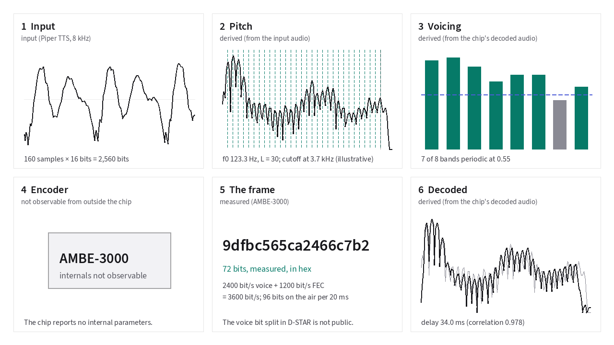
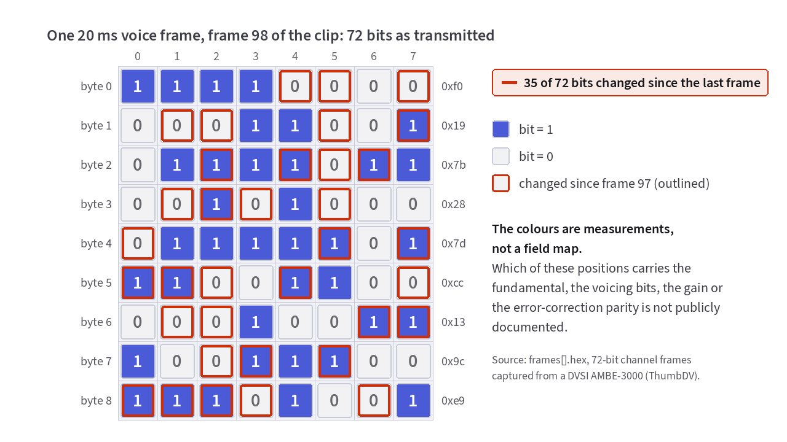
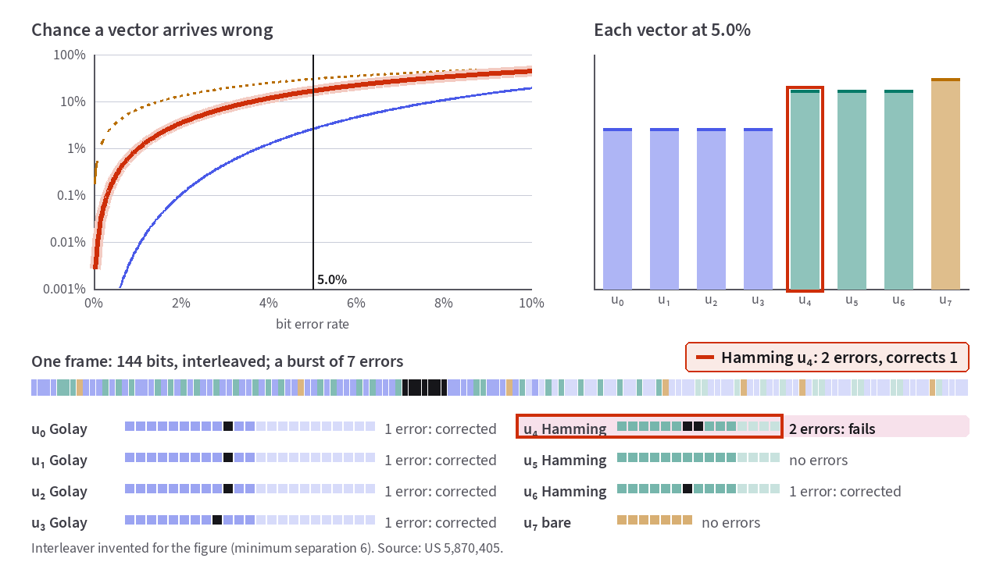

# The D-STAR frame on the air

[Chapter 9](09-quantization.md) ended with a set of quantized integer indices
ordered by how much perceptual damage a bit error in each field would cause.
This chapter follows those bits onto the radio channel: how they are wrapped in
[unequal error protection](18-glossary.md#unequal-error-protection-uep-golay-and-hamming),
interleaved with a slow-speed data slot, and transmitted on a 4,800 bit/s
[GMSK](18-glossary.md#gmsk-and-4fsk) carrier over a mobile VHF or UHF path.
{: .lede }

The primary references for this chapter are the JARL D-STAR system
specification[^jarl] and DVSI's channel-coding patent US 5,870,405[^405].

Before getting to the error-correcting codes, step through
[**Figure 10.1**](#fig-10-1) to follow one 20-millisecond [vowel](18-glossary.md#vowel)
frame on its whole round trip. It starts as 160 input samples entering the
AMBE-3000 chip and becomes 72 channel bits on the wire. The receiver turns
those bits back into audio. Press *Play the walk-through* to watch the steps run
on their own.

<!-- slot: frame-path -->

<div id="fig-10-1" data-anim="frame-path" data-clips="lr-b,lj-b" data-caption="One 20 ms frame of speech followed through a real AMBE-3000, from audio to bits and back." markdown="1">
<figure class="anim-fallback" markdown="0">
  
  <figcaption>One 20 ms frame from a real AMBE-3000 round trip.</figcaption>
</figure>
<ol class="anim-steps" markdown="1">
<li data-stage="1" data-pick="default" data-clip="lr-b" data-view="3d" markdown="block">
Here are 20 ms of microphone audio. That's 160 samples, or 2,560 bits. The
radio has 72 bits for them. In 3D this frame is the thick, outlined slice, with
its neighbors in front and behind.
</li>
<li data-stage="2" data-pick="default" data-clip="lr-b" data-view="2d" markdown="block">
The encoder finds the pitch and lays a comb of harmonics over the
spectrum. The teeth below 3,700 Hz set <i>L</i>, the number of amplitudes
to send.
</li>
<li data-stage="3" data-pick="default" data-clip="lr-b" data-view="2d" markdown="block">
In each of eight bands, the encoder decides whether the band holds voiced
sound or noise.
</li>
<li data-stage="4" data-pick="default" data-clip="lr-b" data-view="2d" markdown="block">
Inside the chip, the encoder quantizes pitch, voicing and amplitudes and
wraps them in error correction. The chip doesn't report any of this, so the box
stays closed.
</li>
<li data-stage="5" data-pick="default" data-clip="lr-b" data-view="3d" markdown="block">
Out come 72 bits. That's 48 of voice and 24 of error correction, 3,600
bit/s in all.[^jarl] In 3D the next frames' rows line up behind this one, 20 ms
apart.
</li>
<li data-stage="6" data-pick="default" data-clip="lr-b" data-view="2d" markdown="block">
The receiving radio decodes the bits. Compare the decoded spectrum with
the input's, drawn underneath.
</li>
<li data-stage="2" data-pick="default" data-clip="lj-b" data-view="2d" markdown="block">
The female voice has a higher pitch, so the comb's teeth spread out and
fewer harmonics fit. The frame is still 72 bits, so each harmonic gets
more of them (see [Chapter 9](09-quantization.md)).
</li>
<li data-stage="7" data-pick="default" data-clip="lr-b" data-view="2d" markdown="block">
On the air, each frame's 72 bits are followed by 24 bits of data. Every
21st data slot carries a sync pattern, so 21 frames make one 420 ms
superframe.[^jarl]
</li>
</ol>
</div>

<!-- end slot: frame-path -->

## The three bit rates of a D-STAR signal

The JARL D-STAR specification defines the digital voice channel in four lines:

> **(1) Modulation methods**: GMSK, QPSK, 4FSK
> **(2) Data rate**: Maximum of 4.8 Kbps
> **(3) Voice encoding method**: AMBE (2020) converting at 2.4 Kbps, FEC at
> 3.6 Kbps
> **(4) Occupied bandwidth**: Maximum of 6 KHz[^jarl]

Every 20-millisecond [frame](18-glossary.md#frame-and-analysis-window) on the
air carries 96 bits total, divided into three distinct allocations that are
easy to confuse because two of them happen to equal 1,200 bit/s:

| Allocation | Bits per 20 ms frame | Bit rate | Purpose |
| :--- | :--- | :--- | :--- |
| **Voice payload** | 48 bits | 2,400 bit/s | Quantized pitch, voicing flags, and spectral envelope |
| **Voice FEC** | 24 bits | 1,200 bit/s | Golay/Hamming parity protecting the most sensitive voice bits |
| **Slow-speed data** | 24 bits | 1,200 bit/s | Callsigns, GPS APRS text, and the 21-frame sync word |
| **Total on the air** | **96 bits** | **4,800 bit/s** | Complete GMSK RF bit stream |

After the initial radio header, the on-air stream alternates between 72 voice
bits and 24 data bits every 20 milliseconds for the duration of the
transmission:

```text
... [ 72 bits voice (48 payload + 24 FEC) ][ 24 bits data ] ...
     \___________________ 96 bits, 20 ms _________________/
```

## Inspecting the 72 voice bits on the wire

[**Figure 10.2**](#fig-10-2) displays the 72 channel bits that a hardware DVSI
AMBE-3000 chip emits for each 20-millisecond frame of a spoken sentence. That's
9 bytes per frame. The figure outlines every bit that flipped since the
previous frame. Step through the frames and watch where the changes fall:

<!-- slot: bits -->

<div id="fig-10-2" data-anim="bits" data-title="The 72 captured channel bits of a 20 ms voice frame" data-caption="The 72 bits the chip sent for each frame. Even in a steady vowel, the changes spread across all 9 bytes." markdown="1">
<figure class="anim-fallback" markdown="0">
  
  <figcaption>The 72 channel bits produced by an AMBE-3000 chip for one 20 ms
  frame, with the bits that changed since the previous frame outlined.</figcaption>
</figure>
<ol class="anim-steps" markdown="1">
<li data-mode="value" data-view="3d" markdown="block">
This grid is one 20 ms frame as the chip sent it. It holds 72 bits in nine
bytes.
Press the ▶ *Next frame* button a few times and look for a byte that stays put.
</li>
<li data-mode="value" data-view="3d" markdown="block">
None does. The outlined cells are the bits that changed since the last
frame, and they turn up in every byte.
</li>
<li data-mode="rate" data-view="3d" markdown="block">
Now each cell is colored by how often it changes over the clip. No
position stays still, so the colors don't show which bits carry which
field.[^405]
</li>
</ol>
</div>

<!-- end slot: bits -->

If the 72 bits were laid out in plain unscrambled fields, the pitch byte would
stay nearly frozen across a steady vowel. Instead, between 14 and 48 of the 72
bits flip on every single frame transition, and no bit position changes less
than 13% of the time. Two mechanisms in US 5,870,405 explain why. They
are **priority-seeded scrambling** and **intra-frame bit interleaving**.

## Unequal error protection: Golay, Hamming, and unprotected bits

Twenty-four bits of [forward error correction](18-glossary.md#forward-error-correction) cannot protect all 48 voice bits
equally, and trying to protect every bit equally would waste parity on fine
spectral details that the ear barely notices.

Instead, AMBE sorts the quantized voice bits into numbered priority vectors,
starting at <i>u</i><sub>0</sub>. It orders them by how severely a bit error in
each vector would degrade the decoded voice[^405]:

- **Highest priority (<i>u</i><sub>0</sub>):** Holds the 6 most significant bits of the
  [fundamental frequency](18-glossary.md#fundamental-frequency-and-pitch-period)
  and the 3 most significant bits of the [PRBA](18-glossary.md#prediction-residual-block-average-prba-and-dct)
  spectral mean[^011]. If these bits are corrupted, the decoder computes the
  wrong harmonic count <i>L</i> and unpacks the entire frame at the wrong bit
  boundaries.
- **High priority (<i>u</i><sub>0</sub> … <i>u</i><sub>3</sub>):** Protected by [23, 12] **Golay codes**.
  Half-rate systems use shortened [23, 12] / [24, 12] Golay codes. Each Golay
  code adds 11 parity bits to 12 payload bits and corrects up to **3 bit
  errors** per codeword[^405].
- **Medium priority (<i>u</i><sub>4</sub> … <i>u</i><sub>6</sub>):** Protected by [15, 11] **Hamming
  codes**, which add 4 parity bits to 11 payload bits and correct **1 bit
  error** per codeword[^405].
- **Lowest priority (<i>u</i><sub>7</sub>):** Fine higher-order spectral detail bits are
  transmitted **unprotected** with 0 parity bits, because an occasional 1-bit
  error in a high-order DCT coefficient is virtually inaudible[^405].

| Vector group (IMBE 7.2 kbps example in US 5,870,405) | Payload bits | Error-correcting code | Transmitted bits | Errors corrected |
| :--- | :--- | :--- | :--- | :--- |
| **<i>u</i><sub>0</sub> … <i>u</i><sub>3</sub>** | 4 × 12 = 48 | Golay (23, 12) | 4 × 23 = 92 | Up to 3 errors per word |
| **<i>u</i><sub>4</sub> … <i>u</i><sub>6</sub>** | 3 × 11 = 33 | Hamming (15, 11) | 3 × 15 = 45 | 1 error per word |
| **<i>u</i><sub>7</sub>** | 7 | Unprotected | 7 | 0 errors |
| **Total** | **88 bits** | | **144 bits** | |

<!-- slot: fec-protection -->

D-STAR's 3.6 kbit/s half-rate AMBE frame scales the same architecture down to
48 payload bits and 24 FEC bits totaling 72 voice bits per 20 ms frame[^jarl].

<!-- end slot: fec-protection -->

## How pitch-seeded scrambling detects uncorrectable fades

A [23, 12] Golay code can correct up to 3 bit errors inside its 23-bit
block. However, if a deep multipath fade flips **4 or more bits** inside <i>u</i><sub>0</sub>,
the Golay decoder silently snaps to the *wrong* valid codeword and reports only
3 corrections. If the synthesizer trusted that corrupted <i>u</i><sub>0</sub>, it would emit a
loud, jarring blast of wrong-pitch audio.

US 5,870,405 prevents silent <i>u</i><sub>0</sub> failures with a clever self-checking lock:

1. **At the transmitter:** After encoding <i>u</i><sub>0</sub>, the encoder interprets the
   12-bit integer <i>u</i><sub>0</sub> ∈ [0, 4095] as the seed for a linear congruential
   pseudo-random number generator (PRNG). It then XORs each lower-priority
   codeword from <i>u</i><sub>1</sub> onward with that pseudo-random bit
   sequence[^405].
2. **At the receiver:** The decoder corrects <i>u</i><sub>0</sub>'s Golay codeword *first*,
   uses the recovered 12-bit <i>u</i><sub>0</sub> to generate the same pseudo-random key, and
   XORs the remaining codewords to descramble them before running their Golay
   and Hamming decoders.
3. **What happens when <i>u</i><sub>0</sub> fails:** If 4 or more bit errors corrupt <i>u</i><sub>0</sub>,
   the decoder generates the *wrong* descrambling key, which scrambles every
   other codeword in the frame into random bits with a 50% bit error rate[^405].
   Every downstream Golay and Hamming decoder immediately reports maximum bit
   corrections!

By monitoring the total number of bit errors corrected across the frame, the
decoder immediately spots when <i>u</i><sub>0</sub> was corrupted. Instead of playing
garbage, it discards the damaged frame and repeats the previous valid 20 ms
frame. This is called **frame repeat**. If several frames fail in a row, it
mutes the audio, which is called **frame mute**.[^405]

### Intra-frame bit interleaving

On a mobile VHF/UHF channel, fades often wipe out 4 to 6 consecutive bits in a
row. If all 23 bits of a Golay codeword were transmitted consecutively, a 6-bit
burst would destroy that single codeword. Instead, the encoder **interleaves**
the bits of the codewords across the frame so that any two bits belonging to
the same codeword sit at least 6 bit positions apart[^405]. A 6-bit burst
error is spread out to at most 1 bit error per codeword, which the Golay and
Hamming codes correct effortlessly.

<!-- slot: fec-protection -->

In [**Figure 10.3**](#fig-10-3), you can test both mechanisms directly. Drag
the channel bit error rate (BER), or set off a burst of errors across the
frame. Toggle *Interleave* to see a 6-bit burst spread across separate
codewords, and watch a 4-error hit on <i>u</i><sub>0</sub> trip the
frame-repeat error meter:

<div data-anim="fec-protection" id="fig-10-3" data-title="Golay and Hamming error correction with bit interleaving" data-caption="Golay and Hamming codes, with interleaving, protecting the most important bits against errors." markdown="1">
<figure class="anim-fallback" markdown="0">
  
  <figcaption>Golay (23,12) and Hamming (15,11) unequal error protection and
  6-bit interleaving across a frame
  <span class="cite">US 5,870,405</span>.</figcaption>
</figure>
<ol class="anim-steps" markdown="1">
<li data-code="none" data-interleave="off" data-burst="7" data-start="57" data-ber="5" data-view="3d" markdown="block">
With no error correction, each curve is the chance that a vector arrives
with a wrong bit. Below, a burst of 7 errors lands in <i>u</i><sub>4</sub>
and <i>u</i><sub>5</sub>, and the receiver can't tell.
</li>
<li data-code="patent" data-interleave="on" data-burst="7" data-start="57" data-ber="5" data-view="3d" markdown="block">
Now the patent's codes protect <i>u</i><sub>0</sub> to <i>u</i><sub>6</sub>.[^405]
The interleaver spreads the burst so most codewords take one error and fix
it, but <i>u</i><sub>4</sub> takes two and fails.
</li>
<li data-code="patent" data-interleave="off" data-burst="4" data-start="0" data-ber="5" data-view="3d" markdown="block">
Four errors in <i>u</i><sub>0</sub> are one more than its Golay code can
fix, so the rest of the frame decodes as noise. The meter counts the
decoder's corrections against the threshold for repeating the frame.
</li>
<li data-code="patent" data-interleave="off" data-burst="6" data-start="98" data-ber="5" data-view="3d" markdown="block">
Sent one after another, the codewords let a 6-bit burst break
<i>u</i><sub>4</sub>. Tick **Interleave** and the six errors land in six
codewords, one each, and the decoder fixes them all.
</li>
</ol>
</div>

<!-- end slot: fec-protection -->

## The 24-bit slow-speed data slot and the 420 ms superframe

<!-- slot: frame-path -->

Every 72-bit voice frame is followed by 24 bits of slow-speed data at 1,200
bit/s. In that slot a D-STAR transceiver can transmit your callsign, GPS
position, and short text messages simultaneously with your voice. It doesn't
borrow a single bit from the vocoder to do it[^jarl].

<!-- end slot: frame-path -->

Every **21st data slot** (once every 21 × 20 ms = 420 ms)
replaces user data with a fixed, unscrambled 24-bit synchronization
pattern.[^sync-pattern][^jarl] That repeating 420 ms heartbeat allows a
receiver that tunes in mid-conversation to lock onto the 96-bit frame
boundaries within less than half a second, even if it missed the initial radio
header. This is called **late entry**.

## Radio header protection and transmission end

When you press PTT to start a transmission, the radio sends a routing header.
The header holds the repeater and operator callsigns plus a 16-bit CRC-CCITT
checksum. The radio protects it with a rate-1/2, constraint-length-3
convolutional code (<i>G</i><sub>1</sub>(<i>D</i>) = 1 + <i>D</i> + <i>D</i>², <i>G</i><sub>2</sub>(<i>D</i>) = 1 + <i>D</i>²) and a 24-row block
interleaver. Together they double the header bit count, which is 100%
redundancy.[^jarl] When you release
PTT, the radio appends a fixed 48-bit unscrambled termination sequence so
repeaters and receivers drop squelch cleanly without a burst of static[^jarl].

---

## Sources for this chapter

[^jarl]: **JARL D-STAR system specification** (English translation). Source for
    4.8 kbps GMSK channel rate, 2.4 kbps AMBE voice rate, 3.6 kbps voice+FEC
    rate, 72-bit voice slot + 24-bit data slot per 20 ms frame, 21-frame
    (420 ms) sync superframe, rate-1/2 convolutional header coding, and 48-bit
    termination sequence. <https://www.jarl.com/d-star/shogen.pdf>

[^405]: **US 5,870,405.** *Digital transmission of acoustic signals over a
    noisy communication channel*. Source for priority vectors <i>u</i><sub>0</sub> … <i>u</i><sub>7</sub>,
    [23, 12] Golay and [15, 11] Hamming unequal error protection, <i>u</i><sub>0</sub>-seeded
    PRNG scrambling, error counting for frame repeat and frame mute, and 6-bit
    intra-frame interleaving. <https://patents.google.com/patent/US5870405A/en>

[^011]: **US 5,630,011.** *Quantization of harmonic amplitudes representing
    speech*. Source for placing the 6 MSBs of fundamental frequency and 3 MSBs
    of the PRBA mean in the highest-priority Golay-protected vector.
    <https://patents.google.com/patent/US5630011A/en>

[^sync-pattern]: The sync pattern is a 10-bit sync plus two 7-bit
    maximal-length `1101000` sequences.

---

**Next: [Synthesis: rebuilding the voice](11-synthesis.md).**
How the receiving radio rebuilds continuous speech from a pitch, eight voicing
flags, and a list of harmonic amplitudes without receiving a single phase bit.
Back to [Turning measurements into bits](09-quantization.md), or to
[the start](index.md).
{: .chapter-nav }

Last reviewed: 2026-10-13.
{: .source-note }
