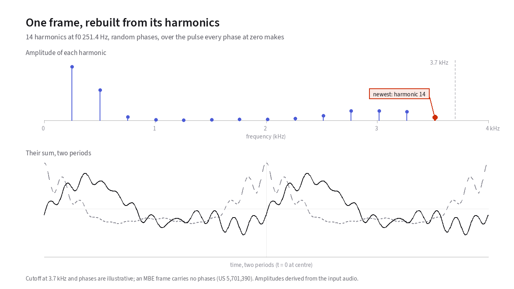
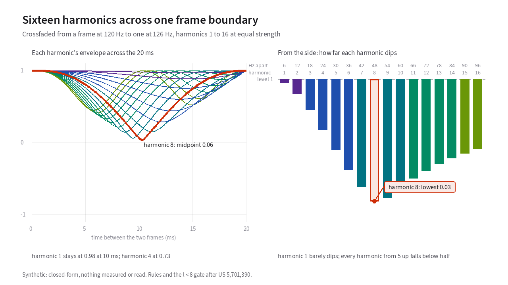
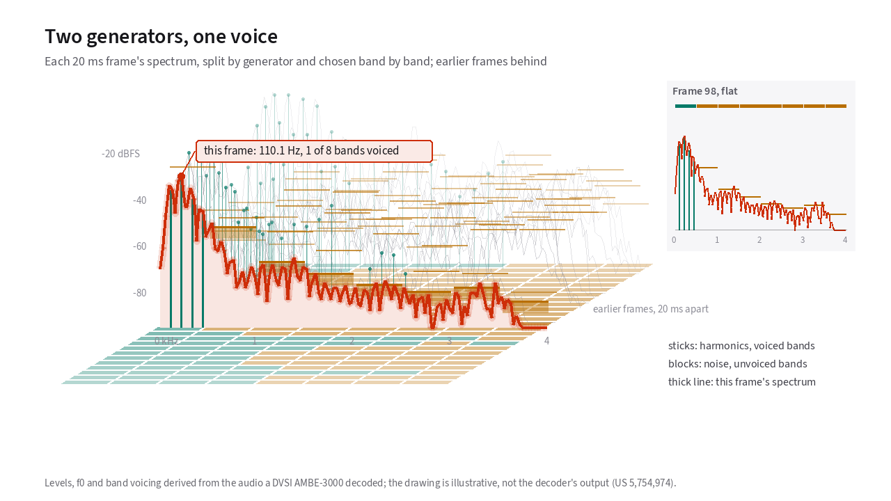

# Synthesis: rebuilding the voice

The receiving radio never receives a speech waveform. Every 20 milliseconds,
its AMBE decoder unpacks three compact ingredients from the channel bits.
They are a [fundamental frequency](18-glossary.md#fundamental-frequency-and-pitch-period)
ω<sub>0</sub>, a set of per-band [voiced/unvoiced flags](18-glossary.md#voiced-and-unvoiced-speech),
and a list of <i>L</i> harmonic amplitudes
<span class="cite">US 5,701,390; US 5,754,974</span>.
From that list of numbers, the synthesizer must manufacture 160 continuous
audio samples per frame, including the one parameter that was completely
discarded at the transmitter: [phase](18-glossary.md#phase).
{: .lede }

## Combining two synthesizers in every frame

Because Multi-Band Excitation allows some frequency bands to be periodic while
other bands in the exact same 20 ms frame are noisy, the receiver runs two
independent synthesizers in parallel and adds their outputs sample by sample:

```text
    s(n)  =  s_voiced(n)  +  s_unvoiced(n)
```

- **The voiced synthesizer** runs in the time domain as a bank of sinusoidal
  oscillators, one oscillator for each harmonic in a voiced band.
- **The unvoiced synthesizer** runs in the frequency domain by shaping white
  noise to match the transmitted amplitudes in the unvoiced bands and silencing
  the voiced bands <span class="cite">Griffin &amp; Lim 1988; US 5,754,974</span>.

### The voiced oscillator bank

For every harmonic <i>l</i> that falls inside a voiced band, the decoder runs a
dedicated cosine oscillator whose amplitude <i>A</i><sub>l</sub>(<i>n</i>) and instantaneous phase
θ<sub><i>l</i></sub>(<i>n</i>) evolve smoothly across the 160 samples of the frame:

```text
    s_voiced(n)  =  SUM over voiced harmonics l of  A_l(n) * cos( theta_l(n) )
```

<span class="cite">Griffin &amp; Lim 1988; US 5,701,390</span>

On a typical adult voice at 120 Hz, roughly 30 harmonics fit below 3,700 Hz, so
the voiced synthesizer is summing 30 sine waves simultaneously. The received
frame tells each oscillator its target amplitude <i>A</i><sub>l</sub>, but says nothing about
what starting phase θ<sub><i>l</i></sub> to use.

<!-- slot: harmonic-sum -->

In [**Figure 11.1**](#fig-11-1), you can see how the choice of starting phase changes the
time-domain waveform of a single [vowel](18-glossary.md#vowel) frame without changing a single
harmonic amplitude in its spectrum. Step through it, or press *Play*:

<div id="fig-11-1" data-anim="harmonic-sum" data-clips="lj-b,lr-a,lr-d" data-title="Summing voiced harmonics" data-caption="A vowel frame rebuilt from its harmonics. Changing their starting phases changes the wave’s shape but not its spectrum." markdown="1">
<figure class="anim-fallback" markdown="0">
  
  <figcaption>One 20 ms vowel frame rebuilt from its harmonic amplitudes under
  zero, random, and scaled phase <span class="cite">US 5,701,390</span>.</figcaption>
</figure>
<ol class="anim-steps" markdown="1">
<li data-n="1" data-phase="zero" data-view="3d" data-preset="corner" markdown="block">
The frame gives the decoder a pitch and one amplitude per harmonic, and
no phases <span class="cite">US 5,701,390</span>. Each ribbon is one
harmonic, and the sum in front adds them up. With one harmonic, the sum
is a plain cosine.
</li>
<li data-n="all" data-phase="zero" data-view="3d" data-preset="corner" markdown="block">
Now every harmonic, each starting at phase zero. Their crests line up
into one sharp pulse per pitch period.
</li>
<li data-n="all" data-phase="random" data-view="3d" data-preset="corner" markdown="block">
Give each harmonic a random starting phase. The ribbons slide along in
time, the crests stop lining up, and the pulse flattens out.
</li>
<li data-n="all" data-phase="random" data-view="2d" data-preset="side" markdown="block">
The stems on top are the harmonic amplitudes, and they haven't moved. The
phases change the shape of the wave but not its spectrum.
</li>
</ol>
</div>

<!-- end slot: harmonic-sum -->

### Shaped noise for unvoiced bands

Unvoiced bands carry the hiss of "s", "sh", and "f". Breathiness in the high
frequencies falls in unvoiced bands too. These bands have no harmonics to
assign to oscillators. Instead, the decoder builds their sound from noise in
six steps <span class="cite">US 5,754,974</span>.

1. It generates a windowed block of white noise.
2. It transforms the block with an FFT.
3. It zeroes out every frequency bin owned by a voiced band.
4. It scales the bins in each unvoiced band to match the transmitted spectral
   magnitudes.
5. It runs an inverse FFT.
6. It overlap-adds the result with the previous frame.

Before synthesis, most MBE decoders also run a **formant enhancement** pass
that slightly boosts the spectral peaks and deepens the valleys between them
while preserving total frame energy, counteracting the slight muffling caused
by coarse codebook quantization <span class="cite">US 5,247,579</span>.

## Regenerating phase without transmitting phase bits

Why does the encoder throw away all measured phases? US 5,701,390 states the
reason directly:

> "At low to medium data rates there are not sufficient bits to transmit any
> phase information between the encoder and the decoder."
> <span class="cite">US 5,701,390</span>

Sending even 4 bits of phase for each of 30 harmonics would consume 120 bits
per frame, which is more than the entire 72-bit D-STAR frame! Because the
decoder receives zero phase bits, it must invent a starting phase for every
voiced harmonic on every frame. The two extreme choices both sound unnatural:

- **All phases locked to zero:** Every harmonic peaks at the exact same instant
  once per pitch period, creating a razor-sharp spike with a high peak-to-RMS
  ratio that sounds buzzy and mechanical.
- **All phases completely random:** The crests scatter across the pitch period,
  flattening the glottal pulse and making the voice sound distant and
  reverberant.

<!-- slot: harmonic-sum -->

### Generation 1: Coherent phase plus voicing-scaled jitter

In DVSI's earlier patent US 5,081,681, each harmonic's phase is carried
forward coherently from the previous frame by integrating the fundamental
frequency, plus a controlled amount of random phase jitter <i>r</i><sub>k</sub>(<i>t</i>) = α(<i>t</i>) <i>u</i><sub>k</sub>(<i>t</i>)
scaled by the fraction α(<i>t</i>) of harmonics that are unvoiced
<span class="cite">US 5,081,681</span>. Fully voiced vowels stay coherent and
punchy, while partially unvoiced transitions receive natural dispersion.

Switch [**Figure 11.1**](#fig-11-1) to 3D to see each harmonic as its own ribbon
behind their sum. Then switch *Phase* between *Zero*, *Random*, and *Scaled*
to watch the ribbons slide in time. The ribbons' heights are the spectral
amplitudes, and they stay fixed.

<!-- end slot: harmonic-sum -->

### Generation 2: Deriving phase from the spectral amplitudes

In a physical resonant tube like the human [vocal tract](18-glossary.md#vocal-folds-and-vocal-tract), magnitude and phase are
not independent. Wherever the spectral envelope climbs steeply into a
[formant](18-glossary.md#formant) resonance, the acoustic filter's phase shifts
predictably.

US 5,701,390 uses that physical relationship to regenerate phase directly from
the log spectral magnitudes <i>B</i><sub>l</sub> = log<sub>2</sub>(<i>M</i><sub>l</sub>) that the decoder already
received, by convolving them with an odd-tap antisymmetric differentiator
kernel <i>h</i>(<i>m</i>) across neighboring harmonics:

```text
    B_l    =  log2( M_l )                      compressed magnitudes
    phi_l  =  SUM over m of  h(m) * B_(l+m)    regenerated phase
```

<span class="cite">US 5,701,390, Eqs. 7-9</span>

That calculation costs zero transmitted bits and restores realistic glottal
pulse concentration at the receiver, measured as the peak-to-RMS ratio. It
also explains why comparing an AMBE-decoded WAV file sample-by-sample against
the input WAV file on an oscilloscope is misleading. The decoder intentionally generates a
synthetic phase trajectory that sounds right to the ear rather than matching
the original microphone phase.

## Stitching 50 frames per second without clicks

Every 20 milliseconds, a new frame arrives with an updated pitch ω<sub>0</sub> and
updated harmonic amplitudes. If the synthesizer abruptly switched oscillators
at the frame boundary, the listener would hear a harsh 50 Hz buzz of phase and
amplitude discontinuities.

Instead, the decoder pairs each harmonic <i>l</i> in the current frame with harmonic
<i>l</i> in the previous frame and applies one of five transition rules
<span class="cite">US 5,701,390</span>:

| Previous frame to current frame | How the synthesizer bridges the 20 ms boundary |
| :--- | :--- |
| **Unvoiced to unvoiced** | The FFT noise synthesizer overlap-adds both frames smoothly. |
| **Voiced to unvoiced** | The old sinusoidal oscillator ramps down to zero while shaped noise ramps up. |
| **Unvoiced to voiced** | A new sinusoidal oscillator ramps up from zero while shaped noise ramps down. |
| **Voiced to voiced (<i>l</i> < 8 and Δω<sub>0</sub> < 10%)** | A single continuous oscillator sweeps smoothly in frequency and amplitude. |
| **Voiced to voiced (<i>l</i> ≥ 8 or Δω<sub>0</sub> ≥ 10%)** | The old oscillator fades out at the old frequency while a new oscillator fades in at the new frequency (overlap-add crossfade). |

<!-- slot: frame-boundary -->

Why does the patent use a single swept oscillator only for the lowest harmonics
(<i>l</i> < 8) when the pitch changes by less than 10%, and crossfade all higher
harmonics?

<!-- end slot: frame-boundary -->

<!-- slot: frame-boundary -->

> "A final synthesis rule is used if the *l*'th spectral amplitude is voiced
> for both the current and the previous frame, and if both `l < 8` and
> `|ω₀(0) − ω₀(−S)| < .1 ω₀(0)`."
> <span class="cite">US 5,701,390</span>

[**Figure 11.2**](#fig-11-2) compares *Crossfade*, *Switch*, and the *Patent's
rule* across a 20-millisecond transition where the pitch rises 5%
from 120 Hz to 126 Hz. Step through the rules in turn:

<div id="fig-11-2" data-anim="frame-boundary" data-title="Crossing the 20 ms frame boundary" data-caption="Three ways to carry each harmonic from one frame to the next across a 20 ms boundary." markdown="1">
<figure class="anim-fallback" markdown="0">
  
  <figcaption>Comparing crossfading, hard switching, and the US 5,701,390
  hybrid rule across a 20 ms frame boundary.</figcaption>
</figure>
<ol class="anim-steps" markdown="1">
<li data-scheme="crossfade" data-change="5" data-view="2d" data-preset="side" markdown="block">
In a crossfade, the old oscillator fades out while the new one fades in.
Where the two drift out of step they cancel, and harmonic 8 (thick) falls
almost to zero at 10&nbsp;ms.
</li>
<li data-scheme="switch" data-change="5" data-view="2d" data-preset="front" markdown="block">
Switching outright at 10&nbsp;ms keeps every envelope at 1, but each
waveform (thin) jumps there. A jump at every frame boundary repeats 50
times a second.
</li>
<li data-scheme="rule" data-change="5" data-view="3d" data-preset="oblique" markdown="block">
The patent's rule sweeps one oscillator for each harmonic below 8, so every
lane in front of the gate plane stays flat. From harmonic 8 up, the
crossfade stays.
</li>
<li data-scheme="rule" data-change="15" data-view="2d" data-preset="side" markdown="block">
At a 15% pitch change the gate closes, so the decoder crossfades every
harmonic and the low ones dip too. Drag *Pitch change* to find where it
closes.
</li>
<li data-scheme="handover" data-change="5" data-view="2d" data-preset="oblique" markdown="block">
Under *Voicing change*, harmonics 9 to 12 hand over from an oscillator to
noise. Their powers add, so the expected level (dashed) dips only a little.
</li>
</ol>
</div>

<!-- end slot: frame-boundary -->

<!-- slot: frame-boundary -->

Look at what happens when you crossfade two steady oscillators whose frequencies
differ by <i>l</i> × 6 Hz over 20 milliseconds. By harmonic 8 (8 × 6 = 48 Hz
difference), the old and new oscillators drift half a cycle out
of step[^half-cycle] right at the 10-millisecond midpoint. They cancel each other out and
carve a deep dip in the envelope!

Conversely, if you tried to sweep a single oscillator at harmonic 20, any small
pitch-tracking error would be multiplied by 20. That error would produce an audible FM warble.
Sweeping harmonics 1 through 7 while crossfading harmonics 8 and above keeps
the fundamental and low formants solid without introducing high-frequency
warble. Switch [**Figure 11.2**](#fig-11-2) to 3D and pick *The patent's rule*
to see all 16 harmonic envelopes, with the gate plane at <i>l</i> < 8 separating
the flat swept low harmonics from the crossfaded upper harmonics.

<!-- end slot: frame-boundary -->

## Hearing and seeing the two synthesizers work together

<!-- slot: synth -->

[**Figure 11.3**](#fig-11-3) puts the complete decoder together across 25 consecutive
20-millisecond frames of hardware-decoded speech. Teal sticks show the voiced
harmonics generated by the oscillator bank, while amber blocks show the
unvoiced bands filled by shaped noise. Drag the *Mix* slider from 0% to 100%.
At 0% the figure shows shaped noise alone, at 50% the measured split, and at 100% the
oscillator bank alone.

<div id="fig-11-3" data-anim="synth" data-title="Combining the voiced oscillator bank and shaped noise" data-caption="Each frame’s eight bands split between harmonics and shaped noise, the two parts the decoder adds together." markdown="1">
<figure class="anim-fallback" markdown="0">
  
  <figcaption>25 consecutive 20 ms frames split between the voiced oscillator
  bank (teal sticks) and the unvoiced noise synthesizer (amber blocks)
  <span class="cite">US 5,754,974</span>.</figcaption>
</figure>
<ol class="anim-steps" markdown="1">
<li data-view="3d" data-pick="vowel" data-preset="corner" data-mix="50" markdown="block">
The decoder builds each frame from two parts. Each harmonic gets a stick
from the oscillator bank, and each unvoiced 500 Hz band gets a block of
shaped noise <span class="cite">US 5,754,974</span>. The outlined slice is
one frame, with the frames before it behind.
</li>
<li data-view="3d" data-pick="vowel" data-preset="top" data-mix="50" markdown="block">
From above, the tiles map the frames with one row each. Teal marks a
voiced band and amber a noise band. The lowest band is teal in most frames, and the top two
almost never.
</li>
<li data-view="2d" data-pick="mixed" data-preset="front" data-mix="0" markdown="block">
With *Mix* at the noise end, every stick is gone and only the shaped noise
remains. Drag *Mix* to the middle for the measured split, or to the
right end for the oscillator bank alone.
</li>
</ol>
</div>

<!-- end slot: synth -->

## What happens when a radio frame is lost

Even with Golay and Hamming error correction (see [Chapter 10](10-the-dstar-frame.md)),
a deep multipath dropout or weak signal will occasionally corrupt a frame
beyond repair. When the error counter trips:

1. **Frame repeat for 1 to 3 consecutive bad frames:** The decoder repeats the
   previous valid frame's pitch, voicing, and amplitudes. It holds them for up
   to a maximum of 4 identical frames, or 80 ms. It can also add slight phase
   jitter so the held vowel does not sound frozen <span class="cite">US 5,247,579; US 5,870,405</span>.
2. **Smooth comfort-noise fade or mute for longer dropouts:** If bad frames
   continue past the repeat limit, the decoder ramps the output smoothly down to
   comfort noise or silence rather than blasting raw digital static into the
   speaker <span class="cite">US 5,247,579</span>.

You have now followed a voice frame from the microphone through analysis,
quantization, and channel coding to synthesis. [Chapter 12](12-listen.md) lets
you listen to real recordings passed through a hardware DVSI AMBE-3000
chip and hear where the model succeeds and where its compromises become audible.

[^half-cycle]: Half a cycle is 180° of phase.

---

**Next: [Listen: real hardware examples](12-listen.md).**
Side-by-side audio and 3D spectral comparisons of studio speech before and
after a hardware DVSI AMBE-3000 chip.
Back to [The D-STAR frame on the air](10-the-dstar-frame.md), or to
[the start](index.md).
{: .chapter-nav }

Last reviewed: 2026-10-13.
{: .source-note }
