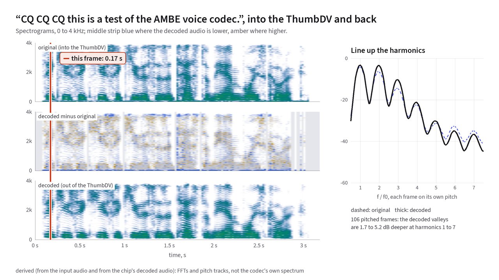

# Listen: real hardware examples

Eight sentences across two voices, each played twice: once as the studio
recording went into the vocoder, and once as it came back out of a hardware
**DVSI AMBE-3000** chip.
{: .lede }

Every "Through the AMBE-3000" audio file on this page was encoded into 72-bit
D-STAR frames and decoded back to 8 kHz audio by a physical DVSI AMBE-3000 IC
inside a NW Digital Radio ThumbDV. No software AMBE implementation was used to
generate these recordings.
{: .source-note }

## How the test recordings were captured

Each comparison pair follows a five-step hardware loop that you can inspect
directly in the repository:

1. **Source audio:** Four standard test sentences synthesized with Piper
   text-to-speech in a male and a female voice, so every clip is free of
   room acoustics and microphone coloration. The male voice is speaker 690
   of `en_US-libritts_r-medium`.[^male-license] The female voice is
   `en_US-ljspeech-high`.[^female-license]
2. **Input format:** Resampled to AMBE's native 8,000 Hz sample rate, 16-bit
   mono PCM (128 kbit/s).
3. **Hardware encoding:** Sent into the ThumbDV in blocks of 160 samples,
   which is 20 ms of audio. Each block produces one 9-byte D-STAR channel
   frame of 72 bits (3,600 bit/s).
4. **Hardware decoding:** Those exact 9-byte frames fed back into the AMBE-3000
   chip to produce 160 decoded audio samples per 20 ms.
5. **Loudness matching:** Normalized by a single constant gain to −20 [dBFS](18-glossary.md#decibel)
   RMS (a small adjustment of −0.66 to +0.03 dB) with zero EQ,
   compression, or noise reduction so you are comparing timbre rather than
   volume.

Across all eight clips, the chip emitted 9,504 bytes in 1,056 frames for
21.05 seconds of speech. That is 2,400 bit/s of voice parameters plus 1,200 bit/s of
[forward error correction](18-glossary.md#unequal-error-protection-uep-golay-and-hamming)
JARL D-STAR system specification.

## Three things to listen for on every pair

When you click between **Original** and **Through the AMBE-3000**, three
patterns stand out both to your ear and in the spectral measurements:

- **Pitch tracks to within ~1%:** Across all eight clips, the decoded
  [fundamental frequency](18-glossary.md#fundamental-frequency-and-pitch-period)
  follows the original pitch to within a median error of 0.62% to
  1.14%.[^pitch-p90]
- **Syllable timing and loudness envelope stay locked:** Cross-correlating the
  20 ms loudness envelopes yields 0.967 to 0.991 across every
  clip.[^delay] Summed across energetic frames, total
  energy in every 1 kHz band from 0 to 4 kHz stays within 2.2 dB of
  the original.
- **Harmonic valleys deepen and [consonant](18-glossary.md#consonant) attacks soften:** Because the decoder
  rebuilds voiced bands from pure sinusoidal oscillators and [formant enhancement](11-synthesis.md#shaped-noise-for-unvoiced-bands)
  US 5,247,579, the spectral valleys *between*
  harmonics are carved 1.3 to 4.2 dB deeper on the male voice and
  5.6 to 9.7 dB deeper on the female voice than in the input audio.
  Meanwhile, sharp [plosive](18-glossary.md#plosive) clicks ("k", "t") are slightly softened by the 20 ms
  frame window.

## Comparing the original and decoded spectra in 2D and 3D

In [**Figure 12.1**](#fig-12-1), you can compare the [spectrograms](18-glossary.md#spectrogram) of the original audio
and the AMBE-3000 decoded audio. Between them sits their decibel difference,
the decoded level minus the original. The panel beside them shows how much deeper the
valleys sit between the first seven harmonics. Step through the clips:

<figure class="anim-fallback" markdown="0">
  
  <figcaption>Comparing the original and AMBE-3000 decoded spectrograms and
  harmonic valley depths.</figcaption>
</figure>
<ol class="anim-steps" markdown="1">
<li data-clip="lr-b" data-show="difference" data-pick="loudest-pitched" data-view="3d" data-preset="corner" markdown="block">
Here is the CQ call in the male voice, as it went into the ThumbDV (back)
and as it came out (front). Height and colour show the level, and the
outlined slice is one 20&nbsp;ms frame.
</li>
<li data-clip="lr-b" data-show="difference" data-pick="loudest-pitched" data-view="2d" data-preset="top" markdown="block">
Seen flat, the sheets are spectrograms. Each vowel is a stack of stripes,
and those stripes are its harmonics. The middle strip, decoded minus original, is
mostly speckle from frame to frame.
</li>
<li data-clip="lr-b" data-show="difference" data-pick="loudest-pitched" data-view="2d" data-preset="side" markdown="block">
One frame is too noisy to judge, so the panel averages every frame with a
pitch. On this clip the decoded valleys come out 1.7 to 5.2&nbsp;dB deeper
than the original's.
</li>
<li data-clip="lj-b" data-show="difference" data-pick="loudest-pitched" data-view="2d" data-preset="corner" data-play="valleys" markdown="block">
The female voice is about 40&nbsp;Hz higher, so her harmonics sit further
apart. Her decoded valleys come out deeper still, at 6.3 to
10.1&nbsp;dB.
</li>
<li data-clip="lr-c" data-show="difference" data-pick="loudest-unpitched" data-view="2d" data-preset="corner" markdown="block">
A sibilant has no harmonics to keep. On this clip's frames with no pitch,
the decoded audio stays within 2&nbsp;dB of the original above 1&nbsp;kHz
and comes out 11.5&nbsp;dB lower below it.
</li>
<li data-clip="lr-c" data-show="both" data-pick="loudest-pitched" data-view="3d" data-preset="corner" markdown="block">
Pick *Both sheets* to compare the two directly, and use *Original* and
*Decoded* to hear 0.6&nbsp;s around the outlined frame.
</li>
</ol>

---

## Male voice comparisons (`en_US-libritts_r-medium`, 132-153 Hz median <i>f</i>0)

### a) "The quick brown fox jumps over the lazy dog."

  

    Original
    <audio controls preload="none" src="assets/audio/lr-a-original.wav"
           aria-label="Sentence a, male voice, quick brown fox, original"></audio>
  

  

    Through the AMBE-3000
    <audio controls preload="none" src="assets/audio/lr-a-ambe.wav"
           aria-label="Sentence a, male voice, quick brown fox, through the AMBE-3000"></audio>
  

In this pangram, 89% of the energetic frames carry a detectable pitch. Listen
closely to the rapid consonant-to-vowel transitions at the *ck* in "quick",
the *x* in "fox", and the *j* in "jumps". At each one the synthesizer switches
bands between shaped noise and sinusoidal oscillators across 20 ms
boundaries.

### b) "CQ CQ CQ this is a test of the AMBE voice codec."

  

    Original
    <audio controls preload="none" src="assets/audio/lr-b-original.wav"
           aria-label="Sentence b, male voice, CQ test, original"></audio>
  

  

    Through the AMBE-3000
    <audio controls preload="none" src="assets/audio/lr-b-ambe.wav"
           aria-label="Sentence b, male voice, CQ test, through the AMBE-3000"></audio>
  

This 3.17-second CQ call spans 159 frames, or 1,431 bytes. It is the primary
recording used in the interactive figures throughout this site. Listen to the hard *K*
burst of each "CQ". The encoder spreads that brief click across a 20 ms
analysis frame, and the decoder rebuilds it without transmitted phase, so the
attack sounds slightly rounded compared to the raw PCM recording.

### c) "She sells sea shells by the sea shore."

  

    Original
    <audio controls preload="none" src="assets/audio/lr-c-original.wav"
           aria-label="Sentence c, male voice, she sells sea shells, original"></audio>
  

  

    Through the AMBE-3000
    <audio controls preload="none" src="assets/audio/lr-c-ambe.wav"
           aria-label="Sentence c, male voice, she sells sea shells, through the AMBE-3000"></audio>
  

Repeated [sibilants](18-glossary.md#sibilant) (*sh* and *s*) test the unvoiced noise synthesizer. Across
the 14 energetic sibilant frames with no pitch, the decoded high-frequency
energy from 1 to 4 kHz stays within 2 dB of the original, while band
periodicity stays at 0.10 or below across all 8 bands. The codec rebuilds the
hiss from shaped white noise at the right spectral tilt, so "sells" and
"shells" remain distinct.

### d) "We were away a year ago."

  

    Original
    <audio controls preload="none" src="assets/audio/lr-d-original.wav"
           aria-label="Sentence d, male voice, we were away a year ago, original"></audio>
  

  

    Through the AMBE-3000
    <audio controls preload="none" src="assets/audio/lr-d-ambe.wav"
           aria-label="Sentence d, male voice, we were away a year ago, through the AMBE-3000"></audio>
  

In this all-voiced sentence, 100% of the 47 energetic frames carry
a continuous [pitch track](18-glossary.md#pitch-track-and-octave-errors). Because a smoothly gliding stack of harmonics is
what the MBE oscillator bank is built to represent, original and decoded sound
closest on this pair.

---

## Female voice comparisons (`en_US-ljspeech-high`, 174-219 Hz median <i>f</i>0)

Because the female speaker's fundamental frequency sits roughly 45 Hz higher
than the male speaker's, only about 20 harmonics fit below 3,700 Hz instead of
27. The quantizer therefore spends its fixed bit budget across fewer, more
widely spaced harmonics (see [Chapter 9](09-quantization.md)).

### a) "The quick brown fox jumps over the lazy dog."

  

    Original
    <audio controls preload="none" src="assets/audio/lj-a-original.wav"
           aria-label="Sentence a, female voice, quick brown fox, original"></audio>
  

  

    Through the AMBE-3000
    <audio controls preload="none" src="assets/audio/lj-a-ambe.wav"
           aria-label="Sentence a, female voice, quick brown fox, through the AMBE-3000"></audio>
  

Compare this pangram against `lr-a`, the male version above. On the female
voice the valleys between harmonics sit 5.6 to 9.7 dB deeper than in the
input. Those deeper valleys give the decoded voice a slightly crisper, more synthetic buzz on held [vowels](18-glossary.md#vowel).

### b) "CQ CQ CQ this is a test of the AMBE voice codec."

  

    Original
    <audio controls preload="none" src="assets/audio/lj-b-original.wav"
           aria-label="Sentence b, female voice, CQ test, original"></audio>
  

  

    Through the AMBE-3000
    <audio controls preload="none" src="assets/audio/lj-b-ambe.wav"
           aria-label="Sentence b, female voice, CQ test, through the AMBE-3000"></audio>
  

This 4.16-second clip spans 208 frames, or 1,872 bytes. Its decoded energy sits
within 0.2 dB of the original in the 0-1 kHz and 2-3 kHz bands. It sits
2.2 dB lower in 1-2 kHz and 1.9 dB higher in 3-4 kHz.

### c) "She sells sea shells by the sea shore."

  

    Original
    <audio controls preload="none" src="assets/audio/lj-c-original.wav"
           aria-label="Sentence c, female voice, she sells sea shells, original"></audio>
  

  

    Through the AMBE-3000
    <audio controls preload="none" src="assets/audio/lj-c-ambe.wav"
           aria-label="Sentence c, female voice, she sells sea shells, through the AMBE-3000"></audio>
  

On the unpitched sibilant frames of this clip, decoded band periodicity stays at
or below 0.17 across all eight bands, rising to 0.81 in the lowest band during
voiced vowels.

### d) "We were away a year ago."

  

    Original
    <audio controls preload="none" src="assets/audio/lj-d-original.wav"
           aria-label="Sentence d, female voice, we were away a year ago, original"></audio>
  

  

    Through the AMBE-3000
    <audio controls preload="none" src="assets/audio/lj-d-ambe.wav"
           aria-label="Sentence d, female voice, we were away a year ago, through the AMBE-3000"></audio>
  

This 1.67-second clip takes 756 bytes in total on the air. Of its energetic
frames, 87% carry a steady pitch track, showing how much speech
intelligibility fits into 450 bytes per second.

---

## Hardware and corpus provenance

| Item | Provenance |
| :--- | :--- |
| **Male source speech** | Piper TTS `en_US-libritts_r-medium` (speaker 690), trained on LibriTTS-R (<http://www.openslr.org/141/>, CC BY 4.0). |
| **Female source speech** | Piper TTS `en_US-ljspeech-high`, trained on the LJ Speech Dataset (<https://keithito.com/LJ-Speech-Dataset/>, public domain). |
| **Vocoder hardware** | DVSI AMBE-3000 IC (`PRODID AMBE3000F`, firmware `V121.E100.XXXX.C110.G514.R014.A0030608.C0020208`) in a NW Digital Radio ThumbDV. |
| **Channel mode** | D-STAR full-rate mode, 72 bits (9 bytes) per 20 ms frame (3,600 bit/s with FEC). |
| **Verification script** | Run `python3 tools/listen-stats.py` to recompute every statistic on this page from `docs/assets/data/`. |

[^male-license]: The male voice's licence is CC BY 4.0.
[^female-license]: The female voice is in the public domain.
[^pitch-p90]: The 90th-percentile pitch error is 1.4% to 4.3%.
[^delay]: The comparison first lines up the two envelopes to remove the
    codec's pipeline delay of 31.6 to 34.4 ms.

---

**Next: [The patent landscape](16-patents.md).**
The MIT and DVSI patents behind AMBE, and when each one expires.
Back to [Synthesis: rebuilding the voice](11-synthesis.md), or to
[the start](index.md).
{: .chapter-nav }

Last reviewed: 2026-10-13.
{: .source-note }
