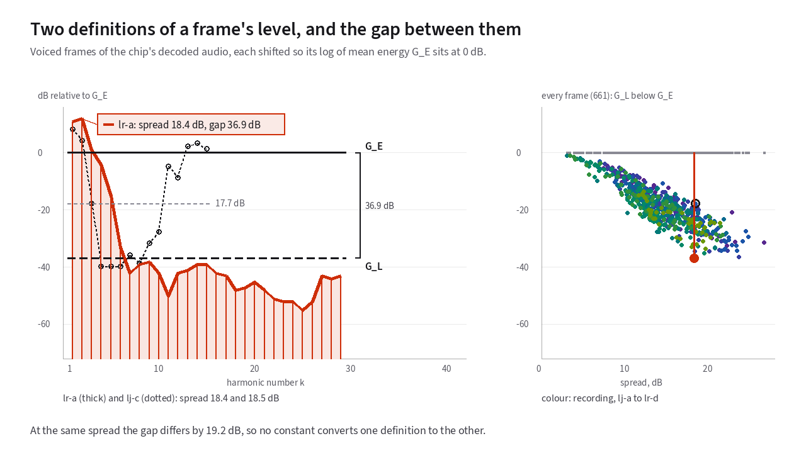

# What is not in the public record

Every chapter up to this point relies on public documents anyone can read:
the Multi-Band Excitation academic papers, expired DVSI patents, and the JARL
D-STAR system specification. Taken together, those documents describe the MBE
algorithm completely enough to build a working MBE vocoder from scratch.
{: .lede }

What the public literature does *not* provide are the exact proprietary lookup
tables and bit-packing layouts inside the commercial DVSI AMBE-3000 chip in a
D-STAR, DMR, or Yaesu System Fusion transceiver. This chapter maps the boundary
between the published algorithm and the unpublished chip tables.

!!! note "Black-box hardware measurements only"

    Every hardware measurement on this site comes from operating a commercially
    purchased DVSI AMBE-3000 USB vocoder, a NW Digital Radio ThumbDV, as an
    external black box: sending audio or channel frames in one side and
    measuring what comes out the other. No firmware was disassembled or read
    out of the chip, and no third-party reverse-engineered source code was
    consulted.

## What the public patents and standards establish

Because patent law requires an inventor to enable a person skilled in the art
to practice the invention, the expired DVSI patents document the algorithmic
machinery in substantial detail:

- **The core MBE speech model:** Representing each 20 ms frame as a
  [fundamental frequency](18-glossary.md#fundamental-frequency-and-pitch-period),
  per-band [voiced/unvoiced flags](18-glossary.md#voiced-and-unvoiced-speech),
  and [spectral envelope](18-glossary.md#spectral-envelope) magnitudes.
  [Chapter 7](07-multi-band-excitation.md) covers the model
  Griffin &amp; Lim 1988.
- **Pitch tracking and voicing estimation:** The patents cover sub-sample
  pitch refinement and sub-multiple octave checks. They also cover
  dynamic-programming pitch tracking and band-voicing error thresholds.
  [Chapter 8](08-analysis.md) explains each one
  US 5,216,747; US 5,715,365; US 5,826,222.
- **Compensated amplitude estimation and analysis windowing:** The 255-point
  Hamming window and compensated harmonic energy estimator
  (see [Chapter 8](08-analysis.md))
  US 5,754,974, Table 1; US 5,701,390.
- **Differential block DCT and PRBA quantization:** Predicting log harmonic
  amplitudes across frames with a leaky decay factor γ < 1, resampling
  across changing harmonic counts <i>L</i>, and transforming 6 frequency blocks via
  DCT (see [Chapter 9](09-quantization.md)) US 5,630,011.
- **Priority vectors, Golay/Hamming FEC, and <i>u</i>0-seeded scrambling:**
  The encoder sorts parameters by perceptual sensitivity and protects
  <i>u</i>0 with Golay codes. It seeds a pseudo-random scrambler
  from <i>u</i>0. The decoder repeats or mutes corrupted frames.
  [Chapter 10](10-the-dstar-frame.md) covers all of this
  US 5,870,405.
- **Phase regeneration and frame-boundary synthesis:** Deriving voiced phase
  from log spectral magnitudes via an antisymmetric kernel and sweeping low
  harmonics (<i>l</i> < 8) across 20 ms boundaries
  (see [Chapter 11](11-synthesis.md)) US 5,701,390.
- **The on-air D-STAR framing:** 4,800 bit/s GMSK carrying 72 voice bits
  (2,400 bit/s voice + 1,200 bit/s FEC) and 24 slow-speed data bits per 20 ms
  frame (see [Chapter 10](10-the-dstar-frame.md))
  JARL D-STAR system specification.

## Where the public documents stop

While the patents explain *how* the algorithm works, a specific radio protocol
must lock down exact table numbers so a transmitter from one manufacturer can
be decoded by a receiver from another. Five specific choices for D-STAR's
3,600 bit/s AMBE mode are not printed in the public patents or the JARL
specification:

### 1. The exact 48-bit voice parameter bit allocation

The expired patents print complete bit-allocation tables for a 7.2 kbit/s IMBE
frame (88 voice bits + 56 FEC bits = 144 bits) and for a 3.6 kbit/s uncoded
MBE frame (72 voice bits + 0 FEC bits)
US 5,754,974; US 5,870,405. D-STAR's 72-bit voice
frame, however, packs **48 bits of voice parameters and 24 bits of FEC** into
those 72 bits JARL D-STAR system specification. No
public document maps which of the 72 wire positions belong to which codeword.
No public document says how the 48 voice bits divide among these parameters
either:

- pitch
- voicing
- gain
- PRBA
- higher-order DCT coefficients

### 2. The vector quantizer codebooks

As shown in [Chapter 9](09-quantization.md), [vector quantization](18-glossary.md#vector-quantization-vq-and-codebooks)
replaces a block of numbers with an integer index into a pre-trained lookup
table. Patent law does not require an applicant to print production VQ codebook
tables, and neither the patents nor the JARL specification list the codebook
vectors for D-STAR's 2,400 bit/s voice payload.

### 3. The exact voicing-band boundaries and thresholds

Examples across the patent family use 12 bands, 11 bands, or 8 bands spanning
0 to 4 kHz Griffin &amp; Lim 1988; US 5,715,365; US 5,754,974.
The examples also describe adaptive voicing thresholds and predictor decay
curves as functions of <i>L</i> without printing the exact lookup table stored
in the AMBE-3000 ROM.

<!-- slot: gain-definitions -->

### 4. The mathematical definition of frame gain (<i>G</i>E vs. <i>G</i>L)

Even a seemingly simple concept like "the average level of a frame's harmonics"
has two plausible mathematical definitions that behave very differently on real
speech:

- **Log of the mean energy (<i>G</i>E):** Average the linear power
  of the harmonics first, which is an arithmetic mean in power. Then convert
  to decibels. Loud low
  harmonics dominate <i>G</i>E, while quiet high harmonics contribute almost
  nothing.
- **Mean of the log magnitudes (<i>G</i>L):** Convert each
  harmonic's magnitude to decibels first, as US 5,630,011 and US 5,870,405
  do. Then take the simple average of those decibel numbers. This works out to
  a geometric mean of the magnitudes. Under <i>G</i>L, a
  −60 dB high harmonic pulls the frame average down just as strongly
  as a 0 dB fundamental pulls it up!

In [**Figure 13.1**](#fig-13-1), you can compare <i>G</i>E (solid line) against <i>G</i>L
(dashed line) on four frames. The solid line sits at 0 dB. Two are the flattest and the steepest
[vowel](18-glossary.md#vowel) frames. The other two have the exact same
spectral spread[^spread] yet differ by **19.2 dB** in the gap
between <i>G</i>E and <i>G</i>L.

<figure class="anim-fallback" markdown="0">
  
  <figcaption>Comparing log of mean energy (G_E) and mean of log levels (G_L)
  across voiced frames of decoded speech.</figcaption>
</figure>
<ol class="anim-steps" markdown="1">
<li data-clip="lr-a" data-pick="flattest" data-view="2d" data-preset="corner" markdown="block">
On the flattest voiced frame, every harmonic has about the same level, so
<i>G</i>E (solid) and <i>G</i>L (dashed) almost agree.
</li>
<li data-clip="lj-a" data-pick="steepest" data-view="2d" markdown="block">
On the steepest frame, a few loud low harmonics tower over a quiet tail.
<i>G</i>E stays near the loud ones, while <i>G</i>L counts
every quiet harmonic as much as a loud one and sits far lower.
</li>
<li data-clip="all" data-pick="flattest" data-view="2d" data-preset="side" markdown="block">
The scatter holds all 661 voiced frames of the eight recordings. The more
spread out a frame's spectrum, the bigger its gap.
</li>
<li data-clip="all" data-pick="equal-spread" data-view="2d" data-preset="side" markdown="block">
These two frames have nearly the same spread, but one has two loud low
harmonics and the other is loud at both ends. Their gaps differ by
19.2&nbsp;dB, so no single constant converts <i>G</i>L to
<i>G</i>E.
</li>
</ol>

Switch [**Figure 13.1**](#fig-13-1) to 3D to see all 661 voiced frames across all eight
hardware-decoded recordings, with the side wall showing how the gap between
<i>G</i>E and <i>G</i>L widens and scatters by up to 24 dB even among
frames with identical spectral spread.

Because the difference between <i>G</i>E and <i>G</i>L depends on the detailed shape of
every frame's harmonic tail, two vocoder implementations that use different
gain definitions will disagree by a time-varying amount from syllable to
syllable, not by a fixed decibel offset that a volume knob could cancel.

<!-- end slot: gain-definitions -->

## What black-box hardware testing can and cannot show

Testing a physical AMBE-3000 chip with known audio signals reveals end-to-end
properties that are never mentioned in the patents, such as the 31.6 to 34.4 ms
pipeline delay measured in [Chapter 12](12-listen.md) and a 20 to 40 ms
gain-tracking ramp at word onsets.

Black-box measurement, however, can only observe input-output behavior. Without
the published bit-packing map and codebook tables, a clean-room implementation
built strictly from the expired patents and academic papers will produce
intelligible Multi-Band Excitation speech of its own, but its 72-bit frames
will not be bit-for-bit interchangeable on the air with a hardware AMBE-3000.

[^spread]: The spectral spreads of these two frames are 18.4 dB and 18.5 dB.

---

**Next: [The patent landscape](16-patents.md).**
Chronological guide to the MIT and DVSI patents covering IMBE, AMBE, and
AMBE+2. The guide gives the date each one expired.
Back to [Listen: real hardware examples](12-listen.md), or to
[the start](index.md).
{: .chapter-nav }

Last reviewed: 2026-10-13.
{: .source-note }
