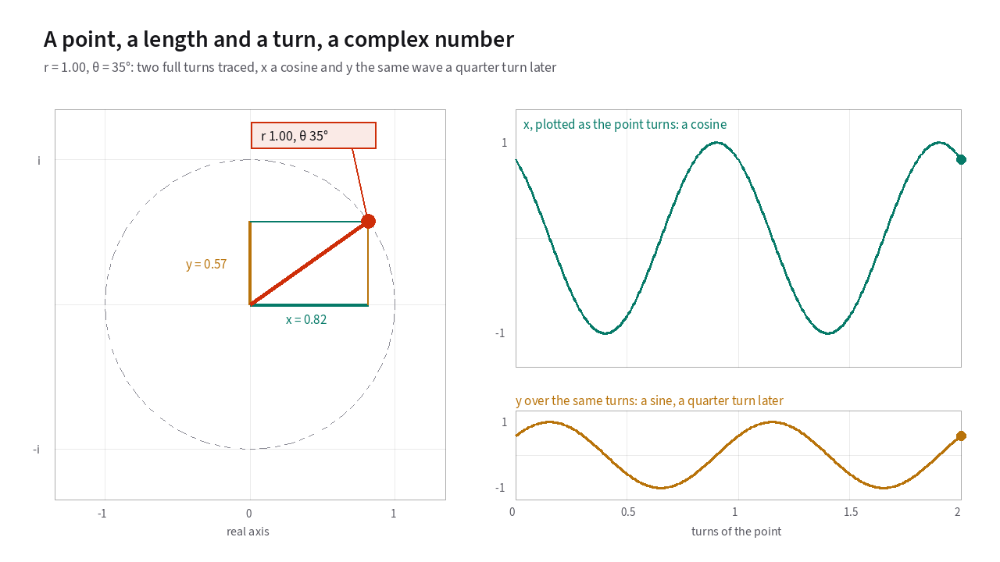

# Glossary of Radio and Vocoder Terms

This glossary defines the acoustic, signal-processing, and radio-protocol
terms used across the site. Each entry links to the chapter and interactive
figure where you can see the mechanism in action, and you can browse all
figures in one place on the [Interactive diagrams](19-diagrams.md) reference
page.
{: .lede }

---

## Acoustic and Vocal Terms

### Fundamental frequency and pitch period (<i>f</i>0, ω0, <i>P</i>) {#fundamental-frequency-and-pitch-period}

The rate at which a speaker's vocal cords open and close during a voiced
sound. When you count it in hertz, meaning cycles per second, you write it
<i>f</i>0. In radians per sample it is ω0. Its reciprocal is the **pitch period**
<i>P</i>, counted in samples (<i>P</i> = 8000 / <i>f</i>0 at an 8 kHz
sample rate). Adult male voices typically sit around 85 to 180 Hz. Adult
female voices typically sit around 165 to 255 Hz. In AMBE, the pitch
tracker searches periods from 22 to 114.5 samples, or roughly 70 to 364 Hz
US 5,216,747.

<!-- diagram: pitch-period -->
<figure class="gloss-diagram" data-diagram="pitch-period">
<svg class="gloss-diagram__svg" viewBox="0 0 640 200" role="img" aria-label="A voiced waveform repeating four times, with one repeat marked as the pitch period P."><path class="gd-axis" d="M40,100 L620,100"/><path class="gd-a" d="M40.0,100.0 L41.5,88.3 L42.9,77.1 L44.4,66.9 L45.8,58.0 L47.2,50.9 L48.7,45.6 L50.1,42.2 L51.6,40.7 L53.0,41.0 L54.5,42.7 L56.0,45.6 L57.4,49.2 L58.9,53.2 L60.3,57.3 L61.8,61.0 L63.2,64.2 L64.7,66.6 L66.1,68.3 L67.5,69.3 L69.0,69.6 L70.5,69.4 L71.9,68.8 L73.3,68.2 L74.8,67.7 L76.2,67.5 L77.7,67.7 L79.2,68.5 L80.6,69.8 L82.0,71.6 L83.5,73.8 L85.0,76.3 L86.4,78.8 L87.8,81.3 L89.3,83.6 L90.8,85.6 L92.2,87.2 L93.7,88.3 L95.1,89.0 L96.6,89.3 L98.0,89.4 L99.4,89.4 L100.9,89.4 L102.3,89.5 L103.8,89.9 L105.2,90.7 L106.7,91.9 L108.1,93.5 L109.6,95.5 L111.0,97.7 L112.5,100.0 L114.0,102.3 L115.4,104.5 L116.9,106.5 L118.3,108.1 L119.8,109.3 L121.2,110.1 L122.6,110.5 L124.1,110.6 L125.5,110.6 L127.0,110.6 L128.4,110.7 L129.9,111.0 L131.3,111.7 L132.8,112.8 L134.2,114.4 L135.7,116.4 L137.2,118.7 L138.6,121.2 L140.1,123.7 L141.5,126.2 L142.9,128.4 L144.4,130.2 L145.8,131.5 L147.3,132.3 L148.8,132.5 L150.2,132.3 L151.7,131.8 L153.1,131.2 L154.6,130.6 L156.0,130.4 L157.4,130.7 L158.9,131.7 L160.3,133.4 L161.8,135.8 L163.2,139.0 L164.7,142.7 L166.2,146.8 L167.6,150.8 L169.1,154.4 L170.5,157.3 L172.0,159.0 L173.4,159.3 L174.8,157.8 L176.3,154.4 L177.8,149.1 L179.2,142.0 L180.7,133.1 L182.1,122.9 L183.6,111.7 L185.0,100.0 L186.4,88.3 L187.9,77.1 L189.3,66.9 L190.8,58.0 L192.2,50.9 L193.7,45.6 L195.2,42.2 L196.6,40.7 L198.1,41.0 L199.5,42.7 L201.0,45.6 L202.4,49.2 L203.8,53.2 L205.3,57.3 L206.8,61.0 L208.2,64.2 L209.6,66.6 L211.1,68.3 L212.5,69.3 L214.0,69.6 L215.4,69.4 L216.9,68.8 L218.3,68.2 L219.8,67.7 L221.2,67.5 L222.7,67.7 L224.2,68.5 L225.6,69.8 L227.1,71.6 L228.5,73.8 L230.0,76.3 L231.4,78.8 L232.9,81.3 L234.3,83.6 L235.8,85.6 L237.2,87.2 L238.7,88.3 L240.1,89.0 L241.5,89.3 L243.0,89.4 L244.4,89.4 L245.9,89.4 L247.3,89.5 L248.8,89.9 L250.2,90.7 L251.7,91.9 L253.2,93.5 L254.6,95.5 L256.1,97.7 L257.5,100.0 L258.9,102.3 L260.4,104.5 L261.9,106.5 L263.3,108.1 L264.8,109.3 L266.2,110.1 L267.6,110.5 L269.1,110.6 L270.6,110.6 L272.0,110.6 L273.5,110.7 L274.9,111.0 L276.4,111.7 L277.8,112.8 L279.2,114.4 L280.7,116.4 L282.1,118.7 L283.6,121.2 L285.0,123.7 L286.5,126.2 L287.9,128.4 L289.4,130.2 L290.9,131.5 L292.3,132.3 L293.8,132.5 L295.2,132.3 L296.6,131.8 L298.1,131.2 L299.6,130.6 L301.0,130.4 L302.4,130.7 L303.9,131.7 L305.4,133.4 L306.8,135.8 L308.2,139.0 L309.7,142.7 L311.2,146.8 L312.6,150.8 L314.1,154.4 L315.5,157.3 L316.9,159.0 L318.4,159.3 L319.8,157.8 L321.3,154.4 L322.8,149.1 L324.2,142.0 L325.6,133.1 L327.1,122.9 L328.6,111.7 L330.0,100.0 L331.4,88.3 L332.9,77.1 L334.3,66.9 L335.8,58.0 L337.2,50.9 L338.7,45.6 L340.1,42.2 L341.6,40.7 L343.0,41.0 L344.5,42.7 L345.9,45.6 L347.4,49.2 L348.8,53.2 L350.3,57.3 L351.8,61.0 L353.2,64.2 L354.6,66.6 L356.1,68.3 L357.6,69.3 L359.0,69.6 L360.4,69.4 L361.9,68.8 L363.4,68.2 L364.8,67.7 L366.2,67.5 L367.7,67.7 L369.1,68.5 L370.6,69.8 L372.1,71.6 L373.5,73.8 L374.9,76.3 L376.4,78.8 L377.9,81.3 L379.3,83.6 L380.8,85.6 L382.2,87.2 L383.7,88.3 L385.1,89.0 L386.6,89.3 L388.0,89.4 L389.5,89.4 L390.9,89.4 L392.4,89.5 L393.8,89.9 L395.2,90.7 L396.7,91.9 L398.2,93.5 L399.6,95.5 L401.1,97.7 L402.5,100.0 L403.9,102.3 L405.4,104.5 L406.8,106.5 L408.3,108.1 L409.8,109.3 L411.2,110.1 L412.6,110.5 L414.1,110.6 L415.5,110.6 L417.0,110.6 L418.4,110.7 L419.9,111.0 L421.3,111.7 L422.8,112.8 L424.2,114.4 L425.7,116.4 L427.1,118.7 L428.6,121.2 L430.1,123.7 L431.5,126.2 L432.9,128.4 L434.4,130.2 L435.9,131.5 L437.3,132.3 L438.8,132.5 L440.2,132.3 L441.6,131.8 L443.1,131.2 L444.6,130.6 L446.0,130.4 L447.4,130.7 L448.9,131.7 L450.4,133.4 L451.8,135.8 L453.2,139.0 L454.7,142.7 L456.2,146.8 L457.6,150.8 L459.1,154.4 L460.5,157.3 L462.0,159.0 L463.4,159.3 L464.9,157.8 L466.3,154.4 L467.8,149.1 L469.2,142.0 L470.7,133.1 L472.1,122.9 L473.6,111.7 L475.0,100.0 L476.4,88.3 L477.9,77.1 L479.3,66.9 L480.8,58.0 L482.2,50.9 L483.7,45.6 L485.1,42.2 L486.6,40.7 L488.0,41.0 L489.5,42.7 L490.9,45.6 L492.4,49.2 L493.8,53.2 L495.3,57.3 L496.8,61.0 L498.2,64.2 L499.6,66.6 L501.1,68.3 L502.6,69.3 L504.0,69.6 L505.4,69.4 L506.9,68.8 L508.4,68.2 L509.8,67.7 L511.2,67.5 L512.7,67.7 L514.1,68.5 L515.6,69.8 L517.0,71.6 L518.5,73.8 L520.0,76.3 L521.4,78.8 L522.9,81.3 L524.3,83.6 L525.8,85.6 L527.2,87.2 L528.7,88.3 L530.1,89.0 L531.5,89.3 L533.0,89.4 L534.5,89.4 L535.9,89.4 L537.4,89.5 L538.8,89.9 L540.2,90.7 L541.7,91.9 L543.2,93.5 L544.6,95.5 L546.0,97.7 L547.5,100.0 L549.0,102.3 L550.4,104.5 L551.8,106.5 L553.3,108.1 L554.8,109.3 L556.2,110.1 L557.6,110.5 L559.1,110.6 L560.5,110.6 L562.0,110.6 L563.4,110.7 L564.9,111.0 L566.4,111.7 L567.8,112.8 L569.2,114.4 L570.7,116.4 L572.1,118.7 L573.6,121.2 L575.0,123.7 L576.5,126.2 L578.0,128.4 L579.4,130.2 L580.9,131.5 L582.3,132.3 L583.8,132.5 L585.2,132.3 L586.6,131.8 L588.1,131.2 L589.5,130.6 L591.0,130.4 L592.5,130.7 L593.9,131.7 L595.4,133.4 L596.8,135.8 L598.2,139.0 L599.7,142.7 L601.1,146.8 L602.6,150.8 L604.1,154.4 L605.5,157.3 L607.0,159.0 L608.4,159.3 L609.9,157.8 L611.3,154.4 L612.8,149.1 L614.2,142.0 L615.6,133.1 L617.1,122.9 L618.6,111.7 L620.0,100.0"/><path class="gd-mark" d="M52.2,30 L52.2,170 M197.2,30 L197.2,170"/><path class="gd-b" d="M52.2,24 L197.2,24"/><text class="gd-label gd-label--b" x="125" y="18" text-anchor="middle">one pitch period, <tspan font-style="italic">P</tspan></text></svg>
<figcaption>A vowel repeats. The length of one repeat is the pitch period <i>P</i>, and the number of repeats in a second is <i>f</i>0.</figcaption>
</figure>
<!-- end diagram -->

- **See it in action:** [Figure 7.1](07-multi-band-excitation.md#fig-7-1)
  shows how <i>f</i>0 controls the harmonic count <i>L</i>.
  [Figure 8.2](08-analysis.md#fig-8-2) shows how the encoder searches for
  the pitch period.

### Formant {#formant}

A broad resonant peak in the [spectral envelope](#spectral-envelope) created by
the acoustic cavities of the throat, tongue, and lips. Moving your tongue and
jaw shifts the frequencies of your formants, which is how a listener tells an
"ah" apart from an "ee" even when both vowels are spoken at the exact same
pitch.

<!-- diagram: formant -->
<figure class="gloss-diagram" data-diagram="formant">
<svg class="gloss-diagram__svg" viewBox="0 0 640 256" role="img" aria-label="A spectrum from 0 to 4 kilohertz. Harmonic stems sit under a solid curve with three peaks, labelled F1, F2 and F3. A dashed curve for a second vowel has its peaks at different frequencies."><path class="gd-axis" d="M80,200 L620,200"/><path class="gd-axis" d="M80.0,200.0 L80.0,206.0"/><text class="gd-label" x="80" y="224" text-anchor="middle">0</text><path class="gd-axis" d="M215.0,200.0 L215.0,206.0"/><text class="gd-label" x="215" y="224" text-anchor="middle">1</text><path class="gd-axis" d="M350.0,200.0 L350.0,206.0"/><text class="gd-label" x="350" y="224" text-anchor="middle">2</text><path class="gd-axis" d="M485.0,200.0 L485.0,206.0"/><text class="gd-label" x="485" y="224" text-anchor="middle">3</text><path class="gd-axis" d="M620.0,200.0 L620.0,206.0"/><text class="gd-label" x="620" y="224" text-anchor="middle">4</text><path class="gd-a" d="M100.2,200.0 L100.2,166.4"/><path class="gd-a" d="M120.5,200.0 L120.5,148.9"/><path class="gd-a" d="M140.8,200.0 L140.8,100.8"/><path class="gd-a" d="M161.0,200.0 L161.0,27.8"/><path class="gd-a" d="M181.2,200.0 L181.2,88.6"/><path class="gd-a" d="M201.5,200.0 L201.5,115.8"/><path class="gd-a" d="M221.8,200.0 L221.8,92.3"/><path class="gd-a" d="M242.0,200.0 L242.0,85.1"/><path class="gd-a" d="M262.2,200.0 L262.2,130.3"/><path class="gd-a" d="M282.5,200.0 L282.5,155.8"/><path class="gd-a" d="M302.8,200.0 L302.8,166.2"/><path class="gd-a" d="M323.0,200.0 L323.0,170.1"/><path class="gd-a" d="M343.2,200.0 L343.2,170.2"/><path class="gd-a" d="M363.5,200.0 L363.5,166.3"/><path class="gd-a" d="M383.8,200.0 L383.8,156.2"/><path class="gd-a" d="M404.0,200.0 L404.0,139.0"/><path class="gd-a" d="M424.2,200.0 L424.2,134.9"/><path class="gd-a" d="M444.5,200.0 L444.5,152.6"/><path class="gd-a" d="M464.8,200.0 L464.8,166.9"/><path class="gd-a" d="M485.0,200.0 L485.0,174.5"/><path class="gd-a" d="M505.2,200.0 L505.2,178.6"/><path class="gd-a" d="M525.5,200.0 L525.5,181.0"/><path class="gd-a" d="M545.8,200.0 L545.8,182.4"/><path class="gd-a" d="M566.0,200.0 L566.0,183.4"/><path class="gd-a" d="M586.2,200.0 L586.2,184.1"/><path class="gd-a" d="M606.5,200.0 L606.5,184.6"/><path class="gd-a" d="M80.0,174.1 L82.7,173.3 L85.4,172.5 L88.1,171.6 L90.8,170.6 L93.5,169.6 L96.2,168.4 L98.9,167.1 L101.6,165.6 L104.3,164.0 L107.0,162.2 L109.7,160.1 L112.4,157.8 L115.1,155.2 L117.8,152.2 L120.5,148.9 L123.2,145.0 L125.9,140.5 L128.6,135.4 L131.3,129.5 L134.0,122.6 L136.7,114.7 L139.4,105.7 L142.1,95.6 L144.8,84.3 L147.5,72.2 L150.2,59.8 L152.9,47.9 L155.6,37.9 L158.3,30.8 L161.0,27.8 L163.7,29.3 L166.4,34.9 L169.1,43.4 L171.8,53.7 L174.5,64.5 L177.2,74.8 L179.9,84.3 L182.6,92.5 L185.3,99.4 L188.0,105.0 L190.7,109.3 L193.4,112.5 L196.1,114.6 L198.8,115.7 L201.5,115.8 L204.2,115.1 L206.9,113.5 L209.6,111.0 L212.3,107.8 L215.0,104.0 L217.7,99.5 L220.4,94.7 L223.1,89.9 L225.8,85.3 L228.5,81.5 L231.2,78.8 L233.9,77.8 L236.6,78.5 L239.3,81.0 L242.0,85.1 L244.7,90.5 L247.4,96.6 L250.1,103.2 L252.8,109.8 L255.5,116.2 L258.2,122.2 L260.9,127.7 L263.6,132.8 L266.3,137.3 L269.0,141.4 L271.7,145.0 L274.4,148.2 L277.1,151.0 L279.8,153.6 L282.5,155.8 L285.2,157.8 L287.9,159.6 L290.6,161.1 L293.3,162.5 L296.0,163.7 L298.7,164.8 L301.4,165.8 L304.1,166.6 L306.8,167.4 L309.5,168.0 L312.2,168.6 L314.9,169.1 L317.6,169.5 L320.3,169.8 L323.0,170.1 L325.7,170.3 L328.4,170.5 L331.1,170.6 L333.8,170.6 L336.5,170.5 L339.2,170.4 L341.9,170.3 L344.6,170.0 L347.3,169.7 L350.0,169.4 L352.7,168.9 L355.4,168.4 L358.1,167.8 L360.8,167.1 L363.5,166.3 L366.2,165.3 L368.9,164.3 L371.6,163.2 L374.3,161.9 L377.0,160.4 L379.7,158.8 L382.4,157.1 L385.1,155.2 L387.8,153.1 L390.5,150.9 L393.2,148.6 L395.9,146.2 L398.6,143.7 L401.3,141.3 L404.0,139.0 L406.7,137.0 L409.4,135.2 L412.1,133.9 L414.8,133.1 L417.5,132.9 L420.2,133.3 L422.9,134.2 L425.6,135.7 L428.3,137.6 L431.0,139.9 L433.7,142.3 L436.4,144.9 L439.1,147.5 L441.8,150.1 L444.5,152.6 L447.2,155.0 L449.9,157.2 L452.6,159.3 L455.3,161.3 L458.0,163.1 L460.7,164.7 L463.4,166.2 L466.1,167.6 L468.8,168.9 L471.5,170.0 L474.2,171.1 L476.9,172.1 L479.6,173.0 L482.3,173.8 L485.0,174.5 L487.7,175.2 L490.4,175.9 L493.1,176.5 L495.8,177.0 L498.5,177.5 L501.2,178.0 L503.9,178.4 L506.6,178.8 L509.3,179.2 L512.0,179.5 L514.7,179.9 L517.4,180.2 L520.1,180.5 L522.8,180.7 L525.5,181.0 L528.2,181.2 L530.9,181.4 L533.6,181.6 L536.3,181.8 L539.0,182.0 L541.7,182.2 L544.4,182.4 L547.1,182.5 L549.8,182.7 L552.5,182.8 L555.2,183.0 L557.9,183.1 L560.6,183.2 L563.3,183.3 L566.0,183.4 L568.7,183.5 L571.4,183.6 L574.1,183.7 L576.8,183.8 L579.5,183.9 L582.2,184.0 L584.9,184.1 L587.6,184.2 L590.3,184.2 L593.0,184.3 L595.7,184.4 L598.4,184.5 L601.1,184.5 L603.8,184.6 L606.5,184.6 L609.2,184.7 L611.9,184.8 L614.6,184.8 L617.3,184.9 L620.0,184.9"/><path class="gd-b gd-dash" d="M80.0,167.1 L82.7,164.8 L85.4,161.9 L88.1,158.6 L90.8,154.6 L93.5,149.8 L96.2,143.9 L98.9,136.7 L101.6,128.1 L104.3,117.7 L107.0,105.4 L109.7,91.4 L112.4,76.8 L115.1,63.1 L117.8,53.2 L120.5,49.5 L123.2,53.1 L125.9,63.0 L128.6,76.6 L131.3,91.2 L134.0,105.0 L136.7,117.3 L139.4,127.6 L142.1,136.2 L144.8,143.3 L147.5,149.1 L150.2,153.9 L152.9,157.8 L155.6,161.1 L158.3,163.8 L161.0,166.1 L163.7,168.0 L166.4,169.7 L169.1,171.1 L171.8,172.3 L174.5,173.4 L177.2,174.3 L179.9,175.0 L182.6,175.7 L185.3,176.3 L188.0,176.8 L190.7,177.3 L193.4,177.7 L196.1,178.0 L198.8,178.3 L201.5,178.6 L204.2,178.8 L206.9,179.0 L209.6,179.2 L212.3,179.3 L215.0,179.4 L217.7,179.5 L220.4,179.6 L223.1,179.7 L225.8,179.7 L228.5,179.7 L231.2,179.7 L233.9,179.7 L236.6,179.6 L239.3,179.6 L242.0,179.5 L244.7,179.4 L247.4,179.3 L250.1,179.2 L252.8,179.1 L255.5,178.9 L258.2,178.7 L260.9,178.6 L263.6,178.3 L266.3,178.1 L269.0,177.8 L271.7,177.6 L274.4,177.3 L277.1,176.9 L279.8,176.6 L282.5,176.2 L285.2,175.7 L287.9,175.3 L290.6,174.8 L293.3,174.2 L296.0,173.6 L298.7,172.9 L301.4,172.2 L304.1,171.4 L306.8,170.5 L309.5,169.6 L312.2,168.5 L314.9,167.4 L317.6,166.1 L320.3,164.7 L323.0,163.2 L325.7,161.5 L328.4,159.5 L331.1,157.4 L333.8,155.1 L336.5,152.4 L339.2,149.5 L341.9,146.3 L344.6,142.7 L347.3,138.8 L350.0,134.5 L352.7,129.8 L355.4,124.8 L358.1,119.6 L360.8,114.3 L363.5,109.0 L366.2,104.0 L368.9,99.6 L371.6,96.1 L374.3,93.8 L377.0,92.9 L379.7,93.3 L382.4,95.1 L385.1,98.1 L387.8,102.0 L390.5,106.4 L393.2,111.1 L395.9,115.9 L398.6,120.6 L401.3,124.9 L404.0,129.0 L406.7,132.6 L409.4,135.8 L412.1,138.6 L414.8,141.0 L417.5,143.1 L420.2,144.8 L422.9,146.1 L425.6,147.2 L428.3,147.9 L431.0,148.3 L433.7,148.5 L436.4,148.4 L439.1,148.0 L441.8,147.4 L444.5,146.5 L447.2,145.4 L449.9,143.9 L452.6,142.3 L455.3,140.4 L458.0,138.3 L460.7,136.0 L463.4,133.5 L466.1,131.0 L468.8,128.4 L471.5,126.0 L474.2,123.9 L476.9,122.0 L479.6,120.7 L482.3,120.0 L485.0,119.9 L487.7,120.6 L490.4,121.9 L493.1,123.8 L495.8,126.2 L498.5,129.0 L501.2,132.1 L503.9,135.3 L506.6,138.5 L509.3,141.6 L512.0,144.7 L514.7,147.6 L517.4,150.4 L520.1,152.9 L522.8,155.3 L525.5,157.5 L528.2,159.5 L530.9,161.4 L533.6,163.1 L536.3,164.7 L539.0,166.1 L541.7,167.4 L544.4,168.6 L547.1,169.7 L549.8,170.7 L552.5,171.6 L555.2,172.5 L557.9,173.3 L560.6,174.0 L563.3,174.7 L566.0,175.3 L568.7,175.9 L571.4,176.4 L574.1,176.9 L576.8,177.4 L579.5,177.8 L582.2,178.2 L584.9,178.6 L587.6,179.0 L590.3,179.3 L593.0,179.6 L595.7,179.9 L598.4,180.2 L601.1,180.4 L603.8,180.7 L606.5,180.9 L609.2,181.1 L611.9,181.3 L614.6,181.5 L617.3,181.7 L620.0,181.9"/><text class="gd-label gd-label--a" x="161" y="18" text-anchor="middle">F1</text><text class="gd-label gd-label--a" x="235" y="68" text-anchor="middle">F2</text><text class="gd-label gd-label--a" x="418" y="123" text-anchor="middle">F3</text><text class="gd-label gd-label--b" x="485" y="108" text-anchor="middle">another vowel</text><text class="gd-label" x="30" y="120.0" text-anchor="middle" transform="rotate(-90 30 120.0)">level</text><text class="gd-label" x="350" y="248" text-anchor="middle">frequency in kHz →</text></svg>
<figcaption>The solid curve is the spectral envelope of one vowel. Its three peaks are its formants F1, F2 and F3. The dashed curve is another vowel at the same pitch. Its harmonics fall in the same places, but its peaks do not. Both curves are illustrative shapes.</figcaption>
</figure>
<!-- end diagram -->

- **See it in action:** [Figure 1.4](01-why-sinusoids.md#fig-1-4) shows
  formant peaks moving across a spoken sentence.
  [Figure 9.2](09-quantization.md#fig-9-2) shows the formant envelope
  sampled at each harmonic.

### Voiced and unvoiced speech {#voiced-and-unvoiced-speech}

The two physical sound sources in human speech. **Voiced** speech, such as a
[vowel](#vowel), is produced by periodic vibration of the vocal cords and looks like a
repeating pulse train in time or a comb of [harmonics](#harmonic) in frequency.
**Unvoiced** speech (such as "s", "sh", or "f") is produced by turbulent air
rushing past a constriction in the mouth and looks like random broadband hiss.
Many natural speech sounds contain voiced buzz in lower bands and unvoiced
noise in upper bands at the exact same instant
Griffin &amp; Lim 1988, §I.

<!-- diagram: voiced-unvoiced -->
<figure class="gloss-diagram" data-diagram="voiced-unvoiced">
<svg class="gloss-diagram__svg" viewBox="0 0 640 256" role="img" aria-label="Two waveforms against time. The top one, voiced, is the same pulse repeating at a steady spacing. The bottom one, unvoiced, is random noise with no repeating shape."><path class="gd-axis" d="M110,70 L620,70"/><path class="gd-axis" d="M110,180 L620,180"/><path class="gd-mark gd-dash" d="M120.7,18.0 L120.7,116.0"/><path class="gd-mark gd-dash" d="M248.2,18.0 L248.2,116.0"/><path class="gd-mark gd-dash" d="M375.7,18.0 L375.7,116.0"/><path class="gd-mark gd-dash" d="M503.2,18.0 L503.2,116.0"/><path class="gd-a" d="M110.0,70.0 L111.3,62.2 L112.5,54.7 L113.8,47.9 L115.1,42.0 L116.4,37.2 L117.7,33.7 L118.9,31.5 L120.2,30.5 L121.5,30.7 L122.8,31.8 L124.0,33.7 L125.3,36.1 L126.6,38.8 L127.8,41.5 L129.1,44.0 L130.4,46.1 L131.7,47.8 L132.9,48.9 L134.2,49.5 L135.5,49.7 L136.8,49.6 L138.1,49.2 L139.3,48.8 L140.6,48.5 L141.9,48.3 L143.2,48.5 L144.4,49.0 L145.7,49.9 L147.0,51.1 L148.2,52.5 L149.5,54.2 L150.8,55.9 L152.1,57.6 L153.3,59.1 L154.6,60.4 L155.9,61.5 L157.2,62.2 L158.4,62.7 L159.7,62.9 L161.0,62.9 L162.3,62.9 L163.6,62.9 L164.8,63.0 L166.1,63.3 L167.4,63.8 L168.7,64.6 L169.9,65.7 L171.2,67.0 L172.5,68.4 L173.8,70.0 L175.0,71.6 L176.3,73.0 L177.6,74.3 L178.9,75.4 L180.1,76.2 L181.4,76.7 L182.7,77.0 L183.9,77.1 L185.2,77.1 L186.5,77.1 L187.8,77.1 L189.1,77.3 L190.3,77.8 L191.6,78.5 L192.9,79.6 L194.2,80.9 L195.4,82.4 L196.7,84.1 L198.0,85.8 L199.2,87.5 L200.5,88.9 L201.8,90.1 L203.1,91.0 L204.3,91.5 L205.6,91.7 L206.9,91.5 L208.2,91.2 L209.4,90.8 L210.7,90.4 L212.0,90.3 L213.3,90.5 L214.6,91.1 L215.8,92.2 L217.1,93.9 L218.4,96.0 L219.6,98.5 L220.9,101.2 L222.2,103.9 L223.5,106.3 L224.8,108.2 L226.0,109.3 L227.3,109.5 L228.6,108.5 L229.8,106.3 L231.1,102.8 L232.4,98.0 L233.7,92.1 L234.9,85.3 L236.2,77.8 L237.5,70.0 L238.8,62.2 L240.1,54.7 L241.3,47.9 L242.6,42.0 L243.9,37.2 L245.2,33.7 L246.4,31.5 L247.7,30.5 L249.0,30.7 L250.2,31.8 L251.5,33.7 L252.8,36.1 L254.1,38.8 L255.3,41.5 L256.6,44.0 L257.9,46.1 L259.2,47.8 L260.4,48.9 L261.7,49.5 L263.0,49.7 L264.3,49.6 L265.5,49.2 L266.8,48.8 L268.1,48.5 L269.4,48.3 L270.6,48.5 L271.9,49.0 L273.2,49.9 L274.5,51.1 L275.8,52.5 L277.0,54.2 L278.3,55.9 L279.6,57.6 L280.9,59.1 L282.1,60.4 L283.4,61.5 L284.7,62.2 L285.9,62.7 L287.2,62.9 L288.5,62.9 L289.8,62.9 L291.0,62.9 L292.3,63.0 L293.6,63.3 L294.9,63.8 L296.1,64.6 L297.4,65.7 L298.7,67.0 L300.0,68.4 L301.2,70.0 L302.5,71.6 L303.8,73.0 L305.1,74.3 L306.4,75.4 L307.6,76.2 L308.9,76.7 L310.2,77.0 L311.5,77.1 L312.7,77.1 L314.0,77.1 L315.3,77.1 L316.6,77.3 L317.8,77.8 L319.1,78.5 L320.4,79.6 L321.6,80.9 L322.9,82.4 L324.2,84.1 L325.5,85.8 L326.8,87.5 L328.0,88.9 L329.3,90.1 L330.6,91.0 L331.9,91.5 L333.1,91.7 L334.4,91.5 L335.7,91.2 L337.0,90.8 L338.2,90.4 L339.5,90.3 L340.8,90.5 L342.1,91.1 L343.3,92.2 L344.6,93.9 L345.9,96.0 L347.1,98.5 L348.4,101.2 L349.7,103.9 L351.0,106.3 L352.2,108.2 L353.5,109.3 L354.8,109.5 L356.1,108.5 L357.4,106.3 L358.6,102.8 L359.9,98.0 L361.2,92.1 L362.4,85.3 L363.7,77.8 L365.0,70.0 L366.3,62.2 L367.6,54.7 L368.8,47.9 L370.1,42.0 L371.4,37.2 L372.7,33.7 L373.9,31.5 L375.2,30.5 L376.5,30.7 L377.8,31.8 L379.0,33.7 L380.3,36.1 L381.6,38.8 L382.9,41.5 L384.1,44.0 L385.4,46.1 L386.7,47.8 L388.0,48.9 L389.2,49.5 L390.5,49.7 L391.8,49.6 L393.1,49.2 L394.3,48.8 L395.6,48.5 L396.9,48.3 L398.1,48.5 L399.4,49.0 L400.7,49.9 L402.0,51.1 L403.2,52.5 L404.5,54.2 L405.8,55.9 L407.1,57.6 L408.3,59.1 L409.6,60.4 L410.9,61.5 L412.2,62.2 L413.4,62.7 L414.7,62.9 L416.0,62.9 L417.3,62.9 L418.6,62.9 L419.8,63.0 L421.1,63.3 L422.4,63.8 L423.6,64.6 L424.9,65.7 L426.2,67.0 L427.5,68.4 L428.8,70.0 L430.0,71.6 L431.3,73.0 L432.6,74.3 L433.9,75.4 L435.1,76.2 L436.4,76.7 L437.7,77.0 L438.9,77.1 L440.2,77.1 L441.5,77.1 L442.8,77.1 L444.1,77.3 L445.3,77.8 L446.6,78.5 L447.9,79.6 L449.2,80.9 L450.4,82.4 L451.7,84.1 L453.0,85.8 L454.2,87.5 L455.5,88.9 L456.8,90.1 L458.1,91.0 L459.4,91.5 L460.6,91.7 L461.9,91.5 L463.2,91.2 L464.4,90.8 L465.7,90.4 L467.0,90.3 L468.3,90.5 L469.5,91.1 L470.8,92.2 L472.1,93.9 L473.4,96.0 L474.6,98.5 L475.9,101.2 L477.2,103.9 L478.5,106.3 L479.8,108.2 L481.0,109.3 L482.3,109.5 L483.6,108.5 L484.8,106.3 L486.1,102.8 L487.4,98.0 L488.7,92.1 L489.9,85.3 L491.2,77.8 L492.5,70.0 L493.8,62.2 L495.1,54.7 L496.3,47.9 L497.6,42.0 L498.9,37.2 L500.2,33.7 L501.4,31.5 L502.7,30.5 L504.0,30.7 L505.2,31.8 L506.5,33.7 L507.8,36.1 L509.1,38.8 L510.4,41.5 L511.6,44.0 L512.9,46.1 L514.2,47.8 L515.5,48.9 L516.7,49.5 L518.0,49.7 L519.3,49.6 L520.5,49.2 L521.8,48.8 L523.1,48.5 L524.4,48.3 L525.6,48.5 L526.9,49.0 L528.2,49.9 L529.5,51.1 L530.8,52.5 L532.0,54.2 L533.3,55.9 L534.6,57.6 L535.8,59.1 L537.1,60.4 L538.4,61.5 L539.7,62.2 L541.0,62.7 L542.2,62.9 L543.5,62.9 L544.8,62.9 L546.0,62.9 L547.3,63.0 L548.6,63.3 L549.9,63.8 L551.1,64.6 L552.4,65.7 L553.7,67.0 L555.0,68.4 L556.2,70.0 L557.5,71.6 L558.8,73.0 L560.1,74.3 L561.4,75.4 L562.6,76.2 L563.9,76.7 L565.2,77.0 L566.5,77.1 L567.7,77.1 L569.0,77.1 L570.3,77.1 L571.5,77.3 L572.8,77.8 L574.1,78.5 L575.4,79.6 L576.7,80.9 L577.9,82.4 L579.2,84.1 L580.5,85.8 L581.8,87.5 L583.0,88.9 L584.3,90.1 L585.6,91.0 L586.9,91.5 L588.1,91.7 L589.4,91.5 L590.7,91.2 L592.0,90.8 L593.2,90.4 L594.5,90.3 L595.8,90.5 L597.0,91.1 L598.3,92.2 L599.6,93.9 L600.9,96.0 L602.1,98.5 L603.4,101.2 L604.7,103.9 L606.0,106.3 L607.2,108.2 L608.5,109.3 L609.8,109.5 L611.1,108.5 L612.3,106.3 L613.6,102.8 L614.9,98.0 L616.2,92.1 L617.5,85.3 L618.7,77.8 L620.0,70.0"/><path class="gd-b" d="M110.0,191.3 L111.7,202.3 L113.4,170.3 L115.1,207.4 L116.8,177.7 L118.5,188.6 L120.2,208.3 L121.9,179.5 L123.6,209.6 L125.3,184.2 L127.0,207.5 L128.7,206.2 L130.4,184.8 L132.1,159.1 L133.8,204.1 L135.5,197.7 L137.2,171.8 L138.9,151.3 L140.6,175.1 L142.3,186.6 L144.0,149.5 L145.7,209.0 L147.4,157.1 L149.1,193.5 L150.8,202.8 L152.5,204.5 L154.2,192.3 L155.9,159.8 L157.6,200.4 L159.3,174.8 L161.0,171.1 L162.7,188.2 L164.4,176.9 L166.1,208.0 L167.8,208.2 L169.5,198.8 L171.2,168.5 L172.9,184.6 L174.6,191.9 L176.3,174.5 L178.0,183.0 L179.7,192.8 L181.4,161.2 L183.1,167.3 L184.8,196.4 L186.5,175.2 L188.2,178.4 L189.9,156.0 L191.6,165.3 L193.3,193.6 L195.0,149.3 L196.7,204.4 L198.4,185.2 L200.1,163.5 L201.8,202.3 L203.5,180.7 L205.2,209.5 L206.9,169.2 L208.6,163.1 L210.3,175.3 L212.0,156.0 L213.7,191.9 L215.4,167.5 L217.1,174.0 L218.8,174.9 L220.5,182.8 L222.2,158.2 L223.9,151.5 L225.6,181.7 L227.3,169.5 L229.0,208.1 L230.7,167.1 L232.4,170.6 L234.1,148.4 L235.8,159.4 L237.5,193.8 L239.2,187.3 L240.9,169.2 L242.6,210.6 L244.3,182.5 L246.0,201.2 L247.7,204.5 L249.4,208.2 L251.1,162.8 L252.8,203.7 L254.5,196.2 L256.2,187.0 L257.9,156.2 L259.6,206.8 L261.3,183.3 L263.0,176.8 L264.7,155.5 L266.4,159.6 L268.1,156.7 L269.8,194.2 L271.5,185.4 L273.2,189.0 L274.9,155.4 L276.6,150.7 L278.3,202.3 L280.0,200.7 L281.7,197.2 L283.4,197.1 L285.1,181.0 L286.8,174.3 L288.5,195.2 L290.2,211.7 L291.9,185.2 L293.6,188.4 L295.3,175.8 L297.0,151.0 L298.7,167.8 L300.4,179.0 L302.1,172.5 L303.8,168.7 L305.5,208.5 L307.2,154.4 L308.9,162.1 L310.6,156.0 L312.3,160.9 L314.0,186.9 L315.7,186.5 L317.4,205.4 L319.1,171.4 L320.8,208.0 L322.5,207.7 L324.2,198.6 L325.9,201.6 L327.6,190.2 L329.3,208.6 L331.0,212.0 L332.7,202.3 L334.4,205.5 L336.1,188.7 L337.8,210.4 L339.5,156.0 L341.2,172.7 L342.9,202.5 L344.6,195.9 L346.3,189.8 L348.0,188.7 L349.7,204.1 L351.4,157.7 L353.1,148.4 L354.8,182.2 L356.5,181.0 L358.2,206.5 L359.9,205.5 L361.6,190.1 L363.3,195.1 L365.0,159.0 L366.7,201.7 L368.4,210.5 L370.1,151.1 L371.8,178.2 L373.5,202.6 L375.2,177.2 L376.9,210.3 L378.6,178.2 L380.3,149.4 L382.0,156.7 L383.7,167.4 L385.4,195.3 L387.1,188.5 L388.8,201.3 L390.5,162.6 L392.2,177.9 L393.9,162.1 L395.6,190.9 L397.3,197.7 L399.0,160.1 L400.7,149.0 L402.4,157.4 L404.1,160.4 L405.8,159.6 L407.5,164.6 L409.2,197.5 L410.9,178.9 L412.6,189.2 L414.3,210.1 L416.0,210.2 L417.7,194.1 L419.4,195.4 L421.1,167.7 L422.8,150.8 L424.5,183.4 L426.2,152.0 L427.9,148.8 L429.6,150.9 L431.3,188.7 L433.0,197.9 L434.7,197.5 L436.4,199.4 L438.1,198.9 L439.8,172.1 L441.5,154.4 L443.2,158.2 L444.9,181.3 L446.6,170.2 L448.3,160.8 L450.0,206.6 L451.7,169.7 L453.4,153.8 L455.1,161.9 L456.8,164.0 L458.5,181.4 L460.2,200.6 L461.9,161.5 L463.6,190.7 L465.3,160.7 L467.0,149.8 L468.7,186.7 L470.4,186.3 L472.1,151.4 L473.8,165.6 L475.5,201.1 L477.2,203.9 L478.9,202.3 L480.6,154.1 L482.3,160.4 L484.0,202.6 L485.7,159.1 L487.4,149.3 L489.1,169.9 L490.8,189.6 L492.5,176.9 L494.2,203.6 L495.9,211.1 L497.6,149.9 L499.3,170.4 L501.0,178.3 L502.7,152.2 L504.4,184.2 L506.1,156.2 L507.8,159.1 L509.5,198.5 L511.2,195.9 L512.9,193.3 L514.6,196.6 L516.3,174.5 L518.0,195.4 L519.7,185.2 L521.4,203.6 L523.1,153.8 L524.8,189.4 L526.5,182.7 L528.2,174.7 L529.9,154.1 L531.6,185.1 L533.3,153.3 L535.0,179.9 L536.7,178.0 L538.4,178.5 L540.1,210.8 L541.8,183.8 L543.5,200.3 L545.2,211.7 L546.9,160.9 L548.6,201.0 L550.3,181.7 L552.0,165.6 L553.7,176.4 L555.4,191.1 L557.1,178.8 L558.8,176.5 L560.5,161.8 L562.2,205.2 L563.9,176.1 L565.6,196.1 L567.3,194.3 L569.0,162.6 L570.7,179.5 L572.4,176.0 L574.1,163.4 L575.8,153.6 L577.5,183.6 L579.2,172.8 L580.9,179.6 L582.6,179.2 L584.3,167.7 L586.0,183.0 L587.7,177.9 L589.4,181.4 L591.1,151.7 L592.8,167.3 L594.5,155.9 L596.2,151.7 L597.9,195.4 L599.6,176.2 L601.3,151.6 L603.0,158.2 L604.7,203.2 L606.4,204.2 L608.1,183.7 L609.8,207.4 L611.5,196.6 L613.2,207.3 L614.9,169.2 L616.6,161.8 L618.3,154.6 L620.0,202.1"/><text class="gd-label gd-label--a" x="96" y="75" text-anchor="end">voiced</text><text class="gd-label gd-label--b" x="96" y="185" text-anchor="end">unvoiced</text><text class="gd-label" x="365" y="248" text-anchor="middle">time →</text></svg>
<figcaption>Above, voiced speech. The same pulse comes round once every pitch period, marked by the dashed lines. Below, unvoiced speech. Turbulent air makes random hiss, and no stretch of it repeats.</figcaption>
</figure>
<!-- end diagram -->

- **See it in action:** [Figure 1.2](01-why-sinusoids.md#fig-1-2) shows a
  repeating vowel next to an unvoiced fricative.
  [Figure 7.2](07-multi-band-excitation.md#fig-7-2) shows voiced and
  unvoiced bands across a spoken sentence.

### Vocal folds and vocal tract {#vocal-folds-and-vocal-tract}

Your voice starts at the **vocal folds**, also called the vocal cords. They
are two flaps of tissue in your throat. During a vowel they snap open and shut, somewhere between
about 85 and 255 times a second, chopping the air from your lungs into a buzz of
pulses. The **vocal tract** is everything above them. That means your throat, mouth, and
nose. As you move your tongue and lips, the tract changes shape. That shape
decides which [harmonics](#harmonic) of the buzz come out loud and which
come out quiet Rabiner &amp; Schafer 1978, ch. 3.
AMBE sends the buzz and the shape as separate numbers. The buzz becomes the
[pitch](#fundamental-frequency-and-pitch-period), and the shape becomes the
[spectral envelope](#spectral-envelope)
Griffin &amp; Lim 1988, §II.

- **See it in action:** [Figure 7.1](07-multi-band-excitation.md#fig-7-1)
  shows the harmonic comb under its spectral envelope.

### Acoustic filter {#acoustic-filter}

Anything that makes some frequencies of a sound louder and others quieter.
Your [vocal tract](#vocal-folds-and-vocal-tract) is one. Your throat and
mouth resonate like a tube, so they boost the frequencies near each
[formant](#formant) and damp the rest
Rabiner &amp; Schafer 1978, ch. 3. A linear
filter only changes how loud each frequency is and delays it a little. It
never creates a new frequency.

- **See it in action:** [Figure 1.3](01-why-sinusoids.md#fig-1-3) shows a
  filter changing the shape of four different waves.

### Vowel {#vowel}

A **vowel** is a sound like "ah", "ee" or "oo". Your vocal folds buzz and
your mouth stays open, so nothing blocks the air. Because the buzz repeats
steadily, a vowel's spectrum is a neat comb of [harmonics](#harmonic), and
vowels are the loudest parts of most words. Each vowel gets its sound from
the [formant](#formant) peaks your mouth shape creates
Ladefoged &amp; Johnson 2015.

<!-- diagram: spectrogram-vowel -->
<figure class="gloss-diagram" data-diagram="spectrogram-vowel">
<svg class="gloss-diagram__svg" viewBox="0 0 640 238" role="img" aria-label="A spectrogram of the word &quot;sells&quot;. The vowel in the middle is a stack of evenly spaced bright stripes."><image xlink:href="assets/glossary/spectrogram-vowel.png" x="64" y="14" width="556" height="150" preserveAspectRatio="none"/><path class="gd-axis" d="M58,164.0 L64,164.0"/><text class="gd-label" x="54" y="169" text-anchor="end">0 kHz</text><path class="gd-axis" d="M58,126.5 L64,126.5"/><text class="gd-label" x="54" y="132" text-anchor="end">1</text><path class="gd-axis" d="M58,89.0 L64,89.0"/><text class="gd-label" x="54" y="94" text-anchor="end">2</text><path class="gd-axis" d="M58,51.5 L64,51.5"/><text class="gd-label" x="54" y="56" text-anchor="end">3</text><path class="gd-axis" d="M58,14.0 L64,14.0"/><text class="gd-label" x="54" y="19" text-anchor="end">4 kHz</text><path class="gd-a" d="M246.0,180.0 L448.1,180.0"/><path class="gd-mark" d="M246.0,174.0 L246.0,186.0"/><path class="gd-mark" d="M448.1,174.0 L448.1,186.0"/><text class="gd-label gd-label--a" x="347" y="204" text-anchor="middle">vowel "e"</text><path class="gd-faint" d="M518.9,226.0 L620.0,226.0"/><text class="gd-label" x="511" y="231" text-anchor="end">100 ms</text></svg>
<figcaption>The word "sells", spoken. Time runs left to right and frequency bottom to top. The vowel "e" is a stack of bright, evenly spaced stripes. Each stripe is one harmonic of the voice.</figcaption>
</figure>
<!-- end diagram -->

- **See it in action:** [Figure 1.2](01-why-sinusoids.md#fig-1-2) shows the
  vowel in "sells", and so does [Figure 1.4](01-why-sinusoids.md#fig-1-4).

### Consonant {#consonant}

A **consonant** is a sound you make by narrowing or closing your mouth
somewhere, with your tongue, teeth or lips. Some consonants are hisses called
[fricatives](#fricative). Others are short pops called
[plosives](#plosive). Some, like "z" or "m", also have the vocal folds
buzzing underneath. Consonants are quieter and shorter than vowels,
but they carry much of what tells words apart. The words "bat", "pat", and
"cat" differ only in their first consonant
Ladefoged &amp; Johnson 2015.

<!-- diagram: spectrogram-consonant -->
<figure class="gloss-diagram" data-diagram="spectrogram-consonant">
<svg class="gloss-diagram__svg" viewBox="0 0 640 238" role="img" aria-label="A spectrogram of the word &quot;jumps&quot;. The &quot;j&quot; is a brief smear high in the band. The &quot;m&quot; is a faint low hum."><image xlink:href="assets/glossary/spectrogram-consonant.png" x="64" y="14" width="556" height="150" preserveAspectRatio="none"/><path class="gd-axis" d="M58,164.0 L64,164.0"/><text class="gd-label" x="54" y="169" text-anchor="end">0 kHz</text><path class="gd-axis" d="M58,126.5 L64,126.5"/><text class="gd-label" x="54" y="132" text-anchor="end">1</text><path class="gd-axis" d="M58,89.0 L64,89.0"/><text class="gd-label" x="54" y="94" text-anchor="end">2</text><path class="gd-axis" d="M58,51.5 L64,51.5"/><text class="gd-label" x="54" y="56" text-anchor="end">3</text><path class="gd-axis" d="M58,14.0 L64,14.0"/><text class="gd-label" x="54" y="19" text-anchor="end">4 kHz</text><path class="gd-a" d="M156.7,180.0 L236.1,180.0"/><path class="gd-mark" d="M156.7,174.0 L156.7,186.0"/><path class="gd-mark" d="M236.1,174.0 L236.1,186.0"/><text class="gd-label gd-label--a" x="196" y="204" text-anchor="middle">"j"</text><path class="gd-a" d="M368.5,180.0 L421.4,180.0"/><path class="gd-mark" d="M368.5,174.0 L368.5,186.0"/><path class="gd-mark" d="M421.4,174.0 L421.4,186.0"/><text class="gd-label gd-label--a" x="395" y="204" text-anchor="middle">"m"</text><path class="gd-faint" d="M487.6,226.0 L620.0,226.0"/><text class="gd-label" x="480" y="231" text-anchor="end">100 ms</text></svg>
<figcaption>The word "jumps", spoken, with two of its consonants marked. The "j" is a short burst of hiss that reaches high in the band. The "m" is quiet and low, a hum from the vocal folds with the lips closed. The bright stripes between them are the vowel.</figcaption>
</figure>
<!-- end diagram -->

### Fricative {#fricative}

A **fricative** is a hiss. You push air through a narrow gap, such as your
tongue close to your teeth, and it comes out turbulent. "f", "s", "sh" and
"th" are fricatives. Nothing repeats, so a fricative's spectrum is a spread
of noise with no comb of harmonics. AMBE codes it as
[unvoiced](#voiced-and-unvoiced-speech). A voiced fricative like "z" or "v"
adds the buzz of the vocal folds under the hiss
Ladefoged &amp; Johnson 2015; Rabiner &amp; Schafer 1978, ch. 3.

<!-- diagram: spectrogram-fricative -->
<figure class="gloss-diagram" data-diagram="spectrogram-fricative">
<svg class="gloss-diagram__svg" viewBox="0 0 640 238" role="img" aria-label="A spectrogram of the word &quot;fox&quot;. The &quot;f&quot; is a faint haze of noise with no stripes, followed by the striped vowel."><image xlink:href="assets/glossary/spectrogram-fricative.png" x="64" y="14" width="556" height="150" preserveAspectRatio="none"/><path class="gd-axis" d="M58,164.0 L64,164.0"/><text class="gd-label" x="54" y="169" text-anchor="end">0 kHz</text><path class="gd-axis" d="M58,126.5 L64,126.5"/><text class="gd-label" x="54" y="132" text-anchor="end">1</text><path class="gd-axis" d="M58,89.0 L64,89.0"/><text class="gd-label" x="54" y="94" text-anchor="end">2</text><path class="gd-axis" d="M58,51.5 L64,51.5"/><text class="gd-label" x="54" y="56" text-anchor="end">3</text><path class="gd-axis" d="M58,14.0 L64,14.0"/><text class="gd-label" x="54" y="19" text-anchor="end">4 kHz</text><path class="gd-a" d="M224.9,180.0 L327.4,180.0"/><path class="gd-mark" d="M224.9,174.0 L224.9,186.0"/><path class="gd-mark" d="M327.4,174.0 L327.4,186.0"/><text class="gd-label gd-label--a" x="276" y="204" text-anchor="middle">"f"</text><path class="gd-faint" d="M473.7,226.0 L620.0,226.0"/><text class="gd-label" x="466" y="231" text-anchor="end">100 ms</text></svg>
<figcaption>The word "fox", spoken. The "f" is a faint haze of noise with no stripes in it, because nothing repeats. When the vowel starts, the stripes of the harmonics appear.</figcaption>
</figure>
<!-- end diagram -->

- **See it in action:** [Figure 1.2](01-why-sinusoids.md#fig-1-2) shows the
  "sh" in "shells". [Figure 7.2](07-multi-band-excitation.md#fig-7-2) shows
  a vowel, a fricative and a mixed frame.

### Sibilant {#sibilant}

A **sibilant** is the loudest kind of [fricative](#fricative). It is the
hiss in "s", "z", and "sh". The "zh" sound in "measure" is one too. Compared with other
fricatives like "f" or "th", a sibilant has more energy and sits higher in
pitch Ladefoged &amp; Johnson 2015. Say "sss" and
then "fff" and you can hear the difference. A sibilant is loud, steady
noise. That makes it a good test of how well a vocoder rebuilds noise, and
the [Listen](12-listen.md) page uses "She sells sea shells" for exactly
that.

<!-- diagram: spectrogram-sibilant -->
<figure class="gloss-diagram" data-diagram="spectrogram-sibilant">
<svg class="gloss-diagram__svg" viewBox="0 0 640 238" role="img" aria-label="A spectrogram of the word &quot;shells&quot;. The &quot;sh&quot; is a loud, bright block of noise high in the band."><image xlink:href="assets/glossary/spectrogram-sibilant.png" x="64" y="14" width="556" height="150" preserveAspectRatio="none"/><path class="gd-axis" d="M58,164.0 L64,164.0"/><text class="gd-label" x="54" y="169" text-anchor="end">0 kHz</text><path class="gd-axis" d="M58,126.5 L64,126.5"/><text class="gd-label" x="54" y="132" text-anchor="end">1</text><path class="gd-axis" d="M58,89.0 L64,89.0"/><text class="gd-label" x="54" y="94" text-anchor="end">2</text><path class="gd-axis" d="M58,51.5 L64,51.5"/><text class="gd-label" x="54" y="56" text-anchor="end">3</text><path class="gd-axis" d="M58,14.0 L64,14.0"/><text class="gd-label" x="54" y="19" text-anchor="end">4 kHz</text><path class="gd-a" d="M162.8,180.0 L348.2,180.0"/><path class="gd-mark" d="M162.8,174.0 L162.8,186.0"/><path class="gd-mark" d="M348.2,174.0 L348.2,186.0"/><text class="gd-label gd-label--a" x="256" y="204" text-anchor="middle">"sh"</text><path class="gd-faint" d="M496.4,226.0 L620.0,226.0"/><text class="gd-label" x="488" y="231" text-anchor="end">100 ms</text></svg>
<figcaption>The word "shells", spoken. The "sh" is a loud hiss packed into the top of the band. Compare it with the faint "f" of a fricative above.</figcaption>
</figure>
<!-- end diagram -->

### Plosive {#plosive}

A **plosive**, also called a stop, is a pop. You close your lips or tongue
completely, let air pressure build behind them, then let it go. The voiceless
plosives are "p", "t", and "k". Their voiced partners are "b", "d", and "g"
Ladefoged &amp; Johnson 2015. The pop is over
quickly, so a vocoder that works in 20 ms [frames](#frame-and-analysis-window)
tends to soften it. You can hear this on the
[Listen](12-listen.md) page, where "k" and "t" come back slightly blunted.

<!-- diagram: spectrogram-plosive -->
<figure class="gloss-diagram" data-diagram="spectrogram-plosive">
<svg class="gloss-diagram__svg" viewBox="0 0 640 238" role="img" aria-label="A spectrogram of the word &quot;dog&quot;. A short dark gap is followed by a thin bright vertical line, then the striped vowel."><image xlink:href="assets/glossary/spectrogram-plosive.png" x="64" y="14" width="556" height="150" preserveAspectRatio="none"/><path class="gd-axis" d="M58,164.0 L64,164.0"/><text class="gd-label" x="54" y="169" text-anchor="end">0 kHz</text><path class="gd-axis" d="M58,126.5 L64,126.5"/><text class="gd-label" x="54" y="132" text-anchor="end">1</text><path class="gd-axis" d="M58,89.0 L64,89.0"/><text class="gd-label" x="54" y="94" text-anchor="end">2</text><path class="gd-axis" d="M58,51.5 L64,51.5"/><text class="gd-label" x="54" y="56" text-anchor="end">3</text><path class="gd-axis" d="M58,14.0 L64,14.0"/><text class="gd-label" x="54" y="19" text-anchor="end">4 kHz</text><path class="gd-a" d="M189.1,180.0 L314.2,180.0"/><path class="gd-mark" d="M189.1,174.0 L189.1,186.0"/><path class="gd-mark" d="M314.2,174.0 L314.2,186.0"/><text class="gd-label gd-label--a" x="252" y="204" text-anchor="middle">"d"</text><path class="gd-faint" d="M481.0,226.0 L620.0,226.0"/><text class="gd-label" x="473" y="231" text-anchor="end">100 ms</text></svg>
<figcaption>The word "dog", spoken. The "d" starts as a short dark gap while the tongue blocks the air. Only a low hum gets through, because the vocal folds keep buzzing. The thin bright line after it is the pop as the air bursts out. Then the vowel begins.</figcaption>
</figure>
<!-- end diagram -->

## Signal Processing and Vocoder Terms

### Sine wave {#sine-wave}

The smooth, repeating wave that a pure tone draws on an oscilloscope. It is
also called a [sinusoid](#sinusoid). Three numbers describe it completely. They are
its [amplitude](#amplitude), its [frequency](#frequency), and its
[phase](#phase). A linear filter, such as your vocal tract or a length of
coax, can change a sine wave's amplitude and phase but never its frequency.
That is why this site describes speech as a sum of sine waves.

<!-- diagram: sine-wave -->
<figure class="gloss-diagram" data-diagram="sine-wave">
<svg class="gloss-diagram__svg" viewBox="0 0 640 232" role="img" aria-label="A graph of a sine wave against time over two cycles. It starts at 0 and rises. One cycle and the amplitude are marked."><path class="gd-grid" d="M80,40.0 L540,40.0"/><path class="gd-grid" d="M80,180.0 L540,180.0"/><path class="gd-axis" d="M80,110 L540,110"/><path class="gd-axis" d="M80,20 L80,200"/><path class="gd-axis" d="M74.0,40.0 L80.0,40.0"/><text class="gd-label" x="70" y="45" text-anchor="end">+1</text><path class="gd-axis" d="M74.0,110.0 L80.0,110.0"/><text class="gd-label" x="70" y="115" text-anchor="end">0</text><path class="gd-axis" d="M74.0,180.0 L80.0,180.0"/><text class="gd-label" x="70" y="185" text-anchor="end">−1</text><text class="gd-label" x="24" y="110" text-anchor="middle" transform="rotate(-90 24 110)">amplitude</text><text class="gd-label" x="310" y="224" text-anchor="middle">time →</text><path class="gd-a" d="M80.0,110.0 L81.2,107.8 L82.3,105.6 L83.5,103.4 L84.6,101.2 L85.8,99.0 L86.9,96.9 L88.0,94.7 L89.2,92.6 L90.3,90.5 L91.5,88.4 L92.7,86.3 L93.8,84.2 L95.0,82.2 L96.1,80.2 L97.2,78.2 L98.4,76.3 L99.5,74.4 L100.7,72.5 L101.8,70.7 L103.0,68.9 L104.2,67.1 L105.3,65.4 L106.5,63.7 L107.6,62.1 L108.8,60.5 L109.9,59.0 L111.0,57.5 L112.2,56.1 L113.3,54.7 L114.5,53.4 L115.7,52.1 L116.8,50.9 L118.0,49.7 L119.1,48.7 L120.2,47.6 L121.4,46.7 L122.5,45.8 L123.7,44.9 L124.8,44.1 L126.0,43.4 L127.2,42.8 L128.3,42.2 L129.4,41.7 L130.6,41.2 L131.8,40.9 L132.9,40.6 L134.1,40.3 L135.2,40.1 L136.3,40.0 L137.5,40.0 L138.7,40.0 L139.8,40.1 L140.9,40.3 L142.1,40.6 L143.2,40.9 L144.4,41.2 L145.6,41.7 L146.7,42.2 L147.8,42.8 L149.0,43.4 L150.1,44.1 L151.3,44.9 L152.4,45.8 L153.6,46.7 L154.8,47.6 L155.9,48.7 L157.1,49.7 L158.2,50.9 L159.3,52.1 L160.5,53.4 L161.6,54.7 L162.8,56.1 L163.9,57.5 L165.1,59.0 L166.2,60.5 L167.4,62.1 L168.6,63.7 L169.7,65.4 L170.9,67.1 L172.0,68.9 L173.2,70.7 L174.3,72.5 L175.4,74.4 L176.6,76.3 L177.8,78.2 L178.9,80.2 L180.1,82.2 L181.2,84.2 L182.4,86.3 L183.5,88.4 L184.7,90.5 L185.8,92.6 L186.9,94.7 L188.1,96.9 L189.2,99.0 L190.4,101.2 L191.6,103.4 L192.7,105.6 L193.8,107.8 L195.0,110.0 L196.2,112.2 L197.3,114.4 L198.4,116.6 L199.6,118.8 L200.8,121.0 L201.9,123.1 L203.1,125.3 L204.2,127.4 L205.4,129.5 L206.5,131.6 L207.7,133.7 L208.8,135.8 L209.9,137.8 L211.1,139.8 L212.2,141.8 L213.4,143.7 L214.5,145.6 L215.7,147.5 L216.8,149.3 L218.0,151.1 L219.2,152.9 L220.3,154.6 L221.4,156.3 L222.6,157.9 L223.8,159.5 L224.9,161.0 L226.1,162.5 L227.2,163.9 L228.3,165.3 L229.5,166.6 L230.7,167.9 L231.8,169.1 L233.0,170.3 L234.1,171.3 L235.2,172.4 L236.4,173.3 L237.6,174.2 L238.7,175.1 L239.8,175.9 L241.0,176.6 L242.1,177.2 L243.3,177.8 L244.4,178.3 L245.6,178.8 L246.8,179.1 L247.9,179.4 L249.0,179.7 L250.2,179.9 L251.3,180.0 L252.5,180.0 L253.7,180.0 L254.8,179.9 L256.0,179.7 L257.1,179.4 L258.2,179.1 L259.4,178.8 L260.6,178.3 L261.7,177.8 L262.9,177.2 L264.0,176.6 L265.1,175.9 L266.3,175.1 L267.4,174.2 L268.6,173.3 L269.8,172.4 L270.9,171.3 L272.0,170.3 L273.2,169.1 L274.4,167.9 L275.5,166.6 L276.6,165.3 L277.8,163.9 L278.9,162.5 L280.1,161.0 L281.2,159.5 L282.4,157.9 L283.6,156.3 L284.7,154.6 L285.9,152.9 L287.0,151.1 L288.1,149.3 L289.3,147.5 L290.5,145.6 L291.6,143.7 L292.8,141.8 L293.9,139.8 L295.1,137.8 L296.2,135.8 L297.4,133.7 L298.5,131.6 L299.6,129.5 L300.8,127.4 L301.9,125.3 L303.1,123.1 L304.2,121.0 L305.4,118.8 L306.5,116.6 L307.7,114.4 L308.9,112.2 L310.0,110.0 L311.1,107.8 L312.3,105.6 L313.4,103.4 L314.6,101.2 L315.8,99.0 L316.9,96.9 L318.0,94.7 L319.2,92.6 L320.4,90.5 L321.5,88.4 L322.6,86.3 L323.8,84.2 L324.9,82.2 L326.1,80.2 L327.2,78.2 L328.4,76.3 L329.5,74.4 L330.7,72.5 L331.9,70.7 L333.0,68.9 L334.1,67.1 L335.3,65.4 L336.4,63.7 L337.6,62.1 L338.8,60.5 L339.9,59.0 L341.1,57.5 L342.2,56.1 L343.4,54.7 L344.5,53.4 L345.7,52.1 L346.8,50.9 L347.9,49.7 L349.1,48.7 L350.2,47.6 L351.4,46.7 L352.6,45.8 L353.7,44.9 L354.9,44.1 L356.0,43.4 L357.2,42.8 L358.3,42.2 L359.5,41.7 L360.6,41.2 L361.8,40.9 L362.9,40.6 L364.1,40.3 L365.2,40.1 L366.4,40.0 L367.5,40.0 L368.6,40.0 L369.8,40.1 L370.9,40.3 L372.1,40.6 L373.2,40.9 L374.4,41.2 L375.5,41.7 L376.7,42.2 L377.8,42.8 L379.0,43.4 L380.1,44.1 L381.3,44.9 L382.4,45.8 L383.6,46.7 L384.8,47.6 L385.9,48.7 L387.1,49.7 L388.2,50.9 L389.3,52.1 L390.5,53.4 L391.6,54.7 L392.8,56.1 L393.9,57.5 L395.1,59.0 L396.2,60.5 L397.4,62.1 L398.6,63.7 L399.7,65.4 L400.9,67.1 L402.0,68.9 L403.2,70.7 L404.3,72.5 L405.4,74.4 L406.6,76.3 L407.8,78.2 L408.9,80.2 L410.1,82.2 L411.2,84.2 L412.4,86.3 L413.5,88.4 L414.7,90.5 L415.8,92.6 L417.0,94.7 L418.1,96.9 L419.2,99.0 L420.4,101.2 L421.6,103.4 L422.7,105.6 L423.9,107.8 L425.0,110.0 L426.1,112.2 L427.3,114.4 L428.4,116.6 L429.6,118.8 L430.8,121.0 L431.9,123.1 L433.0,125.3 L434.2,127.4 L435.3,129.5 L436.5,131.6 L437.6,133.7 L438.8,135.8 L439.9,137.8 L441.1,139.8 L442.2,141.8 L443.4,143.7 L444.6,145.6 L445.7,147.5 L446.8,149.3 L448.0,151.1 L449.1,152.9 L450.3,154.6 L451.4,156.3 L452.6,157.9 L453.8,159.5 L454.9,161.0 L456.1,162.5 L457.2,163.9 L458.4,165.3 L459.5,166.6 L460.7,167.9 L461.8,169.1 L462.9,170.3 L464.1,171.3 L465.2,172.4 L466.4,173.3 L467.6,174.2 L468.7,175.1 L469.9,175.9 L471.0,176.6 L472.2,177.2 L473.3,177.8 L474.5,178.3 L475.6,178.8 L476.8,179.1 L477.9,179.4 L479.1,179.7 L480.2,179.9 L481.4,180.0 L482.5,180.0 L483.6,180.0 L484.8,179.9 L485.9,179.7 L487.1,179.4 L488.2,179.1 L489.4,178.8 L490.5,178.3 L491.7,177.8 L492.8,177.2 L494.0,176.6 L495.1,175.9 L496.3,175.1 L497.4,174.2 L498.6,173.3 L499.8,172.4 L500.9,171.3 L502.1,170.3 L503.2,169.1 L504.3,167.9 L505.5,166.6 L506.6,165.3 L507.8,163.9 L508.9,162.5 L510.1,161.0 L511.2,159.5 L512.4,157.9 L513.5,156.3 L514.7,154.6 L515.9,152.9 L517.0,151.1 L518.2,149.3 L519.3,147.5 L520.5,145.6 L521.6,143.7 L522.8,141.8 L523.9,139.8 L525.0,137.8 L526.2,135.8 L527.4,133.7 L528.5,131.6 L529.7,129.5 L530.8,127.4 L532.0,125.3 L533.1,123.1 L534.2,121.0 L535.4,118.8 L536.5,116.6 L537.7,114.4 L538.9,112.2 L540.0,110.0"/><circle class="gd-dot" cx="80" cy="110" r="5"/><text class="gd-label gd-label--a" x="92" y="134" text-anchor="start">starts at 0</text><path class="gd-b" d="M80.0,26.0 L310.0,26.0"/><path class="gd-mark" d="M310.0,20.0 L310.0,32.0"/><text class="gd-label gd-label--b" x="195" y="18" text-anchor="middle">one cycle lasts 1 / frequency</text><path class="gd-b" d="M556.0,110.0 L556.0,40.0"/><path class="gd-mark" d="M550.0,110.0 L562.0,110.0"/><path class="gd-mark" d="M550.0,40.0 L562.0,40.0"/><text class="gd-label gd-label--b" x="566" y="80" text-anchor="start">amplitude</text></svg>
<figcaption>A sine wave starts at 0 and rises. Three numbers describe it. The amplitude is how far it swings from zero. The frequency is how many cycles it makes each second, so one cycle lasts 1 / frequency. The phase is where the cycle starts, and a sine wave's phase is 0°.</figcaption>
</figure>
<!-- end diagram -->

- **See it in action:** [Figure 1.1](01-why-sinusoids.md#fig-1-1) lets you
  change each of the three numbers.
  [Figure 1.3](01-why-sinusoids.md#fig-1-3) shows a sine wave going through
  a filter.

### Cosine wave {#cosine-wave}

A [sine wave](#sine-wave) that starts a quarter cycle, or 90°, earlier. A
sine wave starts at zero and rises. A cosine wave starts at its peak
instead. The [DFT](#discrete-fourier-transform-dft-and-fft) tests a
recording against both a sine wave and a cosine wave at each frequency.
Between them they catch a tone at any [phase](#phase).

<!-- diagram: cosine-wave -->
<figure class="gloss-diagram" data-diagram="cosine-wave">
<svg class="gloss-diagram__svg" viewBox="0 0 640 262" role="img" aria-label="A graph of a sine wave and a cosine wave against time over two cycles. The sine wave starts at zero and rises. The cosine wave starts at its peak."><path class="gd-grid" d="M80,40.0 L540,40.0"/><path class="gd-grid" d="M80,180.0 L540,180.0"/><path class="gd-axis" d="M80,110 L540,110"/><path class="gd-axis" d="M80,20 L80,200"/><path class="gd-axis" d="M74.0,40.0 L80.0,40.0"/><text class="gd-label" x="70" y="45" text-anchor="end">+1</text><path class="gd-axis" d="M74.0,110.0 L80.0,110.0"/><text class="gd-label" x="70" y="115" text-anchor="end">0</text><path class="gd-axis" d="M74.0,180.0 L80.0,180.0"/><text class="gd-label" x="70" y="185" text-anchor="end">−1</text><path class="gd-axis" d="M80.0,200.0 L80.0,206.0"/><text class="gd-label" x="80" y="224" text-anchor="middle">0°</text><path class="gd-axis" d="M195.0,200.0 L195.0,206.0"/><text class="gd-label" x="195" y="224" text-anchor="middle">180°</text><path class="gd-axis" d="M310.0,200.0 L310.0,206.0"/><text class="gd-label" x="310" y="224" text-anchor="middle">360°</text><path class="gd-axis" d="M425.0,200.0 L425.0,206.0"/><text class="gd-label" x="425" y="224" text-anchor="middle">540°</text><path class="gd-axis" d="M540.0,200.0 L540.0,206.0"/><text class="gd-label" x="540" y="224" text-anchor="middle">720°</text><text class="gd-label" x="24" y="110" text-anchor="middle" transform="rotate(-90 24 110)">amplitude</text><text class="gd-label" x="310" y="256" text-anchor="middle">time →</text><path class="gd-a" d="M80.0,110.0 L81.2,107.8 L82.3,105.6 L83.5,103.4 L84.6,101.2 L85.8,99.0 L86.9,96.9 L88.0,94.7 L89.2,92.6 L90.3,90.5 L91.5,88.4 L92.7,86.3 L93.8,84.2 L95.0,82.2 L96.1,80.2 L97.2,78.2 L98.4,76.3 L99.5,74.4 L100.7,72.5 L101.8,70.7 L103.0,68.9 L104.2,67.1 L105.3,65.4 L106.5,63.7 L107.6,62.1 L108.8,60.5 L109.9,59.0 L111.0,57.5 L112.2,56.1 L113.3,54.7 L114.5,53.4 L115.7,52.1 L116.8,50.9 L118.0,49.7 L119.1,48.7 L120.2,47.6 L121.4,46.7 L122.5,45.8 L123.7,44.9 L124.8,44.1 L126.0,43.4 L127.2,42.8 L128.3,42.2 L129.4,41.7 L130.6,41.2 L131.8,40.9 L132.9,40.6 L134.1,40.3 L135.2,40.1 L136.3,40.0 L137.5,40.0 L138.7,40.0 L139.8,40.1 L140.9,40.3 L142.1,40.6 L143.2,40.9 L144.4,41.2 L145.6,41.7 L146.7,42.2 L147.8,42.8 L149.0,43.4 L150.1,44.1 L151.3,44.9 L152.4,45.8 L153.6,46.7 L154.8,47.6 L155.9,48.7 L157.1,49.7 L158.2,50.9 L159.3,52.1 L160.5,53.4 L161.6,54.7 L162.8,56.1 L163.9,57.5 L165.1,59.0 L166.2,60.5 L167.4,62.1 L168.6,63.7 L169.7,65.4 L170.9,67.1 L172.0,68.9 L173.2,70.7 L174.3,72.5 L175.4,74.4 L176.6,76.3 L177.8,78.2 L178.9,80.2 L180.1,82.2 L181.2,84.2 L182.4,86.3 L183.5,88.4 L184.7,90.5 L185.8,92.6 L186.9,94.7 L188.1,96.9 L189.2,99.0 L190.4,101.2 L191.6,103.4 L192.7,105.6 L193.8,107.8 L195.0,110.0 L196.2,112.2 L197.3,114.4 L198.4,116.6 L199.6,118.8 L200.8,121.0 L201.9,123.1 L203.1,125.3 L204.2,127.4 L205.4,129.5 L206.5,131.6 L207.7,133.7 L208.8,135.8 L209.9,137.8 L211.1,139.8 L212.2,141.8 L213.4,143.7 L214.5,145.6 L215.7,147.5 L216.8,149.3 L218.0,151.1 L219.2,152.9 L220.3,154.6 L221.4,156.3 L222.6,157.9 L223.8,159.5 L224.9,161.0 L226.1,162.5 L227.2,163.9 L228.3,165.3 L229.5,166.6 L230.7,167.9 L231.8,169.1 L233.0,170.3 L234.1,171.3 L235.2,172.4 L236.4,173.3 L237.6,174.2 L238.7,175.1 L239.8,175.9 L241.0,176.6 L242.1,177.2 L243.3,177.8 L244.4,178.3 L245.6,178.8 L246.8,179.1 L247.9,179.4 L249.0,179.7 L250.2,179.9 L251.3,180.0 L252.5,180.0 L253.7,180.0 L254.8,179.9 L256.0,179.7 L257.1,179.4 L258.2,179.1 L259.4,178.8 L260.6,178.3 L261.7,177.8 L262.9,177.2 L264.0,176.6 L265.1,175.9 L266.3,175.1 L267.4,174.2 L268.6,173.3 L269.8,172.4 L270.9,171.3 L272.0,170.3 L273.2,169.1 L274.4,167.9 L275.5,166.6 L276.6,165.3 L277.8,163.9 L278.9,162.5 L280.1,161.0 L281.2,159.5 L282.4,157.9 L283.6,156.3 L284.7,154.6 L285.9,152.9 L287.0,151.1 L288.1,149.3 L289.3,147.5 L290.5,145.6 L291.6,143.7 L292.8,141.8 L293.9,139.8 L295.1,137.8 L296.2,135.8 L297.4,133.7 L298.5,131.6 L299.6,129.5 L300.8,127.4 L301.9,125.3 L303.1,123.1 L304.2,121.0 L305.4,118.8 L306.5,116.6 L307.7,114.4 L308.9,112.2 L310.0,110.0 L311.1,107.8 L312.3,105.6 L313.4,103.4 L314.6,101.2 L315.8,99.0 L316.9,96.9 L318.0,94.7 L319.2,92.6 L320.4,90.5 L321.5,88.4 L322.6,86.3 L323.8,84.2 L324.9,82.2 L326.1,80.2 L327.2,78.2 L328.4,76.3 L329.5,74.4 L330.7,72.5 L331.9,70.7 L333.0,68.9 L334.1,67.1 L335.3,65.4 L336.4,63.7 L337.6,62.1 L338.8,60.5 L339.9,59.0 L341.1,57.5 L342.2,56.1 L343.4,54.7 L344.5,53.4 L345.7,52.1 L346.8,50.9 L347.9,49.7 L349.1,48.7 L350.2,47.6 L351.4,46.7 L352.6,45.8 L353.7,44.9 L354.9,44.1 L356.0,43.4 L357.2,42.8 L358.3,42.2 L359.5,41.7 L360.6,41.2 L361.8,40.9 L362.9,40.6 L364.1,40.3 L365.2,40.1 L366.4,40.0 L367.5,40.0 L368.6,40.0 L369.8,40.1 L370.9,40.3 L372.1,40.6 L373.2,40.9 L374.4,41.2 L375.5,41.7 L376.7,42.2 L377.8,42.8 L379.0,43.4 L380.1,44.1 L381.3,44.9 L382.4,45.8 L383.6,46.7 L384.8,47.6 L385.9,48.7 L387.1,49.7 L388.2,50.9 L389.3,52.1 L390.5,53.4 L391.6,54.7 L392.8,56.1 L393.9,57.5 L395.1,59.0 L396.2,60.5 L397.4,62.1 L398.6,63.7 L399.7,65.4 L400.9,67.1 L402.0,68.9 L403.2,70.7 L404.3,72.5 L405.4,74.4 L406.6,76.3 L407.8,78.2 L408.9,80.2 L410.1,82.2 L411.2,84.2 L412.4,86.3 L413.5,88.4 L414.7,90.5 L415.8,92.6 L417.0,94.7 L418.1,96.9 L419.2,99.0 L420.4,101.2 L421.6,103.4 L422.7,105.6 L423.9,107.8 L425.0,110.0 L426.1,112.2 L427.3,114.4 L428.4,116.6 L429.6,118.8 L430.8,121.0 L431.9,123.1 L433.0,125.3 L434.2,127.4 L435.3,129.5 L436.5,131.6 L437.6,133.7 L438.8,135.8 L439.9,137.8 L441.1,139.8 L442.2,141.8 L443.4,143.7 L444.6,145.6 L445.7,147.5 L446.8,149.3 L448.0,151.1 L449.1,152.9 L450.3,154.6 L451.4,156.3 L452.6,157.9 L453.8,159.5 L454.9,161.0 L456.1,162.5 L457.2,163.9 L458.4,165.3 L459.5,166.6 L460.7,167.9 L461.8,169.1 L462.9,170.3 L464.1,171.3 L465.2,172.4 L466.4,173.3 L467.6,174.2 L468.7,175.1 L469.9,175.9 L471.0,176.6 L472.2,177.2 L473.3,177.8 L474.5,178.3 L475.6,178.8 L476.8,179.1 L477.9,179.4 L479.1,179.7 L480.2,179.9 L481.4,180.0 L482.5,180.0 L483.6,180.0 L484.8,179.9 L485.9,179.7 L487.1,179.4 L488.2,179.1 L489.4,178.8 L490.5,178.3 L491.7,177.8 L492.8,177.2 L494.0,176.6 L495.1,175.9 L496.3,175.1 L497.4,174.2 L498.6,173.3 L499.8,172.4 L500.9,171.3 L502.1,170.3 L503.2,169.1 L504.3,167.9 L505.5,166.6 L506.6,165.3 L507.8,163.9 L508.9,162.5 L510.1,161.0 L511.2,159.5 L512.4,157.9 L513.5,156.3 L514.7,154.6 L515.9,152.9 L517.0,151.1 L518.2,149.3 L519.3,147.5 L520.5,145.6 L521.6,143.7 L522.8,141.8 L523.9,139.8 L525.0,137.8 L526.2,135.8 L527.4,133.7 L528.5,131.6 L529.7,129.5 L530.8,127.4 L532.0,125.3 L533.1,123.1 L534.2,121.0 L535.4,118.8 L536.5,116.6 L537.7,114.4 L538.9,112.2 L540.0,110.0"/><path class="gd-b" d="M80.0,40.0 L81.2,40.0 L82.3,40.1 L83.5,40.3 L84.6,40.6 L85.8,40.9 L86.9,41.2 L88.0,41.7 L89.2,42.2 L90.3,42.8 L91.5,43.4 L92.7,44.1 L93.8,44.9 L95.0,45.8 L96.1,46.7 L97.2,47.6 L98.4,48.7 L99.5,49.7 L100.7,50.9 L101.8,52.1 L103.0,53.4 L104.2,54.7 L105.3,56.1 L106.5,57.5 L107.6,59.0 L108.8,60.5 L109.9,62.1 L111.0,63.7 L112.2,65.4 L113.3,67.1 L114.5,68.9 L115.7,70.7 L116.8,72.5 L118.0,74.4 L119.1,76.3 L120.2,78.2 L121.4,80.2 L122.5,82.2 L123.7,84.2 L124.8,86.3 L126.0,88.4 L127.2,90.5 L128.3,92.6 L129.4,94.7 L130.6,96.9 L131.8,99.0 L132.9,101.2 L134.1,103.4 L135.2,105.6 L136.3,107.8 L137.5,110.0 L138.7,112.2 L139.8,114.4 L140.9,116.6 L142.1,118.8 L143.2,121.0 L144.4,123.1 L145.6,125.3 L146.7,127.4 L147.8,129.5 L149.0,131.6 L150.1,133.7 L151.3,135.8 L152.4,137.8 L153.6,139.8 L154.8,141.8 L155.9,143.7 L157.1,145.6 L158.2,147.5 L159.3,149.3 L160.5,151.1 L161.6,152.9 L162.8,154.6 L163.9,156.3 L165.1,157.9 L166.2,159.5 L167.4,161.0 L168.6,162.5 L169.7,163.9 L170.9,165.3 L172.0,166.6 L173.2,167.9 L174.3,169.1 L175.4,170.3 L176.6,171.3 L177.8,172.4 L178.9,173.3 L180.1,174.2 L181.2,175.1 L182.4,175.9 L183.5,176.6 L184.7,177.2 L185.8,177.8 L186.9,178.3 L188.1,178.8 L189.2,179.1 L190.4,179.4 L191.6,179.7 L192.7,179.9 L193.8,180.0 L195.0,180.0 L196.2,180.0 L197.3,179.9 L198.4,179.7 L199.6,179.4 L200.8,179.1 L201.9,178.8 L203.1,178.3 L204.2,177.8 L205.4,177.2 L206.5,176.6 L207.7,175.9 L208.8,175.1 L209.9,174.2 L211.1,173.3 L212.2,172.4 L213.4,171.3 L214.5,170.3 L215.7,169.1 L216.8,167.9 L218.0,166.6 L219.2,165.3 L220.3,163.9 L221.4,162.5 L222.6,161.0 L223.8,159.5 L224.9,157.9 L226.1,156.3 L227.2,154.6 L228.3,152.9 L229.5,151.1 L230.7,149.3 L231.8,147.5 L233.0,145.6 L234.1,143.7 L235.2,141.8 L236.4,139.8 L237.6,137.8 L238.7,135.8 L239.8,133.7 L241.0,131.6 L242.1,129.5 L243.3,127.4 L244.4,125.3 L245.6,123.1 L246.8,121.0 L247.9,118.8 L249.0,116.6 L250.2,114.4 L251.3,112.2 L252.5,110.0 L253.7,107.8 L254.8,105.6 L256.0,103.4 L257.1,101.2 L258.2,99.0 L259.4,96.9 L260.6,94.7 L261.7,92.6 L262.9,90.5 L264.0,88.4 L265.1,86.3 L266.3,84.2 L267.4,82.2 L268.6,80.2 L269.8,78.2 L270.9,76.3 L272.0,74.4 L273.2,72.5 L274.4,70.7 L275.5,68.9 L276.6,67.1 L277.8,65.4 L278.9,63.7 L280.1,62.1 L281.2,60.5 L282.4,59.0 L283.6,57.5 L284.7,56.1 L285.9,54.7 L287.0,53.4 L288.1,52.1 L289.3,50.9 L290.5,49.7 L291.6,48.7 L292.8,47.6 L293.9,46.7 L295.1,45.8 L296.2,44.9 L297.4,44.1 L298.5,43.4 L299.6,42.8 L300.8,42.2 L301.9,41.7 L303.1,41.2 L304.2,40.9 L305.4,40.6 L306.5,40.3 L307.7,40.1 L308.9,40.0 L310.0,40.0 L311.1,40.0 L312.3,40.1 L313.4,40.3 L314.6,40.6 L315.8,40.9 L316.9,41.2 L318.0,41.7 L319.2,42.2 L320.4,42.8 L321.5,43.4 L322.6,44.1 L323.8,44.9 L324.9,45.8 L326.1,46.7 L327.2,47.6 L328.4,48.7 L329.5,49.7 L330.7,50.9 L331.9,52.1 L333.0,53.4 L334.1,54.7 L335.3,56.1 L336.4,57.5 L337.6,59.0 L338.8,60.5 L339.9,62.1 L341.1,63.7 L342.2,65.4 L343.4,67.1 L344.5,68.9 L345.7,70.7 L346.8,72.5 L347.9,74.4 L349.1,76.3 L350.2,78.2 L351.4,80.2 L352.6,82.2 L353.7,84.2 L354.9,86.3 L356.0,88.4 L357.2,90.5 L358.3,92.6 L359.5,94.7 L360.6,96.9 L361.8,99.0 L362.9,101.2 L364.1,103.4 L365.2,105.6 L366.4,107.8 L367.5,110.0 L368.6,112.2 L369.8,114.4 L370.9,116.6 L372.1,118.8 L373.2,121.0 L374.4,123.1 L375.5,125.3 L376.7,127.4 L377.8,129.5 L379.0,131.6 L380.1,133.7 L381.3,135.8 L382.4,137.8 L383.6,139.8 L384.8,141.8 L385.9,143.7 L387.1,145.6 L388.2,147.5 L389.3,149.3 L390.5,151.1 L391.6,152.9 L392.8,154.6 L393.9,156.3 L395.1,157.9 L396.2,159.5 L397.4,161.0 L398.6,162.5 L399.7,163.9 L400.9,165.3 L402.0,166.6 L403.2,167.9 L404.3,169.1 L405.4,170.3 L406.6,171.3 L407.8,172.4 L408.9,173.3 L410.1,174.2 L411.2,175.1 L412.4,175.9 L413.5,176.6 L414.7,177.2 L415.8,177.8 L417.0,178.3 L418.1,178.8 L419.2,179.1 L420.4,179.4 L421.6,179.7 L422.7,179.9 L423.9,180.0 L425.0,180.0 L426.1,180.0 L427.3,179.9 L428.4,179.7 L429.6,179.4 L430.8,179.1 L431.9,178.8 L433.0,178.3 L434.2,177.8 L435.3,177.2 L436.5,176.6 L437.6,175.9 L438.8,175.1 L439.9,174.2 L441.1,173.3 L442.2,172.4 L443.4,171.3 L444.6,170.3 L445.7,169.1 L446.8,167.9 L448.0,166.6 L449.1,165.3 L450.3,163.9 L451.4,162.5 L452.6,161.0 L453.8,159.5 L454.9,157.9 L456.1,156.3 L457.2,154.6 L458.4,152.9 L459.5,151.1 L460.7,149.3 L461.8,147.5 L462.9,145.6 L464.1,143.7 L465.2,141.8 L466.4,139.8 L467.6,137.8 L468.7,135.8 L469.9,133.7 L471.0,131.6 L472.2,129.5 L473.3,127.4 L474.5,125.3 L475.6,123.1 L476.8,121.0 L477.9,118.8 L479.1,116.6 L480.2,114.4 L481.4,112.2 L482.5,110.0 L483.6,107.8 L484.8,105.6 L485.9,103.4 L487.1,101.2 L488.2,99.0 L489.4,96.9 L490.5,94.7 L491.7,92.6 L492.8,90.5 L494.0,88.4 L495.1,86.3 L496.3,84.2 L497.4,82.2 L498.6,80.2 L499.8,78.2 L500.9,76.3 L502.1,74.4 L503.2,72.5 L504.3,70.7 L505.5,68.9 L506.6,67.1 L507.8,65.4 L508.9,63.7 L510.1,62.1 L511.2,60.5 L512.4,59.0 L513.5,57.5 L514.7,56.1 L515.9,54.7 L517.0,53.4 L518.2,52.1 L519.3,50.9 L520.5,49.7 L521.6,48.7 L522.8,47.6 L523.9,46.7 L525.0,45.8 L526.2,44.9 L527.4,44.1 L528.5,43.4 L529.7,42.8 L530.8,42.2 L532.0,41.7 L533.1,41.2 L534.2,40.9 L535.4,40.6 L536.5,40.3 L537.7,40.1 L538.9,40.0 L540.0,40.0"/><circle class="gd-dot" cx="80" cy="110" r="5"/><circle class="gd-dot gd-dot--b" cx="80" cy="40" r="5"/><text class="gd-label gd-label--a" x="552" y="115" text-anchor="start">sine</text><text class="gd-label gd-label--b" x="552" y="45" text-anchor="start">cosine</text></svg>
<figcaption>A sine wave and a cosine wave with the same amplitude and frequency. The sine wave starts at zero and rises. The cosine wave starts at its peak, a quarter cycle ahead.</figcaption>
</figure>
<!-- end diagram -->

- **See it in action:** [Figure 2.2](02-fourier-and-the-dft.md#fig-2-2)
  runs a sine test and a cosine test together.
  [Figure 2.3](02-fourier-and-the-dft.md#fig-2-3) shows one turning point
  drawing a cosine wave and a sine wave at once.

### Sinusoid {#sinusoid}

Any wave with the smooth shape of a sine wave. It can have any
[amplitude](#amplitude), any [frequency](#frequency) and any
[phase](#phase). A [sine wave](#sine-wave) and a
[cosine wave](#cosine-wave) are both sinusoids. They differ only in where
their cycle starts. This site describes speech as a sum of sinusoids, and
[Chapter 1](01-why-sinusoids.md) shows why.

<!-- diagram: sinusoid -->
<figure class="gloss-diagram" data-diagram="sinusoid">
<svg class="gloss-diagram__svg" viewBox="0 0 640 300" role="img" aria-label="Three sinusoids on their own axes. Each has a different amplitude, number of cycles and phase, but all three have the same smooth shape."><path class="gd-axis" d="M80,56 L620,56"/><path class="gd-axis" d="M80,26 L80,86"/><path class="gd-a" d="M80.0,56.0 L81.3,55.2 L82.7,54.4 L84.0,53.6 L85.4,52.7 L86.8,51.9 L88.1,51.1 L89.5,50.3 L90.8,49.5 L92.2,48.7 L93.5,48.0 L94.8,47.2 L96.2,46.4 L97.5,45.7 L98.9,44.9 L100.2,44.2 L101.6,43.5 L103.0,42.8 L104.3,42.1 L105.7,41.4 L107.0,40.7 L108.3,40.1 L109.7,39.4 L111.0,38.8 L112.4,38.2 L113.8,37.6 L115.1,37.0 L116.5,36.5 L117.8,36.0 L119.2,35.5 L120.5,35.0 L121.8,34.5 L123.2,34.0 L124.6,33.6 L125.9,33.2 L127.2,32.8 L128.6,32.5 L129.9,32.1 L131.3,31.8 L132.7,31.5 L134.0,31.3 L135.3,31.0 L136.7,30.8 L138.1,30.6 L139.4,30.5 L140.8,30.3 L142.1,30.2 L143.4,30.1 L144.8,30.1 L146.2,30.0 L147.5,30.0 L148.8,30.0 L150.2,30.1 L151.6,30.1 L152.9,30.2 L154.2,30.3 L155.6,30.5 L156.9,30.6 L158.3,30.8 L159.6,31.0 L161.0,31.3 L162.3,31.5 L163.7,31.8 L165.1,32.1 L166.4,32.5 L167.8,32.8 L169.1,33.2 L170.4,33.6 L171.8,34.0 L173.1,34.5 L174.5,35.0 L175.8,35.5 L177.2,36.0 L178.6,36.5 L179.9,37.0 L181.2,37.6 L182.6,38.2 L183.9,38.8 L185.3,39.4 L186.7,40.1 L188.0,40.7 L189.4,41.4 L190.7,42.1 L192.1,42.8 L193.4,43.5 L194.8,44.2 L196.1,44.9 L197.4,45.7 L198.8,46.4 L200.2,47.2 L201.5,48.0 L202.9,48.7 L204.2,49.5 L205.6,50.3 L206.9,51.1 L208.2,51.9 L209.6,52.7 L210.9,53.6 L212.3,54.4 L213.7,55.2 L215.0,56.0 L216.3,56.8 L217.7,57.6 L219.1,58.4 L220.4,59.3 L221.8,60.1 L223.1,60.9 L224.5,61.7 L225.8,62.5 L227.2,63.3 L228.5,64.0 L229.9,64.8 L231.2,65.6 L232.5,66.3 L233.9,67.1 L235.2,67.8 L236.6,68.5 L237.9,69.2 L239.3,69.9 L240.7,70.6 L242.0,71.3 L243.3,71.9 L244.7,72.6 L246.1,73.2 L247.4,73.8 L248.8,74.4 L250.1,75.0 L251.4,75.5 L252.8,76.0 L254.2,76.5 L255.5,77.0 L256.9,77.5 L258.2,78.0 L259.6,78.4 L260.9,78.8 L262.2,79.2 L263.6,79.5 L265.0,79.9 L266.3,80.2 L267.6,80.5 L269.0,80.7 L270.4,81.0 L271.7,81.2 L273.0,81.4 L274.4,81.5 L275.8,81.7 L277.1,81.8 L278.4,81.9 L279.8,81.9 L281.1,82.0 L282.5,82.0 L283.9,82.0 L285.2,81.9 L286.6,81.9 L287.9,81.8 L289.2,81.7 L290.6,81.5 L292.0,81.4 L293.3,81.2 L294.6,81.0 L296.0,80.7 L297.4,80.5 L298.7,80.2 L300.0,79.9 L301.4,79.5 L302.8,79.2 L304.1,78.8 L305.4,78.4 L306.8,78.0 L308.1,77.5 L309.5,77.0 L310.9,76.5 L312.2,76.0 L313.6,75.5 L314.9,75.0 L316.2,74.4 L317.6,73.8 L318.9,73.2 L320.3,72.6 L321.6,71.9 L323.0,71.3 L324.4,70.6 L325.7,69.9 L327.1,69.2 L328.4,68.5 L329.8,67.8 L331.1,67.1 L332.5,66.3 L333.8,65.6 L335.1,64.8 L336.5,64.0 L337.8,63.3 L339.2,62.5 L340.6,61.7 L341.9,60.9 L343.2,60.1 L344.6,59.3 L345.9,58.4 L347.3,57.6 L348.6,56.8 L350.0,56.0 L351.3,55.2 L352.7,54.4 L354.0,53.6 L355.4,52.7 L356.8,51.9 L358.1,51.1 L359.4,50.3 L360.8,49.5 L362.1,48.7 L363.5,48.0 L364.8,47.2 L366.2,46.4 L367.6,45.7 L368.9,44.9 L370.2,44.2 L371.6,43.5 L372.9,42.8 L374.3,42.1 L375.6,41.4 L377.0,40.7 L378.4,40.1 L379.7,39.4 L381.1,38.8 L382.4,38.2 L383.8,37.6 L385.1,37.0 L386.4,36.5 L387.8,36.0 L389.1,35.5 L390.5,35.0 L391.9,34.5 L393.2,34.0 L394.6,33.6 L395.9,33.2 L397.2,32.8 L398.6,32.5 L399.9,32.1 L401.3,31.8 L402.7,31.5 L404.0,31.3 L405.4,31.0 L406.7,30.8 L408.1,30.6 L409.4,30.5 L410.8,30.3 L412.1,30.2 L413.5,30.1 L414.8,30.1 L416.2,30.0 L417.5,30.0 L418.8,30.0 L420.2,30.1 L421.5,30.1 L422.9,30.2 L424.2,30.3 L425.6,30.5 L426.9,30.6 L428.3,30.8 L429.6,31.0 L431.0,31.3 L432.3,31.5 L433.7,31.8 L435.1,32.1 L436.4,32.5 L437.8,32.8 L439.1,33.2 L440.4,33.6 L441.8,34.0 L443.1,34.5 L444.5,35.0 L445.9,35.5 L447.2,36.0 L448.6,36.5 L449.9,37.0 L451.2,37.6 L452.6,38.2 L453.9,38.8 L455.3,39.4 L456.6,40.1 L458.0,40.7 L459.4,41.4 L460.7,42.1 L462.1,42.8 L463.4,43.5 L464.8,44.2 L466.1,44.9 L467.4,45.7 L468.8,46.4 L470.2,47.2 L471.5,48.0 L472.9,48.7 L474.2,49.5 L475.6,50.3 L476.9,51.1 L478.2,51.9 L479.6,52.7 L481.0,53.6 L482.3,54.4 L483.7,55.2 L485.0,56.0 L486.3,56.8 L487.7,57.6 L489.0,58.4 L490.4,59.3 L491.8,60.1 L493.1,60.9 L494.4,61.7 L495.8,62.5 L497.1,63.3 L498.5,64.0 L499.8,64.8 L501.2,65.6 L502.6,66.3 L503.9,67.1 L505.2,67.8 L506.6,68.5 L507.9,69.2 L509.3,69.9 L510.6,70.6 L512.0,71.3 L513.4,71.9 L514.7,72.6 L516.0,73.2 L517.4,73.8 L518.8,74.4 L520.1,75.0 L521.5,75.5 L522.8,76.0 L524.1,76.5 L525.5,77.0 L526.9,77.5 L528.2,78.0 L529.5,78.4 L530.9,78.8 L532.2,79.2 L533.6,79.5 L535.0,79.9 L536.3,80.2 L537.7,80.5 L539.0,80.7 L540.4,81.0 L541.7,81.2 L543.0,81.4 L544.4,81.5 L545.8,81.7 L547.1,81.8 L548.5,81.9 L549.8,81.9 L551.2,82.0 L552.5,82.0 L553.8,82.0 L555.2,81.9 L556.5,81.9 L557.9,81.8 L559.2,81.7 L560.6,81.5 L562.0,81.4 L563.3,81.2 L564.6,81.0 L566.0,80.7 L567.3,80.5 L568.7,80.2 L570.0,79.9 L571.4,79.5 L572.8,79.2 L574.1,78.8 L575.5,78.4 L576.8,78.0 L578.1,77.5 L579.5,77.0 L580.9,76.5 L582.2,76.0 L583.5,75.5 L584.9,75.0 L586.2,74.4 L587.6,73.8 L589.0,73.2 L590.3,72.6 L591.6,71.9 L593.0,71.3 L594.4,70.6 L595.7,69.9 L597.0,69.2 L598.4,68.5 L599.8,67.8 L601.1,67.1 L602.5,66.3 L603.8,65.6 L605.1,64.8 L606.5,64.0 L607.9,63.3 L609.2,62.5 L610.6,61.7 L611.9,60.9 L613.2,60.1 L614.6,59.3 L616.0,58.4 L617.3,57.6 L618.6,56.8 L620.0,56.0"/><text class="gd-label gd-label--a" x="80" y="20" text-anchor="start">amplitude 1 · 2 cycles · phase 0°</text><path class="gd-axis" d="M80,140 L620,140"/><path class="gd-axis" d="M80,110 L80,170"/><path class="gd-b" d="M80.0,155.6 L81.3,155.6 L82.7,155.5 L84.0,155.4 L85.4,155.3 L86.8,155.2 L88.1,155.0 L89.5,154.8 L90.8,154.5 L92.2,154.2 L93.5,153.9 L94.8,153.6 L96.2,153.2 L97.5,152.8 L98.9,152.3 L100.2,151.9 L101.6,151.4 L103.0,150.9 L104.3,150.3 L105.7,149.8 L107.0,149.2 L108.3,148.6 L109.7,147.9 L111.0,147.3 L112.4,146.6 L113.8,146.0 L115.1,145.3 L116.5,144.6 L117.8,143.9 L119.2,143.2 L120.5,142.4 L121.8,141.7 L123.2,141.0 L124.6,140.2 L125.9,139.5 L127.2,138.8 L128.6,138.0 L129.9,137.3 L131.3,136.6 L132.7,135.9 L134.0,135.2 L135.3,134.5 L136.7,133.8 L138.1,133.1 L139.4,132.5 L140.8,131.8 L142.1,131.2 L143.4,130.6 L144.8,130.1 L146.2,129.5 L147.5,129.0 L148.8,128.5 L150.2,128.0 L151.6,127.5 L152.9,127.1 L154.2,126.7 L155.6,126.3 L156.9,126.0 L158.3,125.7 L159.6,125.4 L161.0,125.2 L162.3,125.0 L163.7,124.8 L165.1,124.6 L166.4,124.5 L167.8,124.4 L169.1,124.4 L170.4,124.4 L171.8,124.4 L173.1,124.5 L174.5,124.6 L175.8,124.7 L177.2,124.9 L178.6,125.1 L179.9,125.3 L181.2,125.6 L182.6,125.9 L183.9,126.2 L185.3,126.6 L186.7,127.0 L188.0,127.4 L189.4,127.8 L190.7,128.3 L192.1,128.8 L193.4,129.3 L194.8,129.9 L196.1,130.4 L197.4,131.0 L198.8,131.6 L200.2,132.3 L201.5,132.9 L202.9,133.6 L204.2,134.3 L205.6,134.9 L206.9,135.6 L208.2,136.4 L209.6,137.1 L210.9,137.8 L212.3,138.5 L213.7,139.3 L215.0,140.0 L216.3,140.7 L217.7,141.5 L219.1,142.2 L220.4,142.9 L221.8,143.6 L223.1,144.4 L224.5,145.1 L225.8,145.7 L227.2,146.4 L228.5,147.1 L229.9,147.7 L231.2,148.4 L232.5,149.0 L233.9,149.6 L235.2,150.1 L236.6,150.7 L237.9,151.2 L239.3,151.7 L240.7,152.2 L242.0,152.6 L243.3,153.0 L244.7,153.4 L246.1,153.8 L247.4,154.1 L248.8,154.4 L250.1,154.7 L251.4,154.9 L252.8,155.1 L254.2,155.3 L255.5,155.4 L256.9,155.5 L258.2,155.6 L259.6,155.6 L260.9,155.6 L262.2,155.6 L263.6,155.5 L265.0,155.4 L266.3,155.2 L267.6,155.0 L269.0,154.8 L270.4,154.6 L271.7,154.3 L273.0,154.0 L274.4,153.7 L275.8,153.3 L277.1,152.9 L278.4,152.5 L279.8,152.0 L281.1,151.5 L282.5,151.0 L283.9,150.5 L285.2,149.9 L286.6,149.4 L287.9,148.8 L289.2,148.2 L290.6,147.5 L292.0,146.9 L293.3,146.2 L294.6,145.5 L296.0,144.8 L297.4,144.1 L298.7,143.4 L300.0,142.7 L301.4,142.0 L302.8,141.2 L304.1,140.5 L305.4,139.8 L306.8,139.0 L308.1,138.3 L309.5,137.6 L310.9,136.8 L312.2,136.1 L313.6,135.4 L314.9,134.7 L316.2,134.0 L317.6,133.4 L318.9,132.7 L320.3,132.1 L321.6,131.4 L323.0,130.8 L324.4,130.2 L325.7,129.7 L327.1,129.1 L328.4,128.6 L329.8,128.1 L331.1,127.7 L332.5,127.2 L333.8,126.8 L335.1,126.4 L336.5,126.1 L337.8,125.8 L339.2,125.5 L340.6,125.2 L341.9,125.0 L343.2,124.8 L344.6,124.7 L345.9,124.6 L347.3,124.5 L348.6,124.4 L350.0,124.4 L351.3,124.4 L352.7,124.5 L354.0,124.6 L355.4,124.7 L356.8,124.8 L358.1,125.0 L359.4,125.2 L360.8,125.5 L362.1,125.8 L363.5,126.1 L364.8,126.4 L366.2,126.8 L367.6,127.2 L368.9,127.7 L370.2,128.1 L371.6,128.6 L372.9,129.1 L374.3,129.7 L375.6,130.2 L377.0,130.8 L378.4,131.4 L379.7,132.1 L381.1,132.7 L382.4,133.4 L383.8,134.0 L385.1,134.7 L386.4,135.4 L387.8,136.1 L389.1,136.8 L390.5,137.6 L391.9,138.3 L393.2,139.0 L394.6,139.8 L395.9,140.5 L397.2,141.2 L398.6,142.0 L399.9,142.7 L401.3,143.4 L402.7,144.1 L404.0,144.8 L405.4,145.5 L406.7,146.2 L408.1,146.9 L409.4,147.5 L410.8,148.2 L412.1,148.8 L413.5,149.4 L414.8,149.9 L416.2,150.5 L417.5,151.0 L418.8,151.5 L420.2,152.0 L421.5,152.5 L422.9,152.9 L424.2,153.3 L425.6,153.7 L426.9,154.0 L428.3,154.3 L429.6,154.6 L431.0,154.8 L432.3,155.0 L433.7,155.2 L435.1,155.4 L436.4,155.5 L437.8,155.6 L439.1,155.6 L440.4,155.6 L441.8,155.6 L443.1,155.5 L444.5,155.4 L445.9,155.3 L447.2,155.1 L448.6,154.9 L449.9,154.7 L451.2,154.4 L452.6,154.1 L453.9,153.8 L455.3,153.4 L456.6,153.0 L458.0,152.6 L459.4,152.2 L460.7,151.7 L462.1,151.2 L463.4,150.7 L464.8,150.1 L466.1,149.6 L467.4,149.0 L468.8,148.4 L470.2,147.7 L471.5,147.1 L472.9,146.4 L474.2,145.7 L475.6,145.1 L476.9,144.4 L478.2,143.6 L479.6,142.9 L481.0,142.2 L482.3,141.5 L483.7,140.7 L485.0,140.0 L486.3,139.3 L487.7,138.5 L489.0,137.8 L490.4,137.1 L491.8,136.4 L493.1,135.6 L494.4,134.9 L495.8,134.3 L497.1,133.6 L498.5,132.9 L499.8,132.3 L501.2,131.6 L502.6,131.0 L503.9,130.4 L505.2,129.9 L506.6,129.3 L507.9,128.8 L509.3,128.3 L510.6,127.8 L512.0,127.4 L513.4,127.0 L514.7,126.6 L516.0,126.2 L517.4,125.9 L518.8,125.6 L520.1,125.3 L521.5,125.1 L522.8,124.9 L524.1,124.7 L525.5,124.6 L526.9,124.5 L528.2,124.4 L529.5,124.4 L530.9,124.4 L532.2,124.4 L533.6,124.5 L535.0,124.6 L536.3,124.8 L537.7,125.0 L539.0,125.2 L540.4,125.4 L541.7,125.7 L543.0,126.0 L544.4,126.3 L545.8,126.7 L547.1,127.1 L548.5,127.5 L549.8,128.0 L551.2,128.5 L552.5,129.0 L553.8,129.5 L555.2,130.1 L556.5,130.6 L557.9,131.2 L559.2,131.8 L560.6,132.5 L562.0,133.1 L563.3,133.8 L564.6,134.5 L566.0,135.2 L567.3,135.9 L568.7,136.6 L570.0,137.3 L571.4,138.0 L572.8,138.8 L574.1,139.5 L575.5,140.2 L576.8,141.0 L578.1,141.7 L579.5,142.4 L580.9,143.2 L582.2,143.9 L583.5,144.6 L584.9,145.3 L586.2,146.0 L587.6,146.6 L589.0,147.3 L590.3,147.9 L591.6,148.6 L593.0,149.2 L594.4,149.8 L595.7,150.3 L597.0,150.9 L598.4,151.4 L599.8,151.9 L601.1,152.3 L602.5,152.8 L603.8,153.2 L605.1,153.6 L606.5,153.9 L607.9,154.2 L609.2,154.5 L610.6,154.8 L611.9,155.0 L613.2,155.2 L614.6,155.3 L616.0,155.4 L617.3,155.5 L618.6,155.6 L620.0,155.6"/><text class="gd-label gd-label--b" x="80" y="104" text-anchor="start">amplitude 0.6 · 3 cycles · phase 90°</text><path class="gd-axis" d="M80,224 L620,224"/><path class="gd-axis" d="M80,194 L80,254"/><path class="gd-c" d="M80.0,216.4 L81.3,216.9 L82.7,217.4 L84.0,217.9 L85.4,218.4 L86.8,218.9 L88.1,219.4 L89.5,220.0 L90.8,220.5 L92.2,221.0 L93.5,221.5 L94.8,222.0 L96.2,222.5 L97.5,223.1 L98.9,223.6 L100.2,224.1 L101.6,224.6 L103.0,225.1 L104.3,225.7 L105.7,226.2 L107.0,226.7 L108.3,227.2 L109.7,227.7 L111.0,228.2 L112.4,228.7 L113.8,229.3 L115.1,229.8 L116.5,230.3 L117.8,230.8 L119.2,231.2 L120.5,231.7 L121.8,232.2 L123.2,232.7 L124.6,233.2 L125.9,233.7 L127.2,234.1 L128.6,234.6 L129.9,235.0 L131.3,235.5 L132.7,235.9 L134.0,236.4 L135.3,236.8 L136.7,237.2 L138.1,237.6 L139.4,238.0 L140.8,238.4 L142.1,238.8 L143.4,239.2 L144.8,239.6 L146.2,239.9 L147.5,240.3 L148.8,240.6 L150.2,241.0 L151.6,241.3 L152.9,241.6 L154.2,241.9 L155.6,242.2 L156.9,242.5 L158.3,242.8 L159.6,243.1 L161.0,243.3 L162.3,243.6 L163.7,243.8 L165.1,244.0 L166.4,244.3 L167.8,244.5 L169.1,244.6 L170.4,244.8 L171.8,245.0 L173.1,245.2 L174.5,245.3 L175.8,245.4 L177.2,245.6 L178.6,245.7 L179.9,245.8 L181.2,245.8 L182.6,245.9 L183.9,246.0 L185.3,246.0 L186.7,246.1 L188.0,246.1 L189.4,246.1 L190.7,246.1 L192.1,246.1 L193.4,246.1 L194.8,246.0 L196.1,246.0 L197.4,245.9 L198.8,245.8 L200.2,245.8 L201.5,245.7 L202.9,245.5 L204.2,245.4 L205.6,245.3 L206.9,245.1 L208.2,245.0 L209.6,244.8 L210.9,244.6 L212.3,244.4 L213.7,244.2 L215.0,244.0 L216.3,243.8 L217.7,243.6 L219.1,243.3 L220.4,243.1 L221.8,242.8 L223.1,242.5 L224.5,242.2 L225.8,241.9 L227.2,241.6 L228.5,241.3 L229.9,241.0 L231.2,240.6 L232.5,240.3 L233.9,239.9 L235.2,239.6 L236.6,239.2 L237.9,238.8 L239.3,238.4 L240.7,238.0 L242.0,237.6 L243.3,237.2 L244.7,236.8 L246.1,236.3 L247.4,235.9 L248.8,235.5 L250.1,235.0 L251.4,234.6 L252.8,234.1 L254.2,233.6 L255.5,233.2 L256.9,232.7 L258.2,232.2 L259.6,231.7 L260.9,231.2 L262.2,230.7 L263.6,230.2 L265.0,229.7 L266.3,229.2 L267.6,228.7 L269.0,228.2 L270.4,227.7 L271.7,227.2 L273.0,226.7 L274.4,226.2 L275.8,225.6 L277.1,225.1 L278.4,224.6 L279.8,224.1 L281.1,223.6 L282.5,223.0 L283.9,222.5 L285.2,222.0 L286.6,221.5 L287.9,221.0 L289.2,220.4 L290.6,219.9 L292.0,219.4 L293.3,218.9 L294.6,218.4 L296.0,217.9 L297.4,217.4 L298.7,216.9 L300.0,216.4 L301.4,215.9 L302.8,215.5 L304.1,215.0 L305.4,214.5 L306.8,214.0 L308.1,213.6 L309.5,213.1 L310.9,212.7 L312.2,212.2 L313.6,211.8 L314.9,211.4 L316.2,210.9 L317.6,210.5 L318.9,210.1 L320.3,209.7 L321.6,209.3 L323.0,208.9 L324.4,208.6 L325.7,208.2 L327.1,207.8 L328.4,207.5 L329.8,207.1 L331.1,206.8 L332.5,206.5 L333.8,206.2 L335.1,205.9 L336.5,205.6 L337.8,205.3 L339.2,205.0 L340.6,204.8 L341.9,204.5 L343.2,204.3 L344.6,204.0 L345.9,203.8 L347.3,203.6 L348.6,203.4 L350.0,203.2 L351.3,203.1 L352.7,202.9 L354.0,202.8 L355.4,202.6 L356.8,202.5 L358.1,202.4 L359.4,202.3 L360.8,202.2 L362.1,202.1 L363.5,202.0 L364.8,202.0 L366.2,201.9 L367.6,201.9 L368.9,201.9 L370.2,201.9 L371.6,201.9 L372.9,201.9 L374.3,202.0 L375.6,202.0 L377.0,202.1 L378.4,202.1 L379.7,202.2 L381.1,202.3 L382.4,202.4 L383.8,202.5 L385.1,202.7 L386.4,202.8 L387.8,203.0 L389.1,203.1 L390.5,203.3 L391.9,203.5 L393.2,203.7 L394.6,203.9 L395.9,204.1 L397.2,204.4 L398.6,204.6 L399.9,204.9 L401.3,205.1 L402.7,205.4 L404.0,205.7 L405.4,206.0 L406.7,206.3 L408.1,206.6 L409.4,206.9 L410.8,207.3 L412.1,207.6 L413.5,208.0 L414.8,208.3 L416.2,208.7 L417.5,209.1 L418.8,209.5 L420.2,209.9 L421.5,210.3 L422.9,210.7 L424.2,211.1 L425.6,211.5 L426.9,211.9 L428.3,212.4 L429.6,212.8 L431.0,213.3 L432.3,213.7 L433.7,214.2 L435.1,214.7 L436.4,215.2 L437.8,215.6 L439.1,216.1 L440.4,216.6 L441.8,217.1 L443.1,217.6 L444.5,218.1 L445.9,218.6 L447.2,219.1 L448.6,219.6 L449.9,220.1 L451.2,220.6 L452.6,221.2 L453.9,221.7 L455.3,222.2 L456.6,222.7 L458.0,223.2 L459.4,223.7 L460.7,224.3 L462.1,224.8 L463.4,225.3 L464.8,225.8 L466.1,226.3 L467.4,226.9 L468.8,227.4 L470.2,227.9 L471.5,228.4 L472.9,228.9 L474.2,229.4 L475.6,229.9 L476.9,230.4 L478.2,230.9 L479.6,231.4 L481.0,231.9 L482.3,232.4 L483.7,232.9 L485.0,233.3 L486.3,233.8 L487.7,234.3 L489.0,234.7 L490.4,235.2 L491.8,235.6 L493.1,236.1 L494.4,236.5 L495.8,236.9 L497.1,237.3 L498.5,237.8 L499.8,238.2 L501.2,238.6 L502.6,238.9 L503.9,239.3 L505.2,239.7 L506.6,240.1 L507.9,240.4 L509.3,240.8 L510.6,241.1 L512.0,241.4 L513.4,241.7 L514.7,242.0 L516.0,242.3 L517.4,242.6 L518.8,242.9 L520.1,243.2 L521.5,243.4 L522.8,243.7 L524.1,243.9 L525.5,244.1 L526.9,244.3 L528.2,244.5 L529.5,244.7 L530.9,244.9 L532.2,245.0 L533.6,245.2 L535.0,245.3 L536.3,245.5 L537.7,245.6 L539.0,245.7 L540.4,245.8 L541.7,245.9 L543.0,245.9 L544.4,246.0 L545.8,246.0 L547.1,246.1 L548.5,246.1 L549.8,246.1 L551.2,246.1 L552.5,246.1 L553.8,246.1 L555.2,246.0 L556.5,246.0 L557.9,245.9 L559.2,245.8 L560.6,245.7 L562.0,245.6 L563.3,245.5 L564.6,245.4 L566.0,245.2 L567.3,245.1 L568.7,244.9 L570.0,244.8 L571.4,244.6 L572.8,244.4 L574.1,244.2 L575.5,244.0 L576.8,243.7 L578.1,243.5 L579.5,243.2 L580.9,243.0 L582.2,242.7 L583.5,242.4 L584.9,242.1 L586.2,241.8 L587.6,241.5 L589.0,241.2 L590.3,240.9 L591.6,240.5 L593.0,240.2 L594.4,239.8 L595.7,239.4 L597.0,239.1 L598.4,238.7 L599.8,238.3 L601.1,237.9 L602.5,237.5 L603.8,237.1 L605.1,236.6 L606.5,236.2 L607.9,235.8 L609.2,235.3 L610.6,234.9 L611.9,234.4 L613.2,233.9 L614.6,233.5 L616.0,233.0 L617.3,232.5 L618.6,232.0 L620.0,231.6"/><text class="gd-label gd-label--c" x="80" y="188" text-anchor="start">amplitude 0.85 · 1.5 cycles · phase 200°</text><text class="gd-label" x="350" y="292" text-anchor="middle">time →</text></svg>
<figcaption>Three sinusoids. Each one has its own amplitude, frequency and phase. All three share the same smooth shape.</figcaption>
</figure>
<!-- end diagram -->

A sine wave and a cosine wave are two views of one point going round a
circle. In [**Figure 18.1**](#fig-18-1), step through to watch the point
turn. You can drag the 3D view to see its path from any side.

<!-- slot: complex -->

<figure class="anim-fallback" markdown="0">
  
  <figcaption>One point going round a circle. Plotted against the turns, its
  x traces a cosine wave and its y traces a sine wave.</figcaption>
</figure>
<ol class="anim-steps" markdown="1">
<li data-r="1" data-theta="35" data-spin="trace" data-view="3d" data-preset="corner" markdown="block">
This point goes round a circle at a steady rate. Its turns are laid out
in depth, so its path is a helix. Its shadow on the floor is a cosine
wave, and its shadow on the back wall is a sine wave.
</li>
<li data-view="3d" data-preset="end" markdown="block">
Seen end on, the helix flattens into the circle the point goes round. The
cosine is how far the point sits to the side. The sine is how high it sits.
</li>
<li data-theta="125" data-spin="trace" data-view="3d" data-preset="corner" markdown="block">
Set the starting angle to 125°. Both shadows slide along together. The
starting angle is the sinusoid's phase, and the circle's radius is its
amplitude.
</li>
</ol>

<!-- end slot: complex -->

- **See it in action:** [Figure 1.1](01-why-sinusoids.md#fig-1-1) lets you
  change a sinusoid's three numbers.

### Amplitude {#amplitude}

How far a wave swings away from zero, which you hear as loudness. Doubling
a sine wave's amplitude makes it about 6 dB louder (see
[decibel](#decibel)). The AMBE encoder sends one amplitude for each
[harmonic](#harmonic) of the voice.

<!-- diagram: amplitude -->
<figure class="gloss-diagram" data-diagram="amplitude">
<svg class="gloss-diagram__svg" viewBox="0 0 640 232" role="img" aria-label="A graph of two sine waves against time, with the same frequency. One swings up to +1 and down to −1. The other swings only to +0.5 and −0.5."><path class="gd-grid" d="M80,40.0 L500,40.0"/><path class="gd-grid" d="M80,75.0 L500,75.0"/><path class="gd-grid" d="M80,145.0 L500,145.0"/><path class="gd-grid" d="M80,180.0 L500,180.0"/><path class="gd-axis" d="M80,110 L500,110"/><path class="gd-axis" d="M80,20 L80,200"/><path class="gd-axis" d="M74.0,40.0 L80.0,40.0"/><text class="gd-label" x="70" y="45" text-anchor="end">+1</text><path class="gd-axis" d="M74.0,75.0 L80.0,75.0"/><text class="gd-label" x="70" y="80" text-anchor="end">+0.5</text><path class="gd-axis" d="M74.0,110.0 L80.0,110.0"/><text class="gd-label" x="70" y="115" text-anchor="end">0</text><path class="gd-axis" d="M74.0,145.0 L80.0,145.0"/><text class="gd-label" x="70" y="150" text-anchor="end">−0.5</text><path class="gd-axis" d="M74.0,180.0 L80.0,180.0"/><text class="gd-label" x="70" y="185" text-anchor="end">−1</text><text class="gd-label" x="24" y="110" text-anchor="middle" transform="rotate(-90 24 110)">amplitude</text><text class="gd-label" x="290" y="224" text-anchor="middle">time →</text><path class="gd-a" d="M80.0,110.0 L81.0,107.8 L82.1,105.6 L83.2,103.4 L84.2,101.2 L85.2,99.0 L86.3,96.9 L87.3,94.7 L88.4,92.6 L89.5,90.5 L90.5,88.4 L91.5,86.3 L92.6,84.2 L93.7,82.2 L94.7,80.2 L95.8,78.2 L96.8,76.3 L97.8,74.4 L98.9,72.5 L100.0,70.7 L101.0,68.9 L102.0,67.1 L103.1,65.4 L104.2,63.7 L105.2,62.1 L106.2,60.5 L107.3,59.0 L108.3,57.5 L109.4,56.1 L110.5,54.7 L111.5,53.4 L112.5,52.1 L113.6,50.9 L114.7,49.7 L115.7,48.7 L116.8,47.6 L117.8,46.7 L118.8,45.8 L119.9,44.9 L121.0,44.1 L122.0,43.4 L123.0,42.8 L124.1,42.2 L125.2,41.7 L126.2,41.2 L127.2,40.9 L128.3,40.6 L129.3,40.3 L130.4,40.1 L131.4,40.0 L132.5,40.0 L133.6,40.0 L134.6,40.1 L135.7,40.3 L136.7,40.6 L137.8,40.9 L138.8,41.2 L139.8,41.7 L140.9,42.2 L141.9,42.8 L143.0,43.4 L144.1,44.1 L145.1,44.9 L146.2,45.8 L147.2,46.7 L148.2,47.6 L149.3,48.7 L150.4,49.7 L151.4,50.9 L152.4,52.1 L153.5,53.4 L154.6,54.7 L155.6,56.1 L156.6,57.5 L157.7,59.0 L158.8,60.5 L159.8,62.1 L160.9,63.7 L161.9,65.4 L162.9,67.1 L164.0,68.9 L165.1,70.7 L166.1,72.5 L167.1,74.4 L168.2,76.3 L169.2,78.2 L170.3,80.2 L171.3,82.2 L172.4,84.2 L173.4,86.3 L174.5,88.4 L175.6,90.5 L176.6,92.6 L177.7,94.7 L178.7,96.9 L179.8,99.0 L180.8,101.2 L181.8,103.4 L182.9,105.6 L183.9,107.8 L185.0,110.0 L186.1,112.2 L187.1,114.4 L188.2,116.6 L189.2,118.8 L190.2,121.0 L191.3,123.1 L192.4,125.3 L193.4,127.4 L194.4,129.5 L195.5,131.6 L196.6,133.7 L197.6,135.8 L198.6,137.8 L199.7,139.8 L200.8,141.8 L201.8,143.7 L202.8,145.6 L203.9,147.5 L204.9,149.3 L206.0,151.1 L207.1,152.9 L208.1,154.6 L209.2,156.3 L210.2,157.9 L211.2,159.5 L212.3,161.0 L213.3,162.5 L214.4,163.9 L215.5,165.3 L216.5,166.6 L217.6,167.9 L218.6,169.1 L219.7,170.3 L220.7,171.3 L221.8,172.4 L222.8,173.3 L223.9,174.2 L224.9,175.1 L225.9,175.9 L227.0,176.6 L228.0,177.2 L229.1,177.8 L230.2,178.3 L231.2,178.8 L232.2,179.1 L233.3,179.4 L234.3,179.7 L235.4,179.9 L236.4,180.0 L237.5,180.0 L238.6,180.0 L239.6,179.9 L240.7,179.7 L241.7,179.4 L242.8,179.1 L243.8,178.8 L244.8,178.3 L245.9,177.8 L247.0,177.2 L248.0,176.6 L249.1,175.9 L250.1,175.1 L251.1,174.2 L252.2,173.3 L253.2,172.4 L254.3,171.3 L255.3,170.3 L256.4,169.1 L257.4,167.9 L258.5,166.6 L259.5,165.3 L260.6,163.9 L261.6,162.5 L262.7,161.0 L263.8,159.5 L264.8,157.9 L265.9,156.3 L266.9,154.6 L268.0,152.9 L269.0,151.1 L270.1,149.3 L271.1,147.5 L272.1,145.6 L273.2,143.7 L274.2,141.8 L275.3,139.8 L276.4,137.8 L277.4,135.8 L278.4,133.7 L279.5,131.6 L280.5,129.5 L281.6,127.4 L282.6,125.3 L283.7,123.1 L284.8,121.0 L285.8,118.8 L286.9,116.6 L287.9,114.4 L288.9,112.2 L290.0,110.0 L291.0,107.8 L292.1,105.6 L293.1,103.4 L294.2,101.2 L295.2,99.0 L296.3,96.9 L297.4,94.7 L298.4,92.6 L299.4,90.5 L300.5,88.4 L301.5,86.3 L302.6,84.2 L303.6,82.2 L304.7,80.2 L305.8,78.2 L306.8,76.3 L307.9,74.4 L308.9,72.5 L309.9,70.7 L311.0,68.9 L312.0,67.1 L313.1,65.4 L314.1,63.7 L315.2,62.1 L316.2,60.5 L317.3,59.0 L318.4,57.5 L319.4,56.1 L320.5,54.7 L321.5,53.4 L322.6,52.1 L323.6,50.9 L324.6,49.7 L325.7,48.7 L326.8,47.6 L327.8,46.7 L328.9,45.8 L329.9,44.9 L331.0,44.1 L332.0,43.4 L333.1,42.8 L334.1,42.2 L335.1,41.7 L336.2,41.2 L337.2,40.9 L338.3,40.6 L339.4,40.3 L340.4,40.1 L341.5,40.0 L342.5,40.0 L343.5,40.0 L344.6,40.1 L345.6,40.3 L346.7,40.6 L347.8,40.9 L348.8,41.2 L349.8,41.7 L350.9,42.2 L351.9,42.8 L353.0,43.4 L354.1,44.1 L355.1,44.9 L356.1,45.8 L357.2,46.7 L358.2,47.6 L359.3,48.7 L360.3,49.7 L361.4,50.9 L362.4,52.1 L363.5,53.4 L364.6,54.7 L365.6,56.1 L366.6,57.5 L367.7,59.0 L368.8,60.5 L369.8,62.1 L370.9,63.7 L371.9,65.4 L372.9,67.1 L374.0,68.9 L375.1,70.7 L376.1,72.5 L377.2,74.4 L378.2,76.3 L379.2,78.2 L380.3,80.2 L381.4,82.2 L382.4,84.2 L383.4,86.3 L384.5,88.4 L385.6,90.5 L386.6,92.6 L387.7,94.7 L388.7,96.9 L389.8,99.0 L390.8,101.2 L391.9,103.4 L392.9,105.6 L394.0,107.8 L395.0,110.0 L396.0,112.2 L397.1,114.4 L398.1,116.6 L399.2,118.8 L400.2,121.0 L401.3,123.1 L402.3,125.3 L403.4,127.4 L404.4,129.5 L405.5,131.6 L406.6,133.7 L407.6,135.8 L408.6,137.8 L409.7,139.8 L410.8,141.8 L411.8,143.7 L412.8,145.6 L413.9,147.5 L414.9,149.3 L416.0,151.1 L417.1,152.9 L418.1,154.6 L419.1,156.3 L420.2,157.9 L421.2,159.5 L422.3,161.0 L423.4,162.5 L424.4,163.9 L425.4,165.3 L426.5,166.6 L427.6,167.9 L428.6,169.1 L429.7,170.3 L430.7,171.3 L431.8,172.4 L432.8,173.3 L433.9,174.2 L434.9,175.1 L435.9,175.9 L437.0,176.6 L438.1,177.2 L439.1,177.8 L440.2,178.3 L441.2,178.8 L442.2,179.1 L443.3,179.4 L444.4,179.7 L445.4,179.9 L446.5,180.0 L447.5,180.0 L448.5,180.0 L449.6,179.9 L450.6,179.7 L451.7,179.4 L452.8,179.1 L453.8,178.8 L454.8,178.3 L455.9,177.8 L456.9,177.2 L458.0,176.6 L459.1,175.9 L460.1,175.1 L461.1,174.2 L462.2,173.3 L463.2,172.4 L464.3,171.3 L465.3,170.3 L466.4,169.1 L467.4,167.9 L468.5,166.6 L469.6,165.3 L470.6,163.9 L471.6,162.5 L472.7,161.0 L473.8,159.5 L474.8,157.9 L475.9,156.3 L476.9,154.6 L477.9,152.9 L479.0,151.1 L480.1,149.3 L481.1,147.5 L482.2,145.6 L483.2,143.7 L484.2,141.8 L485.3,139.8 L486.4,137.8 L487.4,135.8 L488.4,133.7 L489.5,131.6 L490.6,129.5 L491.6,127.4 L492.7,125.3 L493.7,123.1 L494.8,121.0 L495.8,118.8 L496.9,116.6 L497.9,114.4 L499.0,112.2 L500.0,110.0"/><path class="gd-b" d="M80.0,110.0 L81.0,108.9 L82.1,107.8 L83.2,106.7 L84.2,105.6 L85.2,104.5 L86.3,103.4 L87.3,102.4 L88.4,101.3 L89.5,100.2 L90.5,99.2 L91.5,98.1 L92.6,97.1 L93.7,96.1 L94.7,95.1 L95.8,94.1 L96.8,93.1 L97.8,92.2 L98.9,91.2 L100.0,90.3 L101.0,89.4 L102.0,88.5 L103.1,87.7 L104.2,86.9 L105.2,86.0 L106.2,85.3 L107.3,84.5 L108.3,83.7 L109.4,83.0 L110.5,82.3 L111.5,81.7 L112.5,81.1 L113.6,80.4 L114.7,79.9 L115.7,79.3 L116.8,78.8 L117.8,78.3 L118.8,77.9 L119.9,77.5 L121.0,77.1 L122.0,76.7 L123.0,76.4 L124.1,76.1 L125.2,75.8 L126.2,75.6 L127.2,75.4 L128.3,75.3 L129.3,75.2 L130.4,75.1 L131.4,75.0 L132.5,75.0 L133.6,75.0 L134.6,75.1 L135.7,75.2 L136.7,75.3 L137.8,75.4 L138.8,75.6 L139.8,75.8 L140.9,76.1 L141.9,76.4 L143.0,76.7 L144.1,77.1 L145.1,77.5 L146.2,77.9 L147.2,78.3 L148.2,78.8 L149.3,79.3 L150.4,79.9 L151.4,80.4 L152.4,81.1 L153.5,81.7 L154.6,82.3 L155.6,83.0 L156.6,83.7 L157.7,84.5 L158.8,85.3 L159.8,86.0 L160.9,86.9 L161.9,87.7 L162.9,88.5 L164.0,89.4 L165.1,90.3 L166.1,91.2 L167.1,92.2 L168.2,93.1 L169.2,94.1 L170.3,95.1 L171.3,96.1 L172.4,97.1 L173.4,98.1 L174.5,99.2 L175.6,100.2 L176.6,101.3 L177.7,102.4 L178.7,103.4 L179.8,104.5 L180.8,105.6 L181.8,106.7 L182.9,107.8 L183.9,108.9 L185.0,110.0 L186.1,111.1 L187.1,112.2 L188.2,113.3 L189.2,114.4 L190.2,115.5 L191.3,116.6 L192.4,117.6 L193.4,118.7 L194.4,119.8 L195.5,120.8 L196.6,121.9 L197.6,122.9 L198.6,123.9 L199.7,124.9 L200.8,125.9 L201.8,126.9 L202.8,127.8 L203.9,128.8 L204.9,129.7 L206.0,130.6 L207.1,131.5 L208.1,132.3 L209.2,133.1 L210.2,134.0 L211.2,134.7 L212.3,135.5 L213.3,136.3 L214.4,137.0 L215.5,137.7 L216.5,138.3 L217.6,138.9 L218.6,139.6 L219.7,140.1 L220.7,140.7 L221.8,141.2 L222.8,141.7 L223.9,142.1 L224.9,142.5 L225.9,142.9 L227.0,143.3 L228.0,143.6 L229.1,143.9 L230.2,144.2 L231.2,144.4 L232.2,144.6 L233.3,144.7 L234.3,144.8 L235.4,144.9 L236.4,145.0 L237.5,145.0 L238.6,145.0 L239.6,144.9 L240.7,144.8 L241.7,144.7 L242.8,144.6 L243.8,144.4 L244.8,144.2 L245.9,143.9 L247.0,143.6 L248.0,143.3 L249.1,142.9 L250.1,142.5 L251.1,142.1 L252.2,141.7 L253.2,141.2 L254.3,140.7 L255.3,140.1 L256.4,139.6 L257.4,138.9 L258.5,138.3 L259.5,137.7 L260.6,137.0 L261.6,136.3 L262.7,135.5 L263.8,134.7 L264.8,134.0 L265.9,133.1 L266.9,132.3 L268.0,131.5 L269.0,130.6 L270.1,129.7 L271.1,128.8 L272.1,127.8 L273.2,126.9 L274.2,125.9 L275.3,124.9 L276.4,123.9 L277.4,122.9 L278.4,121.9 L279.5,120.8 L280.5,119.8 L281.6,118.7 L282.6,117.6 L283.7,116.6 L284.8,115.5 L285.8,114.4 L286.9,113.3 L287.9,112.2 L288.9,111.1 L290.0,110.0 L291.0,108.9 L292.1,107.8 L293.1,106.7 L294.2,105.6 L295.2,104.5 L296.3,103.4 L297.4,102.4 L298.4,101.3 L299.4,100.2 L300.5,99.2 L301.5,98.1 L302.6,97.1 L303.6,96.1 L304.7,95.1 L305.8,94.1 L306.8,93.1 L307.9,92.2 L308.9,91.2 L309.9,90.3 L311.0,89.4 L312.0,88.5 L313.1,87.7 L314.1,86.9 L315.2,86.0 L316.2,85.3 L317.3,84.5 L318.4,83.7 L319.4,83.0 L320.5,82.3 L321.5,81.7 L322.6,81.1 L323.6,80.4 L324.6,79.9 L325.7,79.3 L326.8,78.8 L327.8,78.3 L328.9,77.9 L329.9,77.5 L331.0,77.1 L332.0,76.7 L333.1,76.4 L334.1,76.1 L335.1,75.8 L336.2,75.6 L337.2,75.4 L338.3,75.3 L339.4,75.2 L340.4,75.1 L341.5,75.0 L342.5,75.0 L343.5,75.0 L344.6,75.1 L345.6,75.2 L346.7,75.3 L347.8,75.4 L348.8,75.6 L349.8,75.8 L350.9,76.1 L351.9,76.4 L353.0,76.7 L354.1,77.1 L355.1,77.5 L356.1,77.9 L357.2,78.3 L358.2,78.8 L359.3,79.3 L360.3,79.9 L361.4,80.4 L362.4,81.1 L363.5,81.7 L364.6,82.3 L365.6,83.0 L366.6,83.7 L367.7,84.5 L368.8,85.3 L369.8,86.0 L370.9,86.9 L371.9,87.7 L372.9,88.5 L374.0,89.4 L375.1,90.3 L376.1,91.2 L377.2,92.2 L378.2,93.1 L379.2,94.1 L380.3,95.1 L381.4,96.1 L382.4,97.1 L383.4,98.1 L384.5,99.2 L385.6,100.2 L386.6,101.3 L387.7,102.4 L388.7,103.4 L389.8,104.5 L390.8,105.6 L391.9,106.7 L392.9,107.8 L394.0,108.9 L395.0,110.0 L396.0,111.1 L397.1,112.2 L398.1,113.3 L399.2,114.4 L400.2,115.5 L401.3,116.6 L402.3,117.6 L403.4,118.7 L404.4,119.8 L405.5,120.8 L406.6,121.9 L407.6,122.9 L408.6,123.9 L409.7,124.9 L410.8,125.9 L411.8,126.9 L412.8,127.8 L413.9,128.8 L414.9,129.7 L416.0,130.6 L417.1,131.5 L418.1,132.3 L419.1,133.1 L420.2,134.0 L421.2,134.7 L422.3,135.5 L423.4,136.3 L424.4,137.0 L425.4,137.7 L426.5,138.3 L427.6,138.9 L428.6,139.6 L429.7,140.1 L430.7,140.7 L431.8,141.2 L432.8,141.7 L433.9,142.1 L434.9,142.5 L435.9,142.9 L437.0,143.3 L438.1,143.6 L439.1,143.9 L440.2,144.2 L441.2,144.4 L442.2,144.6 L443.3,144.7 L444.4,144.8 L445.4,144.9 L446.5,145.0 L447.5,145.0 L448.5,145.0 L449.6,144.9 L450.6,144.8 L451.7,144.7 L452.8,144.6 L453.8,144.4 L454.8,144.2 L455.9,143.9 L456.9,143.6 L458.0,143.3 L459.1,142.9 L460.1,142.5 L461.1,142.1 L462.2,141.7 L463.2,141.2 L464.3,140.7 L465.3,140.1 L466.4,139.6 L467.4,138.9 L468.5,138.3 L469.6,137.7 L470.6,137.0 L471.6,136.3 L472.7,135.5 L473.8,134.7 L474.8,134.0 L475.9,133.1 L476.9,132.3 L477.9,131.5 L479.0,130.6 L480.1,129.7 L481.1,128.8 L482.2,127.8 L483.2,126.9 L484.2,125.9 L485.3,124.9 L486.4,123.9 L487.4,122.9 L488.4,121.9 L489.5,120.8 L490.6,119.8 L491.6,118.7 L492.7,117.6 L493.7,116.6 L494.8,115.5 L495.8,114.4 L496.9,113.3 L497.9,112.2 L499.0,111.1 L500.0,110.0"/><path class="gd-a gd-dash" d="M132.5,110.0 L132.5,40.0"/><path class="gd-b gd-dash" d="M342.5,110.0 L342.5,75.0"/><text class="gd-label gd-label--a" x="512" y="45" text-anchor="start">amplitude 1</text><text class="gd-label gd-label--b" x="512" y="80" text-anchor="start">amplitude 0.5</text></svg>
<figcaption>Two sine waves with the same frequency. The amplitude is how high each one's peaks rise above zero. The wave with amplitude 0.5 swings half as far, so you hear it about 6 dB quieter.</figcaption>
</figure>
<!-- end diagram -->

- **See it in action:** [Figure 1.1](01-why-sinusoids.md#fig-1-1)

### Frequency {#frequency}

How many complete cycles a wave makes each second, measured in hertz (Hz).
You hear it as pitch. A 150 Hz sine wave repeats 150 times a second. Each
cycle lasts 1/150 of a second, which is about 6.7 ms.

<!-- diagram: frequency -->
<figure class="gloss-diagram" data-diagram="frequency">
<svg class="gloss-diagram__svg" viewBox="0 0 640 262" role="img" aria-label="A graph of two sine waves against time over 20 milliseconds, with the same amplitude. One makes 2 cycles, so its frequency is 100 Hz. The other makes 4 cycles, so its frequency is 200 Hz."><path class="gd-grid" d="M80,40.0 L620,40.0"/><path class="gd-grid" d="M80,180.0 L620,180.0"/><path class="gd-axis" d="M80,110 L620,110"/><path class="gd-axis" d="M80,20 L80,200"/><path class="gd-axis" d="M74.0,40.0 L80.0,40.0"/><text class="gd-label" x="70" y="45" text-anchor="end">+1</text><path class="gd-axis" d="M74.0,110.0 L80.0,110.0"/><text class="gd-label" x="70" y="115" text-anchor="end">0</text><path class="gd-axis" d="M74.0,180.0 L80.0,180.0"/><text class="gd-label" x="70" y="185" text-anchor="end">−1</text><path class="gd-axis" d="M80.0,200.0 L80.0,206.0"/><text class="gd-label" x="80" y="224" text-anchor="middle">0</text><path class="gd-axis" d="M215.0,200.0 L215.0,206.0"/><text class="gd-label" x="215" y="224" text-anchor="middle">5</text><path class="gd-axis" d="M350.0,200.0 L350.0,206.0"/><text class="gd-label" x="350" y="224" text-anchor="middle">10</text><path class="gd-axis" d="M485.0,200.0 L485.0,206.0"/><text class="gd-label" x="485" y="224" text-anchor="middle">15</text><path class="gd-axis" d="M620.0,200.0 L620.0,206.0"/><text class="gd-label" x="620" y="224" text-anchor="middle">20</text><text class="gd-label" x="24" y="110" text-anchor="middle" transform="rotate(-90 24 110)">amplitude</text><text class="gd-label" x="350" y="256" text-anchor="middle">time in milliseconds →</text><path class="gd-a" d="M80.0,110.0 L81.3,107.8 L82.7,105.6 L84.0,103.4 L85.4,101.2 L86.8,99.0 L88.1,96.9 L89.5,94.7 L90.8,92.6 L92.2,90.5 L93.5,88.4 L94.8,86.3 L96.2,84.2 L97.5,82.2 L98.9,80.2 L100.2,78.2 L101.6,76.3 L103.0,74.4 L104.3,72.5 L105.7,70.7 L107.0,68.9 L108.3,67.1 L109.7,65.4 L111.0,63.7 L112.4,62.1 L113.8,60.5 L115.1,59.0 L116.5,57.5 L117.8,56.1 L119.2,54.7 L120.5,53.4 L121.8,52.1 L123.2,50.9 L124.6,49.7 L125.9,48.7 L127.2,47.6 L128.6,46.7 L129.9,45.8 L131.3,44.9 L132.7,44.1 L134.0,43.4 L135.3,42.8 L136.7,42.2 L138.1,41.7 L139.4,41.2 L140.8,40.9 L142.1,40.6 L143.4,40.3 L144.8,40.1 L146.2,40.0 L147.5,40.0 L148.8,40.0 L150.2,40.1 L151.6,40.3 L152.9,40.6 L154.2,40.9 L155.6,41.2 L156.9,41.7 L158.3,42.2 L159.6,42.8 L161.0,43.4 L162.3,44.1 L163.7,44.9 L165.1,45.8 L166.4,46.7 L167.8,47.6 L169.1,48.7 L170.4,49.7 L171.8,50.9 L173.1,52.1 L174.5,53.4 L175.8,54.7 L177.2,56.1 L178.6,57.5 L179.9,59.0 L181.2,60.5 L182.6,62.1 L183.9,63.7 L185.3,65.4 L186.7,67.1 L188.0,68.9 L189.4,70.7 L190.7,72.5 L192.1,74.4 L193.4,76.3 L194.8,78.2 L196.1,80.2 L197.4,82.2 L198.8,84.2 L200.2,86.3 L201.5,88.4 L202.9,90.5 L204.2,92.6 L205.6,94.7 L206.9,96.9 L208.2,99.0 L209.6,101.2 L210.9,103.4 L212.3,105.6 L213.7,107.8 L215.0,110.0 L216.3,112.2 L217.7,114.4 L219.1,116.6 L220.4,118.8 L221.8,121.0 L223.1,123.1 L224.5,125.3 L225.8,127.4 L227.2,129.5 L228.5,131.6 L229.9,133.7 L231.2,135.8 L232.5,137.8 L233.9,139.8 L235.2,141.8 L236.6,143.7 L237.9,145.6 L239.3,147.5 L240.7,149.3 L242.0,151.1 L243.3,152.9 L244.7,154.6 L246.1,156.3 L247.4,157.9 L248.8,159.5 L250.1,161.0 L251.4,162.5 L252.8,163.9 L254.2,165.3 L255.5,166.6 L256.9,167.9 L258.2,169.1 L259.6,170.3 L260.9,171.3 L262.2,172.4 L263.6,173.3 L265.0,174.2 L266.3,175.1 L267.6,175.9 L269.0,176.6 L270.4,177.2 L271.7,177.8 L273.0,178.3 L274.4,178.8 L275.8,179.1 L277.1,179.4 L278.4,179.7 L279.8,179.9 L281.1,180.0 L282.5,180.0 L283.9,180.0 L285.2,179.9 L286.6,179.7 L287.9,179.4 L289.2,179.1 L290.6,178.8 L292.0,178.3 L293.3,177.8 L294.6,177.2 L296.0,176.6 L297.4,175.9 L298.7,175.1 L300.0,174.2 L301.4,173.3 L302.8,172.4 L304.1,171.3 L305.4,170.3 L306.8,169.1 L308.1,167.9 L309.5,166.6 L310.9,165.3 L312.2,163.9 L313.6,162.5 L314.9,161.0 L316.2,159.5 L317.6,157.9 L318.9,156.3 L320.3,154.6 L321.6,152.9 L323.0,151.1 L324.4,149.3 L325.7,147.5 L327.1,145.6 L328.4,143.7 L329.8,141.8 L331.1,139.8 L332.5,137.8 L333.8,135.8 L335.1,133.7 L336.5,131.6 L337.8,129.5 L339.2,127.4 L340.6,125.3 L341.9,123.1 L343.2,121.0 L344.6,118.8 L345.9,116.6 L347.3,114.4 L348.6,112.2 L350.0,110.0 L351.3,107.8 L352.7,105.6 L354.0,103.4 L355.4,101.2 L356.8,99.0 L358.1,96.9 L359.4,94.7 L360.8,92.6 L362.1,90.5 L363.5,88.4 L364.8,86.3 L366.2,84.2 L367.6,82.2 L368.9,80.2 L370.2,78.2 L371.6,76.3 L372.9,74.4 L374.3,72.5 L375.6,70.7 L377.0,68.9 L378.4,67.1 L379.7,65.4 L381.1,63.7 L382.4,62.1 L383.8,60.5 L385.1,59.0 L386.4,57.5 L387.8,56.1 L389.1,54.7 L390.5,53.4 L391.9,52.1 L393.2,50.9 L394.6,49.7 L395.9,48.7 L397.2,47.6 L398.6,46.7 L399.9,45.8 L401.3,44.9 L402.7,44.1 L404.0,43.4 L405.4,42.8 L406.7,42.2 L408.1,41.7 L409.4,41.2 L410.8,40.9 L412.1,40.6 L413.5,40.3 L414.8,40.1 L416.2,40.0 L417.5,40.0 L418.8,40.0 L420.2,40.1 L421.5,40.3 L422.9,40.6 L424.2,40.9 L425.6,41.2 L426.9,41.7 L428.3,42.2 L429.6,42.8 L431.0,43.4 L432.3,44.1 L433.7,44.9 L435.1,45.8 L436.4,46.7 L437.8,47.6 L439.1,48.7 L440.4,49.7 L441.8,50.9 L443.1,52.1 L444.5,53.4 L445.9,54.7 L447.2,56.1 L448.6,57.5 L449.9,59.0 L451.2,60.5 L452.6,62.1 L453.9,63.7 L455.3,65.4 L456.6,67.1 L458.0,68.9 L459.4,70.7 L460.7,72.5 L462.1,74.4 L463.4,76.3 L464.8,78.2 L466.1,80.2 L467.4,82.2 L468.8,84.2 L470.2,86.3 L471.5,88.4 L472.9,90.5 L474.2,92.6 L475.6,94.7 L476.9,96.9 L478.2,99.0 L479.6,101.2 L481.0,103.4 L482.3,105.6 L483.7,107.8 L485.0,110.0 L486.3,112.2 L487.7,114.4 L489.0,116.6 L490.4,118.8 L491.8,121.0 L493.1,123.1 L494.4,125.3 L495.8,127.4 L497.1,129.5 L498.5,131.6 L499.8,133.7 L501.2,135.8 L502.6,137.8 L503.9,139.8 L505.2,141.8 L506.6,143.7 L507.9,145.6 L509.3,147.5 L510.6,149.3 L512.0,151.1 L513.4,152.9 L514.7,154.6 L516.0,156.3 L517.4,157.9 L518.8,159.5 L520.1,161.0 L521.5,162.5 L522.8,163.9 L524.1,165.3 L525.5,166.6 L526.9,167.9 L528.2,169.1 L529.5,170.3 L530.9,171.3 L532.2,172.4 L533.6,173.3 L535.0,174.2 L536.3,175.1 L537.7,175.9 L539.0,176.6 L540.4,177.2 L541.7,177.8 L543.0,178.3 L544.4,178.8 L545.8,179.1 L547.1,179.4 L548.5,179.7 L549.8,179.9 L551.2,180.0 L552.5,180.0 L553.8,180.0 L555.2,179.9 L556.5,179.7 L557.9,179.4 L559.2,179.1 L560.6,178.8 L562.0,178.3 L563.3,177.8 L564.6,177.2 L566.0,176.6 L567.3,175.9 L568.7,175.1 L570.0,174.2 L571.4,173.3 L572.8,172.4 L574.1,171.3 L575.5,170.3 L576.8,169.1 L578.1,167.9 L579.5,166.6 L580.9,165.3 L582.2,163.9 L583.5,162.5 L584.9,161.0 L586.2,159.5 L587.6,157.9 L589.0,156.3 L590.3,154.6 L591.6,152.9 L593.0,151.1 L594.4,149.3 L595.7,147.5 L597.0,145.6 L598.4,143.7 L599.8,141.8 L601.1,139.8 L602.5,137.8 L603.8,135.8 L605.1,133.7 L606.5,131.6 L607.9,129.5 L609.2,127.4 L610.6,125.3 L611.9,123.1 L613.2,121.0 L614.6,118.8 L616.0,116.6 L617.3,114.4 L618.6,112.2 L620.0,110.0"/><path class="gd-b" d="M80.0,110.0 L81.3,105.6 L82.7,101.2 L84.0,96.9 L85.4,92.6 L86.8,88.4 L88.1,84.2 L89.5,80.2 L90.8,76.3 L92.2,72.5 L93.5,68.9 L94.8,65.4 L96.2,62.1 L97.5,59.0 L98.9,56.1 L100.2,53.4 L101.6,50.9 L103.0,48.7 L104.3,46.7 L105.7,44.9 L107.0,43.4 L108.3,42.2 L109.7,41.2 L111.0,40.6 L112.4,40.1 L113.8,40.0 L115.1,40.1 L116.5,40.6 L117.8,41.2 L119.2,42.2 L120.5,43.4 L121.8,44.9 L123.2,46.7 L124.6,48.7 L125.9,50.9 L127.2,53.4 L128.6,56.1 L129.9,59.0 L131.3,62.1 L132.7,65.4 L134.0,68.9 L135.3,72.5 L136.7,76.3 L138.1,80.2 L139.4,84.2 L140.8,88.4 L142.1,92.6 L143.4,96.9 L144.8,101.2 L146.2,105.6 L147.5,110.0 L148.8,114.4 L150.2,118.8 L151.6,123.1 L152.9,127.4 L154.2,131.6 L155.6,135.8 L156.9,139.8 L158.3,143.7 L159.6,147.5 L161.0,151.1 L162.3,154.6 L163.7,157.9 L165.1,161.0 L166.4,163.9 L167.8,166.6 L169.1,169.1 L170.4,171.3 L171.8,173.3 L173.1,175.1 L174.5,176.6 L175.8,177.8 L177.2,178.8 L178.6,179.4 L179.9,179.9 L181.2,180.0 L182.6,179.9 L183.9,179.4 L185.3,178.8 L186.7,177.8 L188.0,176.6 L189.4,175.1 L190.7,173.3 L192.1,171.3 L193.4,169.1 L194.8,166.6 L196.1,163.9 L197.4,161.0 L198.8,157.9 L200.2,154.6 L201.5,151.1 L202.9,147.5 L204.2,143.7 L205.6,139.8 L206.9,135.8 L208.2,131.6 L209.6,127.4 L210.9,123.1 L212.3,118.8 L213.7,114.4 L215.0,110.0 L216.3,105.6 L217.7,101.2 L219.1,96.9 L220.4,92.6 L221.8,88.4 L223.1,84.2 L224.5,80.2 L225.8,76.3 L227.2,72.5 L228.5,68.9 L229.9,65.4 L231.2,62.1 L232.5,59.0 L233.9,56.1 L235.2,53.4 L236.6,50.9 L237.9,48.7 L239.3,46.7 L240.7,44.9 L242.0,43.4 L243.3,42.2 L244.7,41.2 L246.1,40.6 L247.4,40.1 L248.8,40.0 L250.1,40.1 L251.4,40.6 L252.8,41.2 L254.2,42.2 L255.5,43.4 L256.9,44.9 L258.2,46.7 L259.6,48.7 L260.9,50.9 L262.2,53.4 L263.6,56.1 L265.0,59.0 L266.3,62.1 L267.6,65.4 L269.0,68.9 L270.4,72.5 L271.7,76.3 L273.0,80.2 L274.4,84.2 L275.8,88.4 L277.1,92.6 L278.4,96.9 L279.8,101.2 L281.1,105.6 L282.5,110.0 L283.9,114.4 L285.2,118.8 L286.6,123.1 L287.9,127.4 L289.2,131.6 L290.6,135.8 L292.0,139.8 L293.3,143.7 L294.6,147.5 L296.0,151.1 L297.4,154.6 L298.7,157.9 L300.0,161.0 L301.4,163.9 L302.8,166.6 L304.1,169.1 L305.4,171.3 L306.8,173.3 L308.1,175.1 L309.5,176.6 L310.9,177.8 L312.2,178.8 L313.6,179.4 L314.9,179.9 L316.2,180.0 L317.6,179.9 L318.9,179.4 L320.3,178.8 L321.6,177.8 L323.0,176.6 L324.4,175.1 L325.7,173.3 L327.1,171.3 L328.4,169.1 L329.8,166.6 L331.1,163.9 L332.5,161.0 L333.8,157.9 L335.1,154.6 L336.5,151.1 L337.8,147.5 L339.2,143.7 L340.6,139.8 L341.9,135.8 L343.2,131.6 L344.6,127.4 L345.9,123.1 L347.3,118.8 L348.6,114.4 L350.0,110.0 L351.3,105.6 L352.7,101.2 L354.0,96.9 L355.4,92.6 L356.8,88.4 L358.1,84.2 L359.4,80.2 L360.8,76.3 L362.1,72.5 L363.5,68.9 L364.8,65.4 L366.2,62.1 L367.6,59.0 L368.9,56.1 L370.2,53.4 L371.6,50.9 L372.9,48.7 L374.3,46.7 L375.6,44.9 L377.0,43.4 L378.4,42.2 L379.7,41.2 L381.1,40.6 L382.4,40.1 L383.8,40.0 L385.1,40.1 L386.4,40.6 L387.8,41.2 L389.1,42.2 L390.5,43.4 L391.9,44.9 L393.2,46.7 L394.6,48.7 L395.9,50.9 L397.2,53.4 L398.6,56.1 L399.9,59.0 L401.3,62.1 L402.7,65.4 L404.0,68.9 L405.4,72.5 L406.7,76.3 L408.1,80.2 L409.4,84.2 L410.8,88.4 L412.1,92.6 L413.5,96.9 L414.8,101.2 L416.2,105.6 L417.5,110.0 L418.8,114.4 L420.2,118.8 L421.5,123.1 L422.9,127.4 L424.2,131.6 L425.6,135.8 L426.9,139.8 L428.3,143.7 L429.6,147.5 L431.0,151.1 L432.3,154.6 L433.7,157.9 L435.1,161.0 L436.4,163.9 L437.8,166.6 L439.1,169.1 L440.4,171.3 L441.8,173.3 L443.1,175.1 L444.5,176.6 L445.9,177.8 L447.2,178.8 L448.6,179.4 L449.9,179.9 L451.2,180.0 L452.6,179.9 L453.9,179.4 L455.3,178.8 L456.6,177.8 L458.0,176.6 L459.4,175.1 L460.7,173.3 L462.1,171.3 L463.4,169.1 L464.8,166.6 L466.1,163.9 L467.4,161.0 L468.8,157.9 L470.2,154.6 L471.5,151.1 L472.9,147.5 L474.2,143.7 L475.6,139.8 L476.9,135.8 L478.2,131.6 L479.6,127.4 L481.0,123.1 L482.3,118.8 L483.7,114.4 L485.0,110.0 L486.3,105.6 L487.7,101.2 L489.0,96.9 L490.4,92.6 L491.8,88.4 L493.1,84.2 L494.4,80.2 L495.8,76.3 L497.1,72.5 L498.5,68.9 L499.8,65.4 L501.2,62.1 L502.6,59.0 L503.9,56.1 L505.2,53.4 L506.6,50.9 L507.9,48.7 L509.3,46.7 L510.6,44.9 L512.0,43.4 L513.4,42.2 L514.7,41.2 L516.0,40.6 L517.4,40.1 L518.8,40.0 L520.1,40.1 L521.5,40.6 L522.8,41.2 L524.1,42.2 L525.5,43.4 L526.9,44.9 L528.2,46.7 L529.5,48.7 L530.9,50.9 L532.2,53.4 L533.6,56.1 L535.0,59.0 L536.3,62.1 L537.7,65.4 L539.0,68.9 L540.4,72.5 L541.7,76.3 L543.0,80.2 L544.4,84.2 L545.8,88.4 L547.1,92.6 L548.5,96.9 L549.8,101.2 L551.2,105.6 L552.5,110.0 L553.8,114.4 L555.2,118.8 L556.5,123.1 L557.9,127.4 L559.2,131.6 L560.6,135.8 L562.0,139.8 L563.3,143.7 L564.6,147.5 L566.0,151.1 L567.3,154.6 L568.7,157.9 L570.0,161.0 L571.4,163.9 L572.8,166.6 L574.1,169.1 L575.5,171.3 L576.8,173.3 L578.1,175.1 L579.5,176.6 L580.9,177.8 L582.2,178.8 L583.5,179.4 L584.9,179.9 L586.2,180.0 L587.6,179.9 L589.0,179.4 L590.3,178.8 L591.6,177.8 L593.0,176.6 L594.4,175.1 L595.7,173.3 L597.0,171.3 L598.4,169.1 L599.8,166.6 L601.1,163.9 L602.5,161.0 L603.8,157.9 L605.1,154.6 L606.5,151.1 L607.9,147.5 L609.2,143.7 L610.6,139.8 L611.9,135.8 L613.2,131.6 L614.6,127.4 L616.0,123.1 L617.3,118.8 L618.6,114.4 L620.0,110.0"/><path class="gd-a" d="M80.0,28.0 L350.0,28.0"/><path class="gd-mark" d="M80.0,22.0 L80.0,34.0"/><path class="gd-mark" d="M350.0,22.0 L350.0,34.0"/><text class="gd-label gd-label--a" x="360" y="33" text-anchor="start">100 Hz: one cycle lasts 10 ms</text><path class="gd-b" d="M80.0,192.0 L215.0,192.0"/><path class="gd-mark" d="M80.0,186.0 L80.0,198.0"/><path class="gd-mark" d="M215.0,186.0 L215.0,198.0"/><text class="gd-label gd-label--b" x="225" y="197" text-anchor="start">200 Hz: one cycle lasts 5 ms</text></svg>
<figcaption>Two sine waves with the same amplitude. In 20 ms the 100 Hz wave makes 2 cycles and the 200 Hz wave makes 4. Doubling the frequency halves how long each cycle lasts, and you hear it an octave higher.</figcaption>
</figure>
<!-- end diagram -->

- **See it in action:** [Figure 1.1](01-why-sinusoids.md#fig-1-1)

### Harmonic {#harmonic}

An overtone whose frequency is a whole-number multiple of the
[fundamental frequency](#fundamental-frequency-and-pitch-period). The second
harmonic sits at 2<i>f</i>0, the third at 3<i>f</i>0, and so
on up the spectrum.
Because the pulsing of the vocal cords repeats periodically, voiced speech
concentrates its acoustic energy into a comb of harmonics. Because the codec counts
harmonics only up to 3.7 kHz, a lower-pitched voice packs more
harmonics (<i>L</i> = ⌊ 3700 / <i>f</i>0 ⌋) under the cutoff than a
higher-pitched voice US 5,701,390; US 5,754,974.

<!-- diagram: harmonic -->
<figure class="gloss-diagram" data-diagram="harmonic">
<svg class="gloss-diagram__svg" viewBox="0 0 640 285" role="img" aria-label="Three sine waves: the pitch f0, and waves exactly two and three times as fast. Beside them, a spectrum with one spike for each, at f0, 2f0 and 3f0."><path class="gd-axis" d="M54,45 L380,45"/><path class="gd-a" d="M54.0,45.0 L54.8,44.2 L55.6,43.4 L56.4,42.6 L57.3,41.7 L58.1,40.9 L58.9,40.1 L59.7,39.3 L60.5,38.5 L61.3,37.7 L62.1,37.0 L63.0,36.2 L63.8,35.4 L64.6,34.7 L65.4,33.9 L66.2,33.2 L67.0,32.5 L67.9,31.8 L68.7,31.1 L69.5,30.4 L70.3,29.7 L71.1,29.1 L71.9,28.4 L72.7,27.8 L73.6,27.2 L74.4,26.6 L75.2,26.0 L76.0,25.5 L76.8,25.0 L77.6,24.5 L78.5,24.0 L79.3,23.5 L80.1,23.0 L80.9,22.6 L81.7,22.2 L82.5,21.8 L83.3,21.5 L84.2,21.1 L85.0,20.8 L85.8,20.5 L86.6,20.3 L87.4,20.0 L88.2,19.8 L89.0,19.6 L89.9,19.5 L90.7,19.3 L91.5,19.2 L92.3,19.1 L93.1,19.1 L93.9,19.0 L94.8,19.0 L95.6,19.0 L96.4,19.1 L97.2,19.1 L98.0,19.2 L98.8,19.3 L99.6,19.5 L100.5,19.6 L101.3,19.8 L102.1,20.0 L102.9,20.3 L103.7,20.5 L104.5,20.8 L105.3,21.1 L106.2,21.5 L107.0,21.8 L107.8,22.2 L108.6,22.6 L109.4,23.0 L110.2,23.5 L111.0,24.0 L111.9,24.5 L112.7,25.0 L113.5,25.5 L114.3,26.0 L115.1,26.6 L115.9,27.2 L116.8,27.8 L117.6,28.4 L118.4,29.1 L119.2,29.7 L120.0,30.4 L120.8,31.1 L121.6,31.8 L122.5,32.5 L123.3,33.2 L124.1,33.9 L124.9,34.7 L125.7,35.4 L126.5,36.2 L127.4,37.0 L128.2,37.7 L129.0,38.5 L129.8,39.3 L130.6,40.1 L131.4,40.9 L132.2,41.7 L133.1,42.6 L133.9,43.4 L134.7,44.2 L135.5,45.0 L136.3,45.8 L137.1,46.6 L137.9,47.4 L138.8,48.3 L139.6,49.1 L140.4,49.9 L141.2,50.7 L142.0,51.5 L142.8,52.3 L143.7,53.0 L144.5,53.8 L145.3,54.6 L146.1,55.3 L146.9,56.1 L147.7,56.8 L148.5,57.5 L149.4,58.2 L150.2,58.9 L151.0,59.6 L151.8,60.3 L152.6,60.9 L153.4,61.6 L154.2,62.2 L155.1,62.8 L155.9,63.4 L156.7,64.0 L157.5,64.5 L158.3,65.0 L159.1,65.5 L159.9,66.0 L160.8,66.5 L161.6,67.0 L162.4,67.4 L163.2,67.8 L164.0,68.2 L164.8,68.5 L165.7,68.9 L166.5,69.2 L167.3,69.5 L168.1,69.7 L168.9,70.0 L169.7,70.2 L170.5,70.4 L171.4,70.5 L172.2,70.7 L173.0,70.8 L173.8,70.9 L174.6,70.9 L175.4,71.0 L176.2,71.0 L177.1,71.0 L177.9,70.9 L178.7,70.9 L179.5,70.8 L180.3,70.7 L181.1,70.5 L182.0,70.4 L182.8,70.2 L183.6,70.0 L184.4,69.7 L185.2,69.5 L186.0,69.2 L186.8,68.9 L187.7,68.5 L188.5,68.2 L189.3,67.8 L190.1,67.4 L190.9,67.0 L191.7,66.5 L192.5,66.0 L193.4,65.5 L194.2,65.0 L195.0,64.5 L195.8,64.0 L196.6,63.4 L197.4,62.8 L198.3,62.2 L199.1,61.6 L199.9,60.9 L200.7,60.3 L201.5,59.6 L202.3,58.9 L203.1,58.2 L204.0,57.5 L204.8,56.8 L205.6,56.1 L206.4,55.3 L207.2,54.6 L208.0,53.8 L208.8,53.0 L209.7,52.3 L210.5,51.5 L211.3,50.7 L212.1,49.9 L212.9,49.1 L213.7,48.3 L214.6,47.4 L215.4,46.6 L216.2,45.8 L217.0,45.0 L217.8,44.2 L218.6,43.4 L219.4,42.6 L220.3,41.7 L221.1,40.9 L221.9,40.1 L222.7,39.3 L223.5,38.5 L224.3,37.7 L225.2,37.0 L226.0,36.2 L226.8,35.4 L227.6,34.7 L228.4,33.9 L229.2,33.2 L230.0,32.5 L230.9,31.8 L231.7,31.1 L232.5,30.4 L233.3,29.7 L234.1,29.1 L234.9,28.4 L235.7,27.8 L236.6,27.2 L237.4,26.6 L238.2,26.0 L239.0,25.5 L239.8,25.0 L240.6,24.5 L241.4,24.0 L242.3,23.5 L243.1,23.0 L243.9,22.6 L244.7,22.2 L245.5,21.8 L246.3,21.5 L247.2,21.1 L248.0,20.8 L248.8,20.5 L249.6,20.3 L250.4,20.0 L251.2,19.8 L252.0,19.6 L252.9,19.5 L253.7,19.3 L254.5,19.2 L255.3,19.1 L256.1,19.1 L256.9,19.0 L257.8,19.0 L258.6,19.0 L259.4,19.1 L260.2,19.1 L261.0,19.2 L261.8,19.3 L262.6,19.5 L263.5,19.6 L264.3,19.8 L265.1,20.0 L265.9,20.3 L266.7,20.5 L267.5,20.8 L268.3,21.1 L269.2,21.5 L270.0,21.8 L270.8,22.2 L271.6,22.6 L272.4,23.0 L273.2,23.5 L274.1,24.0 L274.9,24.5 L275.7,25.0 L276.5,25.5 L277.3,26.0 L278.1,26.6 L278.9,27.2 L279.8,27.8 L280.6,28.4 L281.4,29.1 L282.2,29.7 L283.0,30.4 L283.8,31.1 L284.6,31.8 L285.5,32.5 L286.3,33.2 L287.1,33.9 L287.9,34.7 L288.7,35.4 L289.5,36.2 L290.4,37.0 L291.2,37.7 L292.0,38.5 L292.8,39.3 L293.6,40.1 L294.4,40.9 L295.2,41.7 L296.1,42.6 L296.9,43.4 L297.7,44.2 L298.5,45.0 L299.3,45.8 L300.1,46.6 L300.9,47.4 L301.8,48.3 L302.6,49.1 L303.4,49.9 L304.2,50.7 L305.0,51.5 L305.8,52.3 L306.6,53.0 L307.5,53.8 L308.3,54.6 L309.1,55.3 L309.9,56.1 L310.7,56.8 L311.5,57.5 L312.4,58.2 L313.2,58.9 L314.0,59.6 L314.8,60.3 L315.6,60.9 L316.4,61.6 L317.2,62.2 L318.1,62.8 L318.9,63.4 L319.7,64.0 L320.5,64.5 L321.3,65.0 L322.1,65.5 L322.9,66.0 L323.8,66.5 L324.6,67.0 L325.4,67.4 L326.2,67.8 L327.0,68.2 L327.8,68.5 L328.7,68.9 L329.5,69.2 L330.3,69.5 L331.1,69.7 L331.9,70.0 L332.7,70.2 L333.5,70.4 L334.4,70.5 L335.2,70.7 L336.0,70.8 L336.8,70.9 L337.6,70.9 L338.4,71.0 L339.2,71.0 L340.1,71.0 L340.9,70.9 L341.7,70.9 L342.5,70.8 L343.3,70.7 L344.1,70.5 L345.0,70.4 L345.8,70.2 L346.6,70.0 L347.4,69.7 L348.2,69.5 L349.0,69.2 L349.8,68.9 L350.7,68.5 L351.5,68.2 L352.3,67.8 L353.1,67.4 L353.9,67.0 L354.7,66.5 L355.6,66.0 L356.4,65.5 L357.2,65.0 L358.0,64.5 L358.8,64.0 L359.6,63.4 L360.4,62.8 L361.3,62.2 L362.1,61.6 L362.9,60.9 L363.7,60.3 L364.5,59.6 L365.3,58.9 L366.1,58.2 L367.0,57.5 L367.8,56.8 L368.6,56.1 L369.4,55.3 L370.2,54.6 L371.0,53.8 L371.8,53.0 L372.7,52.3 L373.5,51.5 L374.3,50.7 L375.1,49.9 L375.9,49.1 L376.7,48.3 L377.6,47.4 L378.4,46.6 L379.2,45.8 L380.0,45.0"/><text class="gd-label gd-label--a" x="36" y="50" text-anchor="end"><tspan font-style="italic">f</tspan>₀</text><path class="gd-axis" d="M54,115 L380,115"/><path class="gd-b" d="M54.0,115.0 L54.8,113.9 L55.6,112.7 L56.4,111.6 L57.3,110.5 L58.1,109.4 L58.9,108.3 L59.7,107.3 L60.5,106.2 L61.3,105.2 L62.1,104.3 L63.0,103.4 L63.8,102.5 L64.6,101.7 L65.4,101.0 L66.2,100.3 L67.0,99.6 L67.9,99.1 L68.7,98.5 L69.5,98.1 L70.3,97.7 L71.1,97.4 L71.9,97.1 L72.7,96.9 L73.6,96.8 L74.4,96.8 L75.2,96.8 L76.0,96.9 L76.8,97.1 L77.6,97.4 L78.5,97.7 L79.3,98.1 L80.1,98.5 L80.9,99.1 L81.7,99.6 L82.5,100.3 L83.3,101.0 L84.2,101.7 L85.0,102.5 L85.8,103.4 L86.6,104.3 L87.4,105.2 L88.2,106.2 L89.0,107.3 L89.9,108.3 L90.7,109.4 L91.5,110.5 L92.3,111.6 L93.1,112.7 L93.9,113.9 L94.8,115.0 L95.6,116.1 L96.4,117.3 L97.2,118.4 L98.0,119.5 L98.8,120.6 L99.6,121.7 L100.5,122.7 L101.3,123.8 L102.1,124.8 L102.9,125.7 L103.7,126.6 L104.5,127.5 L105.3,128.3 L106.2,129.0 L107.0,129.7 L107.8,130.4 L108.6,130.9 L109.4,131.5 L110.2,131.9 L111.0,132.3 L111.9,132.6 L112.7,132.9 L113.5,133.1 L114.3,133.2 L115.1,133.2 L115.9,133.2 L116.8,133.1 L117.6,132.9 L118.4,132.6 L119.2,132.3 L120.0,131.9 L120.8,131.5 L121.6,130.9 L122.5,130.4 L123.3,129.7 L124.1,129.0 L124.9,128.3 L125.7,127.5 L126.5,126.6 L127.4,125.7 L128.2,124.8 L129.0,123.8 L129.8,122.7 L130.6,121.7 L131.4,120.6 L132.2,119.5 L133.1,118.4 L133.9,117.3 L134.7,116.1 L135.5,115.0 L136.3,113.9 L137.1,112.7 L137.9,111.6 L138.8,110.5 L139.6,109.4 L140.4,108.3 L141.2,107.3 L142.0,106.2 L142.8,105.2 L143.7,104.3 L144.5,103.4 L145.3,102.5 L146.1,101.7 L146.9,101.0 L147.7,100.3 L148.5,99.6 L149.4,99.1 L150.2,98.5 L151.0,98.1 L151.8,97.7 L152.6,97.4 L153.4,97.1 L154.2,96.9 L155.1,96.8 L155.9,96.8 L156.7,96.8 L157.5,96.9 L158.3,97.1 L159.1,97.4 L159.9,97.7 L160.8,98.1 L161.6,98.5 L162.4,99.1 L163.2,99.6 L164.0,100.3 L164.8,101.0 L165.7,101.7 L166.5,102.5 L167.3,103.4 L168.1,104.3 L168.9,105.2 L169.7,106.2 L170.5,107.3 L171.4,108.3 L172.2,109.4 L173.0,110.5 L173.8,111.6 L174.6,112.7 L175.4,113.9 L176.2,115.0 L177.1,116.1 L177.9,117.3 L178.7,118.4 L179.5,119.5 L180.3,120.6 L181.1,121.7 L182.0,122.7 L182.8,123.8 L183.6,124.8 L184.4,125.7 L185.2,126.6 L186.0,127.5 L186.8,128.3 L187.7,129.0 L188.5,129.7 L189.3,130.4 L190.1,130.9 L190.9,131.5 L191.7,131.9 L192.5,132.3 L193.4,132.6 L194.2,132.9 L195.0,133.1 L195.8,133.2 L196.6,133.2 L197.4,133.2 L198.3,133.1 L199.1,132.9 L199.9,132.6 L200.7,132.3 L201.5,131.9 L202.3,131.5 L203.1,130.9 L204.0,130.4 L204.8,129.7 L205.6,129.0 L206.4,128.3 L207.2,127.5 L208.0,126.6 L208.8,125.7 L209.7,124.8 L210.5,123.8 L211.3,122.7 L212.1,121.7 L212.9,120.6 L213.7,119.5 L214.6,118.4 L215.4,117.3 L216.2,116.1 L217.0,115.0 L217.8,113.9 L218.6,112.7 L219.4,111.6 L220.3,110.5 L221.1,109.4 L221.9,108.3 L222.7,107.3 L223.5,106.2 L224.3,105.2 L225.2,104.3 L226.0,103.4 L226.8,102.5 L227.6,101.7 L228.4,101.0 L229.2,100.3 L230.0,99.6 L230.9,99.1 L231.7,98.5 L232.5,98.1 L233.3,97.7 L234.1,97.4 L234.9,97.1 L235.7,96.9 L236.6,96.8 L237.4,96.8 L238.2,96.8 L239.0,96.9 L239.8,97.1 L240.6,97.4 L241.4,97.7 L242.3,98.1 L243.1,98.5 L243.9,99.1 L244.7,99.6 L245.5,100.3 L246.3,101.0 L247.2,101.7 L248.0,102.5 L248.8,103.4 L249.6,104.3 L250.4,105.2 L251.2,106.2 L252.0,107.3 L252.9,108.3 L253.7,109.4 L254.5,110.5 L255.3,111.6 L256.1,112.7 L256.9,113.9 L257.8,115.0 L258.6,116.1 L259.4,117.3 L260.2,118.4 L261.0,119.5 L261.8,120.6 L262.6,121.7 L263.5,122.7 L264.3,123.8 L265.1,124.8 L265.9,125.7 L266.7,126.6 L267.5,127.5 L268.3,128.3 L269.2,129.0 L270.0,129.7 L270.8,130.4 L271.6,130.9 L272.4,131.5 L273.2,131.9 L274.1,132.3 L274.9,132.6 L275.7,132.9 L276.5,133.1 L277.3,133.2 L278.1,133.2 L278.9,133.2 L279.8,133.1 L280.6,132.9 L281.4,132.6 L282.2,132.3 L283.0,131.9 L283.8,131.5 L284.6,130.9 L285.5,130.4 L286.3,129.7 L287.1,129.0 L287.9,128.3 L288.7,127.5 L289.5,126.6 L290.4,125.7 L291.2,124.8 L292.0,123.8 L292.8,122.7 L293.6,121.7 L294.4,120.6 L295.2,119.5 L296.1,118.4 L296.9,117.3 L297.7,116.1 L298.5,115.0 L299.3,113.9 L300.1,112.7 L300.9,111.6 L301.8,110.5 L302.6,109.4 L303.4,108.3 L304.2,107.3 L305.0,106.2 L305.8,105.2 L306.6,104.3 L307.5,103.4 L308.3,102.5 L309.1,101.7 L309.9,101.0 L310.7,100.3 L311.5,99.6 L312.4,99.1 L313.2,98.5 L314.0,98.1 L314.8,97.7 L315.6,97.4 L316.4,97.1 L317.2,96.9 L318.1,96.8 L318.9,96.8 L319.7,96.8 L320.5,96.9 L321.3,97.1 L322.1,97.4 L322.9,97.7 L323.8,98.1 L324.6,98.5 L325.4,99.1 L326.2,99.6 L327.0,100.3 L327.8,101.0 L328.7,101.7 L329.5,102.5 L330.3,103.4 L331.1,104.3 L331.9,105.2 L332.7,106.2 L333.5,107.3 L334.4,108.3 L335.2,109.4 L336.0,110.5 L336.8,111.6 L337.6,112.7 L338.4,113.9 L339.2,115.0 L340.1,116.1 L340.9,117.3 L341.7,118.4 L342.5,119.5 L343.3,120.6 L344.1,121.7 L345.0,122.7 L345.8,123.8 L346.6,124.8 L347.4,125.7 L348.2,126.6 L349.0,127.5 L349.8,128.3 L350.7,129.0 L351.5,129.7 L352.3,130.4 L353.1,130.9 L353.9,131.5 L354.7,131.9 L355.6,132.3 L356.4,132.6 L357.2,132.9 L358.0,133.1 L358.8,133.2 L359.6,133.2 L360.4,133.2 L361.3,133.1 L362.1,132.9 L362.9,132.6 L363.7,132.3 L364.5,131.9 L365.3,131.5 L366.1,130.9 L367.0,130.4 L367.8,129.7 L368.6,129.0 L369.4,128.3 L370.2,127.5 L371.0,126.6 L371.8,125.7 L372.7,124.8 L373.5,123.8 L374.3,122.7 L375.1,121.7 L375.9,120.6 L376.7,119.5 L377.6,118.4 L378.4,117.3 L379.2,116.1 L380.0,115.0"/><text class="gd-label gd-label--b" x="36" y="120" text-anchor="end">2<tspan font-style="italic">f</tspan>₀</text><path class="gd-axis" d="M54,185 L380,185"/><path class="gd-c" d="M54.0,185.0 L54.8,183.8 L55.6,182.6 L56.4,181.4 L57.3,180.2 L58.1,179.1 L58.9,178.0 L59.7,177.0 L60.5,176.1 L61.3,175.2 L62.1,174.5 L63.0,173.8 L63.8,173.2 L64.6,172.8 L65.4,172.4 L66.2,172.2 L67.0,172.0 L67.9,172.0 L68.7,172.1 L69.5,172.3 L70.3,172.6 L71.1,173.1 L71.9,173.6 L72.7,174.2 L73.6,175.0 L74.4,175.8 L75.2,176.7 L76.0,177.7 L76.8,178.7 L77.6,179.8 L78.5,181.0 L79.3,182.2 L80.1,183.4 L80.9,184.6 L81.7,185.8 L82.5,187.0 L83.3,188.2 L84.2,189.4 L85.0,190.5 L85.8,191.6 L86.6,192.6 L87.4,193.6 L88.2,194.5 L89.0,195.3 L89.9,196.0 L90.7,196.6 L91.5,197.1 L92.3,197.5 L93.1,197.8 L93.9,197.9 L94.8,198.0 L95.6,197.9 L96.4,197.8 L97.2,197.5 L98.0,197.1 L98.8,196.6 L99.6,196.0 L100.5,195.3 L101.3,194.5 L102.1,193.6 L102.9,192.6 L103.7,191.6 L104.5,190.5 L105.3,189.4 L106.2,188.2 L107.0,187.0 L107.8,185.8 L108.6,184.6 L109.4,183.4 L110.2,182.2 L111.0,181.0 L111.9,179.8 L112.7,178.7 L113.5,177.7 L114.3,176.7 L115.1,175.8 L115.9,175.0 L116.8,174.2 L117.6,173.6 L118.4,173.1 L119.2,172.6 L120.0,172.3 L120.8,172.1 L121.6,172.0 L122.5,172.0 L123.3,172.2 L124.1,172.4 L124.9,172.8 L125.7,173.2 L126.5,173.8 L127.4,174.5 L128.2,175.2 L129.0,176.1 L129.8,177.0 L130.6,178.0 L131.4,179.1 L132.2,180.2 L133.1,181.4 L133.9,182.6 L134.7,183.8 L135.5,185.0 L136.3,186.2 L137.1,187.4 L137.9,188.6 L138.8,189.8 L139.6,190.9 L140.4,192.0 L141.2,193.0 L142.0,193.9 L142.8,194.8 L143.7,195.5 L144.5,196.2 L145.3,196.8 L146.1,197.2 L146.9,197.6 L147.7,197.8 L148.5,198.0 L149.4,198.0 L150.2,197.9 L151.0,197.7 L151.8,197.4 L152.6,196.9 L153.4,196.4 L154.2,195.8 L155.1,195.0 L155.9,194.2 L156.7,193.3 L157.5,192.3 L158.3,191.3 L159.1,190.2 L159.9,189.0 L160.8,187.8 L161.6,186.6 L162.4,185.4 L163.2,184.2 L164.0,183.0 L164.8,181.8 L165.7,180.6 L166.5,179.5 L167.3,178.4 L168.1,177.4 L168.9,176.4 L169.7,175.5 L170.5,174.7 L171.4,174.0 L172.2,173.4 L173.0,172.9 L173.8,172.5 L174.6,172.2 L175.4,172.1 L176.2,172.0 L177.1,172.1 L177.9,172.2 L178.7,172.5 L179.5,172.9 L180.3,173.4 L181.1,174.0 L182.0,174.7 L182.8,175.5 L183.6,176.4 L184.4,177.4 L185.2,178.4 L186.0,179.5 L186.8,180.6 L187.7,181.8 L188.5,183.0 L189.3,184.2 L190.1,185.4 L190.9,186.6 L191.7,187.8 L192.5,189.0 L193.4,190.2 L194.2,191.3 L195.0,192.3 L195.8,193.3 L196.6,194.2 L197.4,195.0 L198.3,195.8 L199.1,196.4 L199.9,196.9 L200.7,197.4 L201.5,197.7 L202.3,197.9 L203.1,198.0 L204.0,198.0 L204.8,197.8 L205.6,197.6 L206.4,197.2 L207.2,196.8 L208.0,196.2 L208.8,195.5 L209.7,194.8 L210.5,193.9 L211.3,193.0 L212.1,192.0 L212.9,190.9 L213.7,189.8 L214.6,188.6 L215.4,187.4 L216.2,186.2 L217.0,185.0 L217.8,183.8 L218.6,182.6 L219.4,181.4 L220.3,180.2 L221.1,179.1 L221.9,178.0 L222.7,177.0 L223.5,176.1 L224.3,175.2 L225.2,174.5 L226.0,173.8 L226.8,173.2 L227.6,172.8 L228.4,172.4 L229.2,172.2 L230.0,172.0 L230.9,172.0 L231.7,172.1 L232.5,172.3 L233.3,172.6 L234.1,173.1 L234.9,173.6 L235.7,174.2 L236.6,175.0 L237.4,175.8 L238.2,176.7 L239.0,177.7 L239.8,178.7 L240.6,179.8 L241.4,181.0 L242.3,182.2 L243.1,183.4 L243.9,184.6 L244.7,185.8 L245.5,187.0 L246.3,188.2 L247.2,189.4 L248.0,190.5 L248.8,191.6 L249.6,192.6 L250.4,193.6 L251.2,194.5 L252.0,195.3 L252.9,196.0 L253.7,196.6 L254.5,197.1 L255.3,197.5 L256.1,197.8 L256.9,197.9 L257.8,198.0 L258.6,197.9 L259.4,197.8 L260.2,197.5 L261.0,197.1 L261.8,196.6 L262.6,196.0 L263.5,195.3 L264.3,194.5 L265.1,193.6 L265.9,192.6 L266.7,191.6 L267.5,190.5 L268.3,189.4 L269.2,188.2 L270.0,187.0 L270.8,185.8 L271.6,184.6 L272.4,183.4 L273.2,182.2 L274.1,181.0 L274.9,179.8 L275.7,178.7 L276.5,177.7 L277.3,176.7 L278.1,175.8 L278.9,175.0 L279.8,174.2 L280.6,173.6 L281.4,173.1 L282.2,172.6 L283.0,172.3 L283.8,172.1 L284.6,172.0 L285.5,172.0 L286.3,172.2 L287.1,172.4 L287.9,172.8 L288.7,173.2 L289.5,173.8 L290.4,174.5 L291.2,175.2 L292.0,176.1 L292.8,177.0 L293.6,178.0 L294.4,179.1 L295.2,180.2 L296.1,181.4 L296.9,182.6 L297.7,183.8 L298.5,185.0 L299.3,186.2 L300.1,187.4 L300.9,188.6 L301.8,189.8 L302.6,190.9 L303.4,192.0 L304.2,193.0 L305.0,193.9 L305.8,194.8 L306.6,195.5 L307.5,196.2 L308.3,196.8 L309.1,197.2 L309.9,197.6 L310.7,197.8 L311.5,198.0 L312.4,198.0 L313.2,197.9 L314.0,197.7 L314.8,197.4 L315.6,196.9 L316.4,196.4 L317.2,195.8 L318.1,195.0 L318.9,194.2 L319.7,193.3 L320.5,192.3 L321.3,191.3 L322.1,190.2 L322.9,189.0 L323.8,187.8 L324.6,186.6 L325.4,185.4 L326.2,184.2 L327.0,183.0 L327.8,181.8 L328.7,180.6 L329.5,179.5 L330.3,178.4 L331.1,177.4 L331.9,176.4 L332.7,175.5 L333.5,174.7 L334.4,174.0 L335.2,173.4 L336.0,172.9 L336.8,172.5 L337.6,172.2 L338.4,172.1 L339.2,172.0 L340.1,172.1 L340.9,172.2 L341.7,172.5 L342.5,172.9 L343.3,173.4 L344.1,174.0 L345.0,174.7 L345.8,175.5 L346.6,176.4 L347.4,177.4 L348.2,178.4 L349.0,179.5 L349.8,180.6 L350.7,181.8 L351.5,183.0 L352.3,184.2 L353.1,185.4 L353.9,186.6 L354.7,187.8 L355.6,189.0 L356.4,190.2 L357.2,191.3 L358.0,192.3 L358.8,193.3 L359.6,194.2 L360.4,195.0 L361.3,195.8 L362.1,196.4 L362.9,196.9 L363.7,197.4 L364.5,197.7 L365.3,197.9 L366.1,198.0 L367.0,198.0 L367.8,197.8 L368.6,197.6 L369.4,197.2 L370.2,196.8 L371.0,196.2 L371.8,195.5 L372.7,194.8 L373.5,193.9 L374.3,193.0 L375.1,192.0 L375.9,190.9 L376.7,189.8 L377.6,188.6 L378.4,187.4 L379.2,186.2 L380.0,185.0"/><text class="gd-label gd-label--c" x="36" y="190" text-anchor="end">3<tspan font-style="italic">f</tspan>₀</text><path class="gd-axis" d="M430,230 L620,230"/><path class="gd-a gd-bar" d="M482.8,230 L482.8,60.0"/><text class="gd-label gd-label--a" x="483" y="252" text-anchor="middle"><tspan font-style="italic">f</tspan>₀</text><path class="gd-b gd-bar" d="M535.6,230 L535.6,111.0"/><text class="gd-label gd-label--b" x="536" y="252" text-anchor="middle">2<tspan font-style="italic">f</tspan>₀</text><path class="gd-c gd-bar" d="M588.3,230 L588.3,145.0"/><text class="gd-label gd-label--c" x="588" y="252" text-anchor="middle">3<tspan font-style="italic">f</tspan>₀</text><text class="gd-label" x="525" y="18" text-anchor="middle">spectrum</text><text class="gd-label" x="210" y="270" text-anchor="middle">time →</text><text class="gd-label" x="525" y="274" text-anchor="middle">frequency →</text></svg>
<figcaption>A harmonic is a sine wave at a whole-number multiple of the pitch. The 2<i>f</i>0 wave fits exactly two cycles into each cycle of <i>f</i>0. On a spectrum the harmonics are evenly spaced spikes.</figcaption>
</figure>
<!-- end diagram -->

- **See it in action:** [Figure 1.3](01-why-sinusoids.md#fig-1-3) shows the
  harmonics inside a filtered wave.
  [Figure 7.1](07-multi-band-excitation.md#fig-7-1) shows the harmonic comb
  across pitch. [Figure 11.1](11-synthesis.md#fig-11-1) shows individual
  harmonics summing into a speech waveform.

### Harmonic comb {#harmonic-comb}

The pattern the [harmonics](#harmonic) of a voiced sound make on a
spectrum. Each harmonic is one spike. The spikes sit at
<i>f</i>0, 2<i>f</i>0, 3<i>f</i>0 and on up.
Like the teeth of a comb, they keep the same gap between them. That gap is the
[fundamental frequency](#fundamental-frequency-and-pitch-period). A deeper
voice has a smaller gap, so more teeth fit under the codec's 3.7 kHz cutoff.
The vocoder describes the comb with one pitch value, which places every
tooth, and one amplitude for each tooth
US 5,701,390.

- **See it in action:** [Figure 1](index.md#fig-1) shows the comb
  crowding together and spreading out as you change the pitch.

### Spectral envelope {#spectral-envelope}

The smooth curve tracing how acoustic energy is distributed across frequency
after passing through the throat, mouth, and lips. AMBE represents the
spectral envelope by sampling its magnitude once at each [harmonic](#harmonic)
of the fundamental frequency Griffin &amp; Lim 1988, §II.

<!-- diagram: spectral-envelope -->
<figure class="gloss-diagram" data-diagram="spectral-envelope">
<svg class="gloss-diagram__svg" viewBox="0 0 640 200" role="img" aria-label="Harmonic stems whose tops follow a smooth curve with two peaks, the spectral envelope."><path class="gd-axis" d="M40,170 L620,170"/><path class="gd-a" d="M70.5,170 L70.5,122.3"/><path class="gd-a" d="M101.1,170 L101.1,108.5"/><path class="gd-a" d="M131.6,170 L131.6,75.2"/><path class="gd-a" d="M162.1,170 L162.1,60.6"/><path class="gd-a" d="M192.6,170 L192.6,89.6"/><path class="gd-a" d="M223.2,170 L223.2,116.3"/><path class="gd-a" d="M253.7,170 L253.7,122.0"/><path class="gd-a" d="M284.2,170 L284.2,115.8"/><path class="gd-a" d="M314.7,170 L314.7,99.1"/><path class="gd-a" d="M345.3,170 L345.3,81.5"/><path class="gd-a" d="M375.8,170 L375.8,82.7"/><path class="gd-a" d="M406.3,170 L406.3,101.1"/><path class="gd-a" d="M436.8,170 L436.8,117.0"/><path class="gd-a" d="M467.4,170 L467.4,123.1"/><path class="gd-a" d="M497.9,170 L497.9,124.4"/><path class="gd-a" d="M528.4,170 L528.4,124.5"/><path class="gd-a" d="M558.9,170 L558.9,124.5"/><path class="gd-a" d="M589.5,170 L589.5,124.5"/><path class="gd-b gd-dash" d="M40.0,124.4 L42.9,124.3 L45.8,124.3 L48.7,124.2 L51.6,124.1 L54.5,124.0 L57.4,123.8 L60.3,123.6 L63.2,123.3 L66.1,123.0 L69.0,122.6 L71.9,122.1 L74.8,121.5 L77.7,120.7 L80.6,119.9 L83.5,118.8 L86.4,117.6 L89.3,116.3 L92.2,114.7 L95.1,112.9 L98.0,110.9 L100.9,108.6 L103.8,106.2 L106.7,103.5 L109.6,100.6 L112.5,97.5 L115.4,94.3 L118.3,90.9 L121.2,87.5 L124.1,84.0 L127.0,80.5 L129.9,77.1 L132.8,73.9 L135.7,70.8 L138.6,68.0 L141.5,65.5 L144.4,63.4 L147.3,61.7 L150.2,60.5 L153.1,59.8 L156.0,59.5 L158.9,59.8 L161.8,60.5 L164.7,61.7 L167.6,63.4 L170.5,65.5 L173.4,68.0 L176.3,70.8 L179.2,73.9 L182.1,77.1 L185.0,80.5 L187.9,84.0 L190.8,87.5 L193.7,90.9 L196.6,94.3 L199.5,97.5 L202.4,100.6 L205.3,103.4 L208.2,106.1 L211.1,108.6 L214.0,110.8 L216.9,112.8 L219.8,114.5 L222.7,116.1 L225.6,117.4 L228.5,118.6 L231.4,119.5 L234.3,120.3 L237.2,120.9 L240.1,121.4 L243.0,121.7 L245.9,122.0 L248.8,122.1 L251.7,122.1 L254.6,122.0 L257.5,121.8 L260.4,121.6 L263.3,121.2 L266.2,120.8 L269.1,120.2 L272.0,119.6 L274.9,118.9 L277.8,118.0 L280.7,117.1 L283.6,116.1 L286.5,114.9 L289.4,113.7 L292.3,112.4 L295.2,110.9 L298.1,109.4 L301.0,107.8 L303.9,106.0 L306.8,104.3 L309.7,102.4 L312.6,100.5 L315.5,98.6 L318.4,96.6 L321.3,94.7 L324.2,92.8 L327.1,90.9 L330.0,89.1 L332.9,87.3 L335.8,85.7 L338.7,84.2 L341.6,82.9 L344.5,81.8 L347.4,80.8 L350.3,80.0 L353.2,79.5 L356.1,79.1 L359.0,79.0 L361.9,79.1 L364.8,79.5 L367.7,80.0 L370.6,80.8 L373.5,81.8 L376.4,82.9 L379.3,84.2 L382.2,85.7 L385.1,87.3 L388.0,89.1 L390.9,90.9 L393.8,92.8 L396.7,94.7 L399.6,96.6 L402.5,98.6 L405.4,100.5 L408.3,102.4 L411.2,104.3 L414.1,106.0 L417.0,107.8 L419.9,109.4 L422.8,110.9 L425.7,112.4 L428.6,113.7 L431.5,115.0 L434.4,116.1 L437.3,117.1 L440.2,118.1 L443.1,118.9 L446.0,119.7 L448.9,120.4 L451.8,121.0 L454.7,121.5 L457.6,122.0 L460.5,122.4 L463.4,122.7 L466.3,123.0 L469.2,123.3 L472.1,123.5 L475.0,123.7 L477.9,123.8 L480.8,123.9 L483.7,124.1 L486.6,124.1 L489.5,124.2 L492.4,124.3 L495.3,124.3 L498.2,124.4 L501.1,124.4 L504.0,124.4 L506.9,124.4 L509.8,124.4 L512.7,124.5 L515.6,124.5 L518.5,124.5 L521.4,124.5 L524.3,124.5 L527.2,124.5 L530.1,124.5 L533.0,124.5 L535.9,124.5 L538.8,124.5 L541.7,124.5 L544.6,124.5 L547.5,124.5 L550.4,124.5 L553.3,124.5 L556.2,124.5 L559.1,124.5 L562.0,124.5 L564.9,124.5 L567.8,124.5 L570.7,124.5 L573.6,124.5 L576.5,124.5 L579.4,124.5 L582.3,124.5 L585.2,124.5 L588.1,124.5 L591.0,124.5 L593.9,124.5 L596.8,124.5 L599.7,124.5 L602.6,124.5 L605.5,124.5 L608.4,124.5 L611.3,124.5 L614.2,124.5 L617.1,124.5 L620.0,124.5"/><text class="gd-label gd-label--b" x="150" y="30" text-anchor="middle">envelope</text><text class="gd-label" x="330" y="192" text-anchor="middle">frequency →</text></svg>
<figcaption>The envelope is the smooth curve over the harmonics' tops. Its peaks are the formants.</figcaption>
</figure>
<!-- end diagram -->

- **See it in action:** [Figure 9.2](09-quantization.md#fig-9-2) shows
  measured spectral envelopes over time.
  [Figure 9.3](09-quantization.md#fig-9-3) shows the envelope compressed
  with DCT blocks.

### Phase {#phase}

The starting offset of a sine wave within its cycle, measured as an angle from
0° to 360° (or 0 to 2π radians). Because the human ear is
largely insensitive to the relative phase of harmonics within a steady 20 ms
frame, commercial AMBE vocoders discard all measured phase bits at the
transmitter and regenerate continuous phase locally at the receiver
US 5,081,681; US 5,701,390.

<!-- diagram: phase -->
<figure class="gloss-diagram" data-diagram="phase">
<svg class="gloss-diagram__svg" viewBox="0 0 640 262" role="img" aria-label="A graph of two sine waves against time, with the same frequency and amplitude. The second wave reaches each peak a quarter cycle, or 90°, after the first."><path class="gd-grid" d="M80,40.0 L620,40.0"/><path class="gd-grid" d="M80,180.0 L620,180.0"/><path class="gd-axis" d="M80,110 L620,110"/><path class="gd-axis" d="M80,20 L80,200"/><path class="gd-axis" d="M74.0,40.0 L80.0,40.0"/><text class="gd-label" x="70" y="45" text-anchor="end">+1</text><path class="gd-axis" d="M74.0,110.0 L80.0,110.0"/><text class="gd-label" x="70" y="115" text-anchor="end">0</text><path class="gd-axis" d="M74.0,180.0 L80.0,180.0"/><text class="gd-label" x="70" y="185" text-anchor="end">−1</text><path class="gd-axis" d="M80.0,200.0 L80.0,206.0"/><text class="gd-label" x="80" y="224" text-anchor="middle">0°</text><path class="gd-axis" d="M147.5,200.0 L147.5,206.0"/><text class="gd-label" x="148" y="224" text-anchor="middle">90°</text><path class="gd-axis" d="M215.0,200.0 L215.0,206.0"/><text class="gd-label" x="215" y="224" text-anchor="middle">180°</text><path class="gd-axis" d="M282.5,200.0 L282.5,206.0"/><text class="gd-label" x="282" y="224" text-anchor="middle">270°</text><path class="gd-axis" d="M350.0,200.0 L350.0,206.0"/><text class="gd-label" x="350" y="224" text-anchor="middle">360°</text><path class="gd-axis" d="M417.5,200.0 L417.5,206.0"/><text class="gd-label" x="418" y="224" text-anchor="middle">450°</text><path class="gd-axis" d="M485.0,200.0 L485.0,206.0"/><text class="gd-label" x="485" y="224" text-anchor="middle">540°</text><path class="gd-axis" d="M552.5,200.0 L552.5,206.0"/><text class="gd-label" x="552" y="224" text-anchor="middle">630°</text><path class="gd-axis" d="M620.0,200.0 L620.0,206.0"/><text class="gd-label" x="620" y="224" text-anchor="middle">720°</text><text class="gd-label" x="24" y="110" text-anchor="middle" transform="rotate(-90 24 110)">amplitude</text><text class="gd-label" x="350" y="256" text-anchor="middle">time →</text><path class="gd-a" d="M80.0,110.0 L81.3,107.8 L82.7,105.6 L84.0,103.4 L85.4,101.2 L86.8,99.0 L88.1,96.9 L89.5,94.7 L90.8,92.6 L92.2,90.5 L93.5,88.4 L94.8,86.3 L96.2,84.2 L97.5,82.2 L98.9,80.2 L100.2,78.2 L101.6,76.3 L103.0,74.4 L104.3,72.5 L105.7,70.7 L107.0,68.9 L108.3,67.1 L109.7,65.4 L111.0,63.7 L112.4,62.1 L113.8,60.5 L115.1,59.0 L116.5,57.5 L117.8,56.1 L119.2,54.7 L120.5,53.4 L121.8,52.1 L123.2,50.9 L124.6,49.7 L125.9,48.7 L127.2,47.6 L128.6,46.7 L129.9,45.8 L131.3,44.9 L132.7,44.1 L134.0,43.4 L135.3,42.8 L136.7,42.2 L138.1,41.7 L139.4,41.2 L140.8,40.9 L142.1,40.6 L143.4,40.3 L144.8,40.1 L146.2,40.0 L147.5,40.0 L148.8,40.0 L150.2,40.1 L151.6,40.3 L152.9,40.6 L154.2,40.9 L155.6,41.2 L156.9,41.7 L158.3,42.2 L159.6,42.8 L161.0,43.4 L162.3,44.1 L163.7,44.9 L165.1,45.8 L166.4,46.7 L167.8,47.6 L169.1,48.7 L170.4,49.7 L171.8,50.9 L173.1,52.1 L174.5,53.4 L175.8,54.7 L177.2,56.1 L178.6,57.5 L179.9,59.0 L181.2,60.5 L182.6,62.1 L183.9,63.7 L185.3,65.4 L186.7,67.1 L188.0,68.9 L189.4,70.7 L190.7,72.5 L192.1,74.4 L193.4,76.3 L194.8,78.2 L196.1,80.2 L197.4,82.2 L198.8,84.2 L200.2,86.3 L201.5,88.4 L202.9,90.5 L204.2,92.6 L205.6,94.7 L206.9,96.9 L208.2,99.0 L209.6,101.2 L210.9,103.4 L212.3,105.6 L213.7,107.8 L215.0,110.0 L216.3,112.2 L217.7,114.4 L219.1,116.6 L220.4,118.8 L221.8,121.0 L223.1,123.1 L224.5,125.3 L225.8,127.4 L227.2,129.5 L228.5,131.6 L229.9,133.7 L231.2,135.8 L232.5,137.8 L233.9,139.8 L235.2,141.8 L236.6,143.7 L237.9,145.6 L239.3,147.5 L240.7,149.3 L242.0,151.1 L243.3,152.9 L244.7,154.6 L246.1,156.3 L247.4,157.9 L248.8,159.5 L250.1,161.0 L251.4,162.5 L252.8,163.9 L254.2,165.3 L255.5,166.6 L256.9,167.9 L258.2,169.1 L259.6,170.3 L260.9,171.3 L262.2,172.4 L263.6,173.3 L265.0,174.2 L266.3,175.1 L267.6,175.9 L269.0,176.6 L270.4,177.2 L271.7,177.8 L273.0,178.3 L274.4,178.8 L275.8,179.1 L277.1,179.4 L278.4,179.7 L279.8,179.9 L281.1,180.0 L282.5,180.0 L283.9,180.0 L285.2,179.9 L286.6,179.7 L287.9,179.4 L289.2,179.1 L290.6,178.8 L292.0,178.3 L293.3,177.8 L294.6,177.2 L296.0,176.6 L297.4,175.9 L298.7,175.1 L300.0,174.2 L301.4,173.3 L302.8,172.4 L304.1,171.3 L305.4,170.3 L306.8,169.1 L308.1,167.9 L309.5,166.6 L310.9,165.3 L312.2,163.9 L313.6,162.5 L314.9,161.0 L316.2,159.5 L317.6,157.9 L318.9,156.3 L320.3,154.6 L321.6,152.9 L323.0,151.1 L324.4,149.3 L325.7,147.5 L327.1,145.6 L328.4,143.7 L329.8,141.8 L331.1,139.8 L332.5,137.8 L333.8,135.8 L335.1,133.7 L336.5,131.6 L337.8,129.5 L339.2,127.4 L340.6,125.3 L341.9,123.1 L343.2,121.0 L344.6,118.8 L345.9,116.6 L347.3,114.4 L348.6,112.2 L350.0,110.0 L351.3,107.8 L352.7,105.6 L354.0,103.4 L355.4,101.2 L356.8,99.0 L358.1,96.9 L359.4,94.7 L360.8,92.6 L362.1,90.5 L363.5,88.4 L364.8,86.3 L366.2,84.2 L367.6,82.2 L368.9,80.2 L370.2,78.2 L371.6,76.3 L372.9,74.4 L374.3,72.5 L375.6,70.7 L377.0,68.9 L378.4,67.1 L379.7,65.4 L381.1,63.7 L382.4,62.1 L383.8,60.5 L385.1,59.0 L386.4,57.5 L387.8,56.1 L389.1,54.7 L390.5,53.4 L391.9,52.1 L393.2,50.9 L394.6,49.7 L395.9,48.7 L397.2,47.6 L398.6,46.7 L399.9,45.8 L401.3,44.9 L402.7,44.1 L404.0,43.4 L405.4,42.8 L406.7,42.2 L408.1,41.7 L409.4,41.2 L410.8,40.9 L412.1,40.6 L413.5,40.3 L414.8,40.1 L416.2,40.0 L417.5,40.0 L418.8,40.0 L420.2,40.1 L421.5,40.3 L422.9,40.6 L424.2,40.9 L425.6,41.2 L426.9,41.7 L428.3,42.2 L429.6,42.8 L431.0,43.4 L432.3,44.1 L433.7,44.9 L435.1,45.8 L436.4,46.7 L437.8,47.6 L439.1,48.7 L440.4,49.7 L441.8,50.9 L443.1,52.1 L444.5,53.4 L445.9,54.7 L447.2,56.1 L448.6,57.5 L449.9,59.0 L451.2,60.5 L452.6,62.1 L453.9,63.7 L455.3,65.4 L456.6,67.1 L458.0,68.9 L459.4,70.7 L460.7,72.5 L462.1,74.4 L463.4,76.3 L464.8,78.2 L466.1,80.2 L467.4,82.2 L468.8,84.2 L470.2,86.3 L471.5,88.4 L472.9,90.5 L474.2,92.6 L475.6,94.7 L476.9,96.9 L478.2,99.0 L479.6,101.2 L481.0,103.4 L482.3,105.6 L483.7,107.8 L485.0,110.0 L486.3,112.2 L487.7,114.4 L489.0,116.6 L490.4,118.8 L491.8,121.0 L493.1,123.1 L494.4,125.3 L495.8,127.4 L497.1,129.5 L498.5,131.6 L499.8,133.7 L501.2,135.8 L502.6,137.8 L503.9,139.8 L505.2,141.8 L506.6,143.7 L507.9,145.6 L509.3,147.5 L510.6,149.3 L512.0,151.1 L513.4,152.9 L514.7,154.6 L516.0,156.3 L517.4,157.9 L518.8,159.5 L520.1,161.0 L521.5,162.5 L522.8,163.9 L524.1,165.3 L525.5,166.6 L526.9,167.9 L528.2,169.1 L529.5,170.3 L530.9,171.3 L532.2,172.4 L533.6,173.3 L535.0,174.2 L536.3,175.1 L537.7,175.9 L539.0,176.6 L540.4,177.2 L541.7,177.8 L543.0,178.3 L544.4,178.8 L545.8,179.1 L547.1,179.4 L548.5,179.7 L549.8,179.9 L551.2,180.0 L552.5,180.0 L553.8,180.0 L555.2,179.9 L556.5,179.7 L557.9,179.4 L559.2,179.1 L560.6,178.8 L562.0,178.3 L563.3,177.8 L564.6,177.2 L566.0,176.6 L567.3,175.9 L568.7,175.1 L570.0,174.2 L571.4,173.3 L572.8,172.4 L574.1,171.3 L575.5,170.3 L576.8,169.1 L578.1,167.9 L579.5,166.6 L580.9,165.3 L582.2,163.9 L583.5,162.5 L584.9,161.0 L586.2,159.5 L587.6,157.9 L589.0,156.3 L590.3,154.6 L591.6,152.9 L593.0,151.1 L594.4,149.3 L595.7,147.5 L597.0,145.6 L598.4,143.7 L599.8,141.8 L601.1,139.8 L602.5,137.8 L603.8,135.8 L605.1,133.7 L606.5,131.6 L607.9,129.5 L609.2,127.4 L610.6,125.3 L611.9,123.1 L613.2,121.0 L614.6,118.8 L616.0,116.6 L617.3,114.4 L618.6,112.2 L620.0,110.0"/><path class="gd-b" d="M80.0,180.0 L81.3,180.0 L82.7,179.9 L84.0,179.7 L85.4,179.4 L86.8,179.1 L88.1,178.8 L89.5,178.3 L90.8,177.8 L92.2,177.2 L93.5,176.6 L94.8,175.9 L96.2,175.1 L97.5,174.2 L98.9,173.3 L100.2,172.4 L101.6,171.3 L103.0,170.3 L104.3,169.1 L105.7,167.9 L107.0,166.6 L108.3,165.3 L109.7,163.9 L111.0,162.5 L112.4,161.0 L113.8,159.5 L115.1,157.9 L116.5,156.3 L117.8,154.6 L119.2,152.9 L120.5,151.1 L121.8,149.3 L123.2,147.5 L124.6,145.6 L125.9,143.7 L127.2,141.8 L128.6,139.8 L129.9,137.8 L131.3,135.8 L132.7,133.7 L134.0,131.6 L135.3,129.5 L136.7,127.4 L138.1,125.3 L139.4,123.1 L140.8,121.0 L142.1,118.8 L143.4,116.6 L144.8,114.4 L146.2,112.2 L147.5,110.0 L148.8,107.8 L150.2,105.6 L151.6,103.4 L152.9,101.2 L154.2,99.0 L155.6,96.9 L156.9,94.7 L158.3,92.6 L159.6,90.5 L161.0,88.4 L162.3,86.3 L163.7,84.2 L165.1,82.2 L166.4,80.2 L167.8,78.2 L169.1,76.3 L170.4,74.4 L171.8,72.5 L173.1,70.7 L174.5,68.9 L175.8,67.1 L177.2,65.4 L178.6,63.7 L179.9,62.1 L181.2,60.5 L182.6,59.0 L183.9,57.5 L185.3,56.1 L186.7,54.7 L188.0,53.4 L189.4,52.1 L190.7,50.9 L192.1,49.7 L193.4,48.7 L194.8,47.6 L196.1,46.7 L197.4,45.8 L198.8,44.9 L200.2,44.1 L201.5,43.4 L202.9,42.8 L204.2,42.2 L205.6,41.7 L206.9,41.2 L208.2,40.9 L209.6,40.6 L210.9,40.3 L212.3,40.1 L213.7,40.0 L215.0,40.0 L216.3,40.0 L217.7,40.1 L219.1,40.3 L220.4,40.6 L221.8,40.9 L223.1,41.2 L224.5,41.7 L225.8,42.2 L227.2,42.8 L228.5,43.4 L229.9,44.1 L231.2,44.9 L232.5,45.8 L233.9,46.7 L235.2,47.6 L236.6,48.7 L237.9,49.7 L239.3,50.9 L240.7,52.1 L242.0,53.4 L243.3,54.7 L244.7,56.1 L246.1,57.5 L247.4,59.0 L248.8,60.5 L250.1,62.1 L251.4,63.7 L252.8,65.4 L254.2,67.1 L255.5,68.9 L256.9,70.7 L258.2,72.5 L259.6,74.4 L260.9,76.3 L262.2,78.2 L263.6,80.2 L265.0,82.2 L266.3,84.2 L267.6,86.3 L269.0,88.4 L270.4,90.5 L271.7,92.6 L273.0,94.7 L274.4,96.9 L275.8,99.0 L277.1,101.2 L278.4,103.4 L279.8,105.6 L281.1,107.8 L282.5,110.0 L283.9,112.2 L285.2,114.4 L286.6,116.6 L287.9,118.8 L289.2,121.0 L290.6,123.1 L292.0,125.3 L293.3,127.4 L294.6,129.5 L296.0,131.6 L297.4,133.7 L298.7,135.8 L300.0,137.8 L301.4,139.8 L302.8,141.8 L304.1,143.7 L305.4,145.6 L306.8,147.5 L308.1,149.3 L309.5,151.1 L310.9,152.9 L312.2,154.6 L313.6,156.3 L314.9,157.9 L316.2,159.5 L317.6,161.0 L318.9,162.5 L320.3,163.9 L321.6,165.3 L323.0,166.6 L324.4,167.9 L325.7,169.1 L327.1,170.3 L328.4,171.3 L329.8,172.4 L331.1,173.3 L332.5,174.2 L333.8,175.1 L335.1,175.9 L336.5,176.6 L337.8,177.2 L339.2,177.8 L340.6,178.3 L341.9,178.8 L343.2,179.1 L344.6,179.4 L345.9,179.7 L347.3,179.9 L348.6,180.0 L350.0,180.0 L351.3,180.0 L352.7,179.9 L354.0,179.7 L355.4,179.4 L356.8,179.1 L358.1,178.8 L359.4,178.3 L360.8,177.8 L362.1,177.2 L363.5,176.6 L364.8,175.9 L366.2,175.1 L367.6,174.2 L368.9,173.3 L370.2,172.4 L371.6,171.3 L372.9,170.3 L374.3,169.1 L375.6,167.9 L377.0,166.6 L378.4,165.3 L379.7,163.9 L381.1,162.5 L382.4,161.0 L383.8,159.5 L385.1,157.9 L386.4,156.3 L387.8,154.6 L389.1,152.9 L390.5,151.1 L391.9,149.3 L393.2,147.5 L394.6,145.6 L395.9,143.7 L397.2,141.8 L398.6,139.8 L399.9,137.8 L401.3,135.8 L402.7,133.7 L404.0,131.6 L405.4,129.5 L406.7,127.4 L408.1,125.3 L409.4,123.1 L410.8,121.0 L412.1,118.8 L413.5,116.6 L414.8,114.4 L416.2,112.2 L417.5,110.0 L418.8,107.8 L420.2,105.6 L421.5,103.4 L422.9,101.2 L424.2,99.0 L425.6,96.9 L426.9,94.7 L428.3,92.6 L429.6,90.5 L431.0,88.4 L432.3,86.3 L433.7,84.2 L435.1,82.2 L436.4,80.2 L437.8,78.2 L439.1,76.3 L440.4,74.4 L441.8,72.5 L443.1,70.7 L444.5,68.9 L445.9,67.1 L447.2,65.4 L448.6,63.7 L449.9,62.1 L451.2,60.5 L452.6,59.0 L453.9,57.5 L455.3,56.1 L456.6,54.7 L458.0,53.4 L459.4,52.1 L460.7,50.9 L462.1,49.7 L463.4,48.7 L464.8,47.6 L466.1,46.7 L467.4,45.8 L468.8,44.9 L470.2,44.1 L471.5,43.4 L472.9,42.8 L474.2,42.2 L475.6,41.7 L476.9,41.2 L478.2,40.9 L479.6,40.6 L481.0,40.3 L482.3,40.1 L483.7,40.0 L485.0,40.0 L486.3,40.0 L487.7,40.1 L489.0,40.3 L490.4,40.6 L491.8,40.9 L493.1,41.2 L494.4,41.7 L495.8,42.2 L497.1,42.8 L498.5,43.4 L499.8,44.1 L501.2,44.9 L502.6,45.8 L503.9,46.7 L505.2,47.6 L506.6,48.7 L507.9,49.7 L509.3,50.9 L510.6,52.1 L512.0,53.4 L513.4,54.7 L514.7,56.1 L516.0,57.5 L517.4,59.0 L518.8,60.5 L520.1,62.1 L521.5,63.7 L522.8,65.4 L524.1,67.1 L525.5,68.9 L526.9,70.7 L528.2,72.5 L529.5,74.4 L530.9,76.3 L532.2,78.2 L533.6,80.2 L535.0,82.2 L536.3,84.2 L537.7,86.3 L539.0,88.4 L540.4,90.5 L541.7,92.6 L543.0,94.7 L544.4,96.9 L545.8,99.0 L547.1,101.2 L548.5,103.4 L549.8,105.6 L551.2,107.8 L552.5,110.0 L553.8,112.2 L555.2,114.4 L556.5,116.6 L557.9,118.8 L559.2,121.0 L560.6,123.1 L562.0,125.3 L563.3,127.4 L564.6,129.5 L566.0,131.6 L567.3,133.7 L568.7,135.8 L570.0,137.8 L571.4,139.8 L572.8,141.8 L574.1,143.7 L575.5,145.6 L576.8,147.5 L578.1,149.3 L579.5,151.1 L580.9,152.9 L582.2,154.6 L583.5,156.3 L584.9,157.9 L586.2,159.5 L587.6,161.0 L589.0,162.5 L590.3,163.9 L591.6,165.3 L593.0,166.6 L594.4,167.9 L595.7,169.1 L597.0,170.3 L598.4,171.3 L599.8,172.4 L601.1,173.3 L602.5,174.2 L603.8,175.1 L605.1,175.9 L606.5,176.6 L607.9,177.2 L609.2,177.8 L610.6,178.3 L611.9,178.8 L613.2,179.1 L614.6,179.4 L616.0,179.7 L617.3,179.9 L618.6,180.0 L620.0,180.0"/><path class="gd-b" d="M147.5,28.0 L215.0,28.0"/><path class="gd-mark" d="M147.5,22.0 L147.5,34.0"/><path class="gd-mark" d="M215.0,22.0 L215.0,34.0"/><text class="gd-label gd-label--b" x="225" y="33" text-anchor="start">90° later</text></svg>
<figcaption>Two sine waves with the same frequency and amplitude. The time axis counts through the first wave's cycle in degrees, so a full cycle is 360°. The second wave reaches each peak 90° later, and that offset is its phase.</figcaption>
</figure>
<!-- end diagram -->

- **See it in action:** [Figure 1.1](01-why-sinusoids.md#fig-1-1) shows the
  three numbers of a sinusoid. [Figure 11.1](11-synthesis.md#fig-11-1) and
  [Figure 11.2](11-synthesis.md#fig-11-2) show phase regeneration and
  frame-boundary stitching.

---

### Discrete Fourier Transform (DFT) and FFT {#discrete-fourier-transform-dft-and-fft}

The mathematical transform that measures how much of each sinusoidal frequency
is present in a block of <i>N</i> audio samples by multiplying the block against
sine and cosine test waves at multiples of 1/<i>T</i> hertz. For a 20 ms
block, that puts the bins 50 Hz apart. The **Fast Fourier Transform (FFT)**
is an algorithm that computes the exact DFT in a number of operations that
grows like <i>N</i> log <i>N</i>.

- **See it in action:** [Figures 2.1 to 2.4](02-fourier-and-the-dft.md#fig-2-1)
  show a 160-sample block probed with sine and cosine test waves.

### Spectral leakage {#spectral-leakage}

False energy smeared across neighboring [DFT](#discrete-fourier-transform-dft-and-fft) frequency bins when a tone does not
complete an exact whole number of cycles inside the analysis block, creating a
sharp step discontinuity between the end of the block and the start of the next
periodic copy.

<!-- diagram: leakage -->
<figure class="gloss-diagram" data-diagram="leakage">
<svg class="gloss-diagram__svg" viewBox="0 0 640 200" role="img" aria-label="Left: a tone that fits the block exactly lands in one DFT bin. Right: a tone between bins spreads into all of them."><path class="gd-axis" d="M40,170 L300,170"/><path class="gd-axis" d="M360,170 L620,170"/><path class="gd-a gd-bar" d="M50.8,170 L50.8,170.0"/><path class="gd-a gd-bar" d="M72.5,170 L72.5,170.0"/><path class="gd-a gd-bar" d="M94.2,170 L94.2,170.0"/><path class="gd-a gd-bar" d="M115.8,170 L115.8,170.0"/><path class="gd-a gd-bar" d="M137.5,170 L137.5,170.0"/><path class="gd-a gd-bar" d="M159.2,170 L159.2,50.0"/><path class="gd-a gd-bar" d="M180.8,170 L180.8,170.0"/><path class="gd-a gd-bar" d="M202.5,170 L202.5,170.0"/><path class="gd-a gd-bar" d="M224.2,170 L224.2,170.0"/><path class="gd-a gd-bar" d="M245.8,170 L245.8,170.0"/><path class="gd-a gd-bar" d="M267.5,170 L267.5,170.0"/><path class="gd-a gd-bar" d="M289.2,170 L289.2,170.0"/><path class="gd-b gd-bar" d="M370.8,170 L370.8,163.1"/><path class="gd-b gd-bar" d="M392.5,170 L392.5,161.5"/><path class="gd-b gd-bar" d="M414.2,170 L414.2,159.1"/><path class="gd-b gd-bar" d="M435.8,170 L435.8,154.7"/><path class="gd-b gd-bar" d="M457.5,170 L457.5,144.5"/><path class="gd-b gd-bar" d="M479.2,170 L479.2,93.6"/><path class="gd-b gd-bar" d="M500.8,170 L500.8,93.6"/><path class="gd-b gd-bar" d="M522.5,170 L522.5,144.5"/><path class="gd-b gd-bar" d="M544.2,170 L544.2,154.7"/><path class="gd-b gd-bar" d="M565.8,170 L565.8,159.1"/><path class="gd-b gd-bar" d="M587.5,170 L587.5,161.5"/><path class="gd-b gd-bar" d="M609.2,170 L609.2,163.1"/><text class="gd-label" x="170" y="192" text-anchor="middle">whole number of cycles</text><text class="gd-label" x="490" y="192" text-anchor="middle">half a bin off</text></svg>
<figcaption>A tone that fits the block a whole number of times lands in one bin. Move it halfway between bins and its energy leaks into every bin.</figcaption>
</figure>
<!-- end diagram -->

- **See it in action:** [Figure 3.2](03-windows-and-frames.md#fig-3-2)
  shows spectral leakage in 2D and 3D.

### Window function (Hann and Hamming) {#window-function-hann-and-hamming}

A smooth bell-shaped weighting curve multiplied against a block of audio
samples before running the [Fourier transform](#discrete-fourier-transform-dft-and-fft) so that both edges of the block
taper smoothly toward zero, suppressing [spectral leakage](#spectral-leakage).
AMBE uses a 255-point symmetric **Hamming window**
(<i>w</i>(<i>n</i>) = 0.54 − 0.46 cos(2π <i>n</i> / 254)) US 5,701,390.

<!-- diagram: window -->
<figure class="gloss-diagram" data-diagram="window">
<svg class="gloss-diagram__svg" viewBox="0 0 640 200" role="img" aria-label="Three window shapes across one block: rectangular stays flat, Hamming tapers almost to zero, Hann tapers to zero."><path class="gd-axis" d="M40,170 L620,170"/><path class="gd-c" d="M40.0,40.0 L42.9,40.0 L45.8,40.0 L48.7,40.0 L51.6,40.0 L54.5,40.0 L57.4,40.0 L60.3,40.0 L63.2,40.0 L66.1,40.0 L69.0,40.0 L71.9,40.0 L74.8,40.0 L77.7,40.0 L80.6,40.0 L83.5,40.0 L86.4,40.0 L89.3,40.0 L92.2,40.0 L95.1,40.0 L98.0,40.0 L100.9,40.0 L103.8,40.0 L106.7,40.0 L109.6,40.0 L112.5,40.0 L115.4,40.0 L118.3,40.0 L121.2,40.0 L124.1,40.0 L127.0,40.0 L129.9,40.0 L132.8,40.0 L135.7,40.0 L138.6,40.0 L141.5,40.0 L144.4,40.0 L147.3,40.0 L150.2,40.0 L153.1,40.0 L156.0,40.0 L158.9,40.0 L161.8,40.0 L164.7,40.0 L167.6,40.0 L170.5,40.0 L173.4,40.0 L176.3,40.0 L179.2,40.0 L182.1,40.0 L185.0,40.0 L187.9,40.0 L190.8,40.0 L193.7,40.0 L196.6,40.0 L199.5,40.0 L202.4,40.0 L205.3,40.0 L208.2,40.0 L211.1,40.0 L214.0,40.0 L216.9,40.0 L219.8,40.0 L222.7,40.0 L225.6,40.0 L228.5,40.0 L231.4,40.0 L234.3,40.0 L237.2,40.0 L240.1,40.0 L243.0,40.0 L245.9,40.0 L248.8,40.0 L251.7,40.0 L254.6,40.0 L257.5,40.0 L260.4,40.0 L263.3,40.0 L266.2,40.0 L269.1,40.0 L272.0,40.0 L274.9,40.0 L277.8,40.0 L280.7,40.0 L283.6,40.0 L286.5,40.0 L289.4,40.0 L292.3,40.0 L295.2,40.0 L298.1,40.0 L301.0,40.0 L303.9,40.0 L306.8,40.0 L309.7,40.0 L312.6,40.0 L315.5,40.0 L318.4,40.0 L321.3,40.0 L324.2,40.0 L327.1,40.0 L330.0,40.0 L332.9,40.0 L335.8,40.0 L338.7,40.0 L341.6,40.0 L344.5,40.0 L347.4,40.0 L350.3,40.0 L353.2,40.0 L356.1,40.0 L359.0,40.0 L361.9,40.0 L364.8,40.0 L367.7,40.0 L370.6,40.0 L373.5,40.0 L376.4,40.0 L379.3,40.0 L382.2,40.0 L385.1,40.0 L388.0,40.0 L390.9,40.0 L393.8,40.0 L396.7,40.0 L399.6,40.0 L402.5,40.0 L405.4,40.0 L408.3,40.0 L411.2,40.0 L414.1,40.0 L417.0,40.0 L419.9,40.0 L422.8,40.0 L425.7,40.0 L428.6,40.0 L431.5,40.0 L434.4,40.0 L437.3,40.0 L440.2,40.0 L443.1,40.0 L446.0,40.0 L448.9,40.0 L451.8,40.0 L454.7,40.0 L457.6,40.0 L460.5,40.0 L463.4,40.0 L466.3,40.0 L469.2,40.0 L472.1,40.0 L475.0,40.0 L477.9,40.0 L480.8,40.0 L483.7,40.0 L486.6,40.0 L489.5,40.0 L492.4,40.0 L495.3,40.0 L498.2,40.0 L501.1,40.0 L504.0,40.0 L506.9,40.0 L509.8,40.0 L512.7,40.0 L515.6,40.0 L518.5,40.0 L521.4,40.0 L524.3,40.0 L527.2,40.0 L530.1,40.0 L533.0,40.0 L535.9,40.0 L538.8,40.0 L541.7,40.0 L544.6,40.0 L547.5,40.0 L550.4,40.0 L553.3,40.0 L556.2,40.0 L559.1,40.0 L562.0,40.0 L564.9,40.0 L567.8,40.0 L570.7,40.0 L573.6,40.0 L576.5,40.0 L579.4,40.0 L582.3,40.0 L585.2,40.0 L588.1,40.0 L591.0,40.0 L593.9,40.0 L596.8,40.0 L599.7,40.0 L602.6,40.0 L605.5,40.0 L608.4,40.0 L611.3,40.0 L614.2,40.0 L617.1,40.0 L620.0,40.0"/><path class="gd-a" d="M40.0,159.6 L42.9,159.6 L45.8,159.5 L48.7,159.3 L51.6,159.1 L54.5,158.9 L57.4,158.5 L60.3,158.2 L63.2,157.7 L66.1,157.2 L69.0,156.7 L71.9,156.1 L74.8,155.4 L77.7,154.7 L80.6,153.9 L83.5,153.1 L86.4,152.2 L89.3,151.3 L92.2,150.3 L95.1,149.3 L98.0,148.2 L100.9,147.1 L103.8,145.9 L106.7,144.7 L109.6,143.4 L112.5,142.1 L115.4,140.7 L118.3,139.3 L121.2,137.9 L124.1,136.5 L127.0,134.9 L129.9,133.4 L132.8,131.8 L135.7,130.2 L138.6,128.6 L141.5,126.9 L144.4,125.3 L147.3,123.5 L150.2,121.8 L153.1,120.1 L156.0,118.3 L158.9,116.5 L161.8,114.7 L164.7,112.8 L167.6,111.0 L170.5,109.2 L173.4,107.3 L176.3,105.4 L179.2,103.6 L182.1,101.7 L185.0,99.8 L187.9,97.9 L190.8,96.0 L193.7,94.2 L196.6,92.3 L199.5,90.4 L202.4,88.6 L205.3,86.8 L208.2,84.9 L211.1,83.1 L214.0,81.3 L216.9,79.5 L219.8,77.8 L222.7,76.1 L225.6,74.3 L228.5,72.7 L231.4,71.0 L234.3,69.4 L237.2,67.8 L240.1,66.2 L243.0,64.7 L245.9,63.1 L248.8,61.7 L251.7,60.3 L254.6,58.9 L257.5,57.5 L260.4,56.2 L263.3,54.9 L266.2,53.7 L269.1,52.5 L272.0,51.4 L274.9,50.3 L277.8,49.3 L280.7,48.3 L283.6,47.4 L286.5,46.5 L289.4,45.7 L292.3,44.9 L295.2,44.2 L298.1,43.5 L301.0,42.9 L303.9,42.4 L306.8,41.9 L309.7,41.4 L312.6,41.1 L315.5,40.7 L318.4,40.5 L321.3,40.3 L324.2,40.1 L327.1,40.0 L330.0,40.0 L332.9,40.0 L335.8,40.1 L338.7,40.3 L341.6,40.5 L344.5,40.7 L347.4,41.1 L350.3,41.4 L353.2,41.9 L356.1,42.4 L359.0,42.9 L361.9,43.5 L364.8,44.2 L367.7,44.9 L370.6,45.7 L373.5,46.5 L376.4,47.4 L379.3,48.3 L382.2,49.3 L385.1,50.3 L388.0,51.4 L390.9,52.5 L393.8,53.7 L396.7,54.9 L399.6,56.2 L402.5,57.5 L405.4,58.9 L408.3,60.3 L411.2,61.7 L414.1,63.1 L417.0,64.7 L419.9,66.2 L422.8,67.8 L425.7,69.4 L428.6,71.0 L431.5,72.7 L434.4,74.3 L437.3,76.1 L440.2,77.8 L443.1,79.5 L446.0,81.3 L448.9,83.1 L451.8,84.9 L454.7,86.8 L457.6,88.6 L460.5,90.4 L463.4,92.3 L466.3,94.2 L469.2,96.0 L472.1,97.9 L475.0,99.8 L477.9,101.7 L480.8,103.6 L483.7,105.4 L486.6,107.3 L489.5,109.2 L492.4,111.0 L495.3,112.8 L498.2,114.7 L501.1,116.5 L504.0,118.3 L506.9,120.1 L509.8,121.8 L512.7,123.5 L515.6,125.3 L518.5,126.9 L521.4,128.6 L524.3,130.2 L527.2,131.8 L530.1,133.4 L533.0,134.9 L535.9,136.5 L538.8,137.9 L541.7,139.3 L544.6,140.7 L547.5,142.1 L550.4,143.4 L553.3,144.7 L556.2,145.9 L559.1,147.1 L562.0,148.2 L564.9,149.3 L567.8,150.3 L570.7,151.3 L573.6,152.2 L576.5,153.1 L579.4,153.9 L582.3,154.7 L585.2,155.4 L588.1,156.1 L591.0,156.7 L593.9,157.2 L596.8,157.7 L599.7,158.2 L602.6,158.5 L605.5,158.9 L608.4,159.1 L611.3,159.3 L614.2,159.5 L617.1,159.6 L620.0,159.6"/><path class="gd-b gd-dash" d="M40.0,170.0 L42.9,170.0 L45.8,169.9 L48.7,169.7 L51.6,169.5 L54.5,169.2 L57.4,168.8 L60.3,168.4 L63.2,168.0 L66.1,167.4 L69.0,166.8 L71.9,166.2 L74.8,165.4 L77.7,164.7 L80.6,163.8 L83.5,162.9 L86.4,162.0 L89.3,160.9 L92.2,159.9 L95.1,158.8 L98.0,157.6 L100.9,156.4 L103.8,155.1 L106.7,153.8 L109.6,152.4 L112.5,151.0 L115.4,149.5 L118.3,148.0 L121.2,146.4 L124.1,144.8 L127.0,143.2 L129.9,141.5 L132.8,139.8 L135.7,138.1 L138.6,136.3 L141.5,134.5 L144.4,132.7 L147.3,130.8 L150.2,128.9 L153.1,127.0 L156.0,125.1 L158.9,123.1 L161.8,121.2 L164.7,119.2 L167.6,117.2 L170.5,115.2 L173.4,113.1 L176.3,111.1 L179.2,109.1 L182.1,107.0 L185.0,105.0 L187.9,103.0 L190.8,100.9 L193.7,98.9 L196.6,96.9 L199.5,94.8 L202.4,92.8 L205.3,90.8 L208.2,88.8 L211.1,86.9 L214.0,84.9 L216.9,83.0 L219.8,81.1 L222.7,79.2 L225.6,77.3 L228.5,75.5 L231.4,73.7 L234.3,71.9 L237.2,70.2 L240.1,68.5 L243.0,66.8 L245.9,65.2 L248.8,63.6 L251.7,62.0 L254.6,60.5 L257.5,59.0 L260.4,57.6 L263.3,56.2 L266.2,54.9 L269.1,53.6 L272.0,52.4 L274.9,51.2 L277.8,50.1 L280.7,49.1 L283.6,48.0 L286.5,47.1 L289.4,46.2 L292.3,45.3 L295.2,44.6 L298.1,43.8 L301.0,43.2 L303.9,42.6 L306.8,42.0 L309.7,41.6 L312.6,41.2 L315.5,40.8 L318.4,40.5 L321.3,40.3 L324.2,40.1 L327.1,40.0 L330.0,40.0 L332.9,40.0 L335.8,40.1 L338.7,40.3 L341.6,40.5 L344.5,40.8 L347.4,41.2 L350.3,41.6 L353.2,42.0 L356.1,42.6 L359.0,43.2 L361.9,43.8 L364.8,44.6 L367.7,45.3 L370.6,46.2 L373.5,47.1 L376.4,48.0 L379.3,49.1 L382.2,50.1 L385.1,51.2 L388.0,52.4 L390.9,53.6 L393.8,54.9 L396.7,56.2 L399.6,57.6 L402.5,59.0 L405.4,60.5 L408.3,62.0 L411.2,63.6 L414.1,65.2 L417.0,66.8 L419.9,68.5 L422.8,70.2 L425.7,71.9 L428.6,73.7 L431.5,75.5 L434.4,77.3 L437.3,79.2 L440.2,81.1 L443.1,83.0 L446.0,84.9 L448.9,86.9 L451.8,88.8 L454.7,90.8 L457.6,92.8 L460.5,94.8 L463.4,96.9 L466.3,98.9 L469.2,100.9 L472.1,103.0 L475.0,105.0 L477.9,107.0 L480.8,109.1 L483.7,111.1 L486.6,113.1 L489.5,115.2 L492.4,117.2 L495.3,119.2 L498.2,121.2 L501.1,123.1 L504.0,125.1 L506.9,127.0 L509.8,128.9 L512.7,130.8 L515.6,132.7 L518.5,134.5 L521.4,136.3 L524.3,138.1 L527.2,139.8 L530.1,141.5 L533.0,143.2 L535.9,144.8 L538.8,146.4 L541.7,148.0 L544.6,149.5 L547.5,151.0 L550.4,152.4 L553.3,153.8 L556.2,155.1 L559.1,156.4 L562.0,157.6 L564.9,158.8 L567.8,159.9 L570.7,160.9 L573.6,162.0 L576.5,162.9 L579.4,163.8 L582.3,164.7 L585.2,165.4 L588.1,166.2 L591.0,166.8 L593.9,167.4 L596.8,168.0 L599.7,168.4 L602.6,168.8 L605.5,169.2 L608.4,169.5 L611.3,169.7 L614.2,169.9 L617.1,170.0 L620.0,170.0"/><text class="gd-label gd-label--c" x="330" y="34" text-anchor="middle">rectangular</text><text class="gd-label gd-label--a" x="470" y="80" text-anchor="start">Hamming</text><text class="gd-label gd-label--b" x="190" y="80" text-anchor="end">Hann</text></svg>
<figcaption>A window multiplies the block. Rectangular keeps every sample whole. Hann and Hamming fade the edges, so the cut is gentle.</figcaption>
</figure>
<!-- end diagram -->

- **See it in action:** [Figure 3.1](03-windows-and-frames.md#fig-3-1)
  shows the Rectangular, Hann, and Hamming windows in 2D and 3D.

### Frame and analysis window {#frame-and-analysis-window}

To track moving speech, a vocoder slices audio into short segments called
**frames**. Each frame advances by 20 milliseconds, which is 160 samples at
8 kHz or 50 frames per second JARL D-STAR spec §2.1.2(2). The encoder's
255-sample [Hamming](#window-function-hann-and-hamming) **analysis window** spans 31.875 milliseconds, overlapping
adjacent 160-sample frames by 95 samples US 5,701,390.

<!-- diagram: frames -->
<figure class="gloss-diagram" data-diagram="frames">
<svg class="gloss-diagram__svg" viewBox="0 0 640 200" role="img" aria-label="Three 20 ms frames in a row, each with a 255-sample Hamming window centred on it that reaches into its neighbours."><path class="gd-axis" d="M40,170 L620,170"/><path class="gd-mark" d="M83.0,150 L83.0,176"/><text class="gd-label" x="156" y="192" text-anchor="middle">frame 1</text><path class="gd-mark" d="M228.0,150 L228.0,176"/><text class="gd-label" x="301" y="192" text-anchor="middle">frame 2</text><path class="gd-mark" d="M373.0,150 L373.0,176"/><text class="gd-label" x="446" y="192" text-anchor="middle">frame 3</text><path class="gd-mark" d="M518.0,150 L518.0,176"/><path class="gd-a" d="M40.0,142.0 L42.3,141.9 L44.6,141.6 L46.9,141.2 L49.2,140.6 L51.6,139.7 L53.9,138.8 L56.2,137.6 L58.5,136.3 L60.8,134.8 L63.1,133.2 L65.4,131.4 L67.7,129.5 L70.0,127.5 L72.4,125.3 L74.7,123.0 L77.0,120.6 L79.3,118.2 L81.6,115.6 L83.9,112.9 L86.2,110.2 L88.5,107.4 L90.8,104.6 L93.2,101.8 L95.5,98.9 L97.8,96.0 L100.1,93.1 L102.4,90.2 L104.7,87.4 L107.0,84.6 L109.3,81.8 L111.6,79.1 L114.0,76.4 L116.3,73.8 L118.6,71.4 L120.9,69.0 L123.2,66.7 L125.5,64.5 L127.8,62.5 L130.1,60.6 L132.4,58.8 L134.7,57.2 L137.1,55.7 L139.4,54.4 L141.7,53.2 L144.0,52.3 L146.3,51.4 L148.6,50.8 L150.9,50.4 L153.2,50.1 L155.5,50.0 L157.9,50.1 L160.2,50.4 L162.5,50.8 L164.8,51.4 L167.1,52.3 L169.4,53.2 L171.7,54.4 L174.0,55.7 L176.3,57.2 L178.7,58.8 L181.0,60.6 L183.3,62.5 L185.6,64.5 L187.9,66.7 L190.2,69.0 L192.5,71.4 L194.8,73.8 L197.1,76.4 L199.5,79.1 L201.8,81.8 L204.1,84.6 L206.4,87.4 L208.7,90.2 L211.0,93.1 L213.3,96.0 L215.6,98.9 L217.9,101.8 L220.3,104.6 L222.6,107.4 L224.9,110.2 L227.2,112.9 L229.5,115.6 L231.8,118.2 L234.1,120.6 L236.4,123.0 L238.7,125.3 L241.1,127.5 L243.4,129.5 L245.7,131.4 L248.0,133.2 L250.3,134.8 L252.6,136.3 L254.9,137.6 L257.2,138.8 L259.5,139.7 L261.9,140.6 L264.2,141.2 L266.5,141.6 L268.8,141.9 L271.1,142.0"/><path class="gd-b" d="M185.0,142.0 L187.3,141.9 L189.6,141.6 L191.9,141.2 L194.2,140.6 L196.6,139.7 L198.9,138.8 L201.2,137.6 L203.5,136.3 L205.8,134.8 L208.1,133.2 L210.4,131.4 L212.7,129.5 L215.0,127.5 L217.4,125.3 L219.7,123.0 L222.0,120.6 L224.3,118.2 L226.6,115.6 L228.9,112.9 L231.2,110.2 L233.5,107.4 L235.8,104.6 L238.2,101.8 L240.5,98.9 L242.8,96.0 L245.1,93.1 L247.4,90.2 L249.7,87.4 L252.0,84.6 L254.3,81.8 L256.6,79.1 L258.9,76.4 L261.3,73.8 L263.6,71.4 L265.9,69.0 L268.2,66.7 L270.5,64.5 L272.8,62.5 L275.1,60.6 L277.4,58.8 L279.7,57.2 L282.1,55.7 L284.4,54.4 L286.7,53.2 L289.0,52.3 L291.3,51.4 L293.6,50.8 L295.9,50.4 L298.2,50.1 L300.5,50.0 L302.9,50.1 L305.2,50.4 L307.5,50.8 L309.8,51.4 L312.1,52.3 L314.4,53.2 L316.7,54.4 L319.0,55.7 L321.3,57.2 L323.7,58.8 L326.0,60.6 L328.3,62.5 L330.6,64.5 L332.9,66.7 L335.2,69.0 L337.5,71.4 L339.8,73.8 L342.1,76.4 L344.5,79.1 L346.8,81.8 L349.1,84.6 L351.4,87.4 L353.7,90.2 L356.0,93.1 L358.3,96.0 L360.6,98.9 L362.9,101.8 L365.3,104.6 L367.6,107.4 L369.9,110.2 L372.2,112.9 L374.5,115.6 L376.8,118.2 L379.1,120.6 L381.4,123.0 L383.7,125.3 L386.1,127.5 L388.4,129.5 L390.7,131.4 L393.0,133.2 L395.3,134.8 L397.6,136.3 L399.9,137.6 L402.2,138.8 L404.5,139.7 L406.9,140.6 L409.2,141.2 L411.5,141.6 L413.8,141.9 L416.1,142.0"/><path class="gd-c" d="M330.0,142.0 L332.3,141.9 L334.6,141.6 L336.9,141.2 L339.2,140.6 L341.6,139.7 L343.9,138.8 L346.2,137.6 L348.5,136.3 L350.8,134.8 L353.1,133.2 L355.4,131.4 L357.7,129.5 L360.0,127.5 L362.4,125.3 L364.7,123.0 L367.0,120.6 L369.3,118.2 L371.6,115.6 L373.9,112.9 L376.2,110.2 L378.5,107.4 L380.8,104.6 L383.2,101.8 L385.5,98.9 L387.8,96.0 L390.1,93.1 L392.4,90.2 L394.7,87.4 L397.0,84.6 L399.3,81.8 L401.6,79.1 L403.9,76.4 L406.3,73.8 L408.6,71.4 L410.9,69.0 L413.2,66.7 L415.5,64.5 L417.8,62.5 L420.1,60.6 L422.4,58.8 L424.7,57.2 L427.1,55.7 L429.4,54.4 L431.7,53.2 L434.0,52.3 L436.3,51.4 L438.6,50.8 L440.9,50.4 L443.2,50.1 L445.5,50.0 L447.9,50.1 L450.2,50.4 L452.5,50.8 L454.8,51.4 L457.1,52.3 L459.4,53.2 L461.7,54.4 L464.0,55.7 L466.3,57.2 L468.7,58.8 L471.0,60.6 L473.3,62.5 L475.6,64.5 L477.9,66.7 L480.2,69.0 L482.5,71.4 L484.8,73.8 L487.1,76.4 L489.5,79.1 L491.8,81.8 L494.1,84.6 L496.4,87.4 L498.7,90.2 L501.0,93.1 L503.3,96.0 L505.6,98.9 L507.9,101.8 L510.3,104.6 L512.6,107.4 L514.9,110.2 L517.2,112.9 L519.5,115.6 L521.8,118.2 L524.1,120.6 L526.4,123.0 L528.7,125.3 L531.1,127.5 L533.4,129.5 L535.7,131.4 L538.0,133.2 L540.3,134.8 L542.6,136.3 L544.9,137.6 L547.2,138.8 L549.5,139.7 L551.9,140.6 L554.2,141.2 L556.5,141.6 L558.8,141.9 L561.1,142.0"/></svg>
<figcaption>Each frame moves on by 160 samples, which is 20 ms. Its window is 255 samples wide, so neighbouring windows overlap.</figcaption>
</figure>
<!-- end diagram -->

- **See it in action:** [Figure 3.3](03-windows-and-frames.md#fig-3-3)
  shows the time-versus-frequency tradeoff in block length.
  [Figure 8.1](08-analysis.md#fig-8-1) shows overlapping 255-sample windows
  across 160-sample frames.

### Multi-Band Excitation (MBE, IMBE, AMBE, AMBE+2) {#multi-band-excitation-mbe-imbe-ambe-ambe2}

A speech coding model introduced by Daniel Griffin and Jae Lim in 1988 that
divides the audio spectrum into multiple frequency bands[^bands] and assigns each band its own independent binary
[voiced/unvoiced](#voiced-and-unvoiced-speech) decision
Griffin &amp; Lim 1988, §II; US 5,754,974.

- **See it in action:** [Figure 7.2](07-multi-band-excitation.md#fig-7-2)
  compares eight-band voicing with single-switch voicing.
  [Figure 11.3](11-synthesis.md#fig-11-3) shows the decoder combining the
  voiced oscillator bank and the shaped-noise synthesizer.

### Analysis-by-synthesis {#analysis-by-synthesis}

An estimation strategy in which the encoder evaluates candidate parameters,
such as [pitch periods](#fundamental-frequency-and-pitch-period) <i>P</i>
and band [voicing](#voiced-and-unvoiced-speech) flags. For each candidate it
computes the spectrum that the receiver's synthesizer would produce. It then
chooses the parameters that minimize the squared error against the actual
microphone spectrum Griffin &amp; Lim 1988, §III.

- **See it in action:** [Figure 8.2](08-analysis.md#fig-8-2) shows the
  encoder scoring candidate pitch periods across harmonic multiples.

### Prediction Residual Block Average (PRBA) and DCT {#prediction-residual-block-average-prba-and-dct}

In AMBE's envelope coder, the encoder predicts the current
[frame's](#frame-and-analysis-window) log [harmonic](#harmonic) amplitudes
from the previous frame. The difference is the prediction residual, which
the encoder splits into 6 frequency blocks. It applies a **Discrete Cosine
Transform (DCT)** to each block. It then collects the DC averages of the 6
blocks into the **Prediction Residual Block Average (PRBA)** vector to
represent overall spectral tilt US 5,630,011; US 5,870,405.

- **See it in action:** [Figure 9.3](09-quantization.md#fig-9-3) lets you
  rebuild a 28-harmonic envelope from 1 up to all of the DCT coefficients
  per block.

### Vector Quantization (VQ) and codebooks {#vector-quantization-vq-and-codebooks}

Quantizing a group of correlated numbers together by searching a pre-trained
lookup table of candidate vectors and transmitting the single integer index of
the closest entry US 5,630,011; US 5,870,405. That
table is called a **codebook**.

- **See it in action:** [Figure 9.1](09-quantization.md#fig-9-1) compares a
  scalar grid with a trained vector codebook in 2D and 3D.

---

### Oscilloscope {#oscilloscope}

An instrument that draws a signal as a line moving across a screen over
time. Feed it a microphone and you see the sound's waveform. The line shows
how far the air pressure swings above and below rest at each moment.

- **See it in action:** [Figure 1.2](01-why-sinusoids.md#fig-1-2) draws a
  spoken sentence the same way.

### Sample and sample rate {#sample-and-sample-rate}

A **sample** is one measurement of the microphone signal. The vocoder takes
8,000 of them every second, so its **sample rate** is 8,000 Hz, and a 20 ms
[frame](#frame-and-analysis-window) holds 160 samples
US 5,701,390. A sample rate can only capture
frequencies up to half of itself, so at 8,000 Hz nothing above 4,000 Hz
survives Rabiner &amp; Schafer 1978.

<!-- diagram: samples -->
<figure class="gloss-diagram" data-diagram="samples">
<svg class="gloss-diagram__svg" viewBox="0 0 640 200" role="img" aria-label="A smooth wave with evenly spaced dots on it, each dot one sample."><path class="gd-axis" d="M40,100 L620,100"/><path class="gd-faint" d="M40.0,100.0 L41.5,98.6 L42.9,97.2 L44.4,95.8 L45.8,94.4 L47.2,92.9 L48.7,91.5 L50.1,90.1 L51.6,88.8 L53.0,87.4 L54.5,86.0 L56.0,84.6 L57.4,83.3 L58.9,81.9 L60.3,80.6 L61.8,79.2 L63.2,77.9 L64.7,76.6 L66.1,75.3 L67.5,74.0 L69.0,72.8 L70.5,71.5 L71.9,70.3 L73.3,69.1 L74.8,67.9 L76.2,66.7 L77.7,65.5 L79.2,64.4 L80.6,63.2 L82.0,62.1 L83.5,61.0 L85.0,60.0 L86.4,58.9 L87.8,57.9 L89.3,56.9 L90.8,55.9 L92.2,55.0 L93.7,54.1 L95.1,53.2 L96.6,52.3 L98.0,51.5 L99.4,50.6 L100.9,49.9 L102.3,49.1 L103.8,48.4 L105.2,47.7 L106.7,47.0 L108.1,46.3 L109.6,45.7 L111.0,45.1 L112.5,44.6 L114.0,44.0 L115.4,43.5 L116.9,43.1 L118.3,42.7 L119.8,42.3 L121.2,41.9 L122.6,41.5 L124.1,41.2 L125.5,41.0 L127.0,40.7 L128.4,40.5 L129.9,40.4 L131.3,40.2 L132.8,40.1 L134.2,40.0 L135.7,40.0 L137.2,40.0 L138.6,40.0 L140.1,40.1 L141.5,40.2 L142.9,40.3 L144.4,40.5 L145.8,40.7 L147.3,40.9 L148.8,41.2 L150.2,41.4 L151.7,41.8 L153.1,42.1 L154.6,42.5 L156.0,42.9 L157.4,43.4 L158.9,43.9 L160.3,44.4 L161.8,44.9 L163.2,45.5 L164.7,46.1 L166.2,46.8 L167.6,47.4 L169.1,48.1 L170.5,48.8 L172.0,49.6 L173.4,50.4 L174.8,51.2 L176.3,52.0 L177.8,52.9 L179.2,53.8 L180.7,54.7 L182.1,55.6 L183.6,56.6 L185.0,57.6 L186.4,58.6 L187.9,59.6 L189.3,60.7 L190.8,61.8 L192.2,62.9 L193.7,64.0 L195.2,65.1 L196.6,66.3 L198.1,67.5 L199.5,68.7 L201.0,69.9 L202.4,71.1 L203.8,72.3 L205.3,73.6 L206.8,74.9 L208.2,76.2 L209.6,77.5 L211.1,78.8 L212.5,80.1 L214.0,81.5 L215.4,82.8 L216.9,84.2 L218.3,85.5 L219.8,86.9 L221.2,88.3 L222.7,89.7 L224.2,91.1 L225.6,92.5 L227.1,93.9 L228.5,95.3 L230.0,96.7 L231.4,98.1 L232.9,99.5 L234.3,100.9 L235.8,102.4 L237.2,103.8 L238.7,105.2 L240.1,106.6 L241.5,108.0 L243.0,109.4 L244.4,110.8 L245.9,112.2 L247.3,113.5 L248.8,114.9 L250.2,116.3 L251.7,117.6 L253.2,119.0 L254.6,120.3 L256.1,121.6 L257.5,123.0 L258.9,124.3 L260.4,125.5 L261.9,126.8 L263.3,128.1 L264.8,129.3 L266.2,130.5 L267.6,131.8 L269.1,132.9 L270.6,134.1 L272.0,135.3 L273.5,136.4 L274.9,137.5 L276.4,138.6 L277.8,139.7 L279.2,140.7 L280.7,141.8 L282.1,142.8 L283.6,143.7 L285.0,144.7 L286.5,145.6 L287.9,146.5 L289.4,147.4 L290.9,148.3 L292.3,149.1 L293.8,149.9 L295.2,150.7 L296.6,151.4 L298.1,152.1 L299.6,152.8 L301.0,153.5 L302.4,154.1 L303.9,154.7 L305.4,155.3 L306.8,155.8 L308.2,156.3 L309.7,156.8 L311.2,157.2 L312.6,157.6 L314.1,158.0 L315.5,158.3 L316.9,158.7 L318.4,158.9 L319.8,159.2 L321.3,159.4 L322.8,159.6 L324.2,159.7 L325.6,159.9 L327.1,159.9 L328.6,160.0 L330.0,160.0 L331.4,160.0 L332.9,159.9 L334.3,159.9 L335.8,159.7 L337.2,159.6 L338.7,159.4 L340.1,159.2 L341.6,158.9 L343.0,158.7 L344.5,158.3 L345.9,158.0 L347.4,157.6 L348.8,157.2 L350.3,156.8 L351.8,156.3 L353.2,155.8 L354.6,155.3 L356.1,154.7 L357.6,154.1 L359.0,153.5 L360.4,152.8 L361.9,152.1 L363.4,151.4 L364.8,150.7 L366.2,149.9 L367.7,149.1 L369.1,148.3 L370.6,147.4 L372.1,146.5 L373.5,145.6 L374.9,144.7 L376.4,143.7 L377.9,142.8 L379.3,141.8 L380.8,140.7 L382.2,139.7 L383.7,138.6 L385.1,137.5 L386.6,136.4 L388.0,135.3 L389.5,134.1 L390.9,132.9 L392.4,131.8 L393.8,130.5 L395.2,129.3 L396.7,128.1 L398.2,126.8 L399.6,125.5 L401.1,124.3 L402.5,123.0 L403.9,121.6 L405.4,120.3 L406.8,119.0 L408.3,117.6 L409.8,116.3 L411.2,114.9 L412.6,113.5 L414.1,112.2 L415.5,110.8 L417.0,109.4 L418.4,108.0 L419.9,106.6 L421.3,105.2 L422.8,103.8 L424.2,102.4 L425.7,100.9 L427.1,99.5 L428.6,98.1 L430.1,96.7 L431.5,95.3 L432.9,93.9 L434.4,92.5 L435.9,91.1 L437.3,89.7 L438.8,88.3 L440.2,86.9 L441.6,85.5 L443.1,84.2 L444.6,82.8 L446.0,81.5 L447.4,80.1 L448.9,78.8 L450.4,77.5 L451.8,76.2 L453.2,74.9 L454.7,73.6 L456.2,72.3 L457.6,71.1 L459.1,69.9 L460.5,68.7 L462.0,67.5 L463.4,66.3 L464.9,65.1 L466.3,64.0 L467.8,62.9 L469.2,61.8 L470.7,60.7 L472.1,59.6 L473.6,58.6 L475.0,57.6 L476.4,56.6 L477.9,55.6 L479.3,54.7 L480.8,53.8 L482.2,52.9 L483.7,52.0 L485.1,51.2 L486.6,50.4 L488.0,49.6 L489.5,48.8 L490.9,48.1 L492.4,47.4 L493.8,46.8 L495.3,46.1 L496.8,45.5 L498.2,44.9 L499.6,44.4 L501.1,43.9 L502.6,43.4 L504.0,42.9 L505.4,42.5 L506.9,42.1 L508.4,41.8 L509.8,41.4 L511.2,41.2 L512.7,40.9 L514.1,40.7 L515.6,40.5 L517.0,40.3 L518.5,40.2 L520.0,40.1 L521.4,40.0 L522.9,40.0 L524.3,40.0 L525.8,40.0 L527.2,40.1 L528.7,40.2 L530.1,40.4 L531.5,40.5 L533.0,40.7 L534.5,41.0 L535.9,41.2 L537.4,41.5 L538.8,41.9 L540.2,42.3 L541.7,42.7 L543.2,43.1 L544.6,43.5 L546.0,44.0 L547.5,44.6 L549.0,45.1 L550.4,45.7 L551.8,46.3 L553.3,47.0 L554.8,47.7 L556.2,48.4 L557.6,49.1 L559.1,49.9 L560.5,50.6 L562.0,51.5 L563.4,52.3 L564.9,53.2 L566.4,54.1 L567.8,55.0 L569.2,55.9 L570.7,56.9 L572.1,57.9 L573.6,58.9 L575.0,60.0 L576.5,61.0 L578.0,62.1 L579.4,63.2 L580.9,64.4 L582.3,65.5 L583.8,66.7 L585.2,67.9 L586.6,69.1 L588.1,70.3 L589.5,71.5 L591.0,72.8 L592.5,74.0 L593.9,75.3 L595.4,76.6 L596.8,77.9 L598.2,79.2 L599.7,80.6 L601.1,81.9 L602.6,83.3 L604.1,84.6 L605.5,86.0 L607.0,87.4 L608.4,88.8 L609.9,90.1 L611.3,91.5 L612.8,92.9 L614.2,94.4 L615.6,95.8 L617.1,97.2 L618.6,98.6 L620.0,100.0"/><path class="gd-mark" d="M40.0,100 L40.0,100.0"/><circle class="gd-dot" cx="40.0" cy="100.0" r="4"/><path class="gd-mark" d="M64.2,100 L64.2,77.0"/><circle class="gd-dot" cx="64.2" cy="77.0" r="4"/><path class="gd-mark" d="M88.3,100 L88.3,57.6"/><circle class="gd-dot" cx="88.3" cy="57.6" r="4"/><path class="gd-mark" d="M112.5,100 L112.5,44.6"/><circle class="gd-dot" cx="112.5" cy="44.6" r="4"/><path class="gd-mark" d="M136.7,100 L136.7,40.0"/><circle class="gd-dot" cx="136.7" cy="40.0" r="4"/><path class="gd-mark" d="M160.8,100 L160.8,44.6"/><circle class="gd-dot" cx="160.8" cy="44.6" r="4"/><path class="gd-mark" d="M185.0,100 L185.0,57.6"/><circle class="gd-dot" cx="185.0" cy="57.6" r="4"/><path class="gd-mark" d="M209.2,100 L209.2,77.0"/><circle class="gd-dot" cx="209.2" cy="77.0" r="4"/><path class="gd-mark" d="M233.3,100 L233.3,100.0"/><circle class="gd-dot" cx="233.3" cy="100.0" r="4"/><path class="gd-mark" d="M257.5,100 L257.5,123.0"/><circle class="gd-dot" cx="257.5" cy="123.0" r="4"/><path class="gd-mark" d="M281.7,100 L281.7,142.4"/><circle class="gd-dot" cx="281.7" cy="142.4" r="4"/><path class="gd-mark" d="M305.8,100 L305.8,155.4"/><circle class="gd-dot" cx="305.8" cy="155.4" r="4"/><path class="gd-mark" d="M330.0,100 L330.0,160.0"/><circle class="gd-dot" cx="330.0" cy="160.0" r="4"/><path class="gd-mark" d="M354.2,100 L354.2,155.4"/><circle class="gd-dot" cx="354.2" cy="155.4" r="4"/><path class="gd-mark" d="M378.3,100 L378.3,142.4"/><circle class="gd-dot" cx="378.3" cy="142.4" r="4"/><path class="gd-mark" d="M402.5,100 L402.5,123.0"/><circle class="gd-dot" cx="402.5" cy="123.0" r="4"/><path class="gd-mark" d="M426.7,100 L426.7,100.0"/><circle class="gd-dot" cx="426.7" cy="100.0" r="4"/><path class="gd-mark" d="M450.8,100 L450.8,77.0"/><circle class="gd-dot" cx="450.8" cy="77.0" r="4"/><path class="gd-mark" d="M475.0,100 L475.0,57.6"/><circle class="gd-dot" cx="475.0" cy="57.6" r="4"/><path class="gd-mark" d="M499.2,100 L499.2,44.6"/><circle class="gd-dot" cx="499.2" cy="44.6" r="4"/><path class="gd-mark" d="M523.3,100 L523.3,40.0"/><circle class="gd-dot" cx="523.3" cy="40.0" r="4"/><path class="gd-mark" d="M547.5,100 L547.5,44.6"/><circle class="gd-dot" cx="547.5" cy="44.6" r="4"/><path class="gd-mark" d="M571.7,100 L571.7,57.6"/><circle class="gd-dot" cx="571.7" cy="57.6" r="4"/><path class="gd-mark" d="M595.8,100 L595.8,77.0"/><circle class="gd-dot" cx="595.8" cy="77.0" r="4"/><path class="gd-mark" d="M620.0,100 L620.0,100.0"/><circle class="gd-dot" cx="620.0" cy="100.0" r="4"/></svg>
<figcaption>The vocoder never sees the smooth wave. It only sees these measurements, 8,000 of them every second.</figcaption>
</figure>
<!-- end diagram -->

### Decibel (dB and dBFS) {#decibel}

A **decibel** compares two levels on a logarithmic scale. The level in dB is
10 × log10 of the power ratio. So every 10 dB is ten times the
power, and every 3 dB is about double. **dBFS** means decibels relative to
full scale. It measures against the loudest value a digital recording can
hold. 0
dBFS is that ceiling, so every real level is negative.

### Spectrogram {#spectrogram}

A **spectrogram** is a picture of sound over time. Time runs left to right,
frequency runs bottom to top, and brightness shows how loud each frequency is
at each moment. It's built by taking a [DFT](#discrete-fourier-transform-dft-and-fft)
of one short frame after another and laying the results side by side. A
vowel shows up as stacked horizontal stripes, its harmonics. A fricative
shows up as a fuzzy patch high in the band
Rabiner &amp; Schafer 1978.

- **See it in action:** [Figure 1.4](01-why-sinusoids.md#fig-1-4) stacks
  the spectra of one sentence in 3D. [Figure 12.1](12-listen.md#fig-12-1)
  shows the original and decoded spectrograms side by side.

### Autocorrelation {#autocorrelation}

**Autocorrelation** compares a signal with a delayed copy of itself. Slide
the copy along by some number of samples, multiply the two sample by sample,
and add up the products. It is the same multiply-and-add test the
[DFT](#discrete-fourier-transform-dft-and-fft) uses. When the delay equals
one pitch period, the copy lines up with the original and the sum peaks.
That's why pitch searches use it. The delay where the peak lands is the
[pitch period](#fundamental-frequency-and-pitch-period)
Griffin &amp; Lim 1988, eqs. 12 and 13; US 5,216,747.

<!-- diagram: autocorrelation -->
<figure class="gloss-diagram" data-diagram="autocorrelation">
<svg class="gloss-diagram__svg" viewBox="0 0 640 200" role="img" aria-label="A voiced waveform, and below it the same waveform starting one pitch period later. Their peaks line up."><path class="gd-axis" d="M40,60 L620,60"/><path class="gd-axis" d="M185.0,150 L620,150"/><path class="gd-a" d="M40.0,60.0 L41.5,53.4 L42.9,47.0 L44.4,41.2 L45.8,36.2 L47.2,32.2 L48.7,29.2 L50.1,27.2 L51.6,26.4 L53.0,26.6 L54.5,27.5 L56.0,29.2 L57.4,31.2 L58.9,33.5 L60.3,35.8 L61.8,37.9 L63.2,39.7 L64.7,41.1 L66.1,42.1 L67.5,42.6 L69.0,42.8 L70.5,42.6 L71.9,42.3 L73.3,42.0 L74.8,41.7 L76.2,41.6 L77.7,41.7 L79.2,42.1 L80.6,42.9 L82.0,43.9 L83.5,45.1 L85.0,46.5 L86.4,48.0 L87.8,49.4 L89.3,50.7 L90.8,51.9 L92.2,52.7 L93.7,53.4 L95.1,53.8 L96.6,54.0 L98.0,54.0 L99.4,54.0 L100.9,54.0 L102.3,54.1 L103.8,54.3 L105.2,54.8 L106.7,55.4 L108.1,56.3 L109.6,57.4 L111.0,58.7 L112.5,60.0 L114.0,61.3 L115.4,62.6 L116.9,63.7 L118.3,64.6 L119.8,65.2 L121.2,65.7 L122.6,65.9 L124.1,66.0 L125.5,66.0 L127.0,66.0 L128.4,66.0 L129.9,66.2 L131.3,66.6 L132.8,67.3 L134.2,68.1 L135.7,69.3 L137.2,70.6 L138.6,72.0 L140.1,73.5 L141.5,74.9 L142.9,76.1 L144.4,77.1 L145.8,77.9 L147.3,78.3 L148.8,78.4 L150.2,78.3 L151.7,78.0 L153.1,77.7 L154.6,77.4 L156.0,77.2 L157.4,77.4 L158.9,77.9 L160.3,78.9 L161.8,80.3 L163.2,82.1 L164.7,84.2 L166.2,86.5 L167.6,88.8 L169.1,90.8 L170.5,92.5 L172.0,93.4 L173.4,93.6 L174.8,92.8 L176.3,90.8 L177.8,87.8 L179.2,83.8 L180.7,78.8 L182.1,73.0 L183.6,66.6 L185.0,60.0 L186.4,53.4 L187.9,47.0 L189.3,41.2 L190.8,36.2 L192.2,32.2 L193.7,29.2 L195.2,27.2 L196.6,26.4 L198.1,26.6 L199.5,27.5 L201.0,29.2 L202.4,31.2 L203.8,33.5 L205.3,35.8 L206.8,37.9 L208.2,39.7 L209.6,41.1 L211.1,42.1 L212.5,42.6 L214.0,42.8 L215.4,42.6 L216.9,42.3 L218.3,42.0 L219.8,41.7 L221.2,41.6 L222.7,41.7 L224.2,42.1 L225.6,42.9 L227.1,43.9 L228.5,45.1 L230.0,46.5 L231.4,48.0 L232.9,49.4 L234.3,50.7 L235.8,51.9 L237.2,52.7 L238.7,53.4 L240.1,53.8 L241.5,54.0 L243.0,54.0 L244.4,54.0 L245.9,54.0 L247.3,54.1 L248.8,54.3 L250.2,54.8 L251.7,55.4 L253.2,56.3 L254.6,57.4 L256.1,58.7 L257.5,60.0 L258.9,61.3 L260.4,62.6 L261.9,63.7 L263.3,64.6 L264.8,65.2 L266.2,65.7 L267.6,65.9 L269.1,66.0 L270.6,66.0 L272.0,66.0 L273.5,66.0 L274.9,66.2 L276.4,66.6 L277.8,67.3 L279.2,68.1 L280.7,69.3 L282.1,70.6 L283.6,72.0 L285.0,73.5 L286.5,74.9 L287.9,76.1 L289.4,77.1 L290.9,77.9 L292.3,78.3 L293.8,78.4 L295.2,78.3 L296.6,78.0 L298.1,77.7 L299.6,77.4 L301.0,77.2 L302.4,77.4 L303.9,77.9 L305.4,78.9 L306.8,80.3 L308.2,82.1 L309.7,84.2 L311.2,86.5 L312.6,88.8 L314.1,90.8 L315.5,92.5 L316.9,93.4 L318.4,93.6 L319.8,92.8 L321.3,90.8 L322.8,87.8 L324.2,83.8 L325.6,78.8 L327.1,73.0 L328.6,66.6 L330.0,60.0 L331.4,53.4 L332.9,47.0 L334.3,41.2 L335.8,36.2 L337.2,32.2 L338.7,29.2 L340.1,27.2 L341.6,26.4 L343.0,26.6 L344.5,27.5 L345.9,29.2 L347.4,31.2 L348.8,33.5 L350.3,35.8 L351.8,37.9 L353.2,39.7 L354.6,41.1 L356.1,42.1 L357.6,42.6 L359.0,42.8 L360.4,42.6 L361.9,42.3 L363.4,42.0 L364.8,41.7 L366.2,41.6 L367.7,41.7 L369.1,42.1 L370.6,42.9 L372.1,43.9 L373.5,45.1 L374.9,46.5 L376.4,48.0 L377.9,49.4 L379.3,50.7 L380.8,51.9 L382.2,52.7 L383.7,53.4 L385.1,53.8 L386.6,54.0 L388.0,54.0 L389.5,54.0 L390.9,54.0 L392.4,54.1 L393.8,54.3 L395.2,54.8 L396.7,55.4 L398.2,56.3 L399.6,57.4 L401.1,58.7 L402.5,60.0 L403.9,61.3 L405.4,62.6 L406.8,63.7 L408.3,64.6 L409.8,65.2 L411.2,65.7 L412.6,65.9 L414.1,66.0 L415.5,66.0 L417.0,66.0 L418.4,66.0 L419.9,66.2 L421.3,66.6 L422.8,67.3 L424.2,68.1 L425.7,69.3 L427.1,70.6 L428.6,72.0 L430.1,73.5 L431.5,74.9 L432.9,76.1 L434.4,77.1 L435.9,77.9 L437.3,78.3 L438.8,78.4 L440.2,78.3 L441.6,78.0 L443.1,77.7 L444.6,77.4 L446.0,77.2 L447.4,77.4 L448.9,77.9 L450.4,78.9 L451.8,80.3 L453.2,82.1 L454.7,84.2 L456.2,86.5 L457.6,88.8 L459.1,90.8 L460.5,92.5 L462.0,93.4 L463.4,93.6 L464.9,92.8 L466.3,90.8 L467.8,87.8 L469.2,83.8 L470.7,78.8 L472.1,73.0 L473.6,66.6 L475.0,60.0 L476.4,53.4 L477.9,47.0 L479.3,41.2 L480.8,36.2 L482.2,32.2 L483.7,29.2 L485.1,27.2 L486.6,26.4 L488.0,26.6 L489.5,27.5 L490.9,29.2 L492.4,31.2 L493.8,33.5 L495.3,35.8 L496.8,37.9 L498.2,39.7 L499.6,41.1 L501.1,42.1 L502.6,42.6 L504.0,42.8 L505.4,42.6 L506.9,42.3 L508.4,42.0 L509.8,41.7 L511.2,41.6 L512.7,41.7 L514.1,42.1 L515.6,42.9 L517.0,43.9 L518.5,45.1 L520.0,46.5 L521.4,48.0 L522.9,49.4 L524.3,50.7 L525.8,51.9 L527.2,52.7 L528.7,53.4 L530.1,53.8 L531.5,54.0 L533.0,54.0 L534.5,54.0 L535.9,54.0 L537.4,54.1 L538.8,54.3 L540.2,54.8 L541.7,55.4 L543.2,56.3 L544.6,57.4 L546.0,58.7 L547.5,60.0 L549.0,61.3 L550.4,62.6 L551.8,63.7 L553.3,64.6 L554.8,65.2 L556.2,65.7 L557.6,65.9 L559.1,66.0 L560.5,66.0 L562.0,66.0 L563.4,66.0 L564.9,66.2 L566.4,66.6 L567.8,67.3 L569.2,68.1 L570.7,69.3 L572.1,70.6 L573.6,72.0 L575.0,73.5 L576.5,74.9 L578.0,76.1 L579.4,77.1 L580.9,77.9 L582.3,78.3 L583.8,78.4 L585.2,78.3 L586.6,78.0 L588.1,77.7 L589.5,77.4 L591.0,77.2 L592.5,77.4 L593.9,77.9 L595.4,78.9 L596.8,80.3 L598.2,82.1 L599.7,84.2 L601.1,86.5 L602.6,88.8 L604.1,90.8 L605.5,92.5 L607.0,93.4 L608.4,93.6 L609.9,92.8 L611.3,90.8 L612.8,87.8 L614.2,83.8 L615.6,78.8 L617.1,73.0 L618.6,66.6 L620.0,60.0"/><path class="gd-b" d="M185.0,150.0 L186.4,143.4 L187.9,137.0 L189.3,131.2 L190.8,126.2 L192.2,122.2 L193.7,119.2 L195.2,117.2 L196.6,116.4 L198.1,116.6 L199.5,117.5 L201.0,119.2 L202.4,121.2 L203.8,123.5 L205.3,125.8 L206.8,127.9 L208.2,129.7 L209.6,131.1 L211.1,132.1 L212.5,132.6 L214.0,132.8 L215.4,132.6 L216.9,132.3 L218.3,132.0 L219.8,131.7 L221.2,131.6 L222.7,131.7 L224.2,132.1 L225.6,132.9 L227.1,133.9 L228.5,135.1 L230.0,136.5 L231.4,138.0 L232.9,139.4 L234.3,140.7 L235.8,141.9 L237.2,142.7 L238.7,143.4 L240.1,143.8 L241.5,144.0 L243.0,144.0 L244.4,144.0 L245.9,144.0 L247.3,144.1 L248.8,144.3 L250.2,144.8 L251.7,145.4 L253.2,146.3 L254.6,147.4 L256.1,148.7 L257.5,150.0 L258.9,151.3 L260.4,152.6 L261.9,153.7 L263.3,154.6 L264.8,155.2 L266.2,155.7 L267.6,155.9 L269.1,156.0 L270.6,156.0 L272.0,156.0 L273.5,156.0 L274.9,156.2 L276.4,156.6 L277.8,157.3 L279.2,158.1 L280.7,159.3 L282.1,160.6 L283.6,162.0 L285.0,163.5 L286.5,164.9 L287.9,166.1 L289.4,167.1 L290.9,167.9 L292.3,168.3 L293.8,168.4 L295.2,168.3 L296.6,168.0 L298.1,167.7 L299.6,167.4 L301.0,167.2 L302.4,167.4 L303.9,167.9 L305.4,168.9 L306.8,170.3 L308.2,172.1 L309.7,174.2 L311.2,176.5 L312.6,178.8 L314.1,180.8 L315.5,182.5 L316.9,183.4 L318.4,183.6 L319.8,182.8 L321.3,180.8 L322.8,177.8 L324.2,173.8 L325.6,168.8 L327.1,163.0 L328.6,156.6 L330.0,150.0 L331.4,143.4 L332.9,137.0 L334.3,131.2 L335.8,126.2 L337.2,122.2 L338.7,119.2 L340.1,117.2 L341.6,116.4 L343.0,116.6 L344.5,117.5 L345.9,119.2 L347.4,121.2 L348.8,123.5 L350.3,125.8 L351.8,127.9 L353.2,129.7 L354.6,131.1 L356.1,132.1 L357.6,132.6 L359.0,132.8 L360.4,132.6 L361.9,132.3 L363.4,132.0 L364.8,131.7 L366.2,131.6 L367.7,131.7 L369.1,132.1 L370.6,132.9 L372.1,133.9 L373.5,135.1 L374.9,136.5 L376.4,138.0 L377.9,139.4 L379.3,140.7 L380.8,141.9 L382.2,142.7 L383.7,143.4 L385.1,143.8 L386.6,144.0 L388.0,144.0 L389.5,144.0 L390.9,144.0 L392.4,144.1 L393.8,144.3 L395.2,144.8 L396.7,145.4 L398.2,146.3 L399.6,147.4 L401.1,148.7 L402.5,150.0 L403.9,151.3 L405.4,152.6 L406.8,153.7 L408.3,154.6 L409.8,155.2 L411.2,155.7 L412.6,155.9 L414.1,156.0 L415.5,156.0 L417.0,156.0 L418.4,156.0 L419.9,156.2 L421.3,156.6 L422.8,157.3 L424.2,158.1 L425.7,159.3 L427.1,160.6 L428.6,162.0 L430.1,163.5 L431.5,164.9 L432.9,166.1 L434.4,167.1 L435.9,167.9 L437.3,168.3 L438.8,168.4 L440.2,168.3 L441.6,168.0 L443.1,167.7 L444.6,167.4 L446.0,167.2 L447.4,167.4 L448.9,167.9 L450.4,168.9 L451.8,170.3 L453.2,172.1 L454.7,174.2 L456.2,176.5 L457.6,178.8 L459.1,180.8 L460.5,182.5 L462.0,183.4 L463.4,183.6 L464.9,182.8 L466.3,180.8 L467.8,177.8 L469.2,173.8 L470.7,168.8 L472.1,163.0 L473.6,156.6 L475.0,150.0 L476.4,143.4 L477.9,137.0 L479.3,131.2 L480.8,126.2 L482.2,122.2 L483.7,119.2 L485.1,117.2 L486.6,116.4 L488.0,116.6 L489.5,117.5 L490.9,119.2 L492.4,121.2 L493.8,123.5 L495.3,125.8 L496.8,127.9 L498.2,129.7 L499.6,131.1 L501.1,132.1 L502.6,132.6 L504.0,132.8 L505.4,132.6 L506.9,132.3 L508.4,132.0 L509.8,131.7 L511.2,131.6 L512.7,131.7 L514.1,132.1 L515.6,132.9 L517.0,133.9 L518.5,135.1 L520.0,136.5 L521.4,138.0 L522.9,139.4 L524.3,140.7 L525.8,141.9 L527.2,142.7 L528.7,143.4 L530.1,143.8 L531.5,144.0 L533.0,144.0 L534.5,144.0 L535.9,144.0 L537.4,144.1 L538.8,144.3 L540.2,144.8 L541.7,145.4 L543.2,146.3 L544.6,147.4 L546.0,148.7 L547.5,150.0 L549.0,151.3 L550.4,152.6 L551.8,153.7 L553.3,154.6 L554.8,155.2 L556.2,155.7 L557.6,155.9 L559.1,156.0 L560.5,156.0 L562.0,156.0 L563.4,156.0 L564.9,156.2 L566.4,156.6 L567.8,157.3 L569.2,158.1 L570.7,159.3 L572.1,160.6 L573.6,162.0 L575.0,163.5 L576.5,164.9 L578.0,166.1 L579.4,167.1 L580.9,167.9 L582.3,168.3 L583.8,168.4 L585.2,168.3 L586.6,168.0 L588.1,167.7 L589.5,167.4 L591.0,167.2 L592.5,167.4 L593.9,167.9 L595.4,168.9 L596.8,170.3 L598.2,172.1 L599.7,174.2 L601.1,176.5 L602.6,178.8 L604.1,180.8 L605.5,182.5 L607.0,183.4 L608.4,183.6 L609.9,182.8 L611.3,180.8 L612.8,177.8 L614.2,173.8 L615.6,168.8 L617.1,163.0 L618.6,156.6 L620.0,150.0"/><path class="gd-mark gd-dash" d="M197.2,26 L197.2,116"/><path class="gd-mark gd-dash" d="M342.2,26 L342.2,116"/><path class="gd-mark gd-dash" d="M487.2,26 L487.2,116"/><path class="gd-b" d="M40,190 L185.0,190"/><text class="gd-label gd-label--b" x="112" y="182" text-anchor="middle">slide by <tspan font-style="italic">P</tspan></text><text class="gd-label gd-label--a" x="624" y="18" text-anchor="end">original</text><text class="gd-label gd-label--b" x="624" y="196" text-anchor="end">slid copy</text></svg>
<figcaption>Slide a copy along. When the slide equals one pitch period, every peak meets a peak, and the multiply-and-add sum is at its largest.</figcaption>
</figure>
<!-- end diagram -->

- **See it in action:** [Figure 8.2](08-analysis.md#fig-8-2) shows the
  encoder scoring every candidate period.

### Pitch track and octave errors {#pitch-track-and-octave-errors}

A **pitch track** is the pitch measured frame after frame. It is the line
you'd draw through a sentence's rising and falling voice. Real pitch moves
smoothly, so the encoder checks each new estimate against the frames
before and after it Griffin &amp; Lim 1988, §III-B; US 5,216,747. The classic mistake is an **octave
error**. The encoder picks a period twice as long as the true one, which
drops the decoded voice by an octave Griffin &amp; Lim 1988, §III-A. [Chapter 8](08-analysis.md) shows how the
encoder guards against it.

- **See it in action:** In [Figure 8.2](08-analysis.md#fig-8-2), switch to
  *Whole clip* to follow the pitch track.

### Pitch marker {#pitch-marker}

A mark at the same point in every cycle of a voiced sound, such as the peak
of each pulse. Neighboring markers sit one
[pitch period](#fundamental-frequency-and-pitch-period) apart. Cutting a
vowel at its pitch markers gives slices that each hold one cycle, so you
can lay one cycle over the next and compare them.

- **See it in action:** [Figure 1.2](01-why-sinusoids.md#fig-1-2) cuts a
  vowel at pitch markers 5.38 ms apart and stacks the slices.

### Quantization {#quantization}

**Quantization** means rounding a measurement to one of a fixed set of
values so it fits in a few bits. A 3-bit field can hold only 8 values, so the
encoder snaps every pitch, level or amplitude it measures to the nearest
allowed step. That rounding error is what the bits cost.
In one DVSI design, 72 bits carry a whole frame. Of those, 7 go to the
pitch and 8 to the voicing. The other 57 carry the spectral amplitudes US 5,754,974.
[Vector quantization](#vector-quantization-vq-and-codebooks) rounds several
numbers at once.

<!-- diagram: quantization -->
<figure class="gloss-diagram" data-diagram="quantization">
<svg class="gloss-diagram__svg" viewBox="0 0 640 200" role="img" aria-label="A smooth wave and the same wave rounded to eight allowed levels, which turns it into a staircase."><path class="gd-grid" d="M40,170.0 L620,170.0"/><path class="gd-grid" d="M40,150.0 L620,150.0"/><path class="gd-grid" d="M40,130.0 L620,130.0"/><path class="gd-grid" d="M40,110.0 L620,110.0"/><path class="gd-grid" d="M40,90.0 L620,90.0"/><path class="gd-grid" d="M40,70.0 L620,70.0"/><path class="gd-grid" d="M40,50.0 L620,50.0"/><path class="gd-grid" d="M40,30.0 L620,30.0"/><path class="gd-faint" d="M40.0,100.0 L41.5,98.9 L42.9,97.8 L44.4,96.7 L45.8,95.6 L47.2,94.5 L48.7,93.4 L50.1,92.3 L51.6,91.2 L53.0,90.1 L54.5,89.0 L56.0,88.0 L57.4,86.9 L58.9,85.8 L60.3,84.7 L61.8,83.7 L63.2,82.6 L64.7,81.5 L66.1,80.5 L67.5,79.4 L69.0,78.4 L70.5,77.3 L71.9,76.3 L73.3,75.3 L74.8,74.2 L76.2,73.2 L77.7,72.2 L79.2,71.2 L80.6,70.2 L82.0,69.2 L83.5,68.2 L85.0,67.2 L86.4,66.3 L87.8,65.3 L89.3,64.4 L90.8,63.4 L92.2,62.5 L93.7,61.6 L95.1,60.7 L96.6,59.7 L98.0,58.9 L99.4,58.0 L100.9,57.1 L102.3,56.2 L103.8,55.4 L105.2,54.5 L106.7,53.7 L108.1,52.9 L109.6,52.1 L111.0,51.3 L112.5,50.5 L114.0,49.7 L115.4,49.0 L116.9,48.2 L118.3,47.5 L119.8,46.8 L121.2,46.1 L122.6,45.4 L124.1,44.7 L125.5,44.0 L127.0,43.4 L128.4,42.7 L129.9,42.1 L131.3,41.5 L132.8,40.9 L134.2,40.3 L135.7,39.7 L137.2,39.2 L138.6,38.7 L140.1,38.1 L141.5,37.6 L142.9,37.1 L144.4,36.7 L145.8,36.2 L147.3,35.8 L148.8,35.3 L150.2,34.9 L151.7,34.5 L153.1,34.1 L154.6,33.8 L156.0,33.4 L157.4,33.1 L158.9,32.8 L160.3,32.5 L161.8,32.2 L163.2,31.9 L164.7,31.7 L166.2,31.5 L167.6,31.2 L169.1,31.0 L170.5,30.9 L172.0,30.7 L173.4,30.6 L174.8,30.4 L176.3,30.3 L177.8,30.2 L179.2,30.1 L180.7,30.1 L182.1,30.0 L183.6,30.0 L185.0,30.0 L186.4,30.0 L187.9,30.0 L189.3,30.1 L190.8,30.1 L192.2,30.2 L193.7,30.3 L195.2,30.4 L196.6,30.6 L198.1,30.7 L199.5,30.9 L201.0,31.0 L202.4,31.2 L203.8,31.5 L205.3,31.7 L206.8,31.9 L208.2,32.2 L209.6,32.5 L211.1,32.8 L212.5,33.1 L214.0,33.4 L215.4,33.8 L216.9,34.1 L218.3,34.5 L219.8,34.9 L221.2,35.3 L222.7,35.8 L224.2,36.2 L225.6,36.7 L227.1,37.1 L228.5,37.6 L230.0,38.1 L231.4,38.7 L232.9,39.2 L234.3,39.7 L235.8,40.3 L237.2,40.9 L238.7,41.5 L240.1,42.1 L241.5,42.7 L243.0,43.4 L244.4,44.0 L245.9,44.7 L247.3,45.4 L248.8,46.1 L250.2,46.8 L251.7,47.5 L253.2,48.2 L254.6,49.0 L256.1,49.7 L257.5,50.5 L258.9,51.3 L260.4,52.1 L261.9,52.9 L263.3,53.7 L264.8,54.5 L266.2,55.4 L267.6,56.2 L269.1,57.1 L270.6,58.0 L272.0,58.9 L273.5,59.7 L274.9,60.7 L276.4,61.6 L277.8,62.5 L279.2,63.4 L280.7,64.4 L282.1,65.3 L283.6,66.3 L285.0,67.2 L286.5,68.2 L287.9,69.2 L289.4,70.2 L290.9,71.2 L292.3,72.2 L293.8,73.2 L295.2,74.2 L296.6,75.3 L298.1,76.3 L299.6,77.3 L301.0,78.4 L302.4,79.4 L303.9,80.5 L305.4,81.5 L306.8,82.6 L308.2,83.7 L309.7,84.7 L311.2,85.8 L312.6,86.9 L314.1,88.0 L315.5,89.0 L316.9,90.1 L318.4,91.2 L319.8,92.3 L321.3,93.4 L322.8,94.5 L324.2,95.6 L325.6,96.7 L327.1,97.8 L328.6,98.9 L330.0,100.0 L331.4,101.1 L332.9,102.2 L334.3,103.3 L335.8,104.4 L337.2,105.5 L338.7,106.6 L340.1,107.7 L341.6,108.8 L343.0,109.9 L344.5,111.0 L345.9,112.0 L347.4,113.1 L348.8,114.2 L350.3,115.3 L351.8,116.3 L353.2,117.4 L354.6,118.5 L356.1,119.5 L357.6,120.6 L359.0,121.6 L360.4,122.7 L361.9,123.7 L363.4,124.7 L364.8,125.8 L366.2,126.8 L367.7,127.8 L369.1,128.8 L370.6,129.8 L372.1,130.8 L373.5,131.8 L374.9,132.8 L376.4,133.7 L377.9,134.7 L379.3,135.6 L380.8,136.6 L382.2,137.5 L383.7,138.4 L385.1,139.3 L386.6,140.3 L388.0,141.1 L389.5,142.0 L390.9,142.9 L392.4,143.8 L393.8,144.6 L395.2,145.5 L396.7,146.3 L398.2,147.1 L399.6,147.9 L401.1,148.7 L402.5,149.5 L403.9,150.3 L405.4,151.0 L406.8,151.8 L408.3,152.5 L409.8,153.2 L411.2,153.9 L412.6,154.6 L414.1,155.3 L415.5,156.0 L417.0,156.6 L418.4,157.3 L419.9,157.9 L421.3,158.5 L422.8,159.1 L424.2,159.7 L425.7,160.3 L427.1,160.8 L428.6,161.3 L430.1,161.9 L431.5,162.4 L432.9,162.9 L434.4,163.3 L435.9,163.8 L437.3,164.2 L438.8,164.7 L440.2,165.1 L441.6,165.5 L443.1,165.9 L444.6,166.2 L446.0,166.6 L447.4,166.9 L448.9,167.2 L450.4,167.5 L451.8,167.8 L453.2,168.1 L454.7,168.3 L456.2,168.5 L457.6,168.8 L459.1,169.0 L460.5,169.1 L462.0,169.3 L463.4,169.4 L464.9,169.6 L466.3,169.7 L467.8,169.8 L469.2,169.9 L470.7,169.9 L472.1,170.0 L473.6,170.0 L475.0,170.0 L476.4,170.0 L477.9,170.0 L479.3,169.9 L480.8,169.9 L482.2,169.8 L483.7,169.7 L485.1,169.6 L486.6,169.4 L488.0,169.3 L489.5,169.1 L490.9,169.0 L492.4,168.8 L493.8,168.5 L495.3,168.3 L496.8,168.1 L498.2,167.8 L499.6,167.5 L501.1,167.2 L502.6,166.9 L504.0,166.6 L505.4,166.2 L506.9,165.9 L508.4,165.5 L509.8,165.1 L511.2,164.7 L512.7,164.2 L514.1,163.8 L515.6,163.3 L517.0,162.9 L518.5,162.4 L520.0,161.9 L521.4,161.3 L522.9,160.8 L524.3,160.3 L525.8,159.7 L527.2,159.1 L528.7,158.5 L530.1,157.9 L531.5,157.3 L533.0,156.6 L534.5,156.0 L535.9,155.3 L537.4,154.6 L538.8,153.9 L540.2,153.2 L541.7,152.5 L543.2,151.8 L544.6,151.0 L546.0,150.3 L547.5,149.5 L549.0,148.7 L550.4,147.9 L551.8,147.1 L553.3,146.3 L554.8,145.5 L556.2,144.6 L557.6,143.8 L559.1,142.9 L560.5,142.0 L562.0,141.1 L563.4,140.3 L564.9,139.3 L566.4,138.4 L567.8,137.5 L569.2,136.6 L570.7,135.6 L572.1,134.7 L573.6,133.7 L575.0,132.8 L576.5,131.8 L578.0,130.8 L579.4,129.8 L580.9,128.8 L582.3,127.8 L583.8,126.8 L585.2,125.8 L586.6,124.7 L588.1,123.7 L589.5,122.7 L591.0,121.6 L592.5,120.6 L593.9,119.5 L595.4,118.5 L596.8,117.4 L598.2,116.3 L599.7,115.3 L601.1,114.2 L602.6,113.1 L604.1,112.0 L605.5,111.0 L607.0,109.9 L608.4,108.8 L609.9,107.7 L611.3,106.6 L612.8,105.5 L614.2,104.4 L615.6,103.3 L617.1,102.2 L618.6,101.1 L620.0,100.0"/><path class="gd-a" d="M40.0,90.0 L52.1,90.0 L52.1,90.0 L64.2,90.0 L64.2,90.0 L76.2,90.0 L76.2,70.0 L88.3,70.0 L88.3,70.0 L100.4,70.0 L100.4,50.0 L112.5,50.0 L112.5,50.0 L124.6,50.0 L124.6,50.0 L136.7,50.0 L136.7,30.0 L148.8,30.0 L148.8,30.0 L160.8,30.0 L160.8,30.0 L172.9,30.0 L172.9,30.0 L185.0,30.0 L185.0,30.0 L197.1,30.0 L197.1,30.0 L209.2,30.0 L209.2,30.0 L221.2,30.0 L221.2,30.0 L233.3,30.0 L233.3,30.0 L245.4,30.0 L245.4,50.0 L257.5,50.0 L257.5,50.0 L269.6,50.0 L269.6,50.0 L281.7,50.0 L281.7,70.0 L293.8,70.0 L293.8,70.0 L305.8,70.0 L305.8,90.0 L317.9,90.0 L317.9,90.0 L330.0,90.0 L330.0,90.0 L342.1,90.0 L342.1,110.0 L354.2,110.0 L354.2,110.0 L366.2,110.0 L366.2,130.0 L378.3,130.0 L378.3,130.0 L390.4,130.0 L390.4,150.0 L402.5,150.0 L402.5,150.0 L414.6,150.0 L414.6,150.0 L426.7,150.0 L426.7,170.0 L438.8,170.0 L438.8,170.0 L450.8,170.0 L450.8,170.0 L462.9,170.0 L462.9,170.0 L475.0,170.0 L475.0,170.0 L487.1,170.0 L487.1,170.0 L499.2,170.0 L499.2,170.0 L511.2,170.0 L511.2,170.0 L523.3,170.0 L523.3,170.0 L535.4,170.0 L535.4,150.0 L547.5,150.0 L547.5,150.0 L559.6,150.0 L559.6,150.0 L571.7,150.0 L571.7,130.0 L583.8,130.0 L583.8,130.0 L595.8,130.0 L595.8,110.0 L607.9,110.0 L607.9,110.0 L620.0,110.0 L620.0,110.0"/></svg>
<figcaption>With 3 bits there are only 8 allowed levels. Every value snaps to the nearest one, and the gap is the rounding error.</figcaption>
</figure>
<!-- end diagram -->

- **See it in action:** [Figure 9.1](09-quantization.md#fig-9-1) and
  [Figure 9.2](09-quantization.md#fig-9-2).

### Codec and vocoder {#codec-and-vocoder}

A **codec** is anything that turns a signal into bits and back. A
**vocoder**, short for voice coder, is a codec built only for speech. It measures
the voice's pitch, voicing, and spectrum instead of sending the waveform.
The decoder builds a voice from those numbers
Griffin &amp; Lim 1988, §I. That's how
D-STAR fits speech into 2,400 bits per second, where the plain 8,000-sample,
16-bit recording would need 128,000.

### Intelligibility and the Diagnostic Rhyme Test {#intelligibility-and-the-diagnostic-rhyme-test}

**Intelligibility** is how many words a listener understands, as opposed to
how natural the voice sounds. The **Diagnostic Rhyme Test (DRT)** measures
it with pairs of rhyming words that differ only in their first
[consonant](#consonant). Listeners hear one word and pick which of the pair
it was, and a score of 100 means they always got it right. Griffin and Lim
used it to compare multi-band excitation against a single voicing switch
Griffin &amp; Lim 1988, §V.

## Radio Protocol and Channel Terms

### Forward error correction (FEC) {#forward-error-correction}

**Forward error correction** adds extra check bits so the receiver can
repair some bit errors by itself, without asking the sender to repeat
anything. D-STAR spends 24 of every 72 bits on it, leaving 48 for the voice
JARL D-STAR system specification. Those 24 bits
protect only the most important voice bits, using
[Golay and Hamming codes](#unequal-error-protection-uep-golay-and-hamming).

- **See it in action:** [Figure 10.1](10-the-dstar-frame.md#fig-10-1) and
  [Figure 10.3](10-the-dstar-frame.md#fig-10-3).

### Unequal Error Protection (UEP), Golay, and Hamming {#unequal-error-protection-uep-golay-and-hamming}

**Unequal error protection** guards some bits of a voice frame more
strongly than others. The most perceptually sensitive bits include the
pitch and coarse level in vector <i>u</i>0. They get the [23, 12]
**Golay code**, which corrects up to 3 bit errors per codeword.
Middle-priority vectors get [15, 11] **Hamming codes**, which correct 1 bit
error each. The finest spectral detail bits go unprotected
US 5,870,405.

- **See it in action:** [Figure 10.3](10-the-dstar-frame.md#fig-10-3) shows
  the Golay and Hamming error curves, <i>u</i>0 scrambling, and
  burst interleaving.

### Interleaving {#interleaving}

Spreading the bits of each [FEC](#unequal-error-protection-uep-golay-and-hamming) codeword across non-adjacent positions in the
transmitted frame[^interleave-gap] so a multi-bit RF
fade damages at most 1 bit in any single codeword
US 5,870,405.

- **See it in action:** [Figure 10.3](10-the-dstar-frame.md#fig-10-3).

### Superframe and data slot {#superframe}

In D-STAR, every 72-bit voice [frame](#frame-and-analysis-window) lasts 20 ms and is followed by a 24-bit slow-speed
data slot (1,200 bit/s), forming a 96-bit frame (4,800 bit/s). Every 21st data
slot carries a fixed 24-bit sync pattern, grouping 21 frames into a 420 ms
**superframe** JARL D-STAR spec §2.1.2(2).

- **See it in action:** [Figure 10.1](10-the-dstar-frame.md#fig-10-1) and
  [Figure 10.2](10-the-dstar-frame.md#fig-10-2).

### GMSK and 4FSK {#gmsk-and-4fsk}

The constant-envelope digital frequency-modulation schemes that carry AMBE
and [AMBE+2](#multi-band-excitation-mbe-imbe-ambe-ambe2) frames over VHF and
UHF radio channels. D-STAR uses Gaussian Minimum Shift Keying (**GMSK**) at
4,800 bit/s. DMR and Yaesu System Fusion use 4-level Frequency Shift Keying
(**4FSK**), and so do P25 Phase 1 and NXDN
JARL D-STAR spec §1.1(1).

---

Last reviewed: 2026-10-13.
{: .source-note }

[^bands]: Full-rate AMBE uses eight bands, each 500 Hz wide.
[^interleave-gap]: US 5,870,405 places the bits of each codeword at least 6
    bits apart.

---

**[← Sources and method](17-sources.md)** · **[Next: Interactive diagrams →](19-diagrams.md)**
