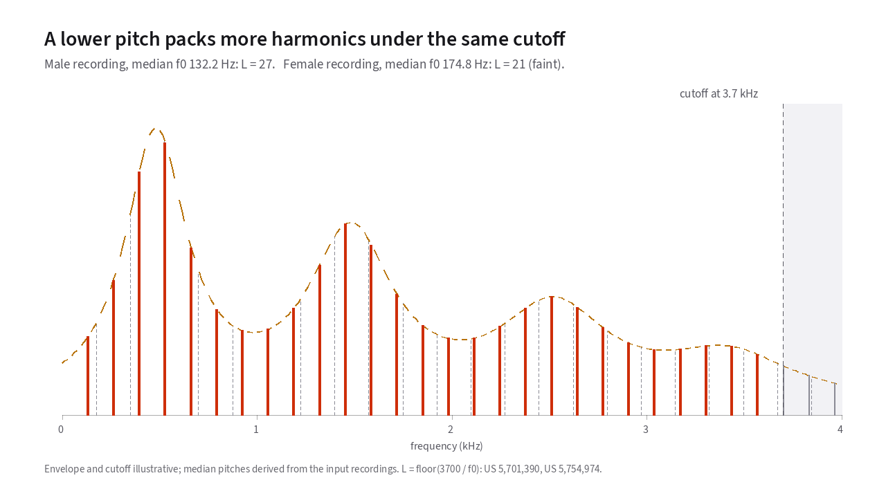

# How AMBE Works

Fifty times every second, AMBE samples your voice, turning it into a digital waveform.
It compresses that waveform into 9 bytes of data.
This site explains what is inside those 9 bytes, how the encoder fits a voice into them,
and how a digital radio rebuilds a recognizable human voice from them.
{: .lede }

## The physical idea behind every design tradeoff

Almost every design tradeoff in an AMBE vocoder comes from one physical fact.
A spoken vowel is a stack of [harmonics](18-glossary.md#harmonic) at
whole-number multiples of the speaker's [fundamental pitch](18-glossary.md#fundamental-frequency-and-pitch-period).
The deeper the voice, the more harmonics fit under the codec's 3.7 kHz cutoff.
This stack of evenly spaced spikes is called the [harmonic comb](18-glossary.md#harmonic-comb).

In [**Figure 1**](#fig-1), drag the *Fundamental frequency* slider from a deep bass voice
at 75 Hz up to a high voice at 400 Hz and watch the harmonic comb compress and
expand under the same [spectral envelope](18-glossary.md#spectral-envelope).

You can also listen to the comb in [**Figure 1**](#fig-1). Press *Play* to hear it as a steady tone,
and set the level with *Volume*. Then drag the *Fundamental frequency*
slider while it plays. The pitch you hear rises as the spikes spread apart,
because the pitch is the spacing between them. The envelope stays put, so
the tone keeps the same vowel-like color. At 75 Hz, 49 harmonics fit under
the cutoff to trace that envelope. Near 400 Hz only 9 are left to trace it, and the vowel gets
harder to make out.

<!-- slot: harmonics -->

<figure class="anim-fallback" markdown="0">
  
  <figcaption>A lower pitch packs more harmonics under the 3.7 kHz cutoff.
  At 132.2 Hz there are 27 amplitudes to send, and at 174.8 Hz there are 21.</figcaption>
</figure>

<!-- end slot: harmonics -->

Whether the speaker's voice makes 50 harmonics or 10, the radio channel gives
the vocoder the same 9 bytes every 20 milliseconds. The chapters below explain
how the encoder measures those harmonics and squeezes them into those bytes.
They then show how the radio protects them on the air and how the receiver
rebuilds the voice.

## How this guide is organized

### Part I: The mathematics

1. **[Sinusoids](01-why-sinusoids.md):** Why raw speech waveforms come out of
   a vocal tract distorted, and why sine waves are the one shape a filter
   leaves unchanged.
2. **[The Fourier transform and the DFT](02-fourier-and-the-dft.md):** How
   multiplying and adding against sine and cosine test waves tells you the
   amplitude and phase of each frequency in a 20 ms block.
3. **[Windows and frames](03-windows-and-frames.md):** Why slicing speech into
   blocks leaks energy across neighboring frequencies, how Hann and Hamming
   windows tame that leak, and why speech coders settle on 20 ms frames.

### Part III: The AMBE model and on-air pipeline

4. **[Multi-band excitation](07-multi-band-excitation.md):** Why one
   voiced/unvoiced flag per frame makes the voice sound buzzy, and how
   splitting the spectrum into independent voicing bands fixes it.
5. **[How the encoder measures pitch, voicing and amplitudes](08-analysis.md):** How the encoder measures pitch, voicing and harmonic
   amplitudes by trying out candidate voices on the fly and keeping the ones
   that best match the real speech.
6. **[Turning measurements into bits](09-quantization.md):** How the encoder
   squeezes up to 56 harmonic amplitudes into 48 voice bits. It borrows values
   from the previous frame, redraws the envelope with fewer points, and sends
   groups of amplitudes as numbered choices from a fixed table.
7. **[The D-STAR frame on the air](10-the-dstar-frame.md):** How the 72-bit
   voice frame guards its most sensitive bits with short check words that let
   the receiver fix errors, scrambles lower-priority bits so a burst of
   interference does not hit one field at once, and pairs with the 24-bit
   slow-speed data slot.
8. **[Synthesis: rebuilding the voice](11-synthesis.md):** How the receiver
   rebuilds the voice with a bank of oscillators for the voiced part and
   shaped noise for the unvoiced part, recovers phase from the transmitted
   amplitudes, and crosses 20 ms frame boundaries without clicks.

### Part IV: Hardware listening tests

9. **[Listen: real hardware examples](12-listen.md):** Eight spoken test
   sentences before and after a physical DVSI AMBE-3000 chip, with side-by-side
   audio players and 3D spectrogram difference terrains.

### Part V: Reference

- **[The patent landscape](16-patents.md):** Chronological guide to the MIT and
  DVSI patent family and expiration dates.
- **[Sources and method](17-sources.md):** Primary bibliography, hardware
  capture methodology, and verification tools.
- **[Glossary](18-glossary.md):** Plain-language definitions of vocoder, DSP,
  and digital radio terms cross-linked to chapters and figures.
- **[Interactive diagrams](19-diagrams.md):** Complete visual index of every
  2D and 3D interactive diagram across the site.

## Scope and independence

This repository contains **no software AMBE encoder or decoder**. Every
interactive diagram renders precomputed hardware captures from a retail DVSI
AMBE-3000 chip or generic signal-processing formulas on synthetic waveforms.
This project is independent of Digital Voice Systems, Inc.; AMBE, IMBE, and
AMBE+2 are trademarks of DVSI, used here solely to identify the technology
under discussion.
{: .source-note }

Prose and figures are licensed under CC BY 4.0; build and verification scripts
are MIT licensed. If you spot a citation or measurement issue, please
[open an issue on GitHub](https://github.com/rcludwick/how-ambe-works/issues).

Last reviewed: 2026-10-21.
{: .source-note }
